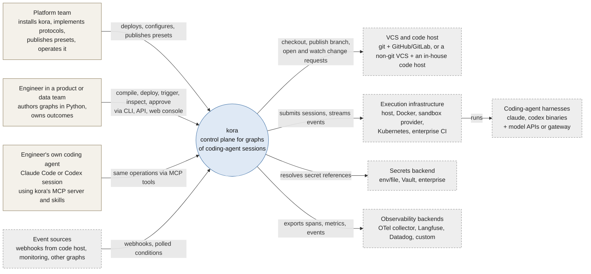
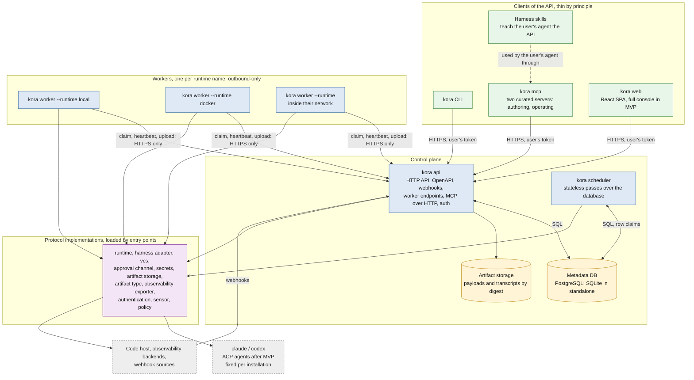

# kora architecture overview

Status: decided by the project owner on 2026-10-15 and 2026-10-16; reviewed by the project owner on 2026-10-16; the reasons behind each choice are in the [decision records](decisions/README.md). This page is the two-page map. The detailed diagrams (components inside the scheduler and the worker, one attempt end to end, deployment shapes), the full stack table with alternatives, and the glossary are in [knowledge/architecture/detailed.md](../knowledge/architecture/detailed.md); the normative specifications are in [knowledge/specs/](../knowledge/README.md).

Execution-recovery amendment dated 2026-10-17: direction and implementation plan accepted by the project owner; document wording pending line-by-line owner review. See [ADR-0017](decisions/0017-execution-uncertainty-and-safe-replacement.md).

Publication-boundary amendment dated 2026-10-17: pending owner review; architectural direction recorded in [ADR-0016](decisions/0016-trusted-execution-and-publication.md).

## What kora is

kora is a control plane that runs graphs whose nodes are full coding-agent sessions (Claude Code and Codex in MVP; agents speaking the Agent Client Protocol after MVP). A graph is written in Python, compiled to a versioned YAML document, deployed to the control plane and triggered manually, on a schedule, by a webhook or by a sensor. Each agent node runs as one session inside a runtime (local process, Docker container, an adopter's own execution infrastructure) on its own checkout (local is a trusted development/test environment); the graph adds the deterministic outer loop: trigger rules, retries of nodes and sub-graphs, typed artifacts, approvals bound to the exact content under review, cost accounting, and the protocols through which an organisation plugs in its runtime, version control, secrets and observability.

## System context

Two rules shape everything else. The HTTP API is the single implementation of every operation, and the CLI, the MCP servers, the harness skills and the web console are thin clients of it ([ADR-0002](decisions/0002-ai-first-api-and-thin-clients.md)). Agent sessions inside a graph never call kora: they receive typed inputs through the workspace and the prompt and leave typed outputs for the worker to collect.

## Containers

| container | owns | never does |
|---|---|---|
| `kora api` | every operation, authentication, webhook ingestion, worker endpoints fenced by a lease epoch, OpenAPI, the static web build, the MCP servers over HTTP | scheduling decisions, running sessions, UI logic |
| `kora scheduler` | the scheduling passes under a per-run lock: triggers, readiness, admission, waits, timeouts, completion and retries, clearing downstream, retention | calling runtimes or harnesses |
| `kora worker` | claiming attempts through the API, requesting VCS plans, idempotent submission, relaying the supervisor journal, late publication authorization/finalization, collecting outputs and usage | deciding what runs next, enforcing session limits (the session runner inside the runtime does), touching the database |
| `kora web` | the React console: approvals, runs, graph view, attempts, logs and cost in MVP | logic of its own, database access |
| `kora mcp` | two curated MCP servers for the user's own coding agent, acting with the user's token | any logic of its own |
| Metadata DB | every entity of the data model; the only run state | payload bytes |
| Artifact storage | payload bytes by digest | metadata |
| `kora standalone` | api, scheduler and a local worker in one process on SQLite, for development | production use |

Workers talk to the API and only to the API ([ADR-0003](decisions/0003-scheduler-and-workers-over-http.md)): an adopter's worker inside a closed network needs one outbound HTTPS route and no database credentials. The three deployment shapes (standalone, docker-compose, organisation with workers in other networks) run the same code; only process layout, database driver and artifact storage change.

## Stack

Python 3.11+ with asyncio in one package `kora` (uv, hatchling) plus a `web/` frontend in the same repository; FastAPI and Pydantic v2 with OpenAPI as the generation source; SQLAlchemy 2.0 and Alembic over PostgreSQL and SQLite; CEL for expressions; sandboxed Jinja2 for prompts; harness adapters over the Claude Agent SDK and the Codex app-server protocol (the Agent Client Protocol after MVP); obstore for S3-compatible artifact storage; OpenTelemetry with the GenAI semantic conventions as the reference exporter; React, TypeScript, Vite, TanStack Query, shadcn/ui and React Flow for the web console. Each choice and its alternatives: [ADR-0013](decisions/0013-implementation-stack.md).

## Boundaries that must not blur

- The API is the only implementation of operations; clients never contain logic, and a coverage test proves parity.
- Agent sessions never reach kora; the tool-policy decision point runs inside the session runner, not in the control plane.
- The scheduler never imports user Python; it reads the compiled graph document.
- Workers execute one attempt and report through the API, fenced by their lease epoch. Lease expiry preserves unknown execution and its reservations; recovery observes the original domain and closes every old dispatcher before restoring platform writes. Replacement requires runtime termination plus dispatch/publication closure, and acquired target holds survive terminal run status until recovery is settled (ADR-0017).
- Protocol implementations are loaded by entry points and never imported by name from core modules.
- Standalone mode is the same code as a full deployment wired into one process: no feature, code path or table exists only in standalone mode, so what works there works in production.
- The lifecycle supervisor owns a journal outside the candidate tree, seals the result after execution, and prepares publication in fresh metadata. The worker obtains late authorization and calls `finalize`; existing candidate commits are preserved, with an additional commit for uncommitted changes. Protected runtimes enforce these authority boundaries; local follows the lifecycle without hostile-code isolation (ADR-0016).
- The session runner inside the runtime is the only enforcer of harness session limits: event count, soft budget and stall timeout. The runtime/common executor also enforces one inherited node/subgraph/run deadline across preparation, execution and publication in its actual placement, including the worker host; fixed nominal grace does not establish physical termination or release capacity ([ADR-0022](decisions/0022-inherited-execution-deadlines.md)).

## Where to go next

- Why these choices: [decision records](decisions/README.md).
- What is deferred and how it would be done: [proposals](proposals/README.md).
- Exact contracts: [knowledge/specs/](../knowledge/README.md), starting with `ir.md` (what a graph is), `data-model.md` (what the control plane stores), `scheduler.md`, `protocols.md`, `api-and-agent-surface.md`, `dsl.md`.
