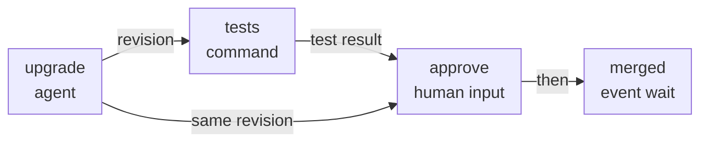
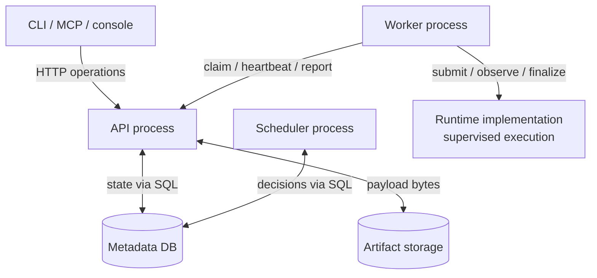
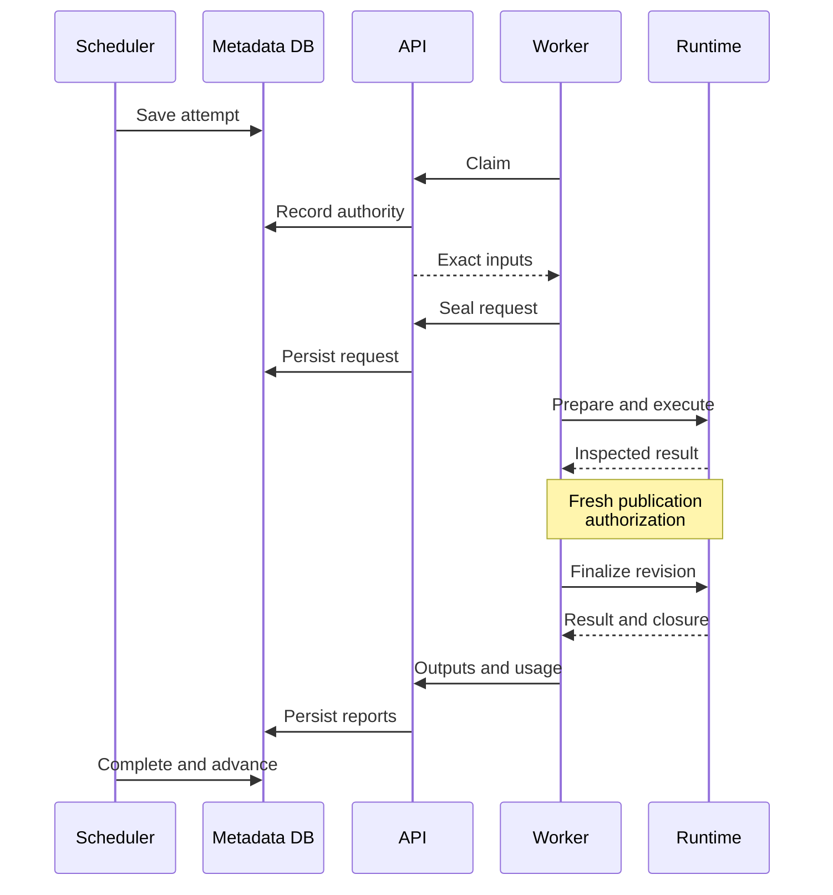

# Inside kora: a technical introduction

Status: scope and implementation plan approved on 2026-10-17; document wording pending line-by-line owner review. kora is in the design stage: the components below describe the intended implementation. This introduction explains existing decisions; the [decision records](decisions/README.md) govern the [specifications](../knowledge/README.md), which provide the exact contracts.

Navigation amendment dated 2026-10-17: scope and implementation plan approved under [issue #76](https://github.com/realkarych/kora/issues/76); wording pending line-by-line owner review.

## 1. What the core does

kora coordinates work that spans several coding-agent sessions. An agent edits code; a command tests it; a person reviews the result; an external system signals that the change has landed. The core turns these steps into a durable graph execution, keeping their dependencies, results, costs and recovery state together.

A graph describes the work. The control plane decides when each step can proceed. Workers connect those decisions to execution infrastructure. Consider a dependency upgrade:

These are graph nodes, not services. Only the first two need a running workload. The remaining steps are durable waits. The same framework also supports branches, parallel expansion and subgraphs retried as a unit. The [complete example](../knowledge/specs/examples/dependency-upgrade.ir.yaml) defines the data bindings omitted from this small picture.

## 2. The objects that move through it

| Object | Meaning in the example |
|---|---|
| **Graph and graph version** | The upgrade workflow and one immutable deployed definition, including its resolved execution and type contracts. |
| **Run** | One execution of that version with parameters, such as the package to upgrade. |
| **Node instance** | A particular step in this run. Parallel expansion creates separate instances for different items. |
| **Attempt** | One runtime submission of an agent or command instance. A retry creates another attempt with its own inputs, result and cost. |
| **Artifact version** | One typed output, such as a revision reference or test result, with a digest and producer lineage. Consumers bind exact versions. |
| **Wait** | Persisted state describing what must happen before a step can continue: approval, an event, a timer or an admission opportunity. |

A graph is acyclic. Repetition comes from retrying a node or a subgraph body. A *subgraph attempt* means another iteration of that body; each agent or command inside it still has its own runtime attempts. Previous results can become explicit inputs to the next iteration.

This distinction makes history useful: retrying work does not erase the earlier execution or silently change what it consumed. New results supersede old artifact versions, and affected downstream work must be reconsidered. See [attempts and retries](decisions/0007-attempt-model-and-retries.md) and [immutable history](decisions/0018-immutable-attempt-history.md).

## 3. The component map

The main processes are the API, scheduler and workers. Compilation happens before them; runtime implementations provide the execution boundary after them. The arrows below show communication, not the order of a run.

### Compiler: Python becomes a saved definition

The graph author uses a Python DSL, a small language for declaring nodes and their connections. Compilation executes that definition in the author's process and produces a YAML intermediate representation (**IR**). Conditions become expressions in Common Expression Language (**CEL**); graph execution does not call back into the author's Python.

The API validates the compiled document and saves a graph version. A run pins that version, including its resolved type and execution contracts, so a later registry update cannot reinterpret its inputs. Compilation stays local because importing arbitrary Python inside the API would execute it with control-plane authority. See [the compiler specification](../knowledge/specs/dsl.md) and [ADR-0002](decisions/0002-ai-first-api-and-thin-clients.md).

### API: the shared operational boundary

The API accepts deployments, starts runs, receives approvals and webhooks, and exposes status, logs and cost. It authenticates callers and handles worker claims, reports and uploads. CLI, MCP and the web console use the same operations; their clients contain no separate scheduling or approval rules.

An engineer's own coding agent may operate kora through MCP. An agent session running *inside a graph* receives its inputs through its workspace and prompt and leaves outputs for collection; it has no kora API or MCP access. These are different roles, even when both use the same coding-agent product.

### Scheduler: graph state becomes execution intent

The scheduler repeatedly examines durable state: which dependencies are satisfied, which limits permit admission, which waits can finish, and which results require completion or retry. It records an attempt when an agent or command can run. It records a wait when a step needs time, a signal or available capacity.

These decisions use short database transactions. External sensor reads and approval delivery happen outside transactions, and their results are checked against current ownership before application. A slow code host therefore need not hold a run's database lock.

The scheduler does not launch workloads or send jobs directly to workers. Workers discover persisted work through the API. A scheduler restart resumes from stored state rather than rebuilding suspended Python coroutines. See [scheduler processes and passes](../knowledge/specs/scheduler.md#1-components-and-processes).

### Worker: execution intent becomes runtime calls

A worker serves one configured runtime. It claims an attempt, builds its workload from saved inputs and configuration, coordinates workspace preparation and submission, relays events and usage, and uploads outputs. Its renewable lease and generation identify which reports the API may accept.

Workers reach the control plane through outbound HTTP and carry no database credentials. Artifact transfer also goes through the API. This lets a worker run near private execution infrastructure while the scheduler stays elsewhere. The worker does not decide downstream readiness. See [ADR-0003](decisions/0003-scheduler-and-workers-over-http.md).

### Runtime, supervisor and harness: three different responsibilities

The **runtime** supplies the execution environment and lifecycle operations: start work, observe or recover it, stop it, and finalize a prepared publication. Local processes, Docker and an adopter's infrastructure implement the same protocol. A runtime is a provider boundary, not necessarily another network service.

The **lifecycle supervisor**, including the session runner's enforcement, coordinates preparation, candidate execution, result sealing, inspection and publication. It keeps private control state and a recovery journal. The **harness adapter** translates kora's session configuration into the coding agent's programmatic interface and normalizes its events. It runs on the supervisor side; the runtime's launcher starts the harness binary in the candidate execution environment. A command workload uses the execution lifecycle without a coding-agent harness.

Thus infrastructure choice and agent choice are separate. The adapter understands the agent; the runtime understands its environment; trusted supervision owns lifecycle facts. On Docker, the supervisor is host-side and candidate execution and publication use separate containers. This is an authority boundary, not a promise that every box is a separately deployed service. See [runtime and harness contracts](../knowledge/specs/protocols.md#2-runtime-fr-81).

### Persistence: shared state and payloads

The **metadata database** holds graph versions, runs, node instances, attempts, waits, artifact metadata, usage and events. **Artifact storage** holds larger payloads and transcript segments by digest; small values may be inline in the database. The API mediates reads and uploads.

Logical run state lives in the database. A runtime additionally keeps private execution checkpoints and its journal, needed to recover what actually happened outside that database. Neither replaces the other. See [the data model](../knowledge/specs/data-model.md).

## 4. One run through the core

Follow the upgrade graph from definition to completion:

1. **Compile and deploy.** The author compiles Python locally. The API validates the IR and saves the immutable deployment contract.
2. **Accept a start.** A manual request, schedule or external trigger starts a run under the graph's overlap and namespace acceptance rules. The scheduler materializes its node instances from the pinned version.
3. **Admit the upgrade.** Once dependencies, policy and capacity permit, the scheduler records an attempt with exact input bindings. The worker claims it through the API. Before preparation effects, its nonsecret execution request is sealed into history.
4. **Execute and publish.** The worker coordinates the runtime. Preparation supplies the checkout; the agent changes it; trusted supervision stops candidate execution, seals its output and inspects the prepared revision. Fresh authorization allows publication of that exact result. The resulting `VcsRef` identifies the revision and change request.
5. **Test the same revision.** The worker reports outputs and usage through the API. Completion requires valid outputs and settled execution/publication. The scheduler then admits the command node against that precise `VcsRef`; its `CommandResult` records the test outcome.
6. **Wait for review.** The approval request binds the commit and test-result digests. No worker waits for the reviewer. After approval, a fresh branch-head check must still match the approved revision before downstream continues. A changed candidate requires new evidence and approval.
7. **Observe the merge.** A sensor waits until a person merges the change request. kora observes that event; this graph does not perform the merge. The successful path can then finish the run, with acquired target holds released only after recovery is settled.

The diagram follows the publishing `upgrade` attempt. Workloads without a `VcsRef` output, including the `tests` command, complete without publication authorization or finalization.

This is a successful execution, with heartbeats and recovery calls omitted. Runtime events also reach the API through the worker while execution is in progress. The [scheduler recovery specification](../knowledge/specs/scheduler.md#3-submission-execution-uncertainty-and-recovery) covers interruptions.

## 5. Why the boundaries matter

**Waiting and executing consume different resources.** An approval or timer persists without occupying a worker or a physical execution slot. Parallel work elsewhere in the run may still occupy capacity. A run can also retain its business target, such as a package being upgraded, while waiting. Acceptance limits, physical execution capacity and target ownership are separate controls ([ADR-0020](decisions/0020-execution-capacity-and-bounded-run-acceptance.md)).

**Lost contact does not prove execution stopped.** If a worker disappears, the original workload may still be running or publishing. kora preserves uncertainty and reservations, tries to observe or adopt that execution, and blocks replacement until termination and closure of earlier dispatch/publication authority are established. Cancellation or an expired deadline alone is insufficient. External effects already issued are not generally rolled back ([ADR-0017](decisions/0017-execution-uncertainty-and-safe-replacement.md)).

**Candidate code cannot certify its own result.** The lifecycle is prepare, execute, seal, inspect, authorize, publish. Protected runtimes separate candidate code from the supervisor's journal and publication credentials. Local execution follows the lifecycle but is for trusted development and provides no hostile-code isolation. Docker support must demonstrate the specified protection through conformance tests; a container alone proves nothing ([ADR-0016](decisions/0016-trusted-execution-and-publication.md)). Gate scripts can travel with the graph version as command resources, pinned by digest and read-only to candidate code, so a graph runs against any target repository without copying them; this protects the scripts, not the evaluation as a whole ([ir.md](../knowledge/specs/ir.md)).

**Approval concerns immutable evidence.** A successful test of commit A cannot justify approving commit B. Binding both the revision and evidence digests makes that relationship explicit. A changed candidate invalidates review instead of silently moving the approval to its new head ([ADR-0008](decisions/0008-content-bound-approvals.md)).

**Limits have an enforcement home.** The scheduler handles admission and aggregate budget decisions. Session supervision enforces event count, soft budget and stall limits from the harness stream. Runtime/common executors enforce inherited execution deadlines through preparation, execution and publication, including phases placed on the worker host. Usage remains attributed to individual attempts, including unsuccessful ones ([ADR-0022](decisions/0022-inherited-execution-deadlines.md)).

## 6. Deployment and extension seams

The planned core is Python with asyncio, a FastAPI API and SQLAlchemy persistence. The React/TypeScript console consumes the API. The [stack decision](decisions/0013-implementation-stack.md) records the technology choices and their reasons.

| Layout | What changes |
|---|---|
| **Standalone development** | API, scheduler and a local worker share one process; SQLite stores metadata and local storage holds payloads. The worker still uses the shared API client, through an in-process transport. |
| **Deployed installation** | API, scheduler and workers run separately, with PostgreSQL and S3-compatible artifact storage. The MVP has one scheduler process. Workers may live in other networks. |

The same scheduling rules and schema apply in both layouts. Standalone simplifies installation, not graph semantics.

Extension points are Python protocols discovered through package entry points. Core code depends on their contracts; installation configuration selects implementations. Examples include a runtime for execution infrastructure, a harness adapter for an agent, a VCS provider for checkouts/publication, an approval channel for delivery, and a sensor for external observations. Secrets, storage, artifact types, authentication, policy and observability have corresponding contracts.

A provider declares capabilities and must satisfy the relevant conformance suite. Replacing a runtime does not move scheduling policy into it; replacing an approval channel does not give it authority to decide whether evidence is current. See [protocol boundaries](decisions/0005-eleven-protocols-with-conformance-suites.md).

## 7. What remains open, and where to read next

Some implementation mechanics remain unresolved: how the API reaches scheduler transition entry points, who applies certain attempt transitions, and the full rule for aggregating terminal run failures. The [architecture reference](../knowledge/architecture/detailed.md#open-implementation-questions) records these questions; [issue #48](https://github.com/realkarych/kora/issues/48) tracks their resolution. The successful path above does not choose answers.

- For component views, deployment, the stack and terminology: [architecture reference](../knowledge/architecture/detailed.md).
- For a specific change: the [specification task index](../knowledge/README.md#which-file-to-load-for-which-task), then the decision records cited there.
- For current implementation status: [roadmap](roadmap.md).
