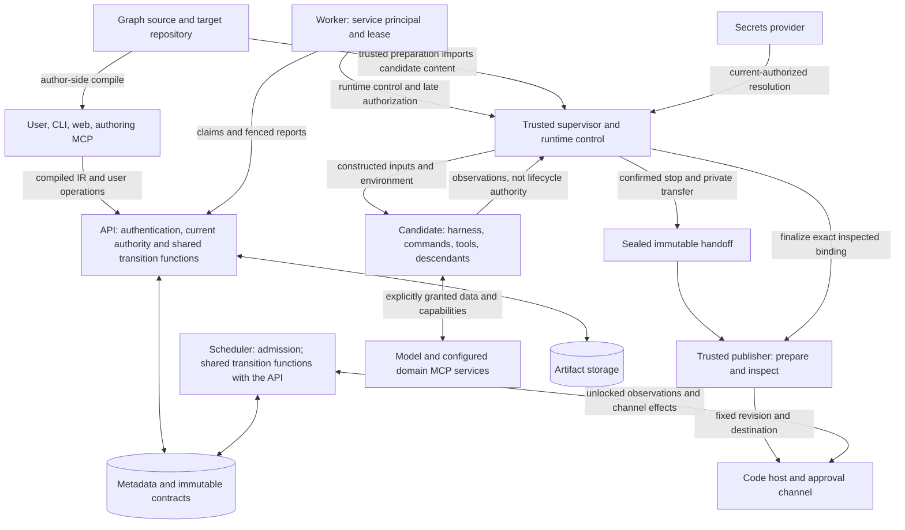

# Threat model

List-edge type amendment dated 2026-10-30: the project owner approved the scoped implementation plan under [issue #495](https://github.com/realkarych/kora/issues/495); evidence wording pending line-by-line owner review. Existing controls and authority are unchanged.

Node-local input path amendment dated 2026-10-30: the project owner approved the scoped implementation plan under [issue #491](https://github.com/realkarych/kora/issues/491); wording pending line-by-line owner review.

Expression/path syntax amendment dated 2026-10-30: the project owner approved the scoped implementation plan under [issue #487](https://github.com/realkarych/kora/issues/487); evidence wording pending line-by-line owner review. Existing controls and authority are unchanged.

Direct-edge type amendment dated 2026-10-30: the project owner approved the scoped implementation plan under [issue #482](https://github.com/realkarych/kora/issues/482); evidence wording pending line-by-line owner review. Existing controls and authority are unchanged.

Output-consistency amendment dated 2026-10-30: the project owner approved the scoped implementation plan under [issue #479](https://github.com/realkarych/kora/issues/479); evidence wording pending line-by-line owner review. Existing controls and authority are unchanged.

Inline-schema validation amendment dated 2026-10-30: the project owner approved the scoped implementation plan under [issue #476](https://github.com/realkarych/kora/issues/476); evidence wording pending line-by-line owner review. Existing controls and authority are unchanged.

Type-schema validation amendment dated 2026-10-30: the project owner approved the scoped implementation plan under [issue #473](https://github.com/realkarych/kora/issues/473); evidence wording pending line-by-line owner review. Existing controls and authority are unchanged.

Type-declaration validation amendment dated 2026-10-30: the project owner approved the scoped implementation plan under [issue #468](https://github.com/realkarych/kora/issues/468); the evidence wording below awaits line-by-line owner review. Existing controls and authority are unchanged.

Graph-link validation amendment dated 2026-10-30: the project owner approved the scoped implementation plan under [issue #463](https://github.com/realkarych/kora/issues/463); the evidence wording below awaits line-by-line owner review. Existing controls and authority are unchanged.

StructuredOutput model amendment dated 2026-10-30: the project owner approved the implementation plan and exact scoped evidence wording under [issue #446](https://github.com/realkarych/kora/issues/446#issuecomment-6508537813). Existing actors, trust assumptions and authority are unchanged.

Local-runtime retirement amendment dated 2026-10-29 (the `local` row, TM-09 and the TM-05/TM-11 evidence row): [issue #430](https://github.com/realkarych/kora/issues/430), part 2b of #195, retires an attempt whose runner never registered by killing the processes that carry the runner's exact vector; [implementation plan](https://github.com/realkarych/kora/issues/430#issuecomment-6503668502) and its four decisions approved by the project owner on 2026-10-29; wording pending line-by-line owner review.

AgentSession revision-1 amendment dated 2026-10-29: the project owner approved the complete amended contract plan and exact wording in this document under [issue #433](https://github.com/realkarych/kora/issues/433#issuecomment-6507248049).

Verification amendment under [issue #434](https://github.com/realkarych/kora/issues/434): [the approved audit](../knowledge/research/approved-verification-audit-2026-10-29.md) updates current TM-12 evidence admission and scanner coverage, with TM-06/TM-07 content protection and TM-08 provenance preserved. TM-04/TM-10 compact CEL 100 ms observations are diagnostics; logical admission, exact ownership and protective deadlines remain blocking. No actors or threat IDs change.

Local-runtime spawn amendment dated 2026-10-29 (the `local` row, TM-10 and the TM-05/TM-11 evidence row): [issue #313](https://github.com/realkarych/kora/issues/313), part 2 of #195, starts the detached runner with a constructed environment and only descriptors 0 to 3, places its socket directory, and adds the interim residual of a squatted `/tmp/kora-<uid>`; implementation plan, its two updates and the split of the `starting`-path `retire` into [issue #430](https://github.com/realkarych/kora/issues/430) approved by the project owner on 2026-10-29; wording pending line-by-line owner review.

Local-runtime class amendment dated 2026-10-28 (the TM-06/TM-07 and TM-08/TM-09 evidence rows): [issue #323](https://github.com/realkarych/kora/issues/323), part 1b of #195, adds the runtime class that opens the state root and applies the registry's transition cells; implementation plan and its four decisions approved by the project owner on 2026-10-28; wording pending line-by-line owner review. Actors and controls are unchanged.

Local-runtime state-root amendment dated 2026-10-27 (TM-09 and the TM-05/TM-11 and TM-08/TM-09 evidence rows): [issue #312](https://github.com/realkarych/kora/issues/312), part 1a of #195, implements the state root, the registry head and the shared process identity's observer namespace; implementation plan and its update approved by the project owner on 2026-10-27; wording pending line-by-line owner review.

CEL schema-tightened bounds amendment dated 2026-10-28 (the TM-04 evidence): schema size keywords lower cost estimates only through bounds enforced at binding, under [issue #374](https://github.com/realkarych/kora/issues/374) with the implementation plan approved by the project owner; the wording was reviewed line by line and approved by the project owner on 2026-10-28. Actors, controls and deployment limitations are unchanged.

CEL integer negation amendment dated 2026-10-28 (the TM-04 evidence): typed checks rewrite integer negation so the binding's wrapping negation is not reachable from checked author expressions, under [issue #372](https://github.com/realkarych/kora/issues/372) with the implementation plan approved by the project owner; the wording was reviewed line by line and approved by the project owner on 2026-10-28. Actors, controls and deployment limitations are unchanged.

Local control-frame amendment dated 2026-10-27 (TM-10 per-message bounds and the accepted decode-amplification limitation): the project owner approved the implementation plan of [issue #314](https://github.com/realkarych/kora/issues/314#issuecomment-6435105162) under the [#195 plan](https://github.com/realkarych/kora/issues/195#issuecomment-6435103392), and on 2026-10-27 accepted decode amplification as a limitation revisited in #315; wording pending line-by-line owner review in the pull request that closes #314.

CEL schema-driven checker amendment dated 2026-10-27 (the TM-04 evidence): the schema mapping and checker land under [issue #337](https://github.com/realkarych/kora/issues/337) and [issue #330](https://github.com/realkarych/kora/issues/330), with the implementation plan approved by the project owner on #330; the wording was reviewed line by line and approved by the project owner on 2026-10-28. Actors, controls and deployment limitations are unchanged.

IR structural evidence amendment dated 2026-10-23: the project owner reviewed and accepted this wording under issue #218 on 2026-10-23. Actors, controls and deployment limitations are unchanged.

The IR models and generated-schema checks under #218 provide structural evidence for TM-04 and TM-10, form/default/output-role preservation evidence for TM-08, and deterministic artifact and drift evidence for TM-12. Content exclusion in the test error projection provides evidence for TM-06/TM-07; public diagnostic conversion and bounded collection remain with the shared validator. These checks establish no namespace policy enforcement, saved execution identity, replay, authentication, webhook admission, publication or runtime isolation guarantee. Those controls retain their implementing owners and integration gates.

Pricing foundation amendment dated 2026-10-24: [issue #213](https://github.com/realkarych/kora/issues/213) implements the shared accounting values and metadata foundation; the updated implementation and test evidence wording was reviewed line by line and [approved by the project owner on 2026-10-24](https://github.com/realkarych/kora/issues/213#issuecomment-6377551455). Future consumer activation and authority are unchanged.

Bounded-read amendment dated 2026-10-23: the project owner approved the contract plan and exact wording under [issue #227](https://github.com/realkarych/kora/issues/227#issuecomment-6371188973).

StructuredOutput revision-1 amendment dated 2026-10-23: the project owner approved the contract plan and exact evidence-status paragraph under issue #246. Existing actors, trust assumptions and authority are unchanged.

VcsRef model amendment dated 2026-10-23: the project owner approved the #209 implementation plan and the exact typed-boundary evidence paragraph below. Existing threat actors, controls, remaining limitations and authority are unchanged.

Retained dispatcher-history amendment dated 2026-10-23: the project owner approved the [contract plan and exact documentation wording](https://github.com/realkarych/kora/issues/226#issuecomment-6368198702), [approval recorded](https://github.com/realkarych/kora/issues/226#issuecomment-6368236030).

Local conformance lifetime amendment dated 2026-10-23: wording reviewed and [accepted by the project owner](https://github.com/realkarych/kora/issues/231#issuecomment-6367958968) on 2026-10-23.

Executor and git provider amendment dated 2026-10-25 (the TM-05/TM-11 evidence row of the implementation plan): the publication-authorization, local credential and principal, and remote-pin tests of [issue #159](https://github.com/realkarych/kora/issues/159), implementation plan approved by the project owner; wording pending line-by-line owner review.

Staged-storage amendment dated 2026-10-23: the project owner [approved the #229 plan](https://github.com/realkarych/kora/issues/229#issuecomment-6368257832), covering TM-09/TM-10/TM-11 and TM-06/TM-07 evidence. Exact wording was [reviewed line by line and approved by the project owner](https://github.com/realkarych/kora/pull/245#issuecomment-6369119893) on 2026-10-23. The contract supplies no runtime enforcement or isolation evidence.

API error and authorization amendment dated 2026-10-23: reviewed and accepted by the project owner under [issue #135](https://github.com/realkarych/kora/issues/135) on 2026-10-23.

Secrets and redaction amendment dated 2026-10-23 (the TM-06/TM-07 evidence row): the `env` provider and captured-stream redaction tests of [issue #192](https://github.com/realkarych/kora/issues/192); wording pending line-by-line owner review.

Pricing evidence amendment dated 2026-10-23: pending negative-test pointers for immutable prices, usage coverage and approval snapshots under [issue #142](https://github.com/realkarych/kora/issues/142#issuecomment-6353409349). The plan is approved; wording reviewed line by line and [approved by the project owner](https://github.com/realkarych/kora/pull/221#issuecomment-6354160885) on 2026-10-23. Actors, controls and deployment limitations are unchanged.

Execution protocol model amendment dated 2026-10-25 (the TM-06/TM-07 and TM-12 evidence rows): the credential, transfer-field and conformance-skeleton tests of [issue #262](https://github.com/realkarych/kora/issues/262), implementation plan approved by the project owner; wording pending line-by-line owner review.

Protocol foundation amendment dated 2026-10-22 (the TM-06/TM-07 and TM-12 evidence rows): the secret-value and conformance-plugin tests of [issue #204](https://github.com/realkarych/kora/issues/204), implementation plan approved by the project owner; wording pending line-by-line owner review.

Local-runtime simplification amendment dated 2026-10-22 (the `local` deployment row): the control channel trusts kernel peer attestation instead of a shared secret, and the row names the residuals that follow (runner impersonation through the socket and the registry or the listening socket, dispatcher impersonation through worker takeover, pid reuse or a self-presented grant binding, editing `attempt.token`, which also defeats redaction after a worker restart, the worker unit's control group shared with candidates and its service notifications where the unit allows them, and a candidate that fills the disk holding terminal evidence unwritten and recovery unresolved until an operator frees space), under [issue #194](https://github.com/realkarych/kora/issues/194); chosen by the project owner in its [plan](https://github.com/realkarych/kora/issues/194#issuecomment-6334771831), wording pending line-by-line owner review.

Browser verification amendment dated 2026-10-22 (TM-12 evidence): the project owner approved the [benchmark removal and matching documentation](https://github.com/realkarych/kora/issues/179#issuecomment-6329273349), with delegated independent review and merge.

Scope and implementation plan approved under [issue #90](https://github.com/realkarych/kora/issues/90); document accepted for merge by the project owner in [PR #92](https://github.com/realkarych/kora/pull/92) on 2026-10-18. Claude harness amendment dated 2026-10-19 (TM-03, TM-05, TM-06, TM-12 and their evidence): scope and implementation plan approved under [issue #125](https://github.com/realkarych/kora/issues/125); accepted by the project owner on 2026-10-19.

CEL evaluator amendment dated 2026-10-21: infrastructure and verification added under [issue #166](https://github.com/realkarych/kora/issues/166); wording accepted by the project owner on 2026-10-22.

CEL cost-regression amendment dated 2026-10-23 (TM-04, TM-10, TM-12 and their evidence): the project owner approved lightweight validation and a 100 ms target under [issue #167](https://github.com/realkarych/kora/issues/167#issuecomment-6351849696); wording reviewed line by line and approved by the project owner on 2026-10-23.

Held-read amendment dated 2026-10-19: the TM-10 scenario names callers that hold reads open and its boundary the API read path, its remaining limit names the bounded run-read wait and `?follow=true` streams, the TM-01, TM-02 and TM-10 evidence rows name the run-read wait and mounted-credential contracts, and the maintenance section records the merge of PR #109; direction and implementation plan approved by the project owner under [issue #124](https://github.com/realkarych/kora/issues/124); wording pending line-by-line owner review.

CEL amendment dated 2026-10-19 (TM-02, TM-04, TM-10, TM-12 and the TM-03/TM-04, TM-08/TM-09, TM-10 and TM-12 evidence rows): decisions taken and implementation plan approved by the project owner under [issue #126](https://github.com/realkarych/kora/issues/126); wording pending line-by-line owner review.

Shared-transition amendment dated 2026-10-19: the scheduler label in the trust-boundary diagram names the shared transition functions that the API and the scheduler both call ([issue #103](https://github.com/realkarych/kora/issues/103)). The API label names them too, because the API runs them in its own process. TM-01, TM-02, TM-08, TM-09 and TM-10 are unchanged in authority: object-level checks run inside every transition under the run lock, and the API evaluates only `approve_when` (TM-10). TM-10 gains a remaining availability limit, recorded in its row: a signal route holds its pooled connection while it waits for its locks, including scope locks held by bulk signals of other namespaces. Wording pending line-by-line owner review.

Harness-scope amendment dated 2026-10-21 (TM-03/TM-04, TM-05/TM-11, TM-06/TM-07, TM-10 and TM-12 evidence rows): both Claude and Codex are required in the first local slice under [issue #172](https://github.com/realkarych/kora/issues/172); scope and implementation plan approved by the project owner, wording pending line-by-line owner review. The evidence applies independently to each real adapter. Required real policy-hook evidence that cannot be reproduced blocks slice readiness; fake and replay evidence cannot replace it. Controls and deployment limitations remain as specified below.

Local-runner amendment dated 2026-10-21 (the `local` deployment row, TM-09 and the TM-05/TM-11, TM-06/TM-07 and TM-08/TM-09 evidence rows): the local runtime's runner, control channel, registry and process-exit evidence under [issue #123](https://github.com/realkarych/kora/issues/123); scope and implementation plan approved by the project owner, wording pending line-by-line owner review.

Fake harness amendment dated 2026-10-25 (the TM-12 evidence row): the reserved-provider legs of [issue #267](https://github.com/realkarych/kora/issues/267), implementation plan approved by the project owner; wording pending line-by-line owner review.

Fake-contract amendment dated 2026-10-21 (the fake runtime/harness deployment row, TM-12 and its evidence row): fakes are injected, never discovered and never reach a serving process, under [issue #136](https://github.com/realkarych/kora/issues/136); implementation plan approved by the project owner, wording pending line-by-line owner review.

First-slice boundary amendment dated 2026-10-23 (TM-01/02/03/05/06/07/09/10/11/12): scope and implementation plan approved under [#140](https://github.com/realkarych/kora/issues/140); wording reviewed line by line and [approved by the project owner](https://github.com/realkarych/kora/pull/220#issuecomment-6361959908) on 2026-10-23.

Token separation amendment dated 2026-10-23: reviewed and accepted by the project owner under [issue #141](https://github.com/realkarych/kora/issues/141) on 2026-10-23.

The saved-type-schema implementation under #473 supplies scoped TM-04/TM-06/TM-07/TM-10 evidence: all author references resolve by point lookup inside saved contracts, with no network or authored filesystem path; schema payloads and native messages stay outside diagnostics; deep malformed metadata and regex capacity refusal preserve safe independent findings. Fixed published built-ins are installed resources. Exact traversal counts, bounded diagnostic output and per-call ownership release are blocking tests. Input-size-dependent work, regex compiler resources and its entry-bounded cache have no new absolute time/byte guarantee; process-wide time/heap/RSS observations are diagnostic. This library pass does not activate API admission or execute payload validation. [Methods, named tests and residual limits](../knowledge/research/type-schema-validation-evidence-2026-10-30.md).

Inline-schema validation under #476 extends this scoped TM-04/TM-06/TM-07/TM-10 evidence to authored graph fields. Each field owns its local root; root-identity cache keys cannot share answers between live roots, and only supplied saved contracts publish artifact URNs. Invalid source labels are omitted, schema keys are masked, and logs contain counts only. Exact traversal, bounded refusal and input/view/result release are blocking checks. Regex/input-dependent costs and diagnostic measurements retain the saved-schema limits. The pass supplies neither public admission nor approval or payload enforcement. [Methods and tests](../knowledge/research/inline-schema-validation-evidence-2026-10-30.md).

Output consistency under #479 extends this scoped TM-04/TM-06/TM-07/TM-10 evidence to paired authored schemas and saved ancestry. Iterative comparison performs no reference retrieval, recursive error rendering or authored-content logging. Fixed owning paths, safe source filtering, collector bounds and unknown-ancestry isolation preserve the existing diagnostic boundary. Per-call ancestry memoization and lazy container traversal release their inputs after success and refusal. Exact work counters and release assertions are blocking; timing and process-memory observations remain diagnostic. The pass grants no runtime, approval, payload or public-admission authority. [Methods and tests](../knowledge/research/output-schema-consistency-evidence-2026-10-30.md).

Expression/path syntax checking under #487 adds scoped TM-04/TM-06/TM-07/TM-10 evidence at the authored-text boundary. Existing pure parsers check operational fields, including dormant policies, without loading an evaluator or resolving data/providers. Fixed messages and exact safe paths/offsets keep source text out of errors and operational logs. Lazy field traversal, bounded diagnostics and success/refusal graph/parser/result release are exercised alongside actual logging shutdown. This does not establish typed evaluation, cost admission, availability or execution authority. [Methods and tests](../knowledge/research/expression-syntax-validation-evidence-2026-10-30.md).

Node-local input path checking under #491 adds scoped TM-04/TM-06/TM-07/TM-10 evidence: workspace and approval references must select an input declared on their own node. Sibling, caller and body declarations grant no visibility. Syntax failures remain non-success without duplicate findings; fixed errors and count-only logging exclude authored path contents. The pass does not resolve values or grant approval/execution authority. [Methods and tests](../knowledge/research/input-path-validation-evidence-2026-10-30.md).

Direct-edge type checking under #482 adds scoped TM-04/TM-06/TM-07/TM-10 evidence for saved nominal ancestry and authored connection metadata. It consults no schema resolver, provider or current alias and grants no execution authority. Valid-root reachability excludes unknown ancestry from comparisons; fixed consumer paths and safe source conversion keep type/schema/reference contents out of errors and count-only logs. Iterative per-call indexing avoids repeated parent walks, while collector bounds and success/refusal input/index/result release remain blocking. Timings and process-memory observations retain their diagnostic limits. [Methods and tests](../knowledge/research/direct-edge-type-validation-evidence-2026-10-30.md). The #495 list extension applies the same controls to equal-depth saved nominal covariance, with iterative spelling checks, prerequisite suppression and release checks for success, refusal, unknown ancestry and malformed spelling. It adds no list payload or aggregate execution authority and changes no numerical acceptance gate. [List methods and limits](../knowledge/research/list-edge-type-validation-evidence-2026-10-30.md).

## Purpose, scope and status

This document explains what kora protects, which actors already have authority, and where that protection ends. It covers the control plane, its thin clients, managed execution and publication, external integrations, and the contributor workflow that changes them. It summarizes the existing requirements, specifications and decisions; it does not introduce new product guarantees or override an ADR. Read the [technical introduction](technical-introduction.md) for the component map and the [architecture reference](../knowledge/architecture/detailed.md) for deployment details.

The [recorded baseline](../knowledge/research/threat-model-document-structure-2026-10-18.md#repository-baseline-and-evidence) contains a typed Python package, a web shell, builds and packaging tests. The API, scheduler, workers, harness integrations and runtime protections described below are specified but not implemented there. **Every product threat entry below has verification status `pending implementation`.** A named conformance case is a required future check, not a passing test. Scaffold CI does not prove these security properties.

Logging bootstrap and scanner amendment dated 2026-10-20 (TM-06/TM-07, TM-10 and TM-12 evidence rows): implementation plan approved by the project owner under [issue #147](https://github.com/realkarych/kora/issues/147), with the TM-12 row's repository-settings sentence updated under [issue #151](https://github.com/realkarych/kora/issues/151) after the owner applied them; wording pending line-by-line owner review.

Metadata database amendment dated 2026-10-20 (TM-06/TM-07 and TM-12 evidence rows): implementation plan approved by the project owner under [issue #153](https://github.com/realkarych/kora/issues/153); wording pending line-by-line owner review.

No-suppression amendment dated 2026-10-20 (TM-12 evidence row): implementation plan approved by the project owner under [issue #155](https://github.com/realkarych/kora/issues/155); wording pending line-by-line owner review.

Provider-loading amendment dated 2026-10-21 (TM-12 row and TM-12 evidence row): implementation plan approved by the project owner under [issue #150](https://github.com/realkarych/kora/issues/150); wording pending line-by-line owner review.

Worker-route amendment dated 2026-10-21 (the TM-01/TM-02, TM-08/TM-09 and TM-10 evidence rows): implementation plan approved by the project owner under [issue #139](https://github.com/realkarych/kora/issues/139); wording pending line-by-line owner review.

Protocol-model amendment dated 2026-10-21 (the TM-03/TM-04, TM-05/TM-11, TM-06/TM-07, TM-10 and TM-12 evidence rows): implementation plan approved by the project owner under [issue #134](https://github.com/realkarych/kora/issues/134); wording pending line-by-line owner review.

Policy and harness model amendment dated 2026-10-23 (the TM-03/TM-04 evidence row): the policy conformance cases land under [issue #236](https://github.com/realkarych/kora/issues/236), with its implementation plan published there; wording pending line-by-line owner review.

allow_deny amendment dated 2026-10-23 (the TM-03 row and the TM-03/TM-04 evidence row): the `allow_deny` policy and its tests land under [issue #233](https://github.com/realkarych/kora/issues/233), with its implementation plan published there; wording pending line-by-line owner review.

Indirection list amendment dated 2026-10-24 (the TM-03 row): the closed indirection list of ADR-0009 gains the forms the readiness review of [issue #233](https://github.com/realkarych/kora/issues/233#issuecomment-6381575724) found re-running an argument, and the hook-time protected-path fold is Unicode's canonical caseless form in decomposed order, so a glob prefix also covers a name whose next character carries a combining mark, and a glob or deny whose wildcard touches a combining mark in its decomposed or case-folded form is refused because canonical reordering could move another mark across it; that fold follows the interpreter's Unicode case tables, so names a filesystem treats as equal beyond canonical caseless equivalence (newer case pairs, ignorable code points, compatibility normalization) are caught only at the gate; wording pending line-by-line owner review.

CEL binding amendment dated 2026-10-21 (TM-04 and TM-12 rows, TM-03/TM-04 and TM-12 evidence rows): implementation plan approved by the project owner under [issue #165](https://github.com/realkarych/kora/issues/165), with the decisions recorded on [issue #162](https://github.com/realkarych/kora/issues/162); wording pending line-by-line owner review.

Three facts remain separate: owner review of this text, acceptance of a design decision, and evidence that an implementation enforces it. Some cited ADRs record accepted direction with wording still pending owner review; this synthesis does not upgrade that status. Deployment conditions are independent of all three. The [source comparison](../knowledge/research/threat-model-document-structure-2026-10-18.md) explains the document structure; external projects are not evidence for kora's protection.

CEL evaluator evidence for TM-04 and TM-12 is active under [issue #166](https://github.com/realkarych/kora/issues/166): exact JSON conversion, pre-allocation bounds, detached snapshots, bounded outstanding ownership and cache, safe error records and diagnostics, narrow native failure mapping and a single pinned terminal worker guard. `test_cel_native_compilation_requires_checked_expression` rejects production raw-compilation access outside the binding loader. The evaluator lifetime artifact covers resource retention and real diagnostic sink failure. The compact regression and golden checks and projections block the first product consumer; typed checks correct minimum-int negation by rewriting integer negation into subtraction, which the binding checks for overflow ([issue #372](https://github.com/realkarych/kora/issues/372)). The compact regression runs within the already-required `CEL evaluator lifetime` CI status added by [PR #175](https://github.com/realkarych/kora/pull/175), alongside the existing lifetime checks; it introduces no new required status. [Evaluator lifetime evidence](../knowledge/research/cel-evaluator-lifetime-2026-10-21.md).

CEL schema-driven checking evidence for TM-04 is active under [issue #337](https://github.com/realkarych/kora/issues/337) and [issue #330](https://github.com/realkarych/kora/issues/330): schema closures map to CEL types through the saved closure only, without interpreter recursion, and refuse nested schema resources and malformed keywords; expressions are type-checked against the declared schemas, including enum literals, optional-field guards and the overloads the binding lacks or evaluates wrongly, and every function, arithmetic and ordering overload the checker accepts for typed operands is evaluated in the binding by a test; both take counted linear steps; conversion refuses a bound value whose JSON kind differs from its declared type before evaluation, so the estimate's types hold for every bound value; and checker diagnostics carry fixed messages without expression text. Under [issue #374](https://github.com/realkarych/kora/issues/374) a schema's `maxItems` and `maxLength` lower the cost estimate only through bounds that the checked expression carries and binding enforces, so data beyond them is refused before it can exceed the estimate. Consumers have not yet built environments from a graph or run the checker; that activation stays with work items 3, 9–11 and the DSL work item.

The VcsRef typed-boundary evidence under [issue #209](https://github.com/realkarych/kora/issues/209) covers TM-04/TM-10 through strict bounded parsing and failure release, TM-06/TM-07 through content-free diagnostics and unchanged untrusted summary content, TM-08/TM-11 through full-payload identity and separate principal identity, and TM-12 through the decided model stack and immutable schema/behavior checks. Publication authority, upload admission, recovery and client rendering are not established by these model tests and remain pending their implementing components.

The StructuredOutput revision-1 contract under [issue #246](https://github.com/realkarych/kora/issues/246) specifies bounded direct JSON admission, immutable complete-payload identity, safe failures and retained content under TM-04/TM-06/TM-07/TM-08/TM-10/TM-11/TM-12. Schema and fixture checks establish publication consistency only. The standalone model evidence under issue #446 covers bounded raw/native admission, complete canonical identity, detached ownership and content-free failures. Effective-schema and provider validation, producer parity, upload authorization, replay, retention and rendering remain pending their implementing work items and supply their own executable evidence; a matching digest or schema grants no authority.

The local runtime's control frames under [issue #314](https://github.com/realkarych/kora/issues/314) bound TM-10 per message: a frame's length and type are checked against its reservation before its payload is allocated (1 MiB per frame, 8 KiB before attach and for the `accept_workload` header, 64 KiB per section frame), a sectioned message's declared section lengths are checked against the operation's caps (12 MiB for the workload) before any buffer is allocated, each section is received into exactly its declared length with 5 s frame and 60 s message progress deadlines on the injected clock, and section JSON is strictly decoded before validation. Error envelopes carry only allowlisted codes with their fixed text, on both writing and reading (TM-06/TM-07). The byte caps do not bound decoding: a shallow section of dense containers at its cap costs hundreds of MiB to several GiB of decode memory before it is refused. The owner accepted this on 2026-10-27 as a limitation revisited in #315, which brings the per-connection and per-runner bounds, one workload-sized message per runner, decoding off the serving loop and the attested peer.

## Assets, actors and assumptions

The assets are namespace objects and administrative/approval rights; API and external-service credentials; graph and execution contracts; source, prepared and published revisions; approval and fact digests; lifecycle journals and dispatcher identities; logs, transcripts, artifacts and retained history; execution capacity, budgets and acquired target holds.

| Actor or domain | Existing authority and trust assumption |
|---|---|
| Personal user and the user's authoring/operating agent | CLI, web and MCP act with their configured credential's namespace permissions. Standalone gives the same owner separate CLI and MCP personal tokens: both can read transcripts, while only the CLI default has approval/platform flags. `approve` and `platform` grant separate powers; `transcripts` is a per-namespace capability. Author-side compilation executes the graph author's Python in that user's process, not in the control plane. A personal credential with platform and every current namespace grant also receives the explicit installation-metrics observation authority below. |
| Graph-node agent, commands and descendants | Receive the resolved inputs, environment and configured domain MCP services. They receive no kora token and do not operate kora. Repository files, model output, tool output and feedback may influence them maliciously. Hermetic configuration does not make their behavior trustworthy. |
| Worker | Has a runtime/namespace-scoped service principal; reporting authority is bound to its attempt lease epoch. It orchestrates execution and late publication authorization, not user approvals. |
| Trusted supervisor, runtime control and publisher | Own lifecycle facts, private checkpoints and prepared publication state. Their separation from the candidate is an enforcement requirement only for a protected runtime. The supervisor has no API credential. |
| Operator and installed providers | Installation, host/runtime control, configured integrations and provider code are trusted. Cooperative-provider contracts do not sandbox malicious or indefinitely blocking Python. |
| External model, MCP, code host, approval channel, sensor, secrets and storage services | Have the data and authority actually sent or granted to them. kora does not establish their internal security, data-retention policy or ability to retract effects. |
| Contributor and reviewer | Can propose source, dependencies, CI and agent-instruction changes. Proposed repository content and tool output are data to assess, not authority to weaken checks or approve themselves. |

These distinctions follow [ADR-0002](decisions/0002-ai-first-api-and-thin-clients.md), [ADR-0009](decisions/0009-target-repository-trust-boundary.md), [ADR-0011](decisions/0011-namespaces-and-personal-tokens.md), [ADR-0016](decisions/0016-trusted-execution-and-publication.md), [ADR-0021](decisions/0021-external-observations-outside-transactions.md) and [AGENTS.md](../AGENTS.md). In particular, the absence of graph-node tokens does not constrain a user's own privileged MCP session. Namespace partitioning is not a promise to contain a compromised platform administrator or host.

## Deployment and runtime applicability

Standalone, shared-service and remote-worker deployments describe placement. They do not determine whether candidate code is isolated. [ADR-0016](decisions/0016-trusted-execution-and-publication.md) and the [runtime contract](../knowledge/specs/protocols.md#2-runtime-fr-81) distinguish these cases:

| Runtime | Condition and protection boundary | Evidence required |
|---|---|---|
| `local` | Ordinary Linux/macOS processes for trusted development and tests. Private paths and process groups provide lifecycle structure, not protection from hostile same-user code. Same-user code can read the launch specification in transit and `KORA_ATTEMPT_TOKEN`, connect to the control socket as itself, impersonate a runner by replacing the socket and editing the registry together or by taking over the runner's listening socket, act as the worker's dispatcher by taking over the worker process (`ptrace`, `pidfd_getfd`, `/proc/<pid>/mem`), through the remaining pid-reuse window of the peer attestation where no pidfd exists, or by attaching under a new dispatcher id with a grant binding that names itself, which the runner cannot tell from a relayed one, edit the registry, its tombstones, the journal and `attempt.token` (which also defeats the worker-side redaction of the real token after a worker restart), exhaust the limits of the worker unit's control group, which it shares, send that unit's service notifications where the unit allows them, fill the disk so terminal evidence stays unwritten and recovery unresolved until an operator frees space, and kill a worker to produce real process-exit evidence ([local runtime](../knowledge/specs/protocols.md#local-runtime-issue-123)). Until the service-manager checks of [issue #316](https://github.com/realkarych/kora/issues/316) move lingering Linux users to `$XDG_RUNTIME_DIR`, the Linux socket directory is `/tmp/kora-<uid>`, so another local user can pre-create it; the sticky bit keeps the victim from removing it, and the runtime refuses to open with `socket_directory_unsafe` until an administrator does: a denial of service across uids that fails safe, never a takeover of the directory. A runner's argv carries the state-root path, the attempt id, the execution-domain id and the launch nonce, which other local users can read through `ps` or `/proc/<pid>/cmdline` unless `/proc` is mounted with `hidepid`; none of them grants access to the 0700 state root or socket directory. `retire` of an attempt whose runner never registered `SIGKILL`s each process whose real, effective and saved uid were the worker's at its last read and whose argv equals the runner vector built from the entry, after re-reading its identity: through a pid descriptor on Linux, with a pid-reuse window between the last read and the signal on macOS. No other uid's argv is read and no process of another uid is signalled (on macOS, outside that window). Same-user code can have the worker kill a process it gives that vector, keep `retire` retryable or delay the runtime's `close` with an unkillable, unreadable or argv-blocked process, and hide a runner by rewriting its argv, which the fence written before the sweep keeps from registering. This limit applies wherever local is selected. | Real lifecycle/publication tests; reject it when deployment policy requires `protected_execution`. No hostile-code isolation claim. |
| Protected Docker or an independent runtime | Candidate authority cannot reach supervisor/control state, publisher storage or the publication channel. Docker requires separate candidate/publisher containers, no candidate control mounts/socket/privileged mode/host PID access, confirmed domain termination and immutable transfer. | Real process/runtime/Git tests for the declared configuration and supported harness/runtime combination. A container's presence is insufficient. |
| Fake runtime/harness | Implements the protocol with deterministic injected behavior, constructed by injection in the testing compositions only ([fakes](../knowledge/specs/fakes.md)). | Core decisions, composition and recovery only; no OS isolation or real harness interception claim. Never selected by a process that serves the API or runs a worker: never discovered, refused as providers by provider loading, confined by the import rule for static and literal imports, and absent from serving processes, which a pending contract proves at run time; installed providers stay trusted code that could still import a fake; inside a testing composition fake capability flags satisfy validation, and every record carries `evidence: fake`. |

`protected_execution`, `enforces_network_policy` and `credential_proxy` are independent capabilities. Requiring one does not imply the others. An unsupported required capability must be rejected. A protected publisher cannot revoke a code-host credential an author explicitly supplied to candidate code. External service permissions remain another boundary beside runtime isolation and harness policy.

## Trust boundaries and data flows

The diagram separates authorities, not network deployment units. Arrows carry data or a specifically granted action; they do not transfer all of the sender's privileges. The candidate box is a logical domain: **on local, there is no hostile-code isolation boundary around it**. On protected runtimes, the runtime must enforce the separation from supervisor and publisher described above.

The supervisor label includes the runtime adapter's trusted execution side; placement of preparation/publication may be `runner` or `worker_host` under the negotiated executor contract. Secret references are saved before current-authorized resolution, and secret values do not enter the saved semantic request. [Runtime and VCS protocols](../knowledge/specs/protocols.md) define those details. Approval validity belongs to the scheduler, not channel text; storage, sensors and secret resolution use the applicable authorization and bounded provider calls. Artifact payload downloads use the authorized API proxy, without direct storage access or presigned redirects. The [stdio download contract](../knowledge/specs/api-and-agent-surface.md#4-mcp-servers-fr-01-dd-28) adds a trusted launch-time root, full payload SHA-256/size verification and bounded transfer admission and cleanup. These are required controls with runtime evidence pending work items 11/12; mounted MCP payload representation has its own activation gate. The [dated research update](../knowledge/research/threat-model-document-structure-2026-10-18.md#artifact-download-contract-resolution-2026-10-23) records resolution of the earlier transport discrepancy.

## Threat scenarios and controls

Threat IDs are stable references for reviews and tests. Each row states the attacker's starting capability, affected asset/boundary, responsible control and residual limit. Applicability inherits the runtime and provider conditions above. Controls are design obligations at the recorded baseline, with required verification mapped in the next section.

| ID and attacker scenario | Asset, boundary and controlling component | Accepted control and remaining limit |
|---|---|---|
| TM-01: a caller uses another namespace's object ID, a worker token as a user token, or a stale lease | Namespace data and approval/platform authority; API authentication and object/attempt ownership | Personal/service separation, by-id namespace checks, flags/capabilities and lease epochs in [ADR-0011](decisions/0011-namespaces-and-personal-tokens.md). Thin clients cannot grant extra permissions. A stolen valid user credential retains its actual rights. The API enforces the default MCP token's missing approval/platform flags; stdio MCP does not read the CLI token or add a second permission model. Standalone binds only to literal 127.0.0.1; remote bearer transport requires HTTPS. Loopback still requires authentication. |
| TM-02: an external caller forges/replays a webhook or a page induces a session mutation | User session and start/approval authority; browser/API and trigger ingress | Opaque server-side cookies, CSRF protection, CSP and no cookies on Bearer-only routes; authenticated webhook envelopes and deduplicated accepted outcomes. [API conventions and operations](../knowledge/specs/api-and-agent-surface.md), [ADR-0020](decisions/0020-execution-capacity-and-bounded-run-acceptance.md). Authentication does not make submitted content safe: an authenticated webhook payload reaches CEL only as a bounded projection, and an error in its `match` is no match ([IR section 7.7](../knowledge/specs/ir.md#77-evaluation-errors)). |
| TM-03: a branch author or model response induces unauthorized tools, repository hooks or edits to gates | Candidate-to-control authority and evaluator integrity; harness configuration, policy and runtime | Hermetic configuration by default, namespace deny precedence, declared interception coverage, protected-path checks and explicit rejection of unsupported required policy in [ADR-0009](decisions/0009-target-repository-trust-boundary.md). On `claude` the `PreToolUse` callback is the only decision point: a permission rule's denial before it is recorded from the harness's report, a call a built-in tool's own input validation rejects never runs and is a failed tool result, any other call without a callback decision fails the attempt, and the synthetic `StructuredOutput` output channel is allowed without evaluating either policy under four conditions (exact name, output schema passed, main session, and `max_events` not yet reached); the per-attempt config directory and home lie outside the checkout, so a branch cannot pre-seed them through these directories ([protocols section 3](../knowledge/specs/protocols.md#3-harness-adapter-fr-21-fr-33-fr-66-fr-91-dd-27) and [section 12](../knowledge/specs/protocols.md#12-policy-dd-29)). Allowed programs can still have harmful effects; `allow_deny` resists deny bypass only through the forms on the closed indirection list of [protocols.md section 12](../knowledge/specs/protocols.md#the-allow_deny-policy-issue-233), and hook-time protected paths cover the file-edit tools only; hooks do not prove semantic intent or contain a compromised harness, which can skip the callback and forge the reports bypass detection relies on. With `trust_repo_config: true` the repository's configuration, including settings the agent writes during the session, is trusted code that can rewrite inputs after the decision, may switch off the callback and can change the harness's endpoint, proxy or TLS trust, so namespace denies are not guaranteed; built-in plugins of the pinned CLI can carry hooks in both modes. |
| TM-04: a graph author supplies executable imports, malicious schema references, templates or oversized expressions | Author process, compiler/validator and saved execution contract | Compilation stays author-side; closed schema references and by-value deployed contracts prevent remote imports or later alias reinterpretation. CEL uses only standard functions, checked by kora's own parser and schema-driven checker with fixed length, depth and comprehension limits and a worst-case cost estimate over projected, bounded data; the binding compiles only kora's canonical rendering of the checked tree ([IR section 7](../knowledge/specs/ir.md#7-expressions-and-templates)). Sandboxed Jinja2 forbids filesystem loaders, imports/includes and Python attribute access beyond bound data. [ADR-0002](decisions/0002-ai-first-api-and-thin-clients.md), [ADR-0018](decisions/0018-immutable-attempt-history.md), [IR](../knowledge/specs/ir.md#7-expressions-and-templates). The Jinja2 restrictions alone do not establish resource-exhaustion protection. CEL compile and evaluation run in-process on a process-owned worker with a stack of at least 1 MiB and cannot be interrupted while holding the GIL. The cost weights and regex tables remain provisional; functional boundary tests and the compact 100 ms regression establish no full native crash margin ([ADR-0006](decisions/0006-graph-definition-dsl-and-yaml-representation.md)). A gap in the limits or the estimate, at compile or evaluation, can stall or crash a shared API or scheduler, and a crash recurs on restart while the expression stays runnable. The binding's own `cel` logger, which would forward expression text and values to the host's logging, is disabled and filtered when kora loads the binding; the binding's Rust panic hook still writes a few unframed lines to standard error (the panic location, its message and a backtrace note, or a backtrace when `RUST_BACKTRACE` is set), none of which carries expression text. Author-side compilation is not a sandbox for the author's own machine. |
| TM-05: candidate code forges lifecycle facts, alters Git configuration or leaves descendants to steal publication credentials | Supervisor journal, sealed bytes, publisher credentials and destination; protected runtime/VCS boundary | Private authoritative checkpoints, confirmed whole-domain stop, alias-free handoff, fresh publisher metadata, complete newly published history inspection and late bound authorization in [ADR-0016](decisions/0016-trusted-execution-and-publication.md). Local provides no hostile same-user isolation. Static credentials gain no invented lifetime or scope guarantee. |
| TM-06: an agent or integration sends secrets/content to an allowed external service or targets an internal endpoint | Secret values and content; resolver, runtime network policy, sensor and external-service permissions | Namespace-prefix checks at validation and resolution, captured-value redaction, independent network enforcement, sensor allowlist and refused link-local/metadata addresses in [protocols](../knowledge/specs/protocols.md#6-secrets-fr-101). The `claude` launcher gives the harness only the constructed environment, never the supervisor's environment or descriptors, and a node `env` cannot set the harness's credential, endpoint, proxy or TLS-trust variables (`IR026`); on local, same-user code can still read the supervisor's process environment. The env secrets provider refuses `KORA_*` names under #141, implemented by #192. CLI/MCP credentials appear only in the explicit first-initialization result, never diagnostic output or graph environments. The shared client confines plain HTTP to direct literal-loopback delivery without a proxy, requires certificate-chain and requested-hostname verification for HTTPS and prevents bearer forwarding across origins on redirect; verification failures never trigger an insecure retry. A same-user process that obtains the CLI credential can still use its authority. Intentionally supplied credentials and prompts can be used by their recipients; redaction is not universal exfiltration prevention. |
| TM-07: a caller reads transcripts through saved projections, or hostile retained content reaches a privileged reader | Logs, artifacts, prompts, feedback, summaries and history; API/retention/client rendering | Current authorization, transcript-equivalent access checks and content retention apply to inline copies too; expired evidence stays explicitly unavailable under [ADR-0018](decisions/0018-immutable-attempt-history.md). Web content/diagnostics checks belong to the [browser profile](../.claude/skills/kora-verify/references/browser.md); untrusted-content assessment belongs to [security review](../.claude/skills/kora-verify/references/security.md). The default MCP token can read transcripts, so its agent receives untrusted retained content despite lacking approval/platform flags. Neither stored provenance nor a privileged user's MCP access makes the content trustworthy. |
| TM-08: an agent supplies favorable evidence, a disallowed reviewer approves, or the candidate moves during review | Gate provenance and immutable approval; command/bundle records and scheduler/channel boundary | Separate facts from agent narrative; show protected paths and metric provenance; bind approval to commit and fact digests, eligible identity and the exact current wait. [ADR-0008](decisions/0008-content-bound-approvals.md), [ADR-0009](decisions/0009-target-repository-trust-boundary.md), [ADR-0021](decisions/0021-external-observations-outside-transactions.md). The default MCP credential cannot respond or administer, but a local agent that obtains a stronger token can act as its owner; the audit is not proof of human presence. Authentic command provenance does not make candidate-controlled tests honest; a final head sample is point-in-time. |
| TM-09: a delayed worker/result/observation affects a replacement or starts new work after logical cancellation | Current output, target identity, capacity and publication; API/scheduler ownership and runtime closure | Immutable history/target identity, current-owner checks, durable retirement and closure of every dispatcher/publication operation under [ADR-0017](decisions/0017-execution-uncertainty-and-safe-replacement.md), [ADR-0018](decisions/0018-immutable-attempt-history.md), [ADR-0019](decisions/0019-immutable-run-target-identity.md), [ADR-0021](decisions/0021-external-observations-outside-transactions.md). Epochs and timeouts do not retract already-issued external effects. On `local`, process-exit evidence closes a dead worker's grant only on the same host and pid namespace, with its process group empty, so a surviving effect subprocess that stays in that group keeps the grant open; a descendant that leaves the group with `setsid` or `setpgid` is not observed, and a cloned host id or a copied state root can make the evidence wrong. A live earlier incarnation of the same worker delays re-registration after a reboot until its lease lapses. A `retire` before a runner registered writes its fence before it looks for runners, and a runner registers only from a `starting` entry with its own nonce and no fence, so a runner that starts late never starts a candidate. |
| TM-10: a graph author floods starts/fan-out, consumes storage or leaves provider work unresolved, or an authenticated caller holds many reads open | Availability, budgets and retained capacity; admission, evaluation, provider dispatch and the API read path | Outstanding-run and physical-execution caps, a validation-time CEL cost estimate per expression, bounded CEL data and a per-transaction evaluation allowance in the scheduler ([IR section 7](../knowledge/specs/ir.md#7-expressions-and-templates)). The default steps budget and scheduler allowance are each 100,000,000,000,000 logical charge units; the allowance is never less than one expression's budget. The fixed-case 100 ms regression target is observed, with no interruption deadline or bound for all admitted expressions. The 16 MiB logical estimate establishes no RSS envelope. Other controls include bounded cooperative calls/results and inherited deadlines in [ADR-0020](decisions/0020-execution-capacity-and-bounded-run-acceptance.md), [ADR-0021](decisions/0021-external-observations-outside-transactions.md), [ADR-0022](decisions/0022-inherited-execution-deadlines.md). The run cap does not bound all history/artifact bytes or fan-out approvals; no per-token rate limits are promised. Held reads (the [bounded run-read wait](../knowledge/specs/api-and-agent-surface.md#bounded-run-read-wait-adr-0002), at most 45 s, and `?follow=true` streams) each occupy an API request and repeated reads while open; no per-token or global limit on concurrent held reads is promised. Unknown execution can retain capacity indefinitely. A gap in the CEL limits or estimate can stall or crash the shared process for every namespace, and a crash recurs on restart while the expression stays runnable; server-side compiles and API evaluations are outside the scheduler allowance. On `local` Linux hosts another local user can pre-create the socket directory `/tmp/kora-<uid>` and keep the local runtime from opening until an administrator removes it (the `local` row; interim until [issue #316](https://github.com/realkarych/kora/issues/316)). A signal route holds its pooled connection while it waits for its locks, bounded per lock by `lock_timeout` ([scheduler section 12](../knowledge/specs/scheduler.md#12-execution-backend-boundary-nfr-55)); a caller of one namespace repeating cancels or retries of large runs holds global, namespace and graph scope locks, so reservation-releasing reports and admissions of every namespace queue behind it and can occupy the shared pool until those waits expire. |
| TM-11: a payload or storage reference attempts traversal, mutable aliasing, contract substitution or changed replay | Stored inputs, historical attribution and trusted readers; API upload/type validation and runtime transfer | Saved type contracts, recorded full-content digests and write-once target-source outputs prevent replay from changing accepted identity; protected transfer rejects unsafe aliases. [ADR-0018](decisions/0018-immutable-attempt-history.md), [ADR-0019](decisions/0019-immutable-run-target-identity.md), [ADR-0016](decisions/0016-trusted-execution-and-publication.md). Complete transport and size enforcement require real boundary tests; a digest does not establish authorization. |
| TM-12: a contributor or dependency changes trusted code, CI or agent instructions; an installed provider stalls or leaks data | Installation authority and review integrity; package/provider installation and contributor workflow | Validated provider metadata/configuration and shared conformance; entry points named `<protocol>.<name>`, loaded selectively, with ambiguous registrations, the reserved name `fake` and kora's test and conformance modules refused before import ([provider loading](../knowledge/specs/protocols.md#provider-loading-issue-150)); fakes are never discovered, imported only by the testing roots and absent from serving processes ([fakes](../knowledge/specs/fakes.md#2-fakes-never-reach-a-serving-process)); deliberate locked dependencies (the `claude` harness binary is the CLI bundled in the `claude-agent-sdk` wheel pinned in `uv.lock`, checked against the wheel's record before launch and recorded on each attempt; on local that check detects drift, not tampering, and vendor feature gates can change behaviour within a pinned version, which the built-in plugin check only partly covers, because a plugin's start-up hook can run before the CLI reports the list), with the native CEL binding at an exact pin taken by kora-controlled installs from the hash-locked lock file only as binary wheels, and source builds unsupported elsewhere ([ADR-0013](decisions/0013-implementation-stack.md), [stack reference](../knowledge/architecture/detailed.md#stack-per-component)), independent reviews and preserved base checks under [protocol common rules](../knowledge/specs/protocols.md#1-common-rules), [AGENTS.md](../AGENTS.md) and the [security profile](../.claude/skills/kora-verify/references/security.md). Installed providers remain trusted cooperative code; prompts are not an OS sandbox, and scanner output cannot establish arbitrary-code safety. Lockfile scanning does not see crates bundled into native wheels; the binding's own crate lock is committed and scanned with the other lockfiles, beside an override scoped to its root crate, whose name and version collide with an unrelated advisory. Before importing the binding, kora checks the distribution's version and the hash of every file of the package against its RECORD, and refuses symbolic links anywhere in the package, which also refuses uv's symbolic-link install mode, and directories it cannot list; that detects drift, not tampering. It does not check the bytecode cache, which Python can run instead of the checked source, other import hooks, or the binding's pure-Python import chain. The `wcwidth` constraint applies only to kora-controlled installs, `prompt-toolkit` 3.0.53 and `wcwidth` 0.8.5 carry no PEP 740 attestations and the other dependencies were not checked, the extra installs a `cel` console script, a yanked pin is detected by no check, and the Rust standard library and toolchain compiled into the native module are covered by neither the crate lock nor the wheel's SBOM. |

Bounded-read contracts for TM-07, TM-10 and TM-11 separate metadata from selected retained content, bind each continuation to its route and owner scope, and recheck current authority and availability during transfer. Source and saved-summary owners cannot substitute for each other. Labelled prefixes are inert and incomplete; complete originals keep their existing access rules. Response, query-work, comparison and client-retention bounds limit each operation without claiming a global request-concurrency limit. A cancelled or refused read must release its owned database, provider and client resources. The contracts and named negative/lifetime cases are in [bounded read projections](../knowledge/specs/bounded-read-projections.md); their API, storage, metadata and client evidence remains pending the named implementations.

## First-slice applicability

[ADR-0001](decisions/0001-own-control-plane.md) and [the capability/refusal matrix](../knowledge/specs/first-slice.md) define the first slice. The controls below are required before readiness and remain `pending implementation` with their owning components; this contract amendment supplies no runtime evidence. Existing foundation/CI evidence listed later remains active. Both harnesses independently owe their real-interface policy, launcher, usage and lifetime evidence.

| Threats | Required first-slice controls and evidence; deferred trigger |
|---|---|
| TM-01, TM-02 | Included API/CLI/MCP operations preserve current namespace/service/lease and approval authority; stdio forwards the configured user identity. Exactly GET /healthz, /readyz and /metrics are parity exclusions only; #135 owns their authentication/exposure. Mounted MCP and browser/session cases activate with those surfaces. |
| TM-03 | Unsupported security controls are hard errors (`IR019` for uncovered namespace policy; `IR028` for an uncovered node-only rule), not IR008 warnings. Seeded namespace policy uses normal revision/locking and frozen-attempt semantics; public policy CRUD is deferred. Nonempty skills/hooks/subagents/MCP configuration and repository trust are refused. Real hook side effects and built-in nested calls remain required for both harnesses. |
| TM-05, TM-11 | Explicit saved trusted `local_credential_free` binding, scoped immutable `local_service` principal, nullable-but-required credential fields and original binding revision are checked against the prepared operation. After acquisition, a fresh authenticated heartbeat checks current authority and returns the exact saved publication expectation before each effectful finalization or retry. The worker serializes response validation and dispatch with closure of its local gate; this point-in-time check is not an atomic fence against subsequent binding changes or external effects; runtime/executor inspection, destination/digest matching, deadline and predecessor closure remain mandatory. Existing bare destination paths or empty-authority file URLs are normalized once and directory identity rechecked; inherited/client Git redirection and candidate metadata are excluded. Destination hooks/config remain operator-trusted; local does not contain hostile same-user code or prove a physically local filesystem. Only remote issuer/rotation/expiry/re-scan tests wait for code-host integration. |
| TM-06, TM-07 | Local no-secret publication never resolves a missing secret implicitly or emits credential issuance. Agent secrets keep ADR-0009's separate explicit namespace and per-start opt-ins, both false by default; the narrow exception does not weaken other controls. Prefix/reserved-env, transcript access, redaction and finite payload/projection retention remain required. #216 owns retention; Docker network enforcement and isolated tool-secret evidence wait for the protected runtime. |
| TM-09 | A null credential grants no authority. Current lease/desired state, saved operation/principal/binding, earlier dispatcher/publication closure and retirement checks survive adoption. Unknown execution/publication retains recovery obligations and reservations. Runtime phase provenance distinguishes authorization from push outcome and survives release/retention in append-only audit history. No retry/default creates a replacement attempt. |
| TM-10 | Budget settings (including zero) and retry/provider-pause activation are refused before side effects; usage/completeness and approval cost stay required under #142. Existing admission/deadline, stream, recovery and release measurements stay active. #216 measures actual shared-owner/query work and resource release with blocked cleanup; permanent history and active-version growth remain explicit retained state. |
| TM-07, TM-10, TM-11 | Stdio artifact downloads require an explicit trusted launch-time root and descriptor-relative, no-symlink/no-overwrite writes within it. Tool arguments cannot widen that authority. Existing API metadata supplies full payload SHA-256 and size; both are verified before local publication. Each process admits at most four downloads with no waiting queue, before allocating transfer resources, and retains a slot through unresolved cleanup. Payload bytes stay out of diagnostics, and verification does not make them trusted executable content. The path, integrity and cleanup gates of [the MCP download contract](../knowledge/specs/api-and-agent-surface.md#4-mcp-servers-fr-01-dd-28) belong to work items 11/12 and remain pending implementation. |
| TM-12 | #214 owns doctor prerequisites and cleanup; #215 owns provider listing/conformance and an isolated built-and-installed external distribution. Existing metadata-based loader tests are not that installed fixture. No production fake loading, implicit package installation or new import exception is introduced. Binary/resource verification remains required; skill/MCP digest delivery and author-side dry-run cases activate with those deferred features. |

The local conformance lifetime contract of [#231](https://github.com/realkarych/kora/issues/231) applies to TM-06/TM-07, TM-09, TM-10, TM-11 and TM-12. Its parent owns local acquisition and cleanup independently of pytest, binds effect and process identities before activation, rejects late acquisition after closure, and retains bounded private recovery records when closure is uncertain. Cleanup uses fixed local controllers, identity checks and anchored owned paths; it never treats borrowed services as owned or a callback/pytest exit as proof of whole-domain closure. Reports exclude configuration, exercise content, launch credentials and raw child output. These controls remain pending implementation under #215 and the local-runtime/testing-runner work items. They preserve the local runtime's cooperative same-user limitation under TM-05 and establish no cloud-resource or hostile-process containment guarantee.

## Verification and residual limitations

The VcsRef revision-1 artifact-type provider adds scoped evidence for existing threats. `test_vcs_ref_provider_refuses_wide_and_deep_bindings_before_copy` and `test_artifact_type_provider_lifetime` support TM-04/TM-10 fixed-contract admission and model-backed ownership; timing and retained process memory remain diagnostic. `test_vcs_ref_provider_failures_are_content_free`, `test_vcs_ref_provider_contexts_are_isolated`, `test_vcs_ref_provider_diagnostics_are_content_free` and `test_vcs_ref_provider_ignores_blocked_or_broken_diagnostics` support TM-06/TM-07. `test_vcs_ref_provider_refuses_incompatible_binding`, `test_vcs_ref_provider_owns_bound_contract`, `test_vcs_ref_provider_summary_is_detached` and `test_vcs_ref_provider_digest_selection_is_stable` support TM-08/TM-11. `test_artifact_type_shared_checks_accept_vcs_ref`, `test_installed_vcs_ref_artifact_type_conformance` and `test_installed_artifact_type_configuration_is_effective` support TM-12 injected and installed selection. These tests authenticate no saved graph-version record or publication fact and establish no raw-upload, current-authorization, historical-read, rendering or retention guarantee; those controls retain their existing implementing owners and required evidence.

The graph-link pass under [issue #463](https://github.com/realkarych/kora/issues/463) supplies scoped TM-04/TM-06/TM-07/TM-10 evidence: real-model tests cover reference isolation, cycles, safe diagnostics, bounded retained output and release of per-call references; logging tests cover content exclusion and unavailable sinks. It consumes a structurally validated graph snapshot without provider calls or execution authority. Raw-document admission, schema-error production and deployment enforcement remain pending. The [evidence record](../knowledge/research/graph-link-validation-evidence-2026-10-30.md) states the method and its limits.

The type-declaration pass under [issue #468](https://github.com/realkarych/kora/issues/468) adds scoped evidence for the same threats: missing declarations/parents, cycles and unsupported published revisions are diagnosed with fixed messages, bounded output and safe source/path fallback. Real-model and logging tests exercise deep/shared inputs, content exclusion, blocked/broken sinks and release of input, contract, source and result references. Recognition does not establish installed behavior support, schema/reference closure, edge compatibility or public admission. No provider, filesystem or network authority is acquired. The [evidence record](../knowledge/research/type-declaration-validation-evidence-2026-10-30.md) separates blocking checks from diagnostic timing and memory observations.

The following map names required evidence, not tests executed by writing this model. Product cases remain `pending implementation` at the recorded baseline. When a component lands, its corresponding implementation and revision-specific evidence must replace that status; if implemented but uncheckable, use `blocked`, not `pending implementation` or `passed`. Keep deployment conditions and residual limits even after tests pass.

| Threats | Required evidence and contract location |
|---|---|
| TM-01, TM-02 | Real API denied-access, service/user, session/CSRF and webhook replay tests through the [API contracts](../knowledge/specs/api-and-agent-surface.md), including authorization during a bounded run-read wait and on the mounted MCP servers (`test_run_read_wait_is_bounded`, `test_mcp_mounted_calls_carry_their_own_credential`); authentication and approval-channel [conformance](../knowledge/specs/protocols.md#13-conformance-suites-nfr-102). Metadata integration runs on PostgreSQL and SQLite. The worker route contracts of [issue #139](https://github.com/realkarych/kora/issues/139) add `test_worker_write_requires_its_grant` and `test_upload_requires_grant_before_bytes`, pending implementation. Pricing: `test_usage_usd_is_derived_by_engine` (9, 11, 17) and `test_approval_cost_has_surface_parity` (11, 18) cover forged/cross-namespace prices and response-form replacement; pending implementation. |
| TM-03, TM-04 | `test_required_policy_is_enforced_or_rejected` and `test_harness_launcher_preserves_control_boundary` through both the real Claude Agent SDK and Codex app-server interfaces in slice 1, covering each declared call kind and supported permission/sandbox mode, namespace-deny precedence, `IR019` for unsupported namespace kinds, protected paths and repository-hook exclusion in hermetic mode, preserving the `trust_repo_config: true` residual limits of ADR-0009; the [Claude adapter contracts](../knowledge/specs/protocols.md#claude-adapter-contracts-issue-125) `test_claude_session_ignores_repository_settings`, `test_claude_harness_denials_are_recorded` and `test_claude_structured_output_fallback_validates_schema`, on their scripted-model layer, because replayed streams cannot verify interception; plus compiler/IR closed-contract, CEL-function restriction and template-sandbox cases. [Policy and conformance](../knowledge/specs/protocols.md#12-policy-dd-29), [IR](../knowledge/specs/ir.md). CEL limit, cost-estimate and canonical-rendering cases are active since [issue #161](https://github.com/realkarych/kora/issues/161), and the binding agreement cases and `test_cel_binding_logger_never_carries_content` since [issue #165](https://github.com/realkarych/kora/issues/165); data-bound, projection and evaluation-error cases are named in [IR section 7](../knowledge/specs/ir.md#7-expressions-and-templates) and remain `pending implementation`; bounds for Jinja2 rendering are still an [open question](../knowledge/research/threat-model-document-structure-2026-10-18.md#unresolved-contract-and-evidence-questions). Codex requires its own deterministic app-server driver and managed-hook loading evidence ([implementation plan](implementation-plan.md#8-observability-threat-model-evidence-and-measurements), work item 15); the Claude scripted-model mechanism and probe results are not Codex evidence. A fake cannot verify interception by a real harness. The missing real policy-hook matrix for either harness blocks first-slice readiness. The protocol model contracts of [issue #134](https://github.com/realkarych/kora/issues/134) add `test_tool_policy_layers` (active under issue #233), and `test_policy_failure_denies`, `test_adapter_exception_order` and `test_runner_outcome_covers_every_stop`, pending implementation. The policy conformance cases of [issue #236](https://github.com/realkarych/kora/issues/236) in `kora.conformance.policy` are active against a reference test policy: a matching deny in either layer denies, a non-matching allow list restricts, a protected path stays denied in its nested, absolute, `./` and `..` forms, and every decision is an exact `PolicyDecision` whose reason is a rule id or a closed `PolicyReason`, never argument text. They verify a policy provider, not interception by a harness. The same cases run against `allow_deny` under [issue #233](https://github.com/realkarych/kora/issues/233), with the provider-decision tests in `tests/plugins/policy/test_tool_policy_layers.py` and `tests/plugins/policy/test_allow_deny_patterns.py` for the indirection list, the file-edit family, path resolution and the fuel bound of [section 12](../knowledge/specs/protocols.md#the-allow_deny-policy-issue-233). |
| TM-05, TM-11 | Since [issue #262](https://github.com/realkarych/kora/issues/262) the history page envelopes and content-section references are checked by their models; this is model-only evidence, and the section framing belongs to #195 and #196. Real process/Git tests for `test_candidate_cannot_forge_runner_journal`, `test_candidate_git_configuration_cannot_execute_in_publisher`, `test_agent_descendants_cannot_access_publication_credentials`, `test_publication_destination_is_trusted`, `test_publication_preserves_candidate_commits`, `test_publication_sealing_rejects_mutable_aliases`, `test_claude_session_receives_only_constructed_environment` and `test_codex_session_receives_only_constructed_environment` (no supervisor variable, descriptor or control path reaches either harness) and late authorization. [Publication contracts](../knowledge/specs/protocols.md#publication-authority-and-recovery-contracts); target-source upload replay in [data-model section 12](../knowledge/specs/data-model.md#12-immutable-run-target-identity-adr-0019). The protocol model contracts of [issue #134](https://github.com/realkarych/kora/issues/134) add `test_adapter_cannot_emit_supervisor_kinds`, `test_handle_and_events_are_secret_and_capability_free` and `test_runtime_observation_is_not_quiescence`, pending implementation. The [local runtime contracts](../knowledge/specs/protocols.md#local-runtime-contracts-issue-123) of [issue #123](https://github.com/realkarych/kora/issues/123) add `test_control_channel_rejects_impostors`, `test_journal_classes_and_caps`, `test_transfer_digest_mismatch_is_rejected`, `test_receipt_names_its_scope`, and `test_reused_pgid_is_never_signalled`, pending implementation; `test_state_root_and_socket_dir_refuse_unsafe_ownership` is implemented under [issue #312](https://github.com/realkarych/kora/issues/312) and runs in the `local-runtime` scaffold lane, including a foreign-owned directory and, on Linux, a loopback NFS mount prepared on the CI host; on macOS the network-filesystem refusal is covered only by the refusal table's own leg. `test_runner_environment_excludes_worker_credentials` is implemented under [issue #313](https://github.com/realkarych/kora/issues/313): the runner, started through the real launcher path while the test worker holds an inheritable socket and descriptor, receives only the constructed environment, `/dev/null` on descriptors 0 to 2 and the readiness pipe on descriptor 3; the socket-directory legs of `test_state_root_and_socket_dir_refuse_unsafe_ownership` run through the runtime's own checks and add a directory another uid created. The `starting`-path `retire` of [issue #430](https://github.com/realkarych/kora/issues/430) adds the late-nonce-match, decoy, unreadable-match, incomplete-listing, zero-grace and changed-identity legs of `test_starting_entry_resolves` and the set-user-id carrier and empty-leading-argument legs of `test_platform_mechanisms`; a process of another real uid carrying the exact vector is not exercised, because the lane has no second account. Pricing: `test_attempt_price_snapshot_is_immutable` and `test_runner_uses_saved_price_snapshot` (9, 11, 14, 17) reject altered saved maps and retain missing entries during adoption; pending implementation. |
| TM-06, TM-07 | `test_claude_session_receives_only_constructed_environment` and `test_codex_session_receives_only_constructed_environment` on local in the first slice and on Docker before protected-runtime support; secret-prefix rejection/redaction, denied sensor destinations, runtime network-capability conformance, retained-projection authorization and payload expiry; real browser rendering/diagnostics checks for implemented views. [Secrets/sensor contracts](../knowledge/specs/protocols.md), [history contract](decisions/0018-immutable-attempt-history.md). Test both denied access and permitted intentional egress without claiming the latter is prevented. The bootstrap leg of `test_logging_redacts_content_and_safe_exception_chains` (registered literal values masked before truncation, unregistered markers in exception chains, locals, source, third-party records and warnings excluded) and `test_entry_point_exit_paths` (the unhandled-error exit path keeps the exception message off stderr) are active under [issue #147](https://github.com/realkarych/kora/issues/147); the provider legs are active under [issue #192](https://github.com/realkarych/kora/issues/192). The SQL-parameter and database-URL legs are active under [issue #153](https://github.com/realkarych/kora/issues/153): `test_sql_parameters_and_statements_never_appear_in_diagnostics` (a failing statement with a marker parameter leaves no statement text, parameter or message in any record at DEBUG with the SQLAlchemy loggers admitted) and `tests/db/test_db_upgrade_process.py` (an invalid, incomplete or unreachable `KORA_DATABASE_URL` leaves its user, password and host out of stdout, stderr and every record; the SQLite file and its companions are created with mode 0600). The protocol model contracts of [issue #134](https://github.com/realkarych/kora/issues/134) add `test_secret_value_never_rendered`, `test_secret_reveal_is_confined`, `test_secret_registration_lifetime` and `test_event_content_is_bounded_and_classified`; the first two are active under #204 and the provider legs of `test_secret_registration_lifetime` under #192, and the rest is pending implementation. The local runtime contracts of issue #123 add `test_launcher_takes_spec_from_private_channel` and `test_runner_environment_excludes_worker_credentials`, pending implementation. Since [issue #204](https://github.com/realkarych/kora/issues/204), `test_secret_value_never_rendered`, `test_secret_admission_fails_closed`, `test_secret_scope_release_restores_registry`, `test_secret_transfer_field_is_masked` and `test_secret_reveal_is_confined` prove that a `SecretValue` and its transfer field render, copy and serialise nothing of the value, that admission of the literal and its JSON-escaped bodies is all or nothing, and that release restores the registry; the worker-route, control-channel and rotation legs stay with work items 11, 14 and 17. Since [issue #192](https://github.com/realkarych/kora/issues/192), `test_env_secrets_resolution`, `test_env_secrets_never_resolve_kora_variables`, `test_stream_masker_masks_across_chunks` and `test_logging_redaction_state_is_bounded_across_rotation` prove namespace-bound, content-free `env` resolution, the `KORA_` exclusion, and masking of literal values and their JSON-escaped forms in captured streams across chunk boundaries and rotation; redaction does not cover other encodings, values split across streams, ANSI interleaving or carriage-return rewriting. Pricing value refusals and metadata diagnostics are active under #213, covered by `test_cost_validation_errors_are_content_free`, `test_raw_json_refusal_is_content_free_and_bounded` and `test_cancelled_pricing_upgrade_keeps_diagnostics_content_free`. Since [issue #262](https://github.com/realkarych/kora/issues/262), the `IssuedCredential` and `PublicationAuthorization` legs of `test_secret_value_never_rendered` and the `model_construct` and `model_copy` legs of `test_secret_reveal_is_confined` prove that an admitted credential enters an issued credential or an authorization only through validation in its own unreleased scope, given as the scope or as the provider's admission view, and that decode and coherence refusals carry no part of it in the safe error forms; `test_protocol_models_are_closed` refuses every contradictory credential-free combination. Since [issue #323](https://github.com/realkarych/kora/issues/323) the local runtime's refusals (`state_root_unsafe`, `attempt_invalid`, `handle_invalid`, `runtime_closed` and the registry codes) carry fixed messages and empty details, and its one diagnostic carries no attempt id, hashed name or path below the state root; `state_root_unsafe` also chains no original error, while the registry's own refusals still chain an `OSError` naming a file relative to the state root; `test_state_root_and_socket_dir_refuse_unsafe_ownership` and `test_registry_states_and_release` check the absence of a path marker. Snapshot projection authorization and consumer diagnostics remain pending under [data-model section 7.5](../knowledge/specs/data-model.md#75-future-evidence-and-activation) (9, 11, 14, 15, 17, 18). |
| TM-08, TM-09 | Since [issue #262](https://github.com/realkarych/kora/issues/262) the relayed runtime and dispatcher evidence models and the resumable-history models check their own relationships; this is model-only evidence, and its enforcement belongs to the runtime, worker and API work items that consume them. Stale approvals, replaced waits, late results, changed digests, unknown execution and dispatcher closure. [Scheduler](../knowledge/specs/scheduler.md), [execution-recovery gates](../knowledge/specs/protocols.md#execution-recovery-implementation-gates-adr-0017), [observation ownership](../knowledge/specs/data-model.md#14-external-observation-and-delivery-ownership-adr-0021). CEL approval cases `test_cel_approve_when_not_evaluated_without_authority` and `test_cel_approve_when_error_marks_request_failed` ([IR section 7.9](../knowledge/specs/ir.md#79-future-contracts)) are `pending implementation`. The worker route contracts of [issue #139](https://github.com/realkarych/kora/issues/139) add `test_successful_attempt_requires_closure_evidence`, `test_success_pending_completion_is_rechecked`, `test_terminal_report_rejects_unbound_evidence`, `test_recovery_relay_closes_earlier_grants` and `test_adopted_attempt_reports_after_earlier_grants_close`, pending implementation; relayed runtime and dispatcher evidence is trusted only as far as the current lease holder, and local runtimes give cooperative guarantees only. The local runtime contracts of issue #123 add `test_dead_worker_dispatcher_closed_by_process_exit`, `test_unconnected_grant_closed_by_process_exit`, `test_process_exit_evidence_requires_same_host_and_pid_namespace`, `test_worker_child_effect_keeps_dispatcher_open`, `test_stale_incarnation_claim_binds_its_own_process` and `test_live_old_worker_keeps_adoption_observational`, pending implementation. Since [issue #312](https://github.com/realkarych/kora/issues/312) the shared identity reader names the observer's pid namespace: on Linux a group member that is non-dumpable, of another uid or setuid, or in a child pid namespace reads as live and keeps a dispatch group, and so a grant, open instead of making the observation unknown, while on macOS a member of another uid still reads as unknown; a procfs that hides other users' processes (`hidepid`, `subset=pid`) or belongs to another pid namespace makes the namespace unknown, so such a host supplies no process-exit evidence rather than an empty group. Since [issue #323](https://github.com/realkarych/kora/issues/323) the state-root refusal is enforced by the runtime factory as well, and a closed local runtime refuses every registry call that starts or retries after close began with `runtime_closed`, while transitions already admitted may still finish their writes; this evidence is cooperative under the `local` row and includes no macOS network-filesystem refusal, which the host fixtures prepare on Linux only (`test_state_root_and_socket_dir_refuse_unsafe_ownership`, `test_local_runtime_releases_resources`). Immutable shared values are active under #213, covered by `test_nested_source_and_snapshot_containers_are_immutable`; historical storage is covered by `test_cost_reads_preserve_predecessor_distinctions` and `test_price_schema_upgrade_preserves_history` on both databases. Current-wait binding, publication authority and approval transactions remain with their consumer owners. `test_usage_report_preserves_gaps_and_observation_time` and `test_approval_request_carries_run_cost` (9, 10, 11, 14, 17, 18) cover missing execution evidence, late recovery and immutable approvals; pending implementation. |
| TM-10 | Admission/race tests on both metadata databases, bounded malformed inputs/provider results, independent `test_claude_stream_volume_is_bounded` / `test_claude_session_releases_resources` and `test_codex_stream_volume_is_bounded` / `test_codex_session_releases_resources` evidence, actual deadline enforcement and the [bounded run-read wait](../knowledge/specs/api-and-agent-surface.md#bounded-run-read-wait-adr-0002) (`test_run_read_wait_is_bounded`). [Capacity contract](../knowledge/specs/data-model.md#13-run-acceptance-and-execution-capacity-adr-0020), [inherited-deadline gates](../knowledge/specs/protocols.md#15-inherited-deadline-conformance-gates-adr-0022). Real runtime termination evidence remains separate from an injected-clock decision. Both adapters require repeated success, failure, cancellation, escalation, adoption and shutdown measurements with an explicit quiescence condition, including memory, tasks, descriptors, subprocesses and retained per-session state; the [implementation plan](implementation-plan.md#8-observability-threat-model-evidence-and-measurements) assigns their separate workloads to work item 15. These harness measurements remain `pending implementation`. The compact CEL cost regression and provisional estimate-golden/specification checks are active under [issue #167](https://github.com/realkarych/kora/issues/167), alongside the existing evaluator lifetime suite. Full fitting, RSS/GIL calibration and crash-threshold searches are removed under the [scoped exclusion](../knowledge/reviews/ai-development-setup.md#cel-numerical-calibration-exclusion), not passing or pending gates. Real validation, allowance/transaction, fairness and 1,000-node/five-second scheduling measurements in [IR section 7](../knowledge/specs/ir.md#7-expressions-and-templates) remain `pending implementation` with their API/scheduler owners; compact fixed cases do not satisfy them. The hot-run and bulk-signal measurements of [scheduler section 12](../knowledge/specs/scheduler.md#12-execution-backend-boundary-nfr-55), including the effect of bulk signals on admission and signals of other runs, are `pending implementation`. The bounded diagnostic queue, the cumulative record budget and the bounded drain of [issue #147](https://github.com/realkarych/kora/issues/147) add no entry; `test_logging_sink_failure_does_not_stall_work` and the logging overhead measurement are their evidence. The protocol model contracts of [issue #134](https://github.com/realkarych/kora/issues/134) add `test_command_output_volume_is_bounded`, `test_finalise_memory_is_bounded` and `test_journal_backpressure_never_blocks`, pending implementation. The worker route contracts of [issue #139](https://github.com/realkarych/kora/issues/139) add the cap and reservation legs of `test_upload_requires_grant_before_bytes` and `test_refused_upload_bytes_are_reclaimed`, pending implementation. `test_price_and_approval_bounds_are_explicit` is active for the shared numeric and model bounds under #213. Transactional bounds remain with work items 9 and 18; pricing replay, memory and backpressure cases remain pending with 14, 15 and 17. |
| TM-12 | Since [issue #262](https://github.com/realkarych/kora/issues/262), the runtime and VCS conformance skeletons run the common provider cases against test providers, and `test_protocol_modules_import_in_any_order` imports each protocol module first in a fresh process. Since [issue #150](https://github.com/realkarych/kora/issues/150), `test_provider_loading_imports_only_the_requested_entry_point` proves selective loading, the ambiguity, reserved-name, refused-module and malformed-value checks through real `importlib.metadata` distributions, and `test_provider_metadata_is_validated` proves metadata validation through an injected entry-point source; the built-and-installed third-party fixture, `kora plugins list` and external conformance are required before first-slice readiness under [issue #215](https://github.com/realkarych/kora/issues/215), pending that implementation. Real installed-provider configuration and external conformance as providers land; `test_claude_binary_digest_mismatch_prevents_session_start` ([Claude adapter contracts](../knowledge/specs/protocols.md#claude-adapter-contracts-issue-125)) and `test_codex_binary_digest_mismatch_prevents_session_start` ([implementation plan](implementation-plan.md#7-named-contracts-by-work-item), work item 15), each with installed-version verification before session start; current package/build checks and applicable dependency, secret, CI and instruction review. [Correctness](../.claude/skills/kora-verify/references/correctness.md), [security](../.claude/skills/kora-verify/references/security.md), [development checks](development.md). Since [issue #165](https://github.com/realkarych/kora/issues/165) the CEL binding installs wheel-only through the `cel` extra. These are active: `test_cel_binding_pin_is_consistent`, `test_cel_bundled_crate_lock_covers_installed_wheel`, `test_cel_panic_class_is_the_binding_class`, `test_osv_override_is_scoped_to_the_binding_root_crate`, `test_osv_scans_pass_only_the_three_lockfiles_and_fail_on_findings`, `test_cel_loader_refuses_unchecked_code_before_it_runs`, and the loader legs of `test_cel_evaluating_entry_points_refuse_mismatched_binding_version` and `test_cel_evaluating_entry_points_refuse_without_binding`. The entry-point legs of those two tests wait for the first entry point that evaluates expressions. The [CEL stack record](../knowledge/research/cel-stack-2026-10-21.md) holds the pin baseline. The #167 compact artifact records its checked-out revision, environment, manifest, all forty cold/warm intervals, exact results and cleanup counters; only clean revision-matched reference CI evidence qualifies. Golden outputs pin provisional estimates without proving numerical calibration; local `non_reference` data and historical failed measurements cannot be reported as a reference pass. The [dated record](../knowledge/research/cel-cost-calibration-2026-10-22.md) preserves the failed pilot and qualified smaller-bound evidence. Pin changes repeat conformance, golden, compact, lifetime and applicable security checks; the existing `cel` diagnostics activation row and future API/scheduler error ownership are unchanged. Dependency, secret and static-analysis scanning in CI is active under [issue #147](https://github.com/realkarych/kora/issues/147), each pinned by commit: Ruff's `S` family covers Python patterns; CodeQL's default suite covers `python`, `javascript-typescript` and the workflows and uploads alerts to the code-scanning view; OSV-Scanner reports known advisories in `uv.lock`, `web/pnpm-lock.yaml` and the CEL binding's committed crate lock (newly introduced ones on pull requests, the whole set on `master` and weekly), and sees no other crates bundled in native wheels; Gitleaks matches regex patterns over the complete introduced history through the actual head, including side branches and merge-resolution changes of a pull request, a pushed range on `master`, and the full history weekly and on dispatch; GitHub's secret scanning and push protection are enabled with provider patterns only. A clean scan is not absence of vulnerabilities. Dependabot alerts, required status checks for the scaffold lanes, the templates job and the scanner jobs, the code-scanning rule on the `master` ruleset and enforced full-length action pins were applied by the owner on 2026-10-20 after the change landed ([issue #151](https://github.com/realkarych/kora/issues/151)). Current tooling/evidence status is recorded in the [logging and scanner research](../knowledge/research/logging-stack-and-ci-scanners-2026-10-20.md). The metadata database dependencies of [issue #153](https://github.com/realkarych/kora/issues/153) are hash-locked, installed with `uv sync --no-build` so a missing native wheel fails instead of compiling on the runner, and scanned through `uv.lock`; the PostgreSQL test container is pinned by digest and runs without the reaper container by default, so no container started by the tests mounts the Docker socket unless a contributor re-enables the reaper explicitly; provenance, wheels and the container-image scanning gap are recorded in the [metadata database research](../knowledge/research/metadata-database-stack-2026-10-20.md). The no-suppression checks of [issue #155](https://github.com/realkarych/kora/issues/155) are active: Ruff with `--ignore-noqa` and a banned-API table, Pyright without `type: ignore` support, the ESLint comment rule and `tests/architecture/test_no_suppression.py`, which also protects verification-relevant Ruff, Pyright, pytest, TypeScript and frontend-script invariants while allowing named display-only additions and independent scripts, and refuses shadowing configuration files; they catch the listed forms only, names built from strings, environment variables such as `PYTEST_ADDOPTS` and the command lines of the CI workflow remain review items, and a green check is not proof that every rule of AGENTS.md is met ([no-suppression research](../knowledge/research/no-suppression-checks-2026-10-20.md)). `test_session_spec_is_closed` of [issue #134](https://github.com/realkarych/kora/issues/134) is pending implementation. The fake exclusion contracts of [issue #136](https://github.com/realkarych/kora/issues/136), `test_serving_process_refuses_fake_providers`, `test_fake_import_rule`, `test_production_runner_refuses_fake`, `test_fake_results_carry_fake_evidence` and `test_dry_run_resolves_no_secret`, are pending implementation; the self-test of the import rule runs in CI now. Since [issue #204](https://github.com/realkarych/kora/issues/204), `test_conformance_plugin_import_is_light` and `test_conformance_requires_extra` prove that the opt-in conformance plugin loads no provider, fake or protocol code, and the conformance self-tests prove that the common and secrets cases fail for a broken provider and release their diagnostics capture; a conformance pass proves consistency with the contract, not containment. Since [issue #267](https://github.com/realkarych/kora/issues/267), `test_serving_process_refuses_fake_providers` proves in a fresh `python -I` process that the reserved name, an entry point into the real `kora.plugins.harness.fake` and a third-party factory whose implementation is `FakeHarness` are refused with `provider_reserved`, and that the refusals before import leave no fake, `kora.testing` or `kora.conformance` module loaded; its serving-entry legs stay pending work items 17 and 20. |

Local conformance evidence under #215 includes real process and filesystem cases for lost registration/acknowledgement, acquisition racing cancellation, pytest exit with live descendants, TERM resistance, detached domains, reused or unreadable identity, substituted cleanup paths, owned/borrowed services, bounded output and explicit recovery of uncertain cleanup. Repeated lifecycle measurements cover parent and child memory, tasks, threads, processes, descriptors, pipes, connections, temporary state and retained recovery records. The actual local-runtime/testing-runner handoff and supervisor-exit legs activate in work items 7 and 14. These named obligations are pending tests, not evidence that cleanup or isolation already works.

The model does not promise containment of a compromised trusted host/provider, safe arbitrary author-side Python, immunity to prompt injection, honest candidate-authored tests, universal secret removal, general RBAC, or exactly-once/rollback semantics for external actions. A target key is declared identity, not proof of which business object an agent touched. Deadline enforcement assumes a runnable trusted supervisor, functioning runtime control and the declared clock uncertainty; interruption/escalation thresholds are not proof of physical termination. The controlling decisions are [ADR-0002](decisions/0002-ai-first-api-and-thin-clients.md), [ADR-0009](decisions/0009-target-repository-trust-boundary.md), [ADR-0011](decisions/0011-namespaces-and-personal-tokens.md) and [ADR-0016 through ADR-0022](decisions/README.md).

The #141 token checks remain pending implementation: `test_mcp_token_cannot_respond_or_administer`, `test_stdio_mcp_ignores_cli_token` and `test_mcp_uses_configured_token_permissions` cover TM-01/TM-08; `test_tokens_stored_as_digests_and_never_logged`, `test_client_rejects_remote_cleartext_before_sending_credentials` and `test_client_keeps_bearer_within_verified_origin` cover TM-06/TM-07, including proxy bypass, cross-origin redirects and refusal of untrusted or wrong-host certificates before authenticated delivery; `test_env_secrets_never_resolve_kora_variables` is active under #192. Standalone initialization, listener and personal/service restart cases activate with work item 20. The [implementation plan](implementation-plan.md#8-observability-threat-model-evidence-and-measurements) assigns their owners. No specification acceptance establishes runtime isolation or exactly-once delivery of bootstrap credentials.

### API failures, streams and installation metrics

The #135 contract extends existing threats without creating execution authority from error output. For TM-01/TM-02, uniform API009 credential refusal, API005 principal/namespace/flag checks and complete handler/mount classification follow [API conventions](../knowledge/specs/api-and-agent-surface.md#error-codes-and-statuses). Accepted idempotency receipts and current authority survive lost responses; TM-09 recovery never assumes an unknown mutation had no effect or replays a cached credential.

For TM-06/TM-07, API and local-client failures use reviewed fixed text and safe correlation; credentials, URLs, arbitrary exception strings and untrusted nonsecret payloads remain excluded. For TM-07/TM-10, follow-stream authorization is sampled before the next finite JSON record or opaque raw chunk. Already submitted bytes may arrive after later revocation; the application and additional intermediary buffers have explicit finite bounds and required measurements. Rejected checks discard unsent protected content and permit only a content-free structured terminal or abort opaque raw transfer. For TM-11, server and local terminals remain distinct typed records; transcript strings cannot become trusted control frames, and opaque raw bytes never receive appended JSON. The [stream contract](../knowledge/specs/api-and-agent-surface.md#follow-stream-authorization-and-failure-framing) owns these limits and release conditions. Console terminal handling preserves server/local origin, handles API009/API005 inside HTTP 200 as login/forbidden, and clears protected old-identity data; a lost mutation response remains unknown until authoritative recovery, never a fabricated refusal or an automatic resend. Tolerated additive fields remain bounded data rather than trusted markup or control.

The ADR-0011 installation-metrics grant requires a personal platform token with all current namespace grants, including an empty namespace set. It includes the reviewed historical global aggregates; no approve/transcripts capability is required. The scraper still possesses its platform mutation rights. Success/refusal reveals complete namespace coverage, and new namespaces stop scrapes until grants are updated. Current credential and all-collector generation checks prevent unauthorized partial metric output. Public fixed probes reveal one availability bit and permit anonymous bounded database-check load. These are explicit TM-01/TM-07/TM-10 residuals; no per-token rate-limit promise is added.

The required future evidence is `test_unauthenticated_requests_return_api009`, `test_route_authorization_table_covers_every_operation`, `test_api_transient_failures_preserve_idempotency`, `test_client_distinguishes_transport_and_api_failures`, `test_follow_stream_revalidates_authority`, `test_health_probes_expose_only_fixed_status` and `test_metrics_requires_platform_and_complete_namespace_scope`, together with dense-invalid/overflow validation and existing safe-content/stdout/request-ID checks. [Implementation-plan sections 7–8](implementation-plan.md#7-named-contracts-by-work-item) assign component owners, both-database integration and resource workloads. All new runtime enforcement remains pending its implementing issues.

### Retained dispatcher history evidence and activation

Resumable dispatcher-history transfer binds every page and receiver checkpoint to the authenticated attempt, original execution domain and current worker grant. Partial, replayed or stale snapshots establish no complete closure or effect authority. The #226 continuation, concurrent-append, crash-recovery and resource-release cases activate with #156, work items 9–11/17 and #195–197; the design supplies no executed containment or runtime evidence. Existing local-runtime trust assumptions and publication fences remain unchanged.

Grant-history reads accept only a currently authorized worker service credential. Foreign and absent attempts share the existing scoped refusal; snapshot or position validity is never disclosed before principal, object and current-grant authorization. Digests establish immutable content identity, never caller authority. Diagnostic content exclusions remain in force. Under a full-disk fence, new first attachments requiring an undurable identity record refuse retryably; existing durable bindings may reconnect observationally, while stopping remains independent.

API refusal dispositions advance evidence delivery only. Each accepted or refused disposition names the exact frozen closure item; refused evidence remains durable and unresolved. Later evidence and observation passes may proceed, while authoritative grant closure, current authority, publication fences and replacement conditions remain independently enforced.

These amendments cover TM-01/TM-02 and TM-08/TM-09/TM-10/TM-11, with the existing TM-06/TM-07 diagnostic exclusions. The [shared history contract](../knowledge/specs/protocols.md#resumable-retained-dispatcher-history-issue-226) defines the future cases and their activation owners.

### Staged storage controls and evidence

The [storage contract](../knowledge/specs/protocols.md#7-artifact-storage-fr-44) assigns byte effects and actual closure to providers, and current authorization, immutable validation and full-address owner admission to core. Its [conformance cases](../knowledge/specs/protocols.md#artifact-storage-contracts-issue-229) activate with the local provider in work item 8; API/metadata/retention integration activates with 11/12/17 and #216 on both databases. Concrete S3 evidence activates with that backend. All these runtime cases remain pending implementation.

| Existing threat | Required control and evidence |
|---|---|
| TM-09 | Durable exact mutation intents and truthful creation attribution survive response loss. Issuance and every issued effect must actually close before stage/deletion evidence is compacted. A delayed operation cannot reopen a retired stage or delete recreated accepted content. Neither timeout, cancellation, restart, database generation nor observed absence proves closure. Exercise lost responses, old live issuers, reader closure, crash/restart and both owner-admission/deletion commit orders. |
| TM-10 | Finite private-byte, stage and deletion capacity remains charged through unresolved effects and accepted cleanup backlog. One core finalizer prevents duplicate reads/parsing/preparation; candidate copies and readers are accounted before allocation. Bounded inventory must limit actual work as well as page size. Measure peak/settled memory, tasks, connections, descriptors, temporary bytes and receipt counts, plus real owner-query work and unrelated progress. These controls do not establish aggregate RSS, worker-spool or request-rate guarantees; unresolved safety state may remain charged indefinitely. |
| TM-11 | First-call and replay checks bind every physical store/stage/part/seal/preparation/destination to provider-owned immutable records. Complete raw bytes match their ingress identity before transformation; publication matches the selected prepared bytes. Incomplete transcript prefixes cannot claim complete source integrity or publish directly. Path/symlink substitution and forged references are refused. Storage identity never substitutes for authorization or approval-selected identity. |
| TM-06/TM-07 | Caller-bound diagnostics carry safe codes/counts/durations, never payload digests, private paths/references, credentials or backend response/exception text. Current-authorized terminal recovery exposes only the owner's current saved descriptor and cannot restore expired content, renew retention or disclose another owner's identity. Common diagnostic marker tests and real transformed-recovery/cleanup cases supply evidence. |

Local roots and cooperative provider code do not isolate hostile same-user code. A concrete backend must prove create-only publication attribution and authoritative mutation closure; compatibility branding alone cannot establish those properties. The [implementation plan](implementation-plan.md#6-work-items) assigns the real consumers and separately approved local implementation, preserving every existing check and release-cycle obligation.

The [owner-approved #255 plan](https://github.com/realkarych/kora/issues/255#issuecomment-6371758782) selects concrete local controls for TM-09/TM-10/TM-11. Each receiver captures an immutable physical-root epoch; acknowledged release advances it durably before evidence compaction. This relies on trusted core permanently closing issuance and earlier issuers, checking durable lifecycle before reconstruction and closing actual old resources before replacement. Completed replay grants no effect rights, and byte-bearing replay verifies the supplied bytes under bounded admission. Terminal epoch never wraps or allocates untracked cleanup guards. One promotion operation/content generation per stage retains a unique creator witness until original attribution is durable. These are cooperative lifecycle controls, not protection against core violating its own closed-issuance acknowledgment.

For TM-11, payload operations and cleanup use anchored no-follow descriptors, while private SQLite bookkeeping uses a stable canonical control path. Live root/control-file replacement is unsupported cooperative operator behavior; detected substitution refuses, without a race-safe SQLite refusal claim. Aliases and restart preserve physical identity; copied/uncertain identities, unsafe ownership/ACLs and unsupported filesystems refuse. Initial support is ext4 on Linux and APFS/HFS+ on macOS. Offline relocation/migration and rollback adoption are not implemented. For TM-10, actual executor/read ownership persists across cancelled waiters; separate finite control capacity permits observation and cleanup under data saturation, but arbitrary blocked filesystem calls may leave cleanup unresolved. The [local contract](../knowledge/specs/protocols.md#74-local-provider-implementation-contract-issue-255) and [implementation evidence record](../knowledge/reviews/local-artifact-storage-2026-10-23.md) carry limits, required cases and activation status. Process-wide memory deltas and elapsed timings remain diagnostic observations; they do not prove general leak freedom or throughput. Actual owned-resource closure, quotas, captured working-memory bounds, physical storage bounds and indexed query work remain blocking checks. Plan approved on 2026-10-23; exact wording approval must be recorded in the implementing PR before merge.
AgentSession revision-1 publication under [#433](https://github.com/realkarych/kora/issues/433) clarifies existing TM-01/TM-07/TM-08/TM-09/TM-10/TM-11 boundaries. Transcript-byte identity remains physical storage identity; the separately frozen complete logical-result binding covers metadata, denial sample and source/retained transcript facts. Current namespace/object/transcripts checks still control selected content, and immutable metadata never grants resume or storage authority. Only the fixed safe-metadata CEL/summary view survives content expiry; denial samples, transcript content/references and opaque vendor evidence cannot enter it. A truncated transcript proves only its fully verified retained bytes, not the deliberately unreceived source tail. Published schemas and fixture hashes establish no runtime authorization, replay, pricing, retention, resource-release or adapter-interception evidence. The standalone AgentSession model under #453 adds strict bounded admission, immutable logical identity, an allowlisted detached summary and supplied-byte transcript integrity. Its tests cover existing TM-04/TM-10 input bounds, TM-06/TM-07 disclosure, TM-08/TM-11 identity and TM-12 frozen semantics/evidence; they establish no producer provenance or authority. Provider/consumer gates remain with #138, #199, work items 3/4/8/9/10/11/12/15/17 and #216. For TM-10, AgentSession derived-list, recursive-list and scheduler collect/export aggregate materialization/persistence and command/public-read delivery remain unavailable until work items 3/9/10 coordinated with 11/12 approve and save finite full-aggregate canonical-byte/depth/item-count/admission semantics and prove bounded processing with admission before full allocation; 17/#216 supply actual retained transcript/sample owner propagation. Per-result, upload and CEL bounds do not establish aggregate bounds, and scheduler-produced values can bypass upload. Generic saved list semantics remain unchanged; no aggregate numerical default, quota or new campaign is selected. No actor, threat ID, protected-runtime guarantee or existing numerical/cleanup gate changes.

## Maintenance and review

Use the existing [verification workflow](../.claude/skills/kora-verify/SKILL.md) and [security profile](../.claude/skills/kora-verify/references/security.md). Changes to actors, assets, data flows, credential/permission grants, trust assumptions, runtime capabilities, external integrations, retention or evidence validity require an applicability check against this model. Before plan approval, identify affected threat IDs and proposed model changes in the issue plan. The coordinator updates the model with the approved implementation; reviewers remain read-only. Record why an applicable security review needs no model change when the existing entries already cover it.

Keep IDs stable, add scenarios for newly exposed boundaries and link each control to its owning contract. New mitigations need the ordinary owner decision and specification changes; they do not become accepted merely by appearing in this table. Unresolved hypotheses and conflicting source statements belong in `knowledge/` until resolved. Update the recorded baseline and evidence status when implementation changes a claim, without promoting past checks to a new revision.

Before readiness, independent correctness/security reviewers inspect the complete diff, affected entries and revision-matched evidence. Native GitHub Codex Review delegates the same criteria to fresh component/profile agents. Descendants inherit the reviewed revision, trusted instruction provenance and read-only execution/publication restrictions. Actual scoped results may satisfy matching specialist reviews; an aggregate verdict does not replace missing results or executable gates. This contributor-workflow amendment follows [issue #108](https://github.com/realkarych/kora/issues/108); the project owner accepted its wording for merge in [PR #109](https://github.com/realkarych/kora/pull/109) on 2026-10-18. Review dates and wording approval remain explicit, and owner line-by-line review of this document occurs in the PR before merge.

### Browser verification evidence for TM-12

[Issue #179](https://github.com/realkarych/kora/issues/179) adds a locked development-only Playwright dependency and a read-only browser CI job with full action pins, no explicit secrets or write token and no privileged artifact consumption. Fresh browser profiles, local synthetic data, exact-origin HTTP/WebSocket restrictions and bounded diagnostic/artifact capture constrain the tests; they do not sandbox arbitrary PR code or provide a general browser network firewall. The [dated browser-check record](../knowledge/research/console-browser-checks-2026-10-21.md) records distribution provenance, retained functional/cleanup checks and historical numerical evidence separately. The owner-approved [benchmark removal](https://github.com/realkarych/kora/issues/179#issuecomment-6329273349) removes numerical loading/memory guarantees; network restrictions, sanitized child environments, safe CLI diagnostics, artifact bounds and exact owned-resource release remain active. Browser archives are selected by the pinned Playwright distribution metadata but are not hashed by the pnpm lockfile. Required-status activation remains an owner action.
