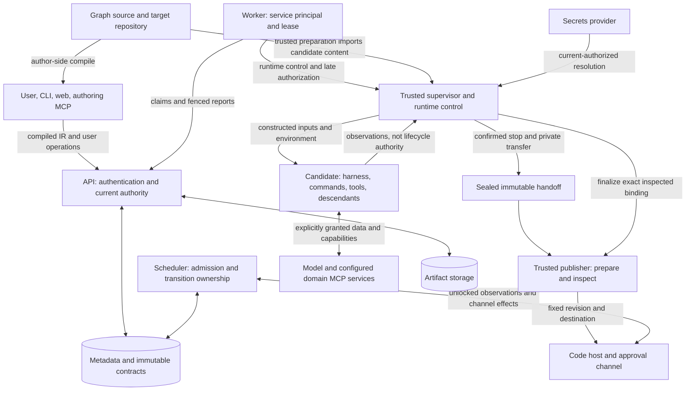

# Threat model

Scope and implementation plan approved under [issue #90](https://github.com/realkarych/kora/issues/90); document accepted for merge by the project owner in [PR #92](https://github.com/realkarych/kora/pull/92) on 2026-10-18. Claude harness amendment dated 2026-10-19 (TM-03, TM-05, TM-06, TM-12 and their evidence): scope and implementation plan approved under [issue #125](https://github.com/realkarych/kora/issues/125); wording pending line-by-line owner review.

## Purpose, scope and status

This document explains what kora protects, which actors already have authority, and where that protection ends. It covers the control plane, its thin clients, managed execution and publication, external integrations, and the contributor workflow that changes them. It summarizes the existing requirements, specifications and decisions; it does not introduce new product guarantees or override an ADR. Read the [technical introduction](technical-introduction.md) for the component map and the [architecture reference](../knowledge/architecture/detailed.md) for deployment details.

The [recorded baseline](../knowledge/research/threat-model-document-structure-2026-10-18.md#repository-baseline-and-evidence) contains a typed Python package, a web shell, builds and packaging tests. The API, scheduler, workers, harness integrations and runtime protections described below are specified but not implemented there. **Every product threat entry below has verification status `pending implementation`.** A named conformance case is a required future check, not a passing test. Scaffold CI does not prove these security properties.

Three facts remain separate: owner review of this text, acceptance of a design decision, and evidence that an implementation enforces it. Some cited ADRs record accepted direction with wording still pending owner review; this synthesis does not upgrade that status. Deployment conditions are independent of all three. The [source comparison](../knowledge/research/threat-model-document-structure-2026-10-18.md) explains the document structure; external projects are not evidence for kora's protection.

## Assets, actors and assumptions

The assets are namespace objects and administrative/approval rights; API and external-service credentials; graph and execution contracts; source, prepared and published revisions; approval and fact digests; lifecycle journals and dispatcher identities; logs, transcripts, artifacts and retained history; execution capacity, budgets and acquired target holds.

| Actor or domain | Existing authority and trust assumption |
|---|---|
| Personal user and the user's authoring/operating agent | CLI, web and MCP act with the user's namespace permissions. `approve` and `platform` grant separate powers; `transcripts` is a per-namespace capability. Author-side compilation executes the graph author's Python in that user's process, not in the control plane. |
| Graph-node agent, commands and descendants | Receive the resolved inputs, environment and configured domain MCP services. They receive no kora token and do not operate kora. Repository files, model output, tool output and feedback may influence them maliciously. Hermetic configuration does not make their behavior trustworthy. |
| Worker | Has a runtime/namespace-scoped service principal; reporting authority is bound to its attempt lease epoch. It orchestrates execution and late publication authorization, not user approvals. |
| Trusted supervisor, runtime control and publisher | Own lifecycle facts, private checkpoints and prepared publication state. Their separation from the candidate is an enforcement requirement only for a protected runtime. The supervisor has no API credential. |
| Operator and installed providers | Installation, host/runtime control, configured integrations and provider code are trusted. Cooperative-provider contracts do not sandbox malicious or indefinitely blocking Python. |
| External model, MCP, code host, approval channel, sensor, secrets and storage services | Have the data and authority actually sent or granted to them. kora does not establish their internal security, data-retention policy or ability to retract effects. |
| Contributor and reviewer | Can propose source, dependencies, CI and agent-instruction changes. Proposed repository content and tool output are data to assess, not authority to weaken checks or approve themselves. |

These distinctions follow [ADR-0002](decisions/0002-ai-first-api-and-thin-clients.md), [ADR-0009](decisions/0009-target-repository-trust-boundary.md), [ADR-0011](decisions/0011-namespaces-and-personal-tokens.md), [ADR-0016](decisions/0016-trusted-execution-and-publication.md), [ADR-0021](decisions/0021-external-observations-outside-transactions.md) and [AGENTS.md](../AGENTS.md). In particular, the absence of graph-node tokens does not constrain a user's own privileged MCP session. Namespace partitioning is not a promise to contain a compromised platform administrator or host.

## Deployment and runtime applicability

Standalone, shared-service and remote-worker deployments describe placement. They do not determine whether candidate code is isolated. [ADR-0016](decisions/0016-trusted-execution-and-publication.md) and the [runtime contract](../knowledge/specs/protocols.md#2-runtime-fr-81) distinguish these cases:

| Runtime | Condition and protection boundary | Evidence required |
|---|---|---|
| `local` | Ordinary Linux/macOS processes for trusted development and tests. Private paths and process groups provide lifecycle structure, not protection from hostile same-user code. This limit applies wherever local is selected. | Real lifecycle/publication tests; reject it when deployment policy requires `protected_execution`. No hostile-code isolation claim. |
| Protected Docker or an independent runtime | Candidate authority cannot reach supervisor/control state, publisher storage or the publication channel. Docker requires separate candidate/publisher containers, no candidate control mounts/socket/privileged mode/host PID access, confirmed domain termination and immutable transfer. | Real process/runtime/Git tests for the declared configuration and supported harness/runtime combination. A container's presence is insufficient. |
| Configured fake runtime/harness | Implements the protocol with deterministic injected behavior. | Core decisions, composition and recovery only; no OS isolation or real harness interception claim. |

`protected_execution`, `enforces_network_policy` and `credential_proxy` are independent capabilities. Requiring one does not imply the others. An unsupported required capability must be rejected. A protected publisher cannot revoke a code-host credential an author explicitly supplied to candidate code. External service permissions remain another boundary beside runtime isolation and harness policy.

## Trust boundaries and data flows

The diagram separates authorities, not network deployment units. Arrows carry data or a specifically granted action; they do not transfer all of the sender's privileges. The candidate box is a logical domain: **on local, there is no hostile-code isolation boundary around it**. On protected runtimes, the runtime must enforce the separation from supervisor and publisher described above.

The supervisor label includes the runtime adapter's trusted execution side; placement of preparation/publication may be `runner` or `worker_host` under the negotiated executor contract. Secret references are saved before current-authorized resolution, and secret values do not enter the saved semantic request. [Runtime and VCS protocols](../knowledge/specs/protocols.md) define those details. Approval validity belongs to the scheduler, not channel text; storage, sensors and secret resolution use the applicable authorization and bounded provider calls. The [research record](../knowledge/research/threat-model-document-structure-2026-10-18.md#unresolved-contract-and-evidence-questions) records the unresolved artifact-download transport wording; this model makes no transport-specific download guarantee.

## Threat scenarios and controls

Threat IDs are stable references for reviews and tests. Each row states the attacker's starting capability, affected asset/boundary, responsible control and residual limit. Applicability inherits the runtime and provider conditions above. Controls are design obligations at the recorded baseline, with required verification mapped in the next section.

| ID and attacker scenario | Asset, boundary and controlling component | Accepted control and remaining limit |
|---|---|---|
| TM-01: a caller uses another namespace's object ID, a worker token as a user token, or a stale lease | Namespace data and approval/platform authority; API authentication and object/attempt ownership | Personal/service separation, by-id namespace checks, flags/capabilities and lease epochs in [ADR-0011](decisions/0011-namespaces-and-personal-tokens.md). Thin clients cannot grant extra permissions. A stolen valid user credential retains its actual rights. |
| TM-02: an external caller forges/replays a webhook or a page induces a session mutation | User session and start/approval authority; browser/API and trigger ingress | Opaque server-side cookies, CSRF protection, CSP and no cookies on Bearer-only routes; authenticated webhook envelopes and deduplicated accepted outcomes. [API conventions and operations](../knowledge/specs/api-and-agent-surface.md), [ADR-0020](decisions/0020-execution-capacity-and-bounded-run-acceptance.md). Authentication does not make submitted content safe. |
| TM-03: a branch author or model response induces unauthorized tools, repository hooks or edits to gates | Candidate-to-control authority and evaluator integrity; harness configuration, policy and runtime | Hermetic configuration by default, namespace deny precedence, declared interception coverage, protected-path checks and explicit rejection of unsupported required policy in [ADR-0009](decisions/0009-target-repository-trust-boundary.md). On `claude` the `PreToolUse` callback is the only decision point: a permission rule's denial before it is recorded from the harness's report, a call a built-in tool's own input validation rejects never runs and is a failed tool result, any other call without a callback decision fails the attempt, and the synthetic `StructuredOutput` output channel is allowed without evaluating either policy under three conditions (exact name, output schema passed, main session); the per-attempt config directory and home lie outside the checkout, so a branch cannot pre-seed them through these directories ([protocols section 3](../knowledge/specs/protocols.md#3-harness-adapter-fr-21-fr-33-fr-66-fr-91-dd-27) and [section 12](../knowledge/specs/protocols.md#12-policy-dd-29)). Allowed programs can still have harmful effects; hooks do not prove semantic intent or contain a compromised harness, which can skip the callback and forge the reports bypass detection relies on. With `trust_repo_config: true` the repository's configuration, including settings the agent writes during the session, is trusted code that can rewrite inputs after the decision, may switch off the callback and can change the harness's endpoint, proxy or TLS trust, so namespace denies are not guaranteed; built-in plugins of the pinned CLI can carry hooks in both modes. |
| TM-04: a graph author supplies executable imports, malicious schema references, templates or oversized expressions | Author process, compiler/validator and saved execution contract | Compilation stays author-side; closed schema references and by-value deployed contracts prevent remote imports or later alias reinterpretation. CEL uses only standard functions; sandboxed Jinja2 forbids filesystem loaders, imports/includes and Python attribute access beyond bound data. [ADR-0002](decisions/0002-ai-first-api-and-thin-clients.md), [ADR-0018](decisions/0018-immutable-attempt-history.md), [IR](../knowledge/specs/ir.md#7-expressions-and-templates). These language restrictions alone do not establish resource-exhaustion protection. Author-side compilation is not a sandbox for the author's own machine. |
| TM-05: candidate code forges lifecycle facts, alters Git configuration or leaves descendants to steal publication credentials | Supervisor journal, sealed bytes, publisher credentials and destination; protected runtime/VCS boundary | Private authoritative checkpoints, confirmed whole-domain stop, alias-free handoff, fresh publisher metadata, complete newly published history inspection and late bound authorization in [ADR-0016](decisions/0016-trusted-execution-and-publication.md). Local provides no hostile same-user isolation. Static credentials gain no invented lifetime or scope guarantee. |
| TM-06: an agent or integration sends secrets/content to an allowed external service or targets an internal endpoint | Secret values and content; resolver, runtime network policy, sensor and external-service permissions | Namespace-prefix checks at validation and resolution, captured-value redaction, independent network enforcement, sensor allowlist and refused link-local/metadata addresses in [protocols](../knowledge/specs/protocols.md#6-secrets-fr-101). The `claude` launcher gives the harness only the constructed environment, never the supervisor's environment or descriptors, and a node `env` cannot set the harness's credential, endpoint, proxy or TLS-trust variables (`IR026`); on local, same-user code can still read the supervisor's process environment. Intentionally supplied credentials and prompts can be used by their recipients; redaction is not universal exfiltration prevention. |
| TM-07: a caller reads transcripts through saved projections, or hostile retained content reaches a privileged reader | Logs, artifacts, prompts, feedback, summaries and history; API/retention/client rendering | Current authorization, transcript-equivalent access checks and content retention apply to inline copies too; expired evidence stays explicitly unavailable under [ADR-0018](decisions/0018-immutable-attempt-history.md). Web content/diagnostics checks belong to the [browser profile](../.claude/skills/kora-verify/references/browser.md); untrusted-content assessment belongs to [security review](../.claude/skills/kora-verify/references/security.md). Neither stored provenance nor a privileged user's MCP access makes the content trustworthy. |
| TM-08: an agent supplies favorable evidence, a disallowed reviewer approves, or the candidate moves during review | Gate provenance and immutable approval; command/bundle records and scheduler/channel boundary | Separate facts from agent narrative; show protected paths and metric provenance; bind approval to commit and fact digests, eligible identity and the exact current wait. [ADR-0008](decisions/0008-content-bound-approvals.md), [ADR-0009](decisions/0009-target-repository-trust-boundary.md), [ADR-0021](decisions/0021-external-observations-outside-transactions.md). Authentic command provenance does not make candidate-controlled tests honest; a final head sample is point-in-time. |
| TM-09: a delayed worker/result/observation affects a replacement or starts new work after logical cancellation | Current output, target identity, capacity and publication; API/scheduler ownership and runtime closure | Immutable history/target identity, current-owner checks, durable retirement and closure of every dispatcher/publication operation under [ADR-0017](decisions/0017-execution-uncertainty-and-safe-replacement.md), [ADR-0018](decisions/0018-immutable-attempt-history.md), [ADR-0019](decisions/0019-immutable-run-target-identity.md), [ADR-0021](decisions/0021-external-observations-outside-transactions.md). Epochs and timeouts do not retract already-issued external effects. |
| TM-10: a graph author floods starts/fan-out, consumes storage or leaves provider work unresolved | Availability, budgets and retained capacity; admission, evaluation and provider dispatch | Outstanding-run and physical-execution caps, bounded cooperative calls/results and inherited deadlines in [ADR-0020](decisions/0020-execution-capacity-and-bounded-run-acceptance.md), [ADR-0021](decisions/0021-external-observations-outside-transactions.md), [ADR-0022](decisions/0022-inherited-execution-deadlines.md). The run cap does not bound all history/artifact bytes or fan-out approvals; no per-token rate limits are promised. Unknown execution can retain capacity indefinitely. |
| TM-11: a payload or storage reference attempts traversal, mutable aliasing, contract substitution or changed replay | Stored inputs, historical attribution and trusted readers; API upload/type validation and runtime transfer | Saved type contracts, recorded full-content digests and write-once target-source outputs prevent replay from changing accepted identity; protected transfer rejects unsafe aliases. [ADR-0018](decisions/0018-immutable-attempt-history.md), [ADR-0019](decisions/0019-immutable-run-target-identity.md), [ADR-0016](decisions/0016-trusted-execution-and-publication.md). Complete transport and size enforcement require real boundary tests; a digest does not establish authorization. |
| TM-12: a contributor or dependency changes trusted code, CI or agent instructions; an installed provider stalls or leaks data | Installation authority and review integrity; package/provider installation and contributor workflow | Validated provider metadata/configuration and shared conformance; deliberate locked dependencies (the `claude` harness binary is the CLI bundled in the `claude-agent-sdk` wheel pinned in `uv.lock`, checked against the wheel's record before launch and recorded on each attempt; on local that check detects drift, not tampering, and vendor feature gates can change behaviour within a pinned version, which the built-in plugin check only partly covers, because a plugin's start-up hook can run before the CLI reports the list), independent reviews and preserved base checks under [protocol common rules](../knowledge/specs/protocols.md#1-common-rules), [AGENTS.md](../AGENTS.md) and the [security profile](../.claude/skills/kora-verify/references/security.md). Installed providers remain trusted cooperative code; prompts are not an OS sandbox, and scanner output cannot establish arbitrary-code safety. |

## Verification and residual limitations

The following map names required evidence, not tests executed by writing this model. Product cases remain `pending implementation` at the recorded baseline. When a component lands, its corresponding implementation and revision-specific evidence must replace that status; if implemented but uncheckable, use `blocked`, not `pending implementation` or `passed`. Keep deployment conditions and residual limits even after tests pass.

| Threats | Required evidence and contract location |
|---|---|
| TM-01, TM-02 | Real API denied-access, service/user, session/CSRF and webhook replay tests through the [API contracts](../knowledge/specs/api-and-agent-surface.md); authentication and approval-channel [conformance](../knowledge/specs/protocols.md#13-conformance-suites-nfr-102). Metadata integration runs on PostgreSQL and SQLite. |
| TM-03, TM-04 | `test_required_policy_is_enforced_or_rejected` and `test_harness_launcher_preserves_control_boundary` through real supported harness interfaces; the [Claude adapter contracts](../knowledge/specs/protocols.md#claude-adapter-contracts-issue-125) `test_claude_session_ignores_repository_settings`, `test_claude_harness_denials_are_recorded` and `test_claude_structured_output_fallback_validates_schema`, on their scripted-model layer, because replayed streams cannot verify interception; plus compiler/IR closed-contract, CEL-function restriction and template-sandbox cases. [Policy and conformance](../knowledge/specs/protocols.md#12-policy-dd-29), [IR](../knowledge/specs/ir.md). Evaluation resource-bound tests need a resolved limit contract; the [open question](../knowledge/research/threat-model-document-structure-2026-10-18.md#unresolved-contract-and-evidence-questions) is not passing or specified protection. A fake cannot verify interception by a real harness. |
| TM-05, TM-11 | Real process/Git tests for `test_candidate_cannot_forge_runner_journal`, `test_candidate_git_configuration_cannot_execute_in_publisher`, `test_agent_descendants_cannot_access_publication_credentials`, `test_publication_destination_is_trusted`, `test_publication_preserves_candidate_commits`, `test_publication_sealing_rejects_mutable_aliases`, `test_claude_session_receives_only_constructed_environment` (no supervisor variable, descriptor or control path reaches the harness) and late authorization. [Publication contracts](../knowledge/specs/protocols.md#publication-authority-and-recovery-contracts); target-source upload replay in [data-model section 12](../knowledge/specs/data-model.md#12-immutable-run-target-identity-adr-0019). |
| TM-06, TM-07 | `test_claude_session_receives_only_constructed_environment` on local and Docker; secret-prefix rejection/redaction, denied sensor destinations, runtime network-capability conformance, retained-projection authorization and payload expiry; real browser rendering/diagnostics checks for implemented views. [Secrets/sensor contracts](../knowledge/specs/protocols.md), [history contract](decisions/0018-immutable-attempt-history.md). Test both denied access and permitted intentional egress without claiming the latter is prevented. |
| TM-08, TM-09 | Stale approvals, replaced waits, late results, changed digests, unknown execution and dispatcher closure. [Scheduler](../knowledge/specs/scheduler.md), [execution-recovery gates](../knowledge/specs/protocols.md#execution-recovery-implementation-gates-adr-0017), [observation ownership](../knowledge/specs/data-model.md#14-external-observation-and-delivery-ownership-adr-0021). |
| TM-10 | Admission/race tests on both metadata databases, bounded malformed inputs/provider results and actual deadline enforcement. [Capacity contract](../knowledge/specs/data-model.md#13-run-acceptance-and-execution-capacity-adr-0020), [inherited-deadline gates](../knowledge/specs/protocols.md#15-inherited-deadline-conformance-gates-adr-0022). Real runtime termination evidence remains separate from an injected-clock decision. |
| TM-12 | Real installed-provider discovery/configuration/external conformance as providers land; `test_claude_binary_digest_mismatch_prevents_session_start` ([Claude adapter contracts](../knowledge/specs/protocols.md#claude-adapter-contracts-issue-125)); current package/build checks and applicable dependency, secret, CI and instruction review. [Correctness](../.claude/skills/kora-verify/references/correctness.md), [security](../.claude/skills/kora-verify/references/security.md), [development checks](development.md). Current tooling/evidence status is recorded separately in the [dated research](../knowledge/research/threat-model-document-structure-2026-10-18.md#repository-baseline-and-evidence). |

The model does not promise containment of a compromised trusted host/provider, safe arbitrary author-side Python, immunity to prompt injection, honest candidate-authored tests, universal secret removal, general RBAC, or exactly-once/rollback semantics for external actions. A target key is declared identity, not proof of which business object an agent touched. Deadline enforcement assumes a runnable trusted supervisor, functioning runtime control and the declared clock uncertainty; interruption/escalation thresholds are not proof of physical termination. The controlling decisions are [ADR-0002](decisions/0002-ai-first-api-and-thin-clients.md), [ADR-0009](decisions/0009-target-repository-trust-boundary.md), [ADR-0011](decisions/0011-namespaces-and-personal-tokens.md) and [ADR-0016 through ADR-0022](decisions/README.md).

## Maintenance and review

Use the existing [verification workflow](../.claude/skills/kora-verify/SKILL.md) and [security profile](../.claude/skills/kora-verify/references/security.md). Changes to actors, assets, data flows, credential/permission grants, trust assumptions, runtime capabilities, external integrations, retention or evidence validity require an applicability check against this model. Before plan approval, identify affected threat IDs and proposed model changes in the issue plan. The coordinator updates the model with the approved implementation; reviewers remain read-only. Record why an applicable security review needs no model change when the existing entries already cover it.

Keep IDs stable, add scenarios for newly exposed boundaries and link each control to its owning contract. New mitigations need the ordinary owner decision and specification changes; they do not become accepted merely by appearing in this table. Unresolved hypotheses and conflicting source statements belong in `knowledge/` until resolved. Update the recorded baseline and evidence status when implementation changes a claim, without promoting past checks to a new revision.

Before readiness, independent correctness/security reviewers inspect the complete diff, affected entries and revision-matched evidence. Native GitHub Codex Review delegates the same criteria to fresh component/profile agents. Descendants inherit the reviewed revision, trusted instruction provenance and read-only execution/publication restrictions. Actual scoped results may satisfy matching specialist reviews; an aggregate verdict does not replace missing results or executable gates. This contributor-workflow amendment follows [issue #108](https://github.com/realkarych/kora/issues/108) and awaits owner wording review in its PR. Review dates and wording approval remain explicit, and owner line-by-line review of this document occurs in the PR before merge.
