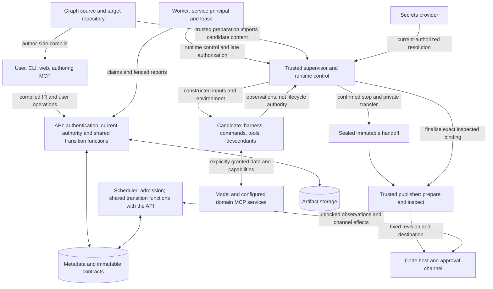

# Threat model

Pricing evidence amendment dated 2026-10-23: pending negative-test pointers for immutable prices, usage coverage and approval snapshots under [issue #142](https://github.com/realkarych/kora/issues/142#issuecomment-6353409349). The plan is approved; wording reviewed line by line and [approved by the project owner](https://github.com/realkarych/kora/pull/221#issuecomment-6354160885) on 2026-10-23. Actors, controls and deployment limitations are unchanged.

Protocol foundation amendment dated 2026-10-22 (the TM-06/TM-07 and TM-12 evidence rows): the secret-value and conformance-plugin tests of [issue #204](https://github.com/realkarych/kora/issues/204), implementation plan approved by the project owner; wording pending line-by-line owner review.

Local-runtime simplification amendment dated 2026-10-22 (the `local` deployment row): the control channel trusts kernel peer attestation instead of a shared secret, and the row names the residuals that follow (runner impersonation through the socket and the registry or the listening socket, dispatcher impersonation through worker takeover, pid reuse or a self-presented grant binding, editing `attempt.token`, which also defeats redaction after a worker restart, the worker unit's control group shared with candidates and its service notifications where the unit allows them, and a candidate that fills the disk holding terminal evidence unwritten and recovery unresolved until an operator frees space), under [issue #194](https://github.com/realkarych/kora/issues/194); chosen by the project owner in its [plan](https://github.com/realkarych/kora/issues/194#issuecomment-6334771831), wording pending line-by-line owner review.

Browser verification amendment dated 2026-10-22 (TM-12 evidence): the project owner approved the [benchmark removal and matching documentation](https://github.com/realkarych/kora/issues/179#issuecomment-6329273349), with delegated independent review and merge.

Scope and implementation plan approved under [issue #90](https://github.com/realkarych/kora/issues/90); document accepted for merge by the project owner in [PR #92](https://github.com/realkarych/kora/pull/92) on 2026-10-18. Claude harness amendment dated 2026-10-19 (TM-03, TM-05, TM-06, TM-12 and their evidence): scope and implementation plan approved under [issue #125](https://github.com/realkarych/kora/issues/125); accepted by the project owner on 2026-10-19.

CEL evaluator amendment dated 2026-10-21: infrastructure and verification added under [issue #166](https://github.com/realkarych/kora/issues/166); wording accepted by the project owner on 2026-10-22.

CEL cost-regression amendment dated 2026-10-23 (TM-04, TM-10, TM-12 and their evidence): the project owner approved lightweight validation and a 100 ms target under [issue #167](https://github.com/realkarych/kora/issues/167#issuecomment-6351849696); wording reviewed line by line and approved by the project owner on 2026-10-23.

Held-read amendment dated 2026-10-19: the TM-10 scenario names callers that hold reads open and its boundary the API read path, its remaining limit names the bounded run-read wait and `?follow=true` streams, the TM-01, TM-02 and TM-10 evidence rows name the run-read wait and mounted-credential contracts, and the maintenance section records the merge of PR #109; direction and implementation plan approved by the project owner under [issue #124](https://github.com/realkarych/kora/issues/124); wording pending line-by-line owner review.

CEL amendment dated 2026-10-19 (TM-02, TM-04, TM-10, TM-12 and the TM-03/TM-04, TM-08/TM-09, TM-10 and TM-12 evidence rows): decisions taken and implementation plan approved by the project owner under [issue #126](https://github.com/realkarych/kora/issues/126); wording pending line-by-line owner review.

Shared-transition amendment dated 2026-10-19: the scheduler label in the trust-boundary diagram names the shared transition functions that the API and the scheduler both call ([issue #103](https://github.com/realkarych/kora/issues/103)). The API label names them too, because the API runs them in its own process. TM-01, TM-02, TM-08, TM-09 and TM-10 are unchanged in authority: object-level checks run inside every transition under the run lock, and the API evaluates only `approve_when` (TM-10). TM-10 gains a remaining availability limit, recorded in its row: a signal route holds its pooled connection while it waits for its locks, including scope locks held by bulk signals of other namespaces. Wording pending line-by-line owner review.

Harness-scope amendment dated 2026-10-21 (TM-03/TM-04, TM-05/TM-11, TM-06/TM-07, TM-10 and TM-12 evidence rows): both Claude and Codex are required in the first local slice under [issue #172](https://github.com/realkarych/kora/issues/172); scope and implementation plan approved by the project owner, wording pending line-by-line owner review. The evidence applies independently to each real adapter. Required real policy-hook evidence that cannot be reproduced blocks slice readiness; fake and replay evidence cannot replace it. Controls and deployment limitations remain as specified below.

Local-runner amendment dated 2026-10-21 (the `local` deployment row, TM-09 and the TM-05/TM-11, TM-06/TM-07 and TM-08/TM-09 evidence rows): the local runtime's runner, control channel, registry and process-exit evidence under [issue #123](https://github.com/realkarych/kora/issues/123); scope and implementation plan approved by the project owner, wording pending line-by-line owner review.

Fake-contract amendment dated 2026-10-21 (the fake runtime/harness deployment row, TM-12 and its evidence row): fakes are injected, never discovered and never reach a serving process, under [issue #136](https://github.com/realkarych/kora/issues/136); implementation plan approved by the project owner, wording pending line-by-line owner review.

## Purpose, scope and status

This document explains what kora protects, which actors already have authority, and where that protection ends. It covers the control plane, its thin clients, managed execution and publication, external integrations, and the contributor workflow that changes them. It summarizes the existing requirements, specifications and decisions; it does not introduce new product guarantees or override an ADR. Read the [technical introduction](technical-introduction.md) for the component map and the [architecture reference](../knowledge/architecture/detailed.md) for deployment details.

The [recorded baseline](../knowledge/research/threat-model-document-structure-2026-10-18.md#repository-baseline-and-evidence) contains a typed Python package, a web shell, builds and packaging tests. The API, scheduler, workers, harness integrations and runtime protections described below are specified but not implemented there. **Every product threat entry below has verification status `pending implementation`.** A named conformance case is a required future check, not a passing test. Scaffold CI does not prove these security properties.

Logging bootstrap and scanner amendment dated 2026-10-20 (TM-06/TM-07, TM-10 and TM-12 evidence rows): implementation plan approved by the project owner under [issue #147](https://github.com/realkarych/kora/issues/147), with the TM-12 row's repository-settings sentence updated under [issue #151](https://github.com/realkarych/kora/issues/151) after the owner applied them; wording pending line-by-line owner review.

Metadata database amendment dated 2026-10-20 (TM-06/TM-07 and TM-12 evidence rows): implementation plan approved by the project owner under [issue #153](https://github.com/realkarych/kora/issues/153); wording pending line-by-line owner review.

No-suppression amendment dated 2026-10-20 (TM-12 evidence row): implementation plan approved by the project owner under [issue #155](https://github.com/realkarych/kora/issues/155); wording pending line-by-line owner review.

Provider-loading amendment dated 2026-10-21 (TM-12 row and TM-12 evidence row): implementation plan approved by the project owner under [issue #150](https://github.com/realkarych/kora/issues/150); wording pending line-by-line owner review.

Worker-route amendment dated 2026-10-21 (the TM-01/TM-02, TM-08/TM-09 and TM-10 evidence rows): implementation plan approved by the project owner under [issue #139](https://github.com/realkarych/kora/issues/139); wording pending line-by-line owner review.

Protocol-model amendment dated 2026-10-21 (the TM-03/TM-04, TM-05/TM-11, TM-06/TM-07, TM-10 and TM-12 evidence rows): implementation plan approved by the project owner under [issue #134](https://github.com/realkarych/kora/issues/134); wording pending line-by-line owner review.

CEL binding amendment dated 2026-10-21 (TM-04 and TM-12 rows, TM-03/TM-04 and TM-12 evidence rows): implementation plan approved by the project owner under [issue #165](https://github.com/realkarych/kora/issues/165), with the decisions recorded on [issue #162](https://github.com/realkarych/kora/issues/162); wording pending line-by-line owner review.

Three facts remain separate: owner review of this text, acceptance of a design decision, and evidence that an implementation enforces it. Some cited ADRs record accepted direction with wording still pending owner review; this synthesis does not upgrade that status. Deployment conditions are independent of all three. The [source comparison](../knowledge/research/threat-model-document-structure-2026-10-18.md) explains the document structure; external projects are not evidence for kora's protection.

CEL evaluator evidence for TM-04 and TM-12 is active under [issue #166](https://github.com/realkarych/kora/issues/166): exact JSON conversion, pre-allocation bounds, detached snapshots, bounded outstanding ownership and cache, safe error records and diagnostics, narrow native failure mapping and a single pinned terminal worker guard. `test_cel_native_compilation_requires_checked_expression` rejects production raw-compilation access outside the binding loader. The evaluator lifetime artifact covers resource retention and real diagnostic sink failure. The compact regression and golden checks, schema-driven checking/projections and correction of minimum-int negation block the first product consumer. The compact regression runs within the already-required `CEL evaluator lifetime` CI status added by [PR #175](https://github.com/realkarych/kora/pull/175), alongside the existing lifetime checks; it introduces no new required status. [Evaluator lifetime evidence](../knowledge/research/cel-evaluator-lifetime-2026-10-21.md).

## Assets, actors and assumptions

The assets are namespace objects and administrative/approval rights; API and external-service credentials; graph and execution contracts; source, prepared and published revisions; approval and fact digests; lifecycle journals and dispatcher identities; logs, transcripts, artifacts and retained history; execution capacity, budgets and acquired target holds.

| Actor or domain | Existing authority and trust assumption |
|---|---|
| Personal user and the user's authoring/operating agent | CLI, web and MCP act with the user's namespace permissions. `approve` and `platform` grant separate powers; `transcripts` is a per-namespace capability. Author-side compilation executes the graph author's Python in that user's process, not in the control plane. |
| Graph-node agent, commands and descendants | Receive the resolved inputs, environment and configured domain MCP services. They receive no kora token and do not operate kora. Repository files, model output, tool output and feedback may influence them maliciously. Hermetic configuration does not make their behavior trustworthy. |
| Worker | Has a runtime/namespace-scoped service principal; reporting authority is bound to its attempt lease epoch. It orchestrates execution and late publication authorization, not user approvals. |
| Trusted supervisor, runtime control and publisher | Own lifecycle facts, private checkpoints and prepared publication state. Their separation from the candidate is an enforcement requirement only for a protected runtime. The supervisor has no API credential. |
| Operator and installed providers | Installation, host/runtime control, configured integrations and provider code are trusted. Cooperative-provider contracts do not sandbox malicious or indefinitely blocking Python. |
| External model, MCP, code host, approval channel, sensor, secrets and storage services | Have the data and authority actually sent or granted to them. kora does not establish their internal security, data-retention policy or ability to retract effects. |
| Contributor and reviewer | Can propose source, dependencies, CI and agent-instruction changes. Proposed repository content and tool output are data to assess, not authority to weaken checks or approve themselves. |

These distinctions follow [ADR-0002](decisions/0002-ai-first-api-and-thin-clients.md), [ADR-0009](decisions/0009-target-repository-trust-boundary.md), [ADR-0011](decisions/0011-namespaces-and-personal-tokens.md), [ADR-0016](decisions/0016-trusted-execution-and-publication.md), [ADR-0021](decisions/0021-external-observations-outside-transactions.md) and [AGENTS.md](../AGENTS.md). In particular, the absence of graph-node tokens does not constrain a user's own privileged MCP session. Namespace partitioning is not a promise to contain a compromised platform administrator or host.

## Deployment and runtime applicability

Standalone, shared-service and remote-worker deployments describe placement. They do not determine whether candidate code is isolated. [ADR-0016](decisions/0016-trusted-execution-and-publication.md) and the [runtime contract](../knowledge/specs/protocols.md#2-runtime-fr-81) distinguish these cases:

| Runtime | Condition and protection boundary | Evidence required |
|---|---|---|
| `local` | Ordinary Linux/macOS processes for trusted development and tests. Private paths and process groups provide lifecycle structure, not protection from hostile same-user code. Same-user code can read the launch specification in transit and `KORA_ATTEMPT_TOKEN`, connect to the control socket as itself, impersonate a runner by replacing the socket and editing the registry together or by taking over the runner's listening socket, act as the worker's dispatcher by taking over the worker process (`ptrace`, `pidfd_getfd`, `/proc/<pid>/mem`), through the remaining pid-reuse window of the peer attestation where no pidfd exists, or by attaching under a new dispatcher id with a grant binding that names itself, which the runner cannot tell from a relayed one, edit the registry, its tombstones, the journal and `attempt.token` (which also defeats the worker-side redaction of the real token after a worker restart), exhaust the limits of the worker unit's control group, which it shares, send that unit's service notifications where the unit allows them, fill the disk so terminal evidence stays unwritten and recovery unresolved until an operator frees space, and kill a worker to produce real process-exit evidence ([local runtime](../knowledge/specs/protocols.md#local-runtime-issue-123)). This limit applies wherever local is selected. | Real lifecycle/publication tests; reject it when deployment policy requires `protected_execution`. No hostile-code isolation claim. |
| Protected Docker or an independent runtime | Candidate authority cannot reach supervisor/control state, publisher storage or the publication channel. Docker requires separate candidate/publisher containers, no candidate control mounts/socket/privileged mode/host PID access, confirmed domain termination and immutable transfer. | Real process/runtime/Git tests for the declared configuration and supported harness/runtime combination. A container's presence is insufficient. |
| Fake runtime/harness | Implements the protocol with deterministic injected behavior, constructed by injection in the testing compositions only ([fakes](../knowledge/specs/fakes.md)). | Core decisions, composition and recovery only; no OS isolation or real harness interception claim. Never selected by a process that serves the API or runs a worker: never discovered, refused as providers by provider loading, confined by the import rule for static and literal imports, and absent from serving processes, which a pending contract proves at run time; installed providers stay trusted code that could still import a fake; inside a testing composition fake capability flags satisfy validation, and every record carries `evidence: fake`. |

`protected_execution`, `enforces_network_policy` and `credential_proxy` are independent capabilities. Requiring one does not imply the others. An unsupported required capability must be rejected. A protected publisher cannot revoke a code-host credential an author explicitly supplied to candidate code. External service permissions remain another boundary beside runtime isolation and harness policy.

## Trust boundaries and data flows

The diagram separates authorities, not network deployment units. Arrows carry data or a specifically granted action; they do not transfer all of the sender's privileges. The candidate box is a logical domain: **on local, there is no hostile-code isolation boundary around it**. On protected runtimes, the runtime must enforce the separation from supervisor and publisher described above.

The supervisor label includes the runtime adapter's trusted execution side; placement of preparation/publication may be `runner` or `worker_host` under the negotiated executor contract. Secret references are saved before current-authorized resolution, and secret values do not enter the saved semantic request. [Runtime and VCS protocols](../knowledge/specs/protocols.md) define those details. Approval validity belongs to the scheduler, not channel text; storage, sensors and secret resolution use the applicable authorization and bounded provider calls. The [research record](../knowledge/research/threat-model-document-structure-2026-10-18.md#unresolved-contract-and-evidence-questions) records the unresolved artifact-download transport wording; this model makes no transport-specific download guarantee.

## Threat scenarios and controls

Threat IDs are stable references for reviews and tests. Each row states the attacker's starting capability, affected asset/boundary, responsible control and residual limit. Applicability inherits the runtime and provider conditions above. Controls are design obligations at the recorded baseline, with required verification mapped in the next section.

| ID and attacker scenario | Asset, boundary and controlling component | Accepted control and remaining limit |
|---|---|---|
| TM-01: a caller uses another namespace's object ID, a worker token as a user token, or a stale lease | Namespace data and approval/platform authority; API authentication and object/attempt ownership | Personal/service separation, by-id namespace checks, flags/capabilities and lease epochs in [ADR-0011](decisions/0011-namespaces-and-personal-tokens.md). Thin clients cannot grant extra permissions. A stolen valid user credential retains its actual rights. |
| TM-02: an external caller forges/replays a webhook or a page induces a session mutation | User session and start/approval authority; browser/API and trigger ingress | Opaque server-side cookies, CSRF protection, CSP and no cookies on Bearer-only routes; authenticated webhook envelopes and deduplicated accepted outcomes. [API conventions and operations](../knowledge/specs/api-and-agent-surface.md), [ADR-0020](decisions/0020-execution-capacity-and-bounded-run-acceptance.md). Authentication does not make submitted content safe: an authenticated webhook payload reaches CEL only as a bounded projection, and an error in its `match` is no match ([IR section 7.7](../knowledge/specs/ir.md#77-evaluation-errors)). |
| TM-03: a branch author or model response induces unauthorized tools, repository hooks or edits to gates | Candidate-to-control authority and evaluator integrity; harness configuration, policy and runtime | Hermetic configuration by default, namespace deny precedence, declared interception coverage, protected-path checks and explicit rejection of unsupported required policy in [ADR-0009](decisions/0009-target-repository-trust-boundary.md). On `claude` the `PreToolUse` callback is the only decision point: a permission rule's denial before it is recorded from the harness's report, a call a built-in tool's own input validation rejects never runs and is a failed tool result, any other call without a callback decision fails the attempt, and the synthetic `StructuredOutput` output channel is allowed without evaluating either policy under four conditions (exact name, output schema passed, main session, and `max_events` not yet reached); the per-attempt config directory and home lie outside the checkout, so a branch cannot pre-seed them through these directories ([protocols section 3](../knowledge/specs/protocols.md#3-harness-adapter-fr-21-fr-33-fr-66-fr-91-dd-27) and [section 12](../knowledge/specs/protocols.md#12-policy-dd-29)). Allowed programs can still have harmful effects; hooks do not prove semantic intent or contain a compromised harness, which can skip the callback and forge the reports bypass detection relies on. With `trust_repo_config: true` the repository's configuration, including settings the agent writes during the session, is trusted code that can rewrite inputs after the decision, may switch off the callback and can change the harness's endpoint, proxy or TLS trust, so namespace denies are not guaranteed; built-in plugins of the pinned CLI can carry hooks in both modes. |
| TM-04: a graph author supplies executable imports, malicious schema references, templates or oversized expressions | Author process, compiler/validator and saved execution contract | Compilation stays author-side; closed schema references and by-value deployed contracts prevent remote imports or later alias reinterpretation. CEL uses only standard functions, checked by kora's own parser and schema-driven checker with fixed length, depth and comprehension limits and a worst-case cost estimate over projected, bounded data; the binding compiles only kora's canonical rendering of the checked tree ([IR section 7](../knowledge/specs/ir.md#7-expressions-and-templates)). Sandboxed Jinja2 forbids filesystem loaders, imports/includes and Python attribute access beyond bound data. [ADR-0002](decisions/0002-ai-first-api-and-thin-clients.md), [ADR-0018](decisions/0018-immutable-attempt-history.md), [IR](../knowledge/specs/ir.md#7-expressions-and-templates). The Jinja2 restrictions alone do not establish resource-exhaustion protection. CEL compile and evaluation run in-process on a process-owned worker with a stack of at least 1 MiB and cannot be interrupted while holding the GIL. The cost weights and regex tables remain provisional; functional boundary tests and the compact 100 ms regression establish no full native crash margin ([ADR-0006](decisions/0006-graph-definition-dsl-and-yaml-representation.md)). A gap in the limits or the estimate, at compile or evaluation, can stall or crash a shared API or scheduler, and a crash recurs on restart while the expression stays runnable. The binding's own `cel` logger, which would forward expression text and values to the host's logging, is disabled and filtered when kora loads the binding; the binding's Rust panic hook still writes a few unframed lines to standard error (the panic location, its message and a backtrace note, or a backtrace when `RUST_BACKTRACE` is set), none of which carries expression text. Author-side compilation is not a sandbox for the author's own machine. |
| TM-05: candidate code forges lifecycle facts, alters Git configuration or leaves descendants to steal publication credentials | Supervisor journal, sealed bytes, publisher credentials and destination; protected runtime/VCS boundary | Private authoritative checkpoints, confirmed whole-domain stop, alias-free handoff, fresh publisher metadata, complete newly published history inspection and late bound authorization in [ADR-0016](decisions/0016-trusted-execution-and-publication.md). Local provides no hostile same-user isolation. Static credentials gain no invented lifetime or scope guarantee. |
| TM-06: an agent or integration sends secrets/content to an allowed external service or targets an internal endpoint | Secret values and content; resolver, runtime network policy, sensor and external-service permissions | Namespace-prefix checks at validation and resolution, captured-value redaction, independent network enforcement, sensor allowlist and refused link-local/metadata addresses in [protocols](../knowledge/specs/protocols.md#6-secrets-fr-101). The `claude` launcher gives the harness only the constructed environment, never the supervisor's environment or descriptors, and a node `env` cannot set the harness's credential, endpoint, proxy or TLS-trust variables (`IR026`); on local, same-user code can still read the supervisor's process environment. Intentionally supplied credentials and prompts can be used by their recipients; redaction is not universal exfiltration prevention. |
| TM-07: a caller reads transcripts through saved projections, or hostile retained content reaches a privileged reader | Logs, artifacts, prompts, feedback, summaries and history; API/retention/client rendering | Current authorization, transcript-equivalent access checks and content retention apply to inline copies too; expired evidence stays explicitly unavailable under [ADR-0018](decisions/0018-immutable-attempt-history.md). Web content/diagnostics checks belong to the [browser profile](../.claude/skills/kora-verify/references/browser.md); untrusted-content assessment belongs to [security review](../.claude/skills/kora-verify/references/security.md). Neither stored provenance nor a privileged user's MCP access makes the content trustworthy. |
| TM-08: an agent supplies favorable evidence, a disallowed reviewer approves, or the candidate moves during review | Gate provenance and immutable approval; command/bundle records and scheduler/channel boundary | Separate facts from agent narrative; show protected paths and metric provenance; bind approval to commit and fact digests, eligible identity and the exact current wait. [ADR-0008](decisions/0008-content-bound-approvals.md), [ADR-0009](decisions/0009-target-repository-trust-boundary.md), [ADR-0021](decisions/0021-external-observations-outside-transactions.md). Authentic command provenance does not make candidate-controlled tests honest; a final head sample is point-in-time. |
| TM-09: a delayed worker/result/observation affects a replacement or starts new work after logical cancellation | Current output, target identity, capacity and publication; API/scheduler ownership and runtime closure | Immutable history/target identity, current-owner checks, durable retirement and closure of every dispatcher/publication operation under [ADR-0017](decisions/0017-execution-uncertainty-and-safe-replacement.md), [ADR-0018](decisions/0018-immutable-attempt-history.md), [ADR-0019](decisions/0019-immutable-run-target-identity.md), [ADR-0021](decisions/0021-external-observations-outside-transactions.md). Epochs and timeouts do not retract already-issued external effects. On `local`, process-exit evidence closes a dead worker's grant only on the same host and pid namespace, with its process group empty, so a surviving effect subprocess that stays in that group keeps the grant open; a descendant that leaves the group with `setsid` or `setpgid` is not observed, and a cloned host id or a copied state root can make the evidence wrong. A live earlier incarnation of the same worker delays re-registration after a reboot until its lease lapses. |
| TM-10: a graph author floods starts/fan-out, consumes storage or leaves provider work unresolved, or an authenticated caller holds many reads open | Availability, budgets and retained capacity; admission, evaluation, provider dispatch and the API read path | Outstanding-run and physical-execution caps, a validation-time CEL cost estimate per expression, bounded CEL data and a per-transaction evaluation allowance in the scheduler ([IR section 7](../knowledge/specs/ir.md#7-expressions-and-templates)). The default steps budget and scheduler allowance are each 100,000,000,000,000 logical charge units; the allowance is never less than one expression's budget. The fixed-case 100 ms regression target is observed, with no interruption deadline or bound for all admitted expressions. The 16 MiB logical estimate establishes no RSS envelope. Other controls include bounded cooperative calls/results and inherited deadlines in [ADR-0020](decisions/0020-execution-capacity-and-bounded-run-acceptance.md), [ADR-0021](decisions/0021-external-observations-outside-transactions.md), [ADR-0022](decisions/0022-inherited-execution-deadlines.md). The run cap does not bound all history/artifact bytes or fan-out approvals; no per-token rate limits are promised. Held reads (the [bounded run-read wait](../knowledge/specs/api-and-agent-surface.md#bounded-run-read-wait-adr-0002), at most 45 s, and `?follow=true` streams) each occupy an API request and repeated reads while open; no per-token or global limit on concurrent held reads is promised. Unknown execution can retain capacity indefinitely. A gap in the CEL limits or estimate can stall or crash the shared process for every namespace, and a crash recurs on restart while the expression stays runnable; server-side compiles and API evaluations are outside the scheduler allowance. A signal route holds its pooled connection while it waits for its locks, bounded per lock by `lock_timeout` ([scheduler section 12](../knowledge/specs/scheduler.md#12-execution-backend-boundary-nfr-55)); a caller of one namespace repeating cancels or retries of large runs holds global, namespace and graph scope locks, so reservation-releasing reports and admissions of every namespace queue behind it and can occupy the shared pool until those waits expire. |
| TM-11: a payload or storage reference attempts traversal, mutable aliasing, contract substitution or changed replay | Stored inputs, historical attribution and trusted readers; API upload/type validation and runtime transfer | Saved type contracts, recorded full-content digests and write-once target-source outputs prevent replay from changing accepted identity; protected transfer rejects unsafe aliases. [ADR-0018](decisions/0018-immutable-attempt-history.md), [ADR-0019](decisions/0019-immutable-run-target-identity.md), [ADR-0016](decisions/0016-trusted-execution-and-publication.md). Complete transport and size enforcement require real boundary tests; a digest does not establish authorization. |
| TM-12: a contributor or dependency changes trusted code, CI or agent instructions; an installed provider stalls or leaks data | Installation authority and review integrity; package/provider installation and contributor workflow | Validated provider metadata/configuration and shared conformance; entry points named `<protocol>.<name>`, loaded selectively, with ambiguous registrations, the reserved name `fake` and kora's test and conformance modules refused before import ([provider loading](../knowledge/specs/protocols.md#provider-loading-issue-150)); fakes are never discovered, imported only by the testing roots and absent from serving processes ([fakes](../knowledge/specs/fakes.md#2-fakes-never-reach-a-serving-process)); deliberate locked dependencies (the `claude` harness binary is the CLI bundled in the `claude-agent-sdk` wheel pinned in `uv.lock`, checked against the wheel's record before launch and recorded on each attempt; on local that check detects drift, not tampering, and vendor feature gates can change behaviour within a pinned version, which the built-in plugin check only partly covers, because a plugin's start-up hook can run before the CLI reports the list), with the native CEL binding at an exact pin taken by kora-controlled installs from the hash-locked lock file only as binary wheels, and source builds unsupported elsewhere ([ADR-0013](decisions/0013-implementation-stack.md), [stack reference](../knowledge/architecture/detailed.md#stack-per-component)), independent reviews and preserved base checks under [protocol common rules](../knowledge/specs/protocols.md#1-common-rules), [AGENTS.md](../AGENTS.md) and the [security profile](../.claude/skills/kora-verify/references/security.md). Installed providers remain trusted cooperative code; prompts are not an OS sandbox, and scanner output cannot establish arbitrary-code safety. Lockfile scanning does not see crates bundled into native wheels; the binding's own crate lock is committed and scanned with the other lockfiles, beside an override scoped to its root crate, whose name and version collide with an unrelated advisory. Before importing the binding, kora checks the distribution's version and the hash of every file of the package against its RECORD, and refuses symbolic links anywhere in the package, which also refuses uv's symbolic-link install mode, and directories it cannot list; that detects drift, not tampering. It does not check the bytecode cache, which Python can run instead of the checked source, other import hooks, or the binding's pure-Python import chain. The `wcwidth` constraint applies only to kora-controlled installs, `prompt-toolkit` 3.0.53 and `wcwidth` 0.8.5 carry no PEP 740 attestations and the other dependencies were not checked, the extra installs a `cel` console script, a yanked pin is detected by no check, and the Rust standard library and toolchain compiled into the native module are covered by neither the crate lock nor the wheel's SBOM. |

## Verification and residual limitations

The following map names required evidence, not tests executed by writing this model. Product cases remain `pending implementation` at the recorded baseline. When a component lands, its corresponding implementation and revision-specific evidence must replace that status; if implemented but uncheckable, use `blocked`, not `pending implementation` or `passed`. Keep deployment conditions and residual limits even after tests pass.

| Threats | Required evidence and contract location |
|---|---|
| TM-01, TM-02 | Real API denied-access, service/user, session/CSRF and webhook replay tests through the [API contracts](../knowledge/specs/api-and-agent-surface.md), including authorization during a bounded run-read wait and on the mounted MCP servers (`test_run_read_wait_is_bounded`, `test_mcp_mounted_calls_carry_their_own_credential`); authentication and approval-channel [conformance](../knowledge/specs/protocols.md#13-conformance-suites-nfr-102). Metadata integration runs on PostgreSQL and SQLite. The worker route contracts of [issue #139](https://github.com/realkarych/kora/issues/139) add `test_worker_write_requires_its_grant` and `test_upload_requires_grant_before_bytes`, pending implementation. Pricing: `test_usage_usd_is_derived_by_engine` (9, 11, 17) and `test_approval_cost_has_surface_parity` (11, 18) cover forged/cross-namespace prices and response-form replacement; pending implementation. |
| TM-03, TM-04 | `test_required_policy_is_enforced_or_rejected` and `test_harness_launcher_preserves_control_boundary` through both the real Claude Agent SDK and Codex app-server interfaces in slice 1, covering each declared call kind and supported permission/sandbox mode, namespace-deny precedence, `IR019` for unsupported namespace kinds, protected paths and repository-hook exclusion in hermetic mode, preserving the `trust_repo_config: true` residual limits of ADR-0009; the [Claude adapter contracts](../knowledge/specs/protocols.md#claude-adapter-contracts-issue-125) `test_claude_session_ignores_repository_settings`, `test_claude_harness_denials_are_recorded` and `test_claude_structured_output_fallback_validates_schema`, on their scripted-model layer, because replayed streams cannot verify interception; plus compiler/IR closed-contract, CEL-function restriction and template-sandbox cases. [Policy and conformance](../knowledge/specs/protocols.md#12-policy-dd-29), [IR](../knowledge/specs/ir.md). CEL limit, cost-estimate and canonical-rendering cases are active since [issue #161](https://github.com/realkarych/kora/issues/161), and the binding agreement cases and `test_cel_binding_logger_never_carries_content` since [issue #165](https://github.com/realkarych/kora/issues/165); data-bound, projection and evaluation-error cases are named in [IR section 7](../knowledge/specs/ir.md#7-expressions-and-templates) and remain `pending implementation`; bounds for Jinja2 rendering are still an [open question](../knowledge/research/threat-model-document-structure-2026-10-18.md#unresolved-contract-and-evidence-questions). Codex requires its own deterministic app-server driver and managed-hook loading evidence ([implementation plan](implementation-plan.md#8-observability-threat-model-evidence-and-measurements), work item 15); the Claude scripted-model mechanism and probe results are not Codex evidence. A fake cannot verify interception by a real harness. The missing real policy-hook matrix for either harness blocks first-slice readiness. The protocol model contracts of [issue #134](https://github.com/realkarych/kora/issues/134) add `test_tool_policy_layers`, `test_policy_failure_denies`, `test_adapter_exception_order` and `test_runner_outcome_covers_every_stop`, pending implementation. |
| TM-05, TM-11 | Real process/Git tests for `test_candidate_cannot_forge_runner_journal`, `test_candidate_git_configuration_cannot_execute_in_publisher`, `test_agent_descendants_cannot_access_publication_credentials`, `test_publication_destination_is_trusted`, `test_publication_preserves_candidate_commits`, `test_publication_sealing_rejects_mutable_aliases`, `test_claude_session_receives_only_constructed_environment` and `test_codex_session_receives_only_constructed_environment` (no supervisor variable, descriptor or control path reaches either harness) and late authorization. [Publication contracts](../knowledge/specs/protocols.md#publication-authority-and-recovery-contracts); target-source upload replay in [data-model section 12](../knowledge/specs/data-model.md#12-immutable-run-target-identity-adr-0019). The protocol model contracts of [issue #134](https://github.com/realkarych/kora/issues/134) add `test_adapter_cannot_emit_supervisor_kinds`, `test_handle_and_events_are_secret_and_capability_free` and `test_runtime_observation_is_not_quiescence`, pending implementation. The [local runtime contracts](../knowledge/specs/protocols.md#local-runtime-contracts-issue-123) of [issue #123](https://github.com/realkarych/kora/issues/123) add `test_control_channel_rejects_impostors`, `test_journal_classes_and_caps`, `test_transfer_digest_mismatch_is_rejected`, `test_receipt_names_its_scope`, `test_reused_pgid_is_never_signalled` and `test_state_root_and_socket_dir_refuse_unsafe_ownership`, pending implementation. Pricing: `test_attempt_price_snapshot_is_immutable` and `test_runner_uses_saved_price_snapshot` (9, 11, 14, 17) reject altered saved maps and retain missing entries during adoption; pending implementation. |
| TM-06, TM-07 | `test_claude_session_receives_only_constructed_environment` and `test_codex_session_receives_only_constructed_environment` on local in the first slice and on Docker before protected-runtime support; secret-prefix rejection/redaction, denied sensor destinations, runtime network-capability conformance, retained-projection authorization and payload expiry; real browser rendering/diagnostics checks for implemented views. [Secrets/sensor contracts](../knowledge/specs/protocols.md), [history contract](decisions/0018-immutable-attempt-history.md). Test both denied access and permitted intentional egress without claiming the latter is prevented. The bootstrap leg of `test_logging_redacts_content_and_safe_exception_chains` (registered literal values masked before truncation, unregistered markers in exception chains, locals, source, third-party records and warnings excluded) and `test_entry_point_exit_paths` (the unhandled-error exit path keeps the exception message off stderr) are active under [issue #147](https://github.com/realkarych/kora/issues/147); the provider legs stay `pending implementation` with the secrets provider. The SQL-parameter and database-URL legs are active under [issue #153](https://github.com/realkarych/kora/issues/153): `test_sql_parameters_and_statements_never_appear_in_diagnostics` (a failing statement with a marker parameter leaves no statement text, parameter or message in any record at DEBUG with the SQLAlchemy loggers admitted) and `tests/db/test_db_upgrade_process.py` (an invalid, incomplete or unreachable `KORA_DATABASE_URL` leaves its user, password and host out of stdout, stderr and every record; the SQLite file and its companions are created with mode 0600). The protocol model contracts of [issue #134](https://github.com/realkarych/kora/issues/134) add `test_secret_value_never_rendered`, `test_secret_reveal_is_confined`, `test_secret_registration_lifetime` and `test_event_content_is_bounded_and_classified`, pending implementation. The local runtime contracts of issue #123 add `test_launcher_takes_spec_from_private_channel` and `test_runner_environment_excludes_worker_credentials`, pending implementation. Since [issue #204](https://github.com/realkarych/kora/issues/204), `test_secret_value_never_rendered`, `test_secret_admission_fails_closed`, `test_secret_scope_release_restores_registry`, `test_secret_transfer_field_is_masked` and `test_secret_reveal_is_confined` prove that a `SecretValue` and its transfer field render, copy and serialise nothing of the value, that admission of the literal and its JSON-escaped bodies is all or nothing, and that release restores the registry; the worker-route, control-channel and rotation legs stay with work items 11, 14 and 17. Pricing diagnostics and snapshot projections retain the observability/authorization rules under [data-model section 7.5](../knowledge/specs/data-model.md#75-future-evidence-and-activation) (9, 11, 14, 15, 17, 18); pending implementation. |
| TM-08, TM-09 | Stale approvals, replaced waits, late results, changed digests, unknown execution and dispatcher closure. [Scheduler](../knowledge/specs/scheduler.md), [execution-recovery gates](../knowledge/specs/protocols.md#execution-recovery-implementation-gates-adr-0017), [observation ownership](../knowledge/specs/data-model.md#14-external-observation-and-delivery-ownership-adr-0021). CEL approval cases `test_cel_approve_when_not_evaluated_without_authority` and `test_cel_approve_when_error_marks_request_failed` ([IR section 7.9](../knowledge/specs/ir.md#79-future-contracts)) are `pending implementation`. The worker route contracts of [issue #139](https://github.com/realkarych/kora/issues/139) add `test_successful_attempt_requires_closure_evidence`, `test_success_pending_completion_is_rechecked`, `test_terminal_report_rejects_unbound_evidence`, `test_recovery_relay_closes_earlier_grants` and `test_adopted_attempt_reports_after_earlier_grants_close`, pending implementation; relayed runtime and dispatcher evidence is trusted only as far as the current lease holder, and local runtimes give cooperative guarantees only. The local runtime contracts of issue #123 add `test_dead_worker_dispatcher_closed_by_process_exit`, `test_unconnected_grant_closed_by_process_exit`, `test_process_exit_evidence_requires_same_host_and_pid_namespace`, `test_worker_child_effect_keeps_dispatcher_open`, `test_stale_incarnation_claim_binds_its_own_process` and `test_live_old_worker_keeps_adoption_observational`, pending implementation. `test_usage_report_preserves_gaps_and_observation_time` and `test_approval_request_carries_run_cost` (9, 10, 11, 14, 17, 18) cover missing execution evidence, late recovery and immutable approvals; pending implementation. |
| TM-10 | Admission/race tests on both metadata databases, bounded malformed inputs/provider results, independent `test_claude_stream_volume_is_bounded` / `test_claude_session_releases_resources` and `test_codex_stream_volume_is_bounded` / `test_codex_session_releases_resources` evidence, actual deadline enforcement and the [bounded run-read wait](../knowledge/specs/api-and-agent-surface.md#bounded-run-read-wait-adr-0002) (`test_run_read_wait_is_bounded`). [Capacity contract](../knowledge/specs/data-model.md#13-run-acceptance-and-execution-capacity-adr-0020), [inherited-deadline gates](../knowledge/specs/protocols.md#15-inherited-deadline-conformance-gates-adr-0022). Real runtime termination evidence remains separate from an injected-clock decision. Both adapters require repeated success, failure, cancellation, escalation, adoption and shutdown measurements with an explicit quiescence condition, including memory, tasks, descriptors, subprocesses and retained per-session state; the [implementation plan](implementation-plan.md#8-observability-threat-model-evidence-and-measurements) assigns their separate workloads to work item 15. These harness measurements remain `pending implementation`. The compact CEL cost regression and provisional estimate-golden/specification checks are active under [issue #167](https://github.com/realkarych/kora/issues/167), alongside the existing evaluator lifetime suite. Full fitting, RSS/GIL calibration and crash-threshold searches are removed under the [scoped exclusion](../knowledge/reviews/ai-development-setup.md#cel-numerical-calibration-exclusion), not passing or pending gates. Real validation, allowance/transaction, fairness and 1,000-node/five-second scheduling measurements in [IR section 7](../knowledge/specs/ir.md#7-expressions-and-templates) remain `pending implementation` with their API/scheduler owners; compact fixed cases do not satisfy them. The hot-run and bulk-signal measurements of [scheduler section 12](../knowledge/specs/scheduler.md#12-execution-backend-boundary-nfr-55), including the effect of bulk signals on admission and signals of other runs, are `pending implementation`. The bounded diagnostic queue, the cumulative record budget and the bounded drain of [issue #147](https://github.com/realkarych/kora/issues/147) add no entry; `test_logging_sink_failure_does_not_stall_work` and the logging overhead measurement are their evidence. The protocol model contracts of [issue #134](https://github.com/realkarych/kora/issues/134) add `test_command_output_volume_is_bounded`, `test_finalise_memory_is_bounded` and `test_journal_backpressure_never_blocks`, pending implementation. The worker route contracts of [issue #139](https://github.com/realkarych/kora/issues/139) add the cap and reservation legs of `test_upload_requires_grant_before_bytes` and `test_refused_upload_bytes_are_reclaimed`, pending implementation. `test_price_and_approval_bounds_are_explicit` (#213, 9, 18) and pricing extensions of the runner memory/backpressure cases (14, 15, 17) cover numeric/model/replay/snapshot bounds; pending implementation. |
| TM-12 | Since [issue #150](https://github.com/realkarych/kora/issues/150), `test_provider_loading_imports_only_the_requested_entry_point` proves selective loading, the ambiguity, reserved-name, refused-module and malformed-value checks through real `importlib.metadata` distributions, and `test_provider_metadata_is_validated` proves metadata validation through an injected entry-point source; the third-party installed-provider fixture, `kora plugins list` and external conformance stay pending under [issue #140](https://github.com/realkarych/kora/issues/140). Real installed-provider configuration and external conformance as providers land; `test_claude_binary_digest_mismatch_prevents_session_start` ([Claude adapter contracts](../knowledge/specs/protocols.md#claude-adapter-contracts-issue-125)) and `test_codex_binary_digest_mismatch_prevents_session_start` ([implementation plan](implementation-plan.md#7-named-contracts-by-work-item), work item 15), each with installed-version verification before session start; current package/build checks and applicable dependency, secret, CI and instruction review. [Correctness](../.claude/skills/kora-verify/references/correctness.md), [security](../.claude/skills/kora-verify/references/security.md), [development checks](development.md). Since [issue #165](https://github.com/realkarych/kora/issues/165) the CEL binding installs wheel-only through the `cel` extra. These are active: `test_cel_binding_pin_is_consistent`, `test_cel_bundled_crate_lock_covers_installed_wheel`, `test_cel_panic_class_is_the_binding_class`, `test_osv_override_is_scoped_to_the_binding_root_crate`, `test_osv_scans_pass_only_the_three_lockfiles_and_fail_on_findings`, `test_cel_loader_refuses_unchecked_code_before_it_runs`, and the loader legs of `test_cel_evaluating_entry_points_refuse_mismatched_binding_version` and `test_cel_evaluating_entry_points_refuse_without_binding`. The entry-point legs of those two tests wait for the first entry point that evaluates expressions. The [CEL stack record](../knowledge/research/cel-stack-2026-10-21.md) holds the pin baseline. The #167 compact artifact records its checked-out revision, environment, manifest, all forty cold/warm intervals, exact results and cleanup counters; only clean revision-matched reference CI evidence qualifies. Golden outputs pin provisional estimates without proving numerical calibration; local `non_reference` data and historical failed measurements cannot be reported as a reference pass. The [dated record](../knowledge/research/cel-cost-calibration-2026-10-22.md) preserves the failed pilot and qualified smaller-bound evidence. Pin changes repeat conformance, golden, compact, lifetime and applicable security checks; the existing `cel` diagnostics activation row and future API/scheduler error ownership are unchanged. Dependency, secret and static-analysis scanning in CI is active under [issue #147](https://github.com/realkarych/kora/issues/147), each pinned by commit: Ruff's `S` family covers Python patterns; CodeQL's default suite covers `python`, `javascript-typescript` and the workflows and uploads alerts to the code-scanning view; OSV-Scanner reports known advisories in `uv.lock`, `web/pnpm-lock.yaml` and the CEL binding's committed crate lock (newly introduced ones on pull requests, the whole set on `master` and weekly), and sees no other crates bundled in native wheels; Gitleaks matches regex patterns over the first 30 first-parent, non-merge commits of a pull request, a pushed range on `master`, and the full history weekly and on dispatch; GitHub's secret scanning and push protection are enabled with provider patterns only. A clean scan is not absence of vulnerabilities. Dependabot alerts, required status checks for the scaffold lanes, the templates job and the scanner jobs, the code-scanning rule on the `master` ruleset and enforced full-length action pins were applied by the owner on 2026-10-20 after the change landed ([issue #151](https://github.com/realkarych/kora/issues/151)). Current tooling/evidence status is recorded in the [logging and scanner research](../knowledge/research/logging-stack-and-ci-scanners-2026-10-20.md). The metadata database dependencies of [issue #153](https://github.com/realkarych/kora/issues/153) are hash-locked, installed with `uv sync --no-build` so a missing native wheel fails instead of compiling on the runner, and scanned through `uv.lock`; the PostgreSQL test container is pinned by digest and runs without the reaper container by default, so no container started by the tests mounts the Docker socket unless a contributor re-enables the reaper explicitly; provenance, wheels and the container-image scanning gap are recorded in the [metadata database research](../knowledge/research/metadata-database-stack-2026-10-20.md). The no-suppression checks of [issue #155](https://github.com/realkarych/kora/issues/155) are active: Ruff with `--ignore-noqa` and a banned-API table, Pyright without `type: ignore` support, the ESLint comment rule and `tests/architecture/test_no_suppression.py`, which also pins the Ruff, Pyright, pytest, TypeScript and frontend-script configuration and refuses shadowing configuration files; they catch the listed forms only, names built from strings, environment variables such as `PYTEST_ADDOPTS` and the command lines of the CI workflow remain review items, and a green check is not proof that every rule of AGENTS.md is met ([no-suppression research](../knowledge/research/no-suppression-checks-2026-10-20.md)). `test_session_spec_is_closed` of [issue #134](https://github.com/realkarych/kora/issues/134) is pending implementation. The fake exclusion contracts of [issue #136](https://github.com/realkarych/kora/issues/136), `test_serving_process_refuses_fake_providers`, `test_fake_import_rule`, `test_production_runner_refuses_fake`, `test_fake_results_carry_fake_evidence` and `test_dry_run_resolves_no_secret`, are pending implementation; the self-test of the import rule runs in CI now. Since [issue #204](https://github.com/realkarych/kora/issues/204), `test_conformance_plugin_import_is_light` and `test_conformance_requires_extra` prove that the opt-in conformance plugin loads no provider, fake or protocol code, and the conformance self-tests prove that the common and secrets cases fail for a broken provider and release their diagnostics capture; a conformance pass proves consistency with the contract, not containment. |

The model does not promise containment of a compromised trusted host/provider, safe arbitrary author-side Python, immunity to prompt injection, honest candidate-authored tests, universal secret removal, general RBAC, or exactly-once/rollback semantics for external actions. A target key is declared identity, not proof of which business object an agent touched. Deadline enforcement assumes a runnable trusted supervisor, functioning runtime control and the declared clock uncertainty; interruption/escalation thresholds are not proof of physical termination. The controlling decisions are [ADR-0002](decisions/0002-ai-first-api-and-thin-clients.md), [ADR-0009](decisions/0009-target-repository-trust-boundary.md), [ADR-0011](decisions/0011-namespaces-and-personal-tokens.md) and [ADR-0016 through ADR-0022](decisions/README.md).

## Maintenance and review

Use the existing [verification workflow](../.claude/skills/kora-verify/SKILL.md) and [security profile](../.claude/skills/kora-verify/references/security.md). Changes to actors, assets, data flows, credential/permission grants, trust assumptions, runtime capabilities, external integrations, retention or evidence validity require an applicability check against this model. Before plan approval, identify affected threat IDs and proposed model changes in the issue plan. The coordinator updates the model with the approved implementation; reviewers remain read-only. Record why an applicable security review needs no model change when the existing entries already cover it.

Keep IDs stable, add scenarios for newly exposed boundaries and link each control to its owning contract. New mitigations need the ordinary owner decision and specification changes; they do not become accepted merely by appearing in this table. Unresolved hypotheses and conflicting source statements belong in `knowledge/` until resolved. Update the recorded baseline and evidence status when implementation changes a claim, without promoting past checks to a new revision.

Before readiness, independent correctness/security reviewers inspect the complete diff, affected entries and revision-matched evidence. Native GitHub Codex Review delegates the same criteria to fresh component/profile agents. Descendants inherit the reviewed revision, trusted instruction provenance and read-only execution/publication restrictions. Actual scoped results may satisfy matching specialist reviews; an aggregate verdict does not replace missing results or executable gates. This contributor-workflow amendment follows [issue #108](https://github.com/realkarych/kora/issues/108); the project owner accepted its wording for merge in [PR #109](https://github.com/realkarych/kora/pull/109) on 2026-10-18. Review dates and wording approval remain explicit, and owner line-by-line review of this document occurs in the PR before merge.

### Browser verification evidence for TM-12

[Issue #179](https://github.com/realkarych/kora/issues/179) adds a locked development-only Playwright dependency and a read-only browser CI job with full action pins, no explicit secrets or write token and no privileged artifact consumption. Fresh browser profiles, local synthetic data, exact-origin HTTP/WebSocket restrictions and bounded diagnostic/artifact capture constrain the tests; they do not sandbox arbitrary PR code or provide a general browser network firewall. The [dated browser-check record](../knowledge/research/console-browser-checks-2026-10-21.md) records distribution provenance, retained functional/cleanup checks and historical numerical evidence separately. The owner-approved [benchmark removal](https://github.com/realkarych/kora/issues/179#issuecomment-6329273349) removes numerical loading/memory guarantees; network restrictions, sanitized child environments, safe CLI diagnostics, artifact bounds and exact owned-resource release remain active. Browser archives are selected by the pinned Playwright distribution metadata but are not hashed by the pnpm lockfile. Required-status activation remains an owner action.
