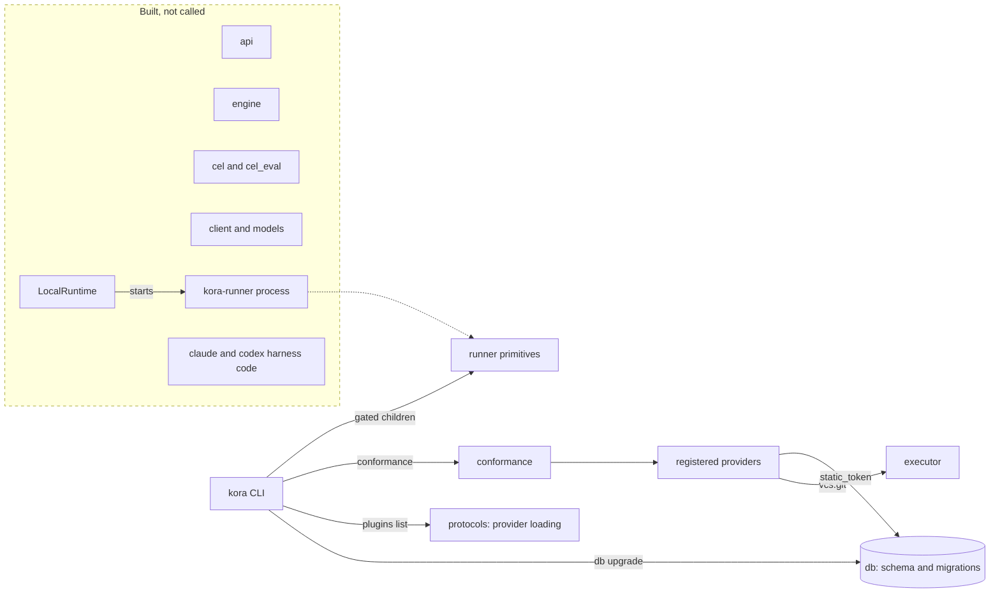

# kora today: the current architecture

Start every task here. This page says what exists on `master`, what runs, what is still only designed, where the trust boundaries are drawn, and which specification and decision records to read next. It is a map, not a contract: the [decision records](../../docs/decisions/README.md) and [specifications](../README.md) govern, and a decision record wins over a specification. Words that look ordinary but have a kora-specific meaning are in the [glossary](detailed.md#glossary).

Checked against `master` at commit `12e1912` on 2026-11-12. Statements about what runs come from the code at that commit, not from the specifications. Sections [2](#2-what-runs-today) and [5](#5-the-walking-skeleton-and-the-first-slice) change most often; when they disagree with the code, the code is right and this page is stale.

## 1. What kora is

kora is a control plane that runs graphs of coding-agent sessions. A graph mixes agent sessions, commands, human approvals and waits for external events. kora keeps their dependencies, results, cost and recovery state durable, so a run survives restarts and its history stays inspectable. The [technical introduction](../../docs/technical-introduction.md) explains the designed core: the API, scheduler and workers, the runtime and harness boundary, and one run from start to finish.

The design has three main processes over one metadata database:

- the **API** is the single implementation of every operation; the CLI, MCP servers and web console are thin clients over it ([ADR-0002](../../docs/decisions/0002-ai-first-api-and-thin-clients.md));
- the **scheduler** is a loop over durable state that decides which work may start and which waits are over ([ADR-0001](../../docs/decisions/0001-own-control-plane.md));
- **workers** claim attempts through the HTTP API and drive a runtime, which supervises the agent or command ([ADR-0003](../../docs/decisions/0003-scheduler-and-workers-over-http.md), [ADR-0016](../../docs/decisions/0016-trusted-execution-and-publication.md)).

Extension points are eleven provider protocols discovered through one entry-point group ([ADR-0005](../../docs/decisions/0005-eleven-protocols-with-conformance-suites.md)). Packages under `src/kora` follow a fixed import table ([ADR-0026](../../docs/decisions/0026-package-layers.md), [package layers](detailed.md#package-layers)).

## 2. What runs today

**No graph runs end to end.** The control-plane pieces that would run one exist only partly, and nothing connects them into a process yet. The packages that exist are foundations with their own tests.

This page uses three statuses:

- **Used**: an installed command or a registered provider entry point runs this code.
- **Built, not called**: the code and its tests exist, but no command, entry point or used package calls it yet.
- **Designed only**: specified, with no package under `src/kora`.

### Installed commands

`pyproject.toml` installs two console scripts.

| Command | What it does |
|---|---|
| `kora --version` | Prints the package version (`0.1.0.dev0`). |
| `kora db upgrade` | Applies pending Alembic migrations to the database named by `KORA_DATABASE_URL`, SQLite or PostgreSQL. |
| `kora plugins list` | Lists installed providers from the `kora.provider` entry points without constructing them. Discovery runs in a separate gated child process. |
| `kora conformance <protocol> <name>` | Runs the conformance suite against an installed provider in an isolated pytest child, with a parent that owns every local resource it creates. `kora conformance cleanup <invocation id>` resumes an interrupted cleanup. Needs the `kora[conformance]` extra. |
| `kora-runner` | The per-attempt supervisor process of the local runtime. It runs only inside an attempt directory that `LocalRuntime` prepares, and `LocalRuntime` starts it as `python -I -m kora.plugins.runtime.local.supervisor`, not through this script. Since only tests construct `LocalRuntime`, nothing outside tests starts a runner yet. |

The CLI uses no API client: none of these commands talks to the HTTP API.

### HTTP API

`kora.api.application.create_application` builds a FastAPI application with exactly two routes, `GET /healthz` and `GET /api/v1/openapi.json`; its route catalog refuses any other inventory. Nothing under `src` serves it: there is no listener and no command that starts an API process, and the ASGI server is a development dependency used by tests. The web frontend build is packaged into the wheel but not mounted.

### Registered providers

`kora plugins list` prints nine providers, all from this repository:

| Entry point | Provider |
|---|---|
| `authentication.static_token` | bearer tokens of users and of worker services, checked against the `api_token` table |
| `artifact_storage.local` | content-addressed local filesystem storage |
| `artifact_type.agent_session`, `artifact_type.command_result`, `artifact_type.structured_output`, `artifact_type.vcs_ref` | the four built-in artifact types, revision 1 |
| `policy.allow_deny` | the reference tool-call policy |
| `secrets.env` | secrets from environment variables |
| `vcs.git` | Git checkout and local bare-repository publication |

No runtime, harness, approval-channel, sensor or observability-exporter provider is registered. Outside tests, `kora plugins list` reads their metadata and only `kora conformance` constructs them.

### Absent packages

The [package layer table](detailed.md#package-layers) lists packages that do not exist yet: `scheduler`, `worker`, `dsl`, `mcp`, `mcp.stdio`, `plugins.approval`, `plugins.sensor` and `plugins.exporter`, and the composition roots `kora.standalone` and `kora.testing`. There is therefore no `kora standalone`, `kora compile`, `kora test`, `kora deploy`, `kora trigger`, `kora approve` or MCP server. `kora doctor` checks the kora version, the CEL binding, the metadata database and the default state root ([#1420](https://github.com/realkarych/kora/issues/1420)); its harness check is pending [#1419](https://github.com/realkarych/kora/issues/1419).

### Size

`src/kora` holds 446 Python modules and about 100,500 lines. The metadata schema has 39 tables and 22 migrations. Loading the commands above at run time reaches none of `kora.api`, `kora.engine`, `kora.cel`, `kora.cel_eval`, `kora.client`, `kora.models` or the harness packages.

## 3. How the existing pieces connect

Solid arrows outside the dashed box are calls made by installed commands. The dashed box and the dashed arrow show code that is built and tested but that no command or entry point calls; only tests run it.

## 4. Components

Each row names the package under `src/kora`, what it does today, its status, and the contract to read before changing it. The ADR-0026 package layer table lists what each package may import.

### 4.1 Shared foundations

| Package | What it does today | Status | Contract |
|---|---|---|---|
| `observability` | One structured-logging bootstrap per process: bound component loggers, a typed event catalog, a bounded queue drained by a writer thread, JSON or text rendering, control-character escaping, truncation and secret masking. Settings come from `KORA_LOG_*`. There is no OpenTelemetry exporter. | Used by `kora`, the plugin-listing child and the conformance child; the runner process configures it too. | [observability](../specs/observability.md), [component activation](../specs/observability.md#7-component-coverage-and-activation) |
| `protocols` | Provider protocol classes and their boundary models for eight of the eleven protocols: runtime, harness, VCS, secrets, artifact storage, artifact type, authentication and policy. Approval channel, sensor and observability exporter exist only as protocol names. Also provider metadata and loading, deadline and time types, process identity, secret values and the conformance-lifetime records. | Used. | [common rules](../specs/protocols.md#1-common-rules), [provider loading](../specs/protocols.md#provider-loading-issue-150), [protocol models](../specs/protocols.md#protocol-model-contracts-issue-134), [ADR-0005](../../docs/decisions/0005-eleven-protocols-with-conformance-suites.md) |
| `ir` | Pydantic models of the graph document (`GraphDocument`), about 25 validation passes that produce `IR0xx` diagnostics, JSON Schema preparation and checks for saved type contracts, and the value types of the four built-in artifacts. There is no YAML reader in `src` and no `kora validate`. | Partly used: provider configuration schemas, artifact values, `ToolPolicy`, `VcsRef` and cost types are loaded by commands; the document model and validators are called only by `api` and `engine`. | [document layout](../specs/ir.md#2-document-layout), [validation rules](../specs/ir.md#10-validation-rules-kora-validate), [shared diagnostics](../specs/diagnostics.md), [ADR-0006](../../docs/decisions/0006-graph-definition-dsl-and-yaml-representation.md), [ADR-0027](../../docs/decisions/0027-bounded-effective-schema-validation.md) |
| `cel` | kora's own CEL lexer, parser, schema-driven type checker, cost estimate, canonical rendering and projection paths. It never imports the CEL binding. | Built, not called. | [expressions](../specs/ir.md#7-expressions-and-templates), [schema-driven checker](../specs/ir.md#74-schema-driven-checker) |
| `cel_eval` | Evaluates checked expressions through the pinned `common-expression-language` binding (the optional `kora[cel]` extra) on a dedicated thread, after checking the installed distribution's files against its record. The only importer of the binding. | Built, not called. | [expressions](../specs/ir.md#7-expressions-and-templates), [CEL stack row](detailed.md#stack-per-component) |
| `models` | API error codes `API001`–`API013` and the structured error envelope. Request, response and worker-route bodies are not written yet. | Built, not called. | [structured errors](../specs/api-and-agent-surface.md#structured-errors-fr-04) |
| `client` | The shared `httpx` client with its own direct network backend. It refuses proxies, allows plain HTTP only to literal `127.0.0.1`, requires a bearer token and decodes structured errors. Its one public operation reads the OpenAPI document. | Built, not called. | [conventions](../specs/api-and-agent-surface.md#1-conventions), [ADR-0002](../../docs/decisions/0002-ai-first-api-and-thin-clients.md) |

### 4.2 Control-plane side

| Package | What it does today | Status | Contract |
|---|---|---|---|
| `db` | SQLAlchemy Core schema of 39 tables, 22 Alembic migrations, and a `Database` with writer, reader, snapshot and migration units on SQLite (`aiosqlite`) and PostgreSQL (`asyncpg`, the `kora[postgres]` extra). Bounded read functions, token revocation, bootstrap issuance, retention snapshots and graph-deployment read projections. | Partly used: `kora db upgrade` and the `static_token` provider. | [entities](../specs/data-model.md#2-entities), [SQLite and PostgreSQL](../specs/scheduler.md#10-standalone-sqlite-versus-postgres), [migrations](../specs/scheduler.md#14-migrations-nfr-72) |
| `engine` | Transaction-scoped transition and preparation functions over `db`: run and scope locks; graph-version identity and execution-contract checks; graph preparation admission, publication outcome and stage promotion; manual start with replay, capacity check, parameter cut and run materialization; pending-run cancellation; atomic manual pending promotion with writer-owned read admission and marker-independent bounded discovery; completion and retry decisions; outcome and deadline records. There are no approval or worker-report transitions and no retention task. | Built, not called. Only `api` modules import parts of it, and fourteen of its modules are imported by tests only. | [execution backend boundary](../specs/scheduler.md#12-execution-backend-boundary-nfr-55), [immutable contracts](../specs/data-model.md#11-immutable-contracts-and-execution-records-adr-0018), [run acceptance](../specs/data-model.md#13-run-acceptance-and-execution-capacity-adr-0020), [original outcomes and deadlines](../specs/data-model.md#16-original-outcome-and-full-deadline-persistence-545), [ADR-0001](../../docs/decisions/0001-own-control-plane.md) |
| `api` | `create_application` with the two routes of [section 2](#http-api), dispatch middleware that authenticates the schema route through an injected authenticator, and structured error responses. The package also holds graph deployment and publication preparation and CEL rendering checks that no route uses yet. | Built, not called; tests build and serve it. | [initial ASGI application](../specs/api-and-agent-surface.md#initial-asgi-application-issue-541), [first graph publication](../specs/api-and-agent-surface.md#first-graph-publication), [operations](../specs/api-and-agent-surface.md#2-resources-and-operations) |
| `plugins.authentication.static_token` | Parses `Authorization: Bearer`, hashes the token and looks it up in `api_token`, refusing revoked or expired tokens; can revoke a token. It returns the stored principal, user or service; telling the two apart for an operation is the API's authorization. | Constructed only by `kora conformance`; `kora plugins list` reads its metadata. No HTTP route uses it. | [authentication](../specs/protocols.md#10-authentication-fr-124-nfr-44), [static-token provider](../specs/protocols.md#static-token-provider-issue-506), [ADR-0011](../../docs/decisions/0011-namespaces-and-personal-tokens.md) |
| `plugins.storage` | The `local` artifact storage: SHA-256 content addresses, write into a stage, seal, create-only promotion, reads and range reads, deletion and a bounded inventory scan, with private SQLite bookkeeping in `control.sqlite`. There is no S3 provider. | Constructed only by `kora conformance`; `kora plugins list` reads its metadata. | [artifact storage](../specs/protocols.md#7-artifact-storage-fr-44), [local provider contract](../specs/protocols.md#74-local-provider-implementation-contract-issue-255), [storage contracts](../specs/protocols.md#artifact-storage-contracts-issue-229) |
| `plugins.artifact_type` | `AgentSession`, `CommandResult`, `StructuredOutput` and `VcsRef`, each revision 1: binding checks, payload validation, digest fields and summaries. | Constructed only by `kora conformance`; `kora plugins list` reads its metadata. | [artifact type](../specs/protocols.md#8-artifact-type-fr-4143), [revision catalogue](../specs/artifacts/README.md) |

### 4.3 Execution side

| Package | What it does today | Status | Contract |
|---|---|---|---|
| `runner` | Process and state primitives for Linux and macOS: process identity (host, boot session, PID namespace, PID, start time, group leadership) read from `/proc` or macOS system calls; gated child launch through `kora.runner.gate`; a per-attempt registry with locked entries; kernel peer attestation of Unix-socket peers; bounded framed channels; descriptor-anchored private files; an append-only journal; tool-call and usage ledgers for harness enforcement. | Used by `kora plugins list` and `kora conformance` for gated child processes and their lifetime helpers; the runner process uses it too. | [local runtime](../specs/protocols.md#local-runtime-issue-123), [local runtime contracts](../specs/protocols.md#local-runtime-contracts-issue-123), [startup I/O](../specs/startup-io.md) |
| `plugins.runtime.local` | `LocalRuntime`, the parent side, can open its private state root, submit an attempt, report status, start, transfer files in and out, retire an attempt that never started running, and close. Each attempt gets a detached runner process in its own session, registered in a file registry under the state root and controlled over a Unix socket that both sides attest. The runner executes only a narrow command workload: no harness session, publication, deadline, limits, environment, secrets, artifacts or resources. Adoption, events, heartbeats, log and transcript reads, finalization, cancellation, recovery and release are not implemented. The `bound_native_*` modules construct the Codex native launch. | Built, not called. Only tests construct `LocalRuntime`, so runner processes also start only under tests; the installed `kora-runner` script is not used to start them. The Codex launch modules are used only by tests. No provider entry point. | [runtime](../specs/protocols.md#2-runtime-fr-81), [local runtime](../specs/protocols.md#local-runtime-issue-123), [local-runtime seam](../specs/conformance-lifetime.md#local-runtime-seam), [ADR-0016](../../docs/decisions/0016-trusted-execution-and-publication.md), [ADR-0017](../../docs/decisions/0017-execution-uncertainty-and-safe-replacement.md) |
| `executor` | The plan executor: runs a VCS provider's `CheckoutPlan` and `PublishPlan` steps as bounded subprocesses, then exports, seals, inspects (secret-pattern scan and protected paths), authorizes and publishes. It runs in the calling process. | Used through `kora conformance` for `vcs.git`; no runner or worker builds it. | [executor and slice-1 Git provider](../specs/protocols.md#executor-and-slice-1-git-provider-issue-159), [credential-free local publication](../specs/protocols.md#credential-free-local-publication), [ADR-0016](../../docs/decisions/0016-trusted-execution-and-publication.md) |
| `plugins.vcs.git` | Checkout and publish plans, head reads through `git ls-remote`, inspection sources and credential-free local credentials. Remotes are local bare repositories given as absolute paths or `file://` URLs. Needs Git 2.43.0 or newer, and `prlimit` on Linux. There is no code-host client. | Used by `kora conformance`. | [VCS](../specs/protocols.md#4-vcs-fr-52), [local publication](../specs/first-slice.md#local-publication), [ADR-0023](../../docs/decisions/0023-code-host-identity-and-purpose-scoped-credentials.md) |
| `plugins.policy.allow_deny` | Decides one tool call against two layers of allow and deny patterns and the protected paths. Shell commands are parsed, with indirection detection; file edits are checked lexically and after resolving links; other tools by name. Evaluation has a fixed work budget. | Constructed only by `kora conformance`; `kora plugins list` reads its metadata. Nothing in `src` connects it to a session yet. | [policy](../specs/protocols.md#12-policy-dd-29), [the `allow_deny` policy](../specs/protocols.md#the-allow_deny-policy-issue-233), [ADR-0009](../../docs/decisions/0009-target-repository-trust-boundary.md) |
| `plugins.secrets` | The `env` provider resolves `secret://env/NAME` from the process environment when the name matches a namespace prefix and is not in a reserved family such as `KORA_`. Resolution requires a sealed request digest. | Constructed only by `kora conformance`; `kora plugins list` reads its metadata. | [secrets](../specs/protocols.md#6-secrets-fr-101) |
| `plugins.harness.claude` | A Claude Agent SDK session driver: it builds the SDK options with the runtime launcher as the CLI path and a `PreToolUse` hook that returns the caller's allow or deny decision, runs scripted sessions, normalizes events and replays recorded streams. It is not a `HarnessAdapter` yet. Needs the `kora[claude]` extra. | Built, not called. | [harness adapter](../specs/protocols.md#3-harness-adapter-fr-21-fr-33-fr-66-fr-91-dd-27), [Claude adapter contracts](../specs/protocols.md#claude-adapter-contracts-issue-125), [ADR-0004](../../docs/decisions/0004-harness-adapters-over-vendor-sdks.md), [ADR-0028](../../docs/decisions/0028-optional-claude-sdk-stack.md) |
| `plugins.harness.codex` | Launch construction for `codex app-server` and `codex exec-server`, a JSON-RPC client for the app-server, startup checks, turn observation and usage. Tool policy goes through a managed `preToolUse` command hook; #1356 records that a hook that itself fails lets the call run. The client refuses every request the server initiates, including approval requests. It is not a `HarnessAdapter` yet. | Built, not called. [#1360](https://github.com/realkarych/kora/issues/1360) moves the policy decision point to native app-server approvals. | [Codex execution profile](../specs/codex-execution-profile.md), [harness adapter](../specs/protocols.md#3-harness-adapter-fr-21-fr-33-fr-66-fr-91-dd-27), [ADR-0004](../../docs/decisions/0004-harness-adapters-over-vendor-sdks.md) |

### 4.4 Composition roots, tooling and tests

| Package | What it does today | Status | Contract |
|---|---|---|---|
| `kora.__main__`, `cli` | The composition root: configures process logging, builds the Typer application, maps interrupts, usage errors and unhandled errors to exit codes 130, 2 and 70, and runs plugin discovery in a gated child. | Used. | [CLI](../specs/api-and-agent-surface.md#3-cli-fr-122), [installed provider listing](../specs/protocols.md#installed-provider-listing-issue-248) |
| `conformance` | `kora conformance`: a parent that owns every local resource through a journaled helper process, a pytest child that loads the provider and runs the common cases and the protocol's own cases. Supports authentication, runtime (common cases only), secrets, policy, harness, VCS, artifact storage and artifact type. | Used. | [conformance suites](../specs/protocols.md#13-conformance-suites-nfr-102), [local conformance command](../specs/protocols.md#local-conformance-command), [lifetime ABI](../specs/conformance-lifetime.md) |
| `plugins.harness.fake`, `plugins.vcs.fake` | `FakeHarness` implements `HarnessAdapter` by playing a scripted session through the policy and the runner's limit helpers. `DirVcs` is a directory-backed VCS. Provider loading refuses both; tests construct them. | Tests only, by design. | [fakes](../specs/fakes.md), [fakes never reach a serving process](../specs/fakes.md#2-fakes-never-reach-a-serving-process) |
| `web/` | A React, TypeScript and Vite placeholder page with browser smoke checks. Its build lands in the wheel under `kora/api/static`. | Not served. | [web console](../specs/api-and-agent-surface.md#6-web-console-fr-73-fr-115-nfr-131), [ADR-0015](../../docs/decisions/0015-web-console-design.md), [console design](../design/console/pages.md) |

### 4.5 Designed only

| Component | Where it is specified | Owner |
|---|---|---|
| Scheduler: tick, readiness, admission, waits, leases, deadlines | [scheduler](../specs/scheduler.md#2-the-scheduling-loop) | work item 10 |
| Worker: claims, heartbeats, request sealing, reports and uploads | [worker route bodies](../specs/api-and-agent-surface.md#worker-route-bodies-issue-139), [ADR-0003](../../docs/decisions/0003-scheduler-and-workers-over-http.md) | work item 17 |
| Graph and run operations on the API, with CLI and MCP parity | [operations](../specs/api-and-agent-surface.md#2-resources-and-operations), [parity checklist](../specs/api-and-agent-surface.md#7-parity-checklist-fr-03-release-gate) | work items 11, 12, 18, 19 |
| Python DSL, `kora compile` and `kora test` | [DSL](../specs/dsl.md), [fakes and the testing composition](../specs/fakes.md) | after the first slice |
| MCP servers | [MCP servers](../specs/api-and-agent-surface.md#4-mcp-servers-fr-01-dd-28) | work item 11 |
| `kora standalone` and the `kora doctor` harness check | [first slice](../specs/first-slice.md), [deployment shapes](detailed.md#deployment-shapes) | work item 20, #214, #1419 |
| CLI approval channel, sensors, notifications | [approval channel](../specs/protocols.md#5-approval-channel-fr-71-fr-72a), [sensor](../specs/protocols.md#11-sensor-fr-23-fr-62-dd-2), [ADR-0025](../../docs/decisions/0025-notifications.md) | work items 8 and 16; sensors and notifications later |
| Docker runtime, S3 storage, code-host integration | [runtime](../specs/protocols.md#2-runtime-fr-81), [storage implementations](../specs/protocols.md#73-implementations-and-activation), [ADR-0023](../../docs/decisions/0023-code-host-identity-and-purpose-scoped-credentials.md) | after the first slice |

Work-item numbers refer to the [implementation plan](../../docs/implementation-plan.md#6-work-items).

## 5. The walking skeleton and the first slice

This section changes most often. It summarizes the owner decisions of 2026-11-11 in [#1356](https://github.com/realkarych/kora/issues/1356); the documents linked below are the authority.

**The walking skeleton** is an intermediate milestone of the first slice, reached before the first-slice gates apply: one graph is deployed, triggered through the CLI and the HTTP API, advanced by a scheduler tick, claimed by a worker over HTTP, runs an agent node on the fake harness and a command node on the local runtime, waits for an approval through the CLI and completes, on SQLite. Only the depth of each component is simplified. Apart from the narrowing the first-slice contract records, the walking-skeleton amendment weakens or removes no first-slice gate. Read:

- the [walking-skeleton amendment of ADR-0001](../../docs/decisions/0001-own-control-plane.md#walking-skeleton-amendment-of-2026-11-11) for the decision, including what pauses until the skeleton runs;
- the [walking-skeleton steps of the implementation plan](../../docs/implementation-plan.md#walking-skeleton) for each step, its depth, its owning work item and its order;
- the [walking skeleton and narrowed depth](../specs/first-slice.md#walking-skeleton-and-narrowed-depth) section of the first-slice contract for the skeleton's depth and the narrowed first slice: live-session adoption stays required outside the skeleton, local process identity uses the process group and start time, startup durability, isolated crash and diagnostic file I/O and macOS native qualification of the runner move out, and `kora doctor` is minimal.

**The first slice** is defined by ADR-0001 and the first-slice contract:

- `kora standalone` on SQLite is the only deployment;
- exactly one sequential chain: agent, then a command gate, then a human-input approval through the CLI;
- the agent runs on Claude through the Agent SDK and, independently, on Codex through the app-server;
- a manual trigger, the local runtime, and publication of a `VcsRef` to a local bare Git repository;
- branches, fan-out, subgraphs, event waits, timers, other triggers, retries, USD budgets, node skills, hooks, subagents, MCP servers and repository trust are refused before side effects.

Further owner decisions of 2026-11-11 reach the slice through their own sub-issues and are not yet in the documents they change:

| Decision | Sub-issue |
|---|---|
| Codex's fail-closed tool-policy decision point becomes native app-server approval requests under an untrusted project. | [#1360](https://github.com/realkarych/kora/issues/1360) |
| A second slice showing the outer loop, then the pilot, come before the scheduler-prototype milestone and the second runtime and VCS pair. | [#1359](https://github.com/realkarych/kora/issues/1359) |

## 6. Trust boundaries as currently specified

The [threat model](../../docs/threat-model.md) is the authority. Its controls are design obligations, and it records separately which of them have executable evidence; most product controls are still pending implementation. The table below names the main boundaries and their controls only. Each threat-model row also states residual limits and deployment conditions, and the threat model draws further boundaries, such as candidate access to model and MCP services and artifact downloads. Map a change to threat IDs in the threat model itself. The component tables above say how much of each package exists.

| Boundary | What crosses it and what protects it | Records |
|---|---|---|
| API caller to API | Personal bearer tokens bound to a person and a namespace list, with the `approve` and `platform` flags and a per-namespace `transcripts` capability. Every by-id route joins on the caller's namespaces. CLI, MCP and console gain no rights of their own. First-slice standalone binds only to literal `127.0.0.1` and still authenticates; loopback is not containment from other code running as the same user. | [ADR-0011](../../docs/decisions/0011-namespaces-and-personal-tokens.md), [ADR-0002](../../docs/decisions/0002-ai-first-api-and-thin-clients.md); TM-01, TM-02 |
| Worker to API | A service principal bound to a runtime and namespaces. Reports are fenced by the attempt's lease epoch. Workers hold no database credentials. In `kora standalone` the worker is a coroutine in the same process as the API, so there this is code structure, not containment. | [ADR-0003](../../docs/decisions/0003-scheduler-and-workers-over-http.md), [ADR-0017](../../docs/decisions/0017-execution-uncertainty-and-safe-replacement.md); TM-09 |
| Graph author to control plane | The author's Python runs only in the author's process; the API receives compiled IR. CEL is parsed and checked by kora's own code under fixed limits and a cost estimate, and the binding only evaluates the checked rendering. Templates use sandboxed Jinja2. The threat model records that these limits do not establish resource-exhaustion protection for a shared API or scheduler process. | [ADR-0002](../../docs/decisions/0002-ai-first-api-and-thin-clients.md), [ADR-0006](../../docs/decisions/0006-graph-definition-dsl-and-yaml-representation.md); TM-04 |
| Target repository to harness and commands | The repository is untrusted by default: hermetic harness configuration, `trust_repo_config: false`, protected paths, one `tool_policy` decided by the policy provider from the harness's pre-tool-call hook, and fail-closed rules for secrets in agent sessions. | [ADR-0009](../../docs/decisions/0009-target-repository-trust-boundary.md); TM-03, TM-06, TM-08 |
| Candidate execution to trusted supervisor | The harness, commands, tools and their descendants form the candidate domain. The supervisor owns the journal, plans and checkpoints; it stops the whole candidate domain, seals an immutable handoff and inspects the exact result before publication is authorized. A protected runtime enforces this separation; on `local` it is lifecycle structure only and gives no protection from hostile code running as the same user. | [ADR-0016](../../docs/decisions/0016-trusted-execution-and-publication.md); TM-05, TM-11 |
| Trusted code to code host | Credentials are acquired per purpose (`checkout`, `publish`, `api`) by trusted code when needed, the publication credential only after inspection. kora acts under a stable bot principal that cannot count as an approver. | [ADR-0023](../../docs/decisions/0023-code-host-identity-and-purpose-scoped-credentials.md), [ADR-0008](../../docs/decisions/0008-content-bound-approvals.md); TM-05, TM-08 |
| Scheduler to external services | Sensor reads and approval delivery run outside database transactions with finite budgets, and their results apply only to the current owner. Installed providers are trusted cooperative code, not sandboxed. | [ADR-0021](../../docs/decisions/0021-external-observations-outside-transactions.md); TM-10, TM-12 |
| Contributors and dependencies to the installation | Provider entry points are validated and loaded selectively; fakes are refused by provider loading and kept out of serving processes by the import rule for static and literal imports, with the run-time proof still a pending contract, and installed providers remain trusted code that could still import one; dependencies are locked; CI and agent-instruction changes are reviewed. | [ADR-0005](../../docs/decisions/0005-eleven-protocols-with-conformance-suites.md), [ADR-0026](../../docs/decisions/0026-package-layers.md); TM-12 |

The operator, the host and installed providers are trusted. Package layers are a packaging rule, not an isolation control.

**Code inside one kora process is not a trust boundary.** [Data-model principle 7](../specs/data-model.md#1-principles) states that code inside kora's own process, and the metadata database that process owns, is not a trust boundary. The principle does not relax the one-writer path for workers, and it does not weaken checks on API requests, worker requests (including the standalone in-process transport), candidate output, target-repository content or external provider responses. Stored content that arrived through those boundaries keeps its validation and read bounds. kora does not re-verify the schema its own migrations create, such as relation layout, indexes, triggers or foreign-key actions. Checks that only re-verify that migration-created structure, and that the data model still describes, are removed when their code next changes. The [threat model](../../docs/threat-model.md) does not state this rule. Open [#1362](https://github.com/realkarych/kora/issues/1362) is the record for adding it there.

## 7. Where to read next

1. For a specific change, find the task in the [task index](../README.md#current-contracts-by-task) and load only the sections it names.
2. Read the decision records those sections cite; they govern.
3. For component maps, deployment shapes, the stack and unresolved mechanics, use the [architecture reference](detailed.md).
4. For implementation order and owners, use the [implementation plan](../../docs/implementation-plan.md) and the [roadmap](../../docs/roadmap.md). Both describe the walking skeleton; the remaining decisions of #1356 listed in [section 5](#5-the-walking-skeleton-and-the-first-slice) reach them through their own sub-issues.
5. For how changes are made and verified, read [AGENTS.md](../../AGENTS.md) and the [development guide](../../docs/development.md).
