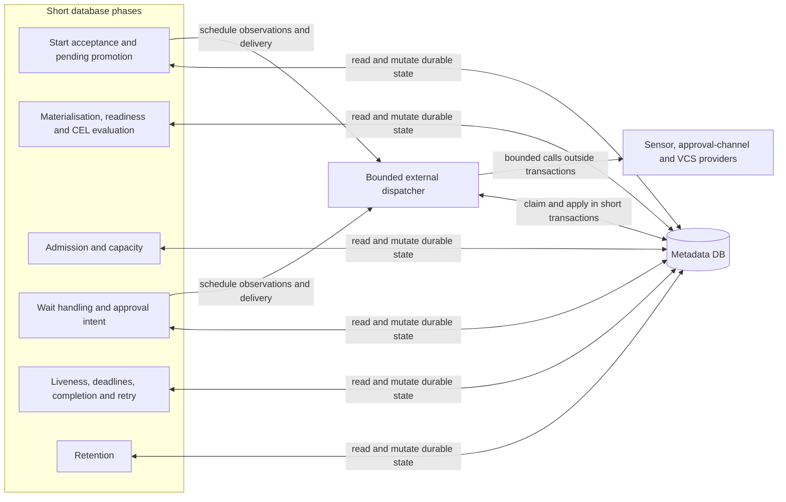
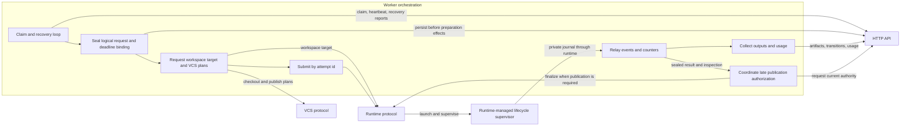
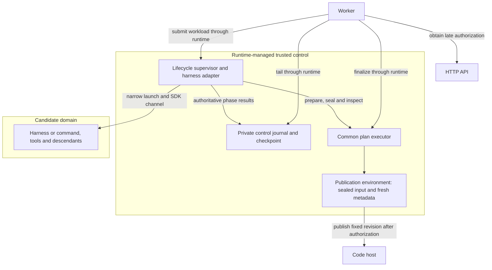
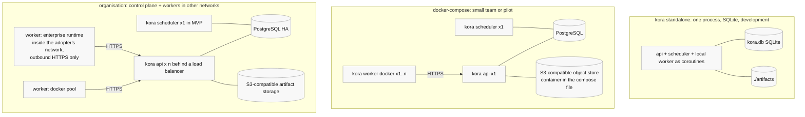

# kora architecture reference

Status: non-normative reference, consolidated against the specifications and ADRs through ADR-0022 on 2026-10-17. The editorial consolidation is pending owner review in [issue #76](https://github.com/realkarych/kora/issues/76). These are planned components; diagrams and named conformance gates are not implementation evidence.

Start with the [technical introduction](../../docs/technical-introduction.md). This reference keeps component and deployment views, the module/contract map, the stack inventory, canonical terms and unresolved implementation mechanics. For a change, use the [specification task index](../README.md#which-file-to-load-for-which-task), then the ADRs it cites. ADRs take precedence over specifications; neither is superseded by this reference.

## Components inside the scheduler

The diagram identifies responsibilities, not a prescribed pass schedule or lock implementation. [Durable discovery](../specs/scheduler.md#8-restart-and-multi-scheduler-safety) uses `needs_scheduling`; independent due-work scans remain active. [Branch selection](../specs/ir.md#45-branch-ownership-and-selection) gates direct targets, and [retry invalidation](../specs/data-model.md#6-clear-downstream-fr-68a) follows declared dependencies and composition ownership. The [loop](../specs/scheduler.md#2-the-scheduling-loop), [admission](../specs/scheduler.md#6-concurrency-limits-fr-610), [external dispatcher](../specs/scheduler.md#16-external-observation-dispatch-adr-0021) and [deadline guards](../specs/scheduler.md#17-inherited-deadline-enforcement-adr-0022) own the rules.

## Components inside a worker

The worker reports through the API; runtime-managed supervision enforces session limits. This collaboration view does not assign the unresolved price-table writer. [Runtime lifecycle](../specs/protocols.md#2-runtime-fr-81), [VCS plans](../specs/protocols.md#4-vcs-fr-52) and [immutable records](../specs/data-model.md#11-immutable-contracts-and-execution-records-adr-0018) define the handoffs. For interruptions, use [original-domain recovery](../specs/scheduler.md#3-submission-execution-uncertainty-and-recovery): lease expiry, cancellation and deadline expiry do not themselves prove closure or release reservations.

## Protected execution boundary

This is an authority view, not a fixed process layout. Protected runtimes keep control journals and publication credentials outside candidate authority; negotiated worker-host placement must preserve that boundary. The supervisor has no control-plane API credential. Local follows the lifecycle for trusted development without hostile-code isolation. The saved inherited deadline reaches every managed preparation/execution/publication placement. [ADR-0016](../../docs/decisions/0016-trusted-execution-and-publication.md), [ADR-0022](../../docs/decisions/0022-inherited-execution-deadlines.md) and the [runtime conformance gates](../specs/protocols.md#13-conformance-suites-nfr-102) define and test the guarantees.

## Deployment shapes

These layouts use the same scheduling code and schema. [Standalone](../specs/scheduler.md#10-standalone-sqlite-versus-postgres) changes process layout, database driver and storage provider. The MVP uses one scheduler; [replication](../specs/scheduler.md#8-restart-and-multi-scheduler-safety) and aggregate external-call budgets require the stated future constraints.

## Module and contract map

Paths below are planned package locations from the stack decision, not a claim that implementation exists. Shared-component placement remains [open](#open-implementation-questions).

| Planned area | Contract to read before changing it |
|---|---|
| `src/kora/ir`, `src/kora/dsl` | [IR and validation](../specs/ir.md), [author-side compilation](../specs/dsl.md); the compiled schema is the API/scheduler boundary. |
| `src/kora/api` | [HTTP resources and errors](../specs/api-and-agent-surface.md#2-resources-and-operations); [scheduler entry points](../specs/scheduler.md#12-execution-backend-boundary-nfr-55); [persistence and state machines](../specs/data-model.md). |
| `src/kora/scheduler` | [Passes](../specs/scheduler.md), [capacity and locks](../specs/data-model.md#13-run-acceptance-and-execution-capacity-adr-0020), [waits and approvals](../specs/scheduler.md#5-waits-hold-no-worker-nfr-13). |
| `src/kora/worker` | [API-mediated claims/recovery](../specs/scheduler.md#3-submission-execution-uncertainty-and-recovery), [runtime workload](../specs/protocols.md#2-runtime-fr-81), [VCS plans](../specs/protocols.md#4-vcs-fr-52). |
| `src/kora/protocols`, `src/kora/plugins/<protocol>/` | [Provider metadata and loading](../specs/protocols.md#1-common-rules); core depends on protocols, implementations register through `kora.provider`. |
| `src/kora/cli`, `src/kora/mcp`, `web/` | [Shared API surface and parity](../specs/api-and-agent-surface.md); [console design](../../docs/console.md). |
| `conformance/`, `tests/` | [Provider conformance](../specs/protocols.md#13-conformance-suites-nfr-102), [testing rules](../../AGENTS.md#testing); [standalone parity](../specs/scheduler.md#10-standalone-sqlite-versus-postgres). |

Cross-component changes also consult the owners of [content-bound approvals](../../docs/decisions/0008-content-bound-approvals.md), [cost accounting](../../docs/decisions/0010-cost-accounting-and-limits.md), [redaction and secrets](../specs/protocols.md#6-secrets-fr-101), [metrics](../specs/scheduler.md#11-metrics-and-health-nfr-73) and [inherited deadlines](../../docs/decisions/0022-inherited-execution-deadlines.md). These links replace a second catalog of rules and future test names.

## Stack per component

The inventory is maintained under [AGENTS.md](../../AGENTS.md#code). *Decided* entries follow [ADR-0013](../../docs/decisions/0013-implementation-stack.md) and the cited decisions; *proposed* entries remain implementation candidates.

| component | stack | status | alternatives considered |
|---|---|---|---|
| Language and runtime | Python 3.11+ (NFR-11.1), `asyncio` throughout | decided | — |
| Packaging | monorepo: one distribution `kora` with extras (`kora[postgres]`, `kora[docker]`, `kora[otel]`); `uv` for dependency management and `hatchling` as build backend (kept over `uv_build` because the embedded web build needs a custom build hook); `src/` layout; the frontend lives in `web/` (pnpm) and its production build is embedded into the Python package at build time, so one `pip install` and one image carry everything | decided | Poetry; `uv_build`; multi-package workspace; separate frontend repository |
| Python build toolchain | uv-managed development and build groups; the Hatchling requirement is identical in the build-system and build group; no runtime dependencies or optional extras until their first consumer; exact pins and reasons in the [scaffold research](../research/repository-scaffold-and-ci-2026-10-18.md#python-implementation-record) | implemented scaffold under ADR-0013 | unpinned isolated backend resolution; unused runtime dependencies |
| Python source checks | Ruff formatting and linting, strict Pyright, pytest with strict configuration/markers and warnings as errors; exact pins in the [scaffold research](../research/repository-scaffold-and-ci-2026-10-18.md#python-implementation-record) | implemented scaffold under AGENTS.md; pytest follows ADR-0013 | separate formatter and import sorter; unchecked build sources |
| Scaffold build verification | Isolated, hash-constrained default sdist-to-wheel build; frozen offline frontend installation in the wheel hook, which fails the build when `index.html` references a missing asset; editable setup skips frontend tools | implemented scaffold under ADR-0013 and AGENTS.md; [development commands](../../docs/development.md) and [dated evidence](../research/repository-scaffold-and-ci-2026-10-18.md) | wheel-only builds that miss sdist omissions; installed-wheel and archive-content tests, removed under [issue #112](https://github.com/realkarych/kora/issues/112) |
| Continuous integration | Required three-lane Linux/macOS source/build matrix with pinned Python, Node, uv and pnpm; lockfile-keyed dependency-store caches; existing Markdown/link/Mermaid/schema/template jobs preserved; [workflow](../../.github/workflows/ci.yml) and [dated action/tool evidence](../research/repository-scaffold-and-ci-2026-10-18.md#ci-and-documentation-check-record) | implemented scaffold under AGENTS.md; complete-workflow budget requires measured run evidence | cached virtual environments; duplicate pnpm store caches; skipped build checks; per-job timeout as timing evidence |
| IR models and JSON Schema | Pydantic v2 models as the single definition; `model_json_schema()` publishes `ir.schema.json`; YAML read/write with `ruamel.yaml` (keeps comments for lock-file style output) | decided (ADR-0013) | PyYAML (no round-trip) |
| Expression language | CEL (DD-3) through the Rust-backed `common-expression-language` Python binding, plus kora's own schema-driven checker for the `inputs.*` environment and the CEL conformance suite in CI (`cel-python` has no static checking) | decided | `cel-python` |
| Prompt templates | Jinja2 `SandboxedEnvironment` (DD-11) | decided | — |
| HTTP API | FastAPI + Pydantic v2; OpenAPI published for the web client generator and the parity coverage test; NDJSON streaming for logs and events; segment and transcript uploads exempt from the 4 MB body limit; `uvicorn` | decided | Litestar; Django REST |
| Metadata DB access | SQLAlchemy 2.0 (Core + typed ORM) with `asyncpg` for PostgreSQL and `aiosqlite` for SQLite; Alembic migrations (`kora db upgrade`) | decided | raw SQL with `psycopg` 3; SQLModel |
| External observations | Existing scheduler async dispatcher; durable owner tokens and approval delivery metadata; unlocked calls with finite installation/resource/namespace budgets and current-owner apply | decided direction (ADR-0021); wording pending owner review | cooperative installed providers; process isolation deferred, no broker or worker-token expansion |
| Row claims and scheduler loop | PostgreSQL `SELECT … FOR UPDATE SKIP LOCKED` inside short transactions; SQLite: single-writer process with the same statements minus `SKIP LOCKED` | decided (scheduler.md §3, §10) | advisory locks; external queue (Redis) rejected: run state must live only in the DB (NFR-1.2) |
| Worker ↔ control plane | workers call the HTTP API only (register, claim, heartbeat with lease epoch, segment and artifact upload, state transitions) over outbound HTTPS with a service token; standalone uses the same client over an in-process ASGI transport | decided (current contract [ADR-0003](../../docs/decisions/0003-scheduler-and-workers-over-http.md)) | workers write SQL directly |
| API client | one hand-written `httpx` client that shares the Pydantic request and response models with FastAPI; used by the Typer CLI, the MCP tools and the worker; a contract test checks it against the OpenAPI document | decided (current contract [ADR-0002](../../docs/decisions/0002-ai-first-api-and-thin-clients.md)) | generated `openapi-python-client` |
| CLI | Typer (Click-based) over the shared client; `rich` for tables | decided | Click directly; argparse |
| MCP server | official `mcp` Python SDK 2.x, server class `MCPServer` (named `FastMCP` in 1.x), two curated servers (`kora-authoring`, `kora-operating`, 14 task-shaped tools incl. `kora_admin` for `platform`-flag operations) over the shared client; tools that start work return at once and waiting is the bounded `wait` option of `kora_runs` over the run read ([API section 2](../specs/api-and-agent-surface.md#bounded-run-read-wait-adr-0002)); skills stay files in the harness's own format; stdio process `kora mcp` and the same servers mounted on the API under `/mcp`, reaching it through the in-process ASGI transport (DD-18, DD-28; SDK and client facts in the [MCP Tasks probe record](../research/mcp-tasks-probe-2026-10-19.md), checked 2026-10-19) | decided (SDK: ADR-0013; surface: ADR-0002, amended 2026-10-19) | one generated tool per API operation; MCP Tasks (`io.modelcontextprotocol/tasks` extension), deferred until the official Python SDK implements it and Claude Code or Codex declares it |
| Policy | `allow_deny` reference implementation of the policy protocol, invoked by the session runner from harness pre-tool-call hooks (DD-29); Cedar (`cedar-python`) and OPA as plugins later | decided | harness-native allowlists only |
| Harness adapters | programmatic interfaces instead of CLI output (DD-27): Claude Agent SDK for Python (`claude-agent-sdk`) and a small kora client speaking the `codex app-server` JSON-RPC protocol directly over stdio (the Codex SDK exists only for TypeScript) in MVP; after MVP an ACP adapter (`agent-client-protocol` JSON-RPC over stdio) for OpenCode, Pi, Gemini and others, through the same protocol and conformance suite (ADR-0004); hosted entirely by the session runner inside the runtime, which is the sole enforcer of `max_events`, soft budget and `stall_after` from the SDK event stream; harness binaries fixed per installation image with the auto-updater off and a tested version range checked at worker start (DD-14) | decided | CLI JSONL parsing (`claude -p --output-format stream-json`, `codex exec --json`) |
| Local runtime | subprocess on the worker host with a per-attempt temp workspace | decided | — |
| Docker runtime | Docker Engine API through `aiodocker` (async); one logical attempt handle, candidate container and separate publisher container, host-side supervisor/control state, private sealed workspace transfer, egress through a candidate network without a direct route out and a small kora-owned forward proxy on `asyncio` streams that allows only the resolved domains (CONNECT and absolute-form HTTP), no new dependency; MCP servers holding secrets in sidecar containers of the attempt, reached over MCP's HTTP transport (ADR-0009, amended 2026-10-18); credential proxy as a sidecar after MVP (ADR-0004) | decided (ADR-0013, ADR-0016); proxy deferred | shelling out to the `docker` CLI (simpler, harder to test) |
| VCS (git) | `git` CLI via subprocess for trusted checkout, sealed object import/raw-tree preparation and fixed-revision push; code-host APIs via `httpx` (GitHub, GitLab) for change requests and status; GitHub App installation tokens issued in the control plane from a JWT signed with the App key (PyJWT with its `cryptography` backend, because `httpx` does not sign JWTs; ADR-0023) | proposed | dulwich/pygit2 (no benefit over the CLI for MVP) |
| Artifact storage | two implementations in MVP (FR-4.4, ADR-0005): `local`, a filesystem tree by digest, for standalone and development, and `s3` for any S3-compatible service through `obstore` (Rust-backed, async; GCS and Azure reachable through the same library), for organisation-scale storage operations; capacity is to be measured against the [load assumptions](../analysis/control-plane-load-estimate.md); docker-compose ships an S3-compatible object store | decided (2026-10-16) | `aiobotocore` (heavier, pins `botocore` versions); MinIO-only client |
| Secrets | env and file providers in MVP; Vault via `hvac` post-MVP | decided | — |
| Frontend (`kora web`) | React + TypeScript + Vite, built from a locked pnpm lockfile; TanStack Query for data; shadcn/ui (Tailwind) components; React Flow for the live graph view, laid out left to right by the ELK layered algorithm through its JavaScript build (`elkjs`), chosen because it lays out the fan-out and sub-graph frames as compound nodes (ADR-0015); TypeScript API client generated with `@hey-api/openapi-ts`; static SPA served by `kora api`; login exchanges the API token for an opaque server-side session cookie (`SameSite=Strict`, `Secure`), CSRF protection on cookie-authenticated mutations, CSP, and cookies never accepted on Bearer-only API paths (DD-19, current contract [ADR-0011](../../docs/decisions/0011-namespaces-and-personal-tokens.md)). MVP ships the full console of FR-7.3 (approvals, runs, live graph, attempts and their diff, live logs, cost, graphs and versions; [api-and-agent-surface.md](../specs/api-and-agent-surface.md) section 6), held to the user-experience bar of NFR-13.1; live views read the NDJSON `?follow=true` streams; graph editing is post-MVP; the console's design, its four actions and the data the API exposes for it are [docs/console.md](../../docs/console.md) and [ADR-0015](../../docs/decisions/0015-web-console-design.md) | decided | server-rendered Jinja2 + HTMX; Next.js; SvelteKit |
| Frontend scaffold dependencies | `react` and `react-dom` render the static shell; Vite and `@vitejs/plugin-react` provide development serving and production bundling into `src/kora/api/static`; TypeScript checks browser and build code with `@types/react`, `@types/react-dom` and `@types/node`; ESLint, `@eslint/js`, `typescript-eslint`, `globals`, `eslint-plugin-react-hooks` and `eslint-plugin-react-refresh` enforce JavaScript, typed TypeScript, browser/Node globals, hooks and refresh rules. Node and pnpm are pinned; the frozen pnpm lockfile and strict dependency build policy control installation. Exact versions and dependency-script evidence are in the [scaffold research](../research/repository-scaffold-and-ci-2026-10-18.md#frontend-implementation-record). Additional console libraries enter with their first consumers. | implemented scaffold under ADR-0013 and AGENTS.md | unused console dependencies; build-time TypeScript transpilation without separate checks; blanket dependency-script approval |
| Observability | OpenTelemetry Python SDK with OTLP exporter as the reference exporter, loaded in the control plane only and replaying the append-only event table (`invoke_workflow` per run, `invoke_agent` per attempt built from the session segments at finish, `gen_ai.conversation.id` = harness session id); `prometheus-client` for scheduler and worker metrics; `structlog` JSON logs | decided (ADR-0013) | vendor SDKs only (Langfuse, Datadog) without OTel |
| Plugins | one `kora.provider` entry-point group returning validated provider metadata with a `config_schema` per protocol; `kora plugins list`; no pluggy hook wrappers in MVP | decided (current contract [ADR-0005](../../docs/decisions/0005-eleven-protocols-with-conformance-suites.md)) | one entry-point group per protocol; pluggy |
| Authentication | `static_token` authenticator in MVP issuing personal bearer tokens: a user principal is bound to a person and a namespace list with the two flags `approve` and `platform` and a per-namespace `transcripts` capability; a service principal per worker is bound to a runtime and a namespace list; no roles or groups (DD-32, [protocols.md](../specs/protocols.md) §10); OIDC via `authlib` post-MVP behind the same `Principal` | decided | single shared API token; RBAC in MVP |
| Testing | `pytest` + `pytest-asyncio`; `hypothesis` for IR and compiler properties; `testcontainers` for PostgreSQL and an S3-compatible server on the Linux CI job, which has Docker (macOS CI runs the artifact storage suite on `local`); fake harness and fake runtime shipped as test fixtures (NFR-10.1); conformance suites as pytest plugins adopters run against their implementations | decided (ADR-0013) | — |
| Repo layout | `src/kora/{ir,dsl,api,scheduler,worker,protocols,plugins/{runtime,harness,vcs,…},cli,mcp}`; `web/` (Vite project, build output embedded into `src/kora/api/static` at package build); `docs/`; `examples/`; `tests/`; `conformance/` | decided | multi-package monorepo |

## Glossary

| term | meaning | not to be confused with |
|---|---|---|
| **run** | one instance of a graph version being carried out, from trigger to a terminal state; the API resource `run_…` | "execution" (not used) |
| **target** | the business object a run works on (a query, a dependency, a flaky test), named by the optional run-lifetime immutable `run.target_key` with namespace scope (ADR-0014/ADR-0019); several runs work on one target over time, and under `defer` one holds it at a time | the delivery key (`run.idempotency_key`), the attempt, a fan-out element |
| **attempt** | one runtime submission of a node instance; the unit of cost and of the `attempt` table | a sub-graph attempt |
| **execution domain** | non-reused identity of the runtime control-registry lineage; persisted before dispatch authority, retained through recovery and never reused by a replacement host/registry (ADR-0017) | a stable worker host name or process incarnation |
| **execution uncertainty** | old execution, dispatcher or publication may still act; original reservations/hold remain, last observation and evidence provenance are exposed | terminal `lost` or permission to retry |
| **dispatcher** | durable grant for one worker incarnation and attempt lease generation; closure atomically gates new dispatch and settles/fences in-flight operations | an API epoch alone or runtime termination receipt |
| **sub-graph attempt** | one pass over a sub-graph body under FR-2.7a; the `subgraph_attempt` integer on node instances; `max_attempts` on a subgraph counts these; `previous_attempt` is the input the next one receives | a runtime attempt |
| **node kinds** | `agent`, `command`, `human_input`, `wait_event`, `timer`, `branch`, `fan_out`, `subgraph`; always spelled this way | "fan-in", "approval node", "sensor node" |
| **SDK event stream** | the raw messages the harness emits inside the runtime: Claude Agent SDK messages, Codex app-server notifications or, after MVP, ACP agent updates | the normalised event stream |
| **normalised event stream** | kora's `{i, at, kind, data}` events written by the session runner to `private control journal`, uploaded as session segments | the opaque transcript |
| **tool_policy** | the single tool-call policy of a node (allow and deny patterns) with the namespace policy prepended, evaluated by the policy protocol | harness permission modes, `allowed_tools` (DSL sugar only) |
| **change request** | the code host's review object (GitHub pull request, GitLab merge request, the review object of an in-house code host); protocol-level text uses this term only | "PR" |
| **kora web** | the React web console served by `kora api`; "web console" in requirements | "approvals page", "UI", "dashboard" |
| **ir_version** | the IR format version (`1.0`), semver | `graph.version`, the author's own informational version string of a graph; `graph_version.number`, the control plane's sequence number assigned at deploy |
| **session runner** | kora's lifecycle supervisor: protected journal and phase checkpoint, harness adapter and candidate launcher, session limits, sealing/inspection and late authorized publication (ADR-0016); local follows the lifecycle in a trusted environment | the worker, which claims, requests plans, submits, relays and uploads |
| **plan executor** | kora's code that executes a `CheckoutPlan` or a `PublishPlan`: in a trusted runtime or private worker-host publication environment, as negotiated; never credentialed in candidate metadata | the VCS, which only returns plans |
| **graph version** | immutable deployed IR plus its resolved contract, identified as a version of a graph ([records](../specs/data-model.md#11-immutable-contracts-and-execution-records-adr-0018)) | the author's informational version string |
| **node instance** | one node occurrence in one run, including its fan-out/subgraph context ([identifiers](../specs/data-model.md#3-identifiers-and-keys)) | the reusable node definition |
| **artifact version** | one stored output version with availability and lineage ([entities](../specs/data-model.md#2-entities)) | a payload blob, which may be shared by digest |
| **wait** | durable waiting state for a timer, approval, event, poll, retry or admission ([waits](../specs/scheduler.md#5-waits-hold-no-worker-nfr-13)) | a worker occupied while waiting |
| **lease epoch** | monotonically advancing ownership generation fencing earlier worker reports ([recovery](../specs/scheduler.md#3-submission-execution-uncertainty-and-recovery)) | proof that old physical execution has stopped |
| **result authority** | permission to accept a current result, including current-attempt, desired-state and deadline guards ([authority](../specs/data-model.md#152-sticky-expiry-and-current-result-authority)) | permission to append bounded historical diagnostics |
| **inherited deadline** | saved minimum cutoff of the applicable node, subgraph and run clocks ([deadlines](../specs/scheduler.md#17-inherited-deadline-enforcement-adr-0022)) | evidence of termination at the nominal cutoff |
| **target hold** | independently acquired exclusion for a bound target, released only under its settlement rules ([capacity](../specs/data-model.md#13-run-acceptance-and-execution-capacity-adr-0020)) | immutable target identity |
| **provider** | an installed implementation of a kora protocol, discovered by entry point ([loading](../specs/protocols.md#1-common-rules)) | a graph node or scheduling policy |
| **workload** | the runtime submission containing plans, agent/command configuration, limits and inputs ([runtime](../specs/protocols.md#2-runtime-fr-81)) | the mutable candidate workspace |
| **WorkspaceRef** | the prepared workspace reference used by trusted executors ([VCS](../specs/protocols.md#4-vcs-fr-52)) | a published result |
| **VcsRef** | the typed published revision/change-request output ([VCS](../specs/protocols.md#4-vcs-fr-52)) | an unverified candidate branch |
| **ReviewBundle** | review facts and narrative whose bound digests identify approval evidence ([approval](../../docs/decisions/0008-content-bound-approvals.md)) | an approval automatically valid for later commits |
| **clear downstream** | transactional invalidation of declared data/control and composition dependencies; full clears become `pending`, child-only wrapper recollection becomes `running` ([lineage](../specs/data-model.md#6-clear-downstream-fr-68a)) | deletion of historical attempts and artifacts |
| **fake** | a real protocol implementation selected through configuration or injection and checked by conformance ([testing](../../AGENTS.md#testing)) | a mock or runtime patch |

## Open implementation questions

These are unresolved aspects of the repository design at the consolidation baseline, inherited from [issue #48](https://github.com/realkarych/kora/issues/48); they do not assert that the issue itself is open. The [dated audit](../research/architecture-documentation-consolidation-2026-10-17.md) preserves their original sources. Established constraints below remain binding while these mechanics are specified.

| Topic | Remaining question and established constraint |
|---|---|
| Shared packages | Where do the runner, plan executor, shared API client, persistence and shared validator live? The [stack layout](#stack-per-component) names only the main packages. |
| Run outcome | What complete predicate selects `succeeded` versus `failed` when work is settled? Compare [node/run terminality](../specs/data-model.md#4-state-machines) with the [completion pass](../specs/scheduler.md#2-the-scheduling-loop). |
| Price ownership | Which process writes `price_table_id`, derives `usd_estimate` and distributes the snapshot? [Snapshotting and derivation](../../docs/decisions/0010-cost-accounting-and-limits.md) are decided; [harness mappings](../specs/protocols.md#14-harness-mapping-tables-fr-33-dd-27) do not settle the handoff. |
| Timeout discovery and locking | How does per-row timeout discovery enter per-run mutation? [Deadline guards](../specs/scheduler.md#17-inherited-deadline-enforcement-adr-0022) already require run locking; broader pass ordering remains unspecified. |
| Budget ordering | Where do daily/run/subgraph budget checks sit relative to admission checks? [Scope lock order](../specs/scheduler.md#6-concurrency-limits-fr-610) and no reservation before all checks pass are fixed. |
| API/scheduler invocation | How does the API invoke shared transition entry points, and when does it call tick? The [three entry points](../specs/scheduler.md#12-execution-backend-boundary-nfr-55) and canonical start implementation are already decided. |
| Dry-run placement | Which process executes `trigger --dry-run` and how is it requested? [Fake execution](../specs/api-and-agent-surface.md#3-cli-fr-122) is specified; author-side compilation is a separate operation. |
| Health serving | How do scheduler and worker serve health/readiness/metrics? [NFR-7.3](../../docs/requirements/non-functional.md) requires them and [scheduler health](../specs/scheduler.md#11-metrics-and-health-nfr-73) specifies content, not serving placement. |
| Transition code ownership | How is the passes-only wording reconciled with [API-mediated worker reports](../specs/scheduler.md#3-submission-execution-uncertainty-and-recovery) and [finishing transitions](../specs/data-model.md#4-state-machines)? Reporting behavior is specified; internal delegation must be consistent. |
| Command inputs | Who materializes `.kora/inputs/*.json` for a runner executor? [IR command inputs](../specs/ir.md#4-node-kinds-and-their-config) name the worker; [executor placement](../specs/protocols.md#4-vcs-fr-52) must still respect workspace authority. |
| Digest mismatch errors | Which [error class](../specs/ir.md#6-retry-policy-and-strategy-fr-63-fr-64) represents a skill/MCP digest mismatch? Pinning and verification are required; this mapping is unspecified. |
| Skill delivery | Where is skill content read at deploy time and obtained at execution time? [ADR-0018](../../docs/decisions/0018-immutable-attempt-history.md) preserves identity/availability while deferring resource/skill transport. |
| Secret prefix ownership | Are allowed prefixes owned by [namespace policy](../specs/data-model.md#2-entities) or [provider configuration](../specs/protocols.md#6-secrets-fr-101)? Validation-time and resolution-time enforcement remain required. |
| Browser API bridge | How does the [cookie-authenticated console](../specs/api-and-agent-surface.md#6-web-console-fr-73-fr-115-nfr-131) invoke Bearer-only public operations through the generated client? Preserve server-side sessions, CSRF protection and the Bearer-only boundary; no route or token-exposure design is implied. |
| Mutation recovery in the browser | How does an unresolved logical action survive reload/login? [API idempotency](../specs/api-and-agent-surface.md#1-conventions) already requires the same key/body for retransmission and a fresh key for a new action; persistence and reconciliation are unspecified. |
| Selected-candidate evidence | How does the [canonical graph](../specs/examples/sql-optimization.ir.yaml) carry the selected candidate's exact equivalence/gate result versions into `ReviewBundle.facts`? ADR-0008 requires bound gate evidence; the current candidate/bundle inputs do not specify that assembly completely. Do not replace it with agent narrative or infer a passing gate from lineage alone. |
| Scheduling metric attribution | How are pre-submit preparation and dependencies-satisfied-to-ready time attributed? [NFR-3.1](../../docs/requirements/non-functional.md) and [scheduler section 9](../specs/scheduler.md#9-scheduling-latency-nfr-31) must retain the SLO, its exclusions and notification-disabled measurement requirement; the two existing metric intervals do not prove it. |
| Selection and focus | Which selection treatment remains distinct from the [keyboard focus ring](../design/console/tokens.md#node-geometry-and-zoom), including when both apply? The earlier identical outlines conflict with the distinct-state requirement; focus colour comes from the tokens, not a separate page-level accent rule. |
