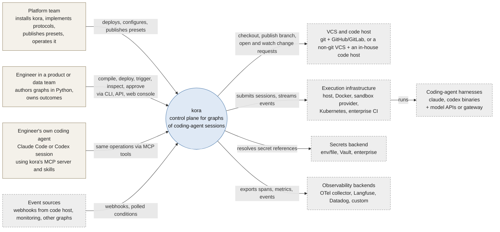
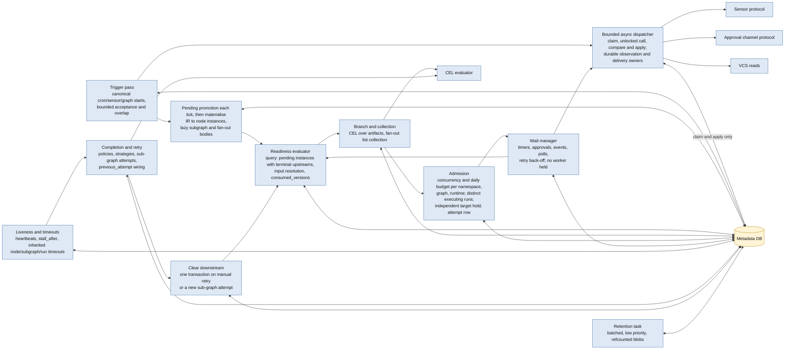
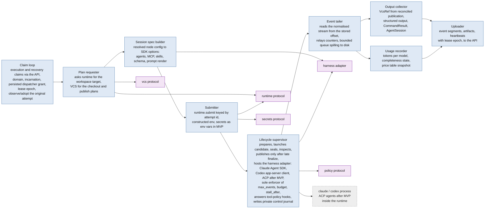
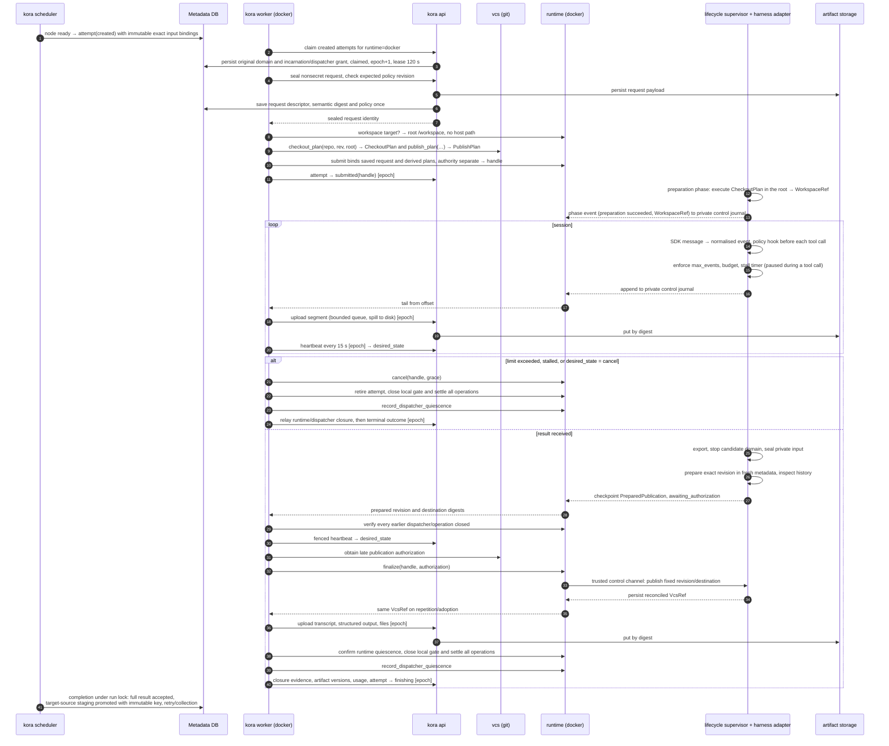

# kora MVP architecture: components, boundaries and stack

Status: decided by the owner on 2026-10-15, revised after the design review ([review-2026-10-15.md](../reviews/review-2026-10-15.md)). This is the detailed companion of the two-page overview in [docs/architecture.md](../../docs/architecture.md), which repeats sections 1 and 2; the reasons behind the choices are in [docs/decisions/](../../docs/decisions/README.md). For a first reading in order, from one example run to each component, start with [internals.md](internals.md). This document is the map; the specifications in `knowledge/specs/` are the territory: [ir.md](../specs/ir.md) (what a graph is), [data-model.md](../specs/data-model.md) (what the control plane stores), [scheduler.md](../specs/scheduler.md) (who decides what and when), [protocols.md](../specs/protocols.md) (where adopters plug in), [api-and-agent-surface.md](../specs/api-and-agent-surface.md) (how humans and their agents operate it), [dsl.md](../specs/dsl.md) (how graphs are written). Diagrams follow the C4 levels (context, containers, components) in Mermaid so they render on GitHub.

## 1. System context (C4 level 1)

Agent sessions inside a graph never call kora. They receive typed inputs through the workspace and the prompt and leave typed outputs for the worker to collect (FR-0.0).

## 2. Containers (C4 level 2)

```mermaid
flowchart TB
    classDef proc fill:#dfe9f5,stroke:#3b6ea5,color:#111
    classDef store fill:#fff4d6,stroke:#b8860b,color:#111
    classDef client fill:#e8f5e9,stroke:#2e7d32,color:#111
    classDef plugin fill:#f3e5f5,stroke:#7b1fa2,color:#111
    classDef ext fill:#eeeeee,stroke:#888,color:#222,stroke-dasharray: 4 3

    subgraph clients [Clients of the API, thin by principle]
        CLI[kora CLI]:::client
        MCP[kora mcp<br/>two curated servers: authoring, operating;<br/>stdio per user session or /mcp on the API]:::client
        SKILLS[Harness skills<br/>teach the user's agent the API]:::client
        WEB[kora web<br/>React SPA, full console in MVP:<br/>approvals, runs, live graph, attempts,<br/>logs, cost, graphs; served by kora api]:::client
    end

    subgraph cp [Control plane]
        API[kora api<br/>HTTP API /api/v1, OpenAPI,<br/>webhook and worker endpoints, MCP over HTTP,<br/>serves kora web static files, auth]:::proc
        SCHED[kora scheduler<br/>stateless passes: triggers, readiness,<br/>admission, waits, timeouts, completion,<br/>clear downstream; retention and<br/>bounded observation dispatcher]:::proc
        DB[(Metadata DB<br/>PostgreSQL; SQLite in standalone)]:::store
        ART[(Artifact storage<br/>payloads and transcripts by digest;<br/>local FS or S3-compatible in MVP)]:::store
    end

    subgraph workers [Workers, one per runtime name, outbound-only]
        W1[kora worker --runtime local]:::proc
        W2[kora worker --runtime docker]:::proc
        W3[kora worker --runtime inhouse_ci<br/>adopter's, inside their network]:::proc
    end

    subgraph plugins [Protocol implementations, loaded by entry points]
        P_RT[runtime]:::plugin
        P_HA[harness adapter<br/>claude: Agent SDK, codex: app-server;<br/>acp after MVP]:::plugin
        P_VCS[vcs<br/>git; inhouse_vcs by adopter]:::plugin
        P_APR[approval channel<br/>cli/api, vcs change request]:::plugin
        P_SEC[secrets]:::plugin
        P_AST[artifact storage<br/>local, s3]:::plugin
        P_ATY[artifact type]:::plugin
        P_OBS[observability exporter]:::plugin
        P_AUTH[authentication]:::plugin
        P_SEN[sensor]:::plugin
        P_POL[policy<br/>allow_deny; Cedar, OPA later]:::plugin
    end

    HARN[claude / codex binaries<br/>fixed per installation]:::ext
    EXT_VCS[Code host]:::ext
    EXT_OBS[Observability backends]:::ext
    EXT_SRC[Webhook sources]:::ext

    CLI -->|HTTPS, bearer token| API
    MCP -->|HTTPS, user's token| API
    SKILLS -.->|used by the user's agent through| MCP
    WEB -->|HTTPS, user's token, generated TS client| API
    EXT_SRC -->|HMAC or bearer| API

    API <-->|SQL| DB
    SCHED <-->|SQL, row claims| DB
    API -->|store uploads, serve downloads,<br/>through the artifact storage protocol| ART

    W1 & W2 & W3 -->|claim with domain and incarnation,<br/>lease epoch, heartbeat,<br/>upload segments and artifacts: HTTPS only| API

    W1 & W2 & W3 --> P_RT & P_HA & P_VCS & P_SEC & P_POL
    P_HA --> HARN
    P_VCS --> EXT_VCS
    SCHED --> P_SEN & P_APR
    API --> P_AUTH & P_APR & P_ATY & P_AST
    API & SCHED & W1 & W2 & W3 --> P_OBS --> EXT_OBS
```

Responsibilities, in one line each:

| container | owns | never does |
|---|---|---|
| `kora api` | the only implementation of every operation; authentication (user and service principals); canonical bounded start acceptance with durable run/skip receipts before webhook acknowledgement; wait-directed inbound signals; worker endpoints (claim, heartbeat, segment and artifact upload, transitions, fenced by lease epoch); OpenAPI, from which the web client is generated and against which the hand-written Python client is tested; serving the `kora web` static build; the two MCP servers over HTTP | physical admission or pass decisions in routers (they delegate to shared scheduler entry points); running sessions; UI logic |
| `kora web` | the production web console, full in MVP (FR-7.3) and held to the user-experience bar of NFR-13.1: approvals, runs, the live graph with node states and timeline, attempts with artifacts and the diff between them, live session logs, cost per run, node and attempt, graphs and their versions; graph editing post-MVP; a thin client of the API through a TypeScript client generated with `@hey-api/openapi-ts`; opaque server-side session cookie, CSRF protection, CSP | logic of its own; direct database access; designed in [docs/console.md](../../docs/console.md) before it is built ([ADR-0015](../../docs/decisions/0015-web-console-design.md)) |
| `kora scheduler` | short locked database phases; bounded cooperative observation/delivery calls outside all transactions and locks; approval intent with run cost; clear-downstream; batched retention | calling runtimes or harnesses |
| `kora worker` | claiming `created` attempts and original-domain recovery of unresolved attempts through the API, including cancelled/superseded attempts of terminal runs; sealing its nonsecret logical request and execution policy through the API before allocation/preparation, then asking the runtime for the workspace target and the VCS for plans; negotiating trusted executor placement; submission keyed by attempt id with the plans in the workload; launching the supervisor and candidate domain; closing all earlier dispatcher grants/operations before new platform writes, obtaining late authorization and calling runtime.finalize after immutable inspection; tailing the normalised event stream and relaying the runner's counters; uploading event segments; collecting outputs, the reconciled prepared `VcsRef` among them, into artifact versions; usage records | deciding what runs next; enforcing limits (the runner does); touching the database |
| Metadata DB | every entity in data-model.md; the only run state; row claims with `SELECT … FOR UPDATE SKIP LOCKED` and the run lock (an advisory lock per run) on Postgres | payload bytes |
| Artifact storage | payload bytes by digest: artifacts, transcripts, live segments, saved request content and content-bearing derived results; explicit availability and active/recovery holds (ADR-0018) | metadata |
| `kora mcp` | the authoring and operating MCP servers for the user's own harness: 14 curated, task-shaped tools, long operations as MCP Tasks; forwards with the user's token, whose default has no `approve` flag | any logic of its own; serving skills (they are files in the harness's own format) |
| `kora standalone` | api, scheduler and a local worker as coroutines in one process on SQLite; the worker uses the same API client over an in-process ASGI transport | production use |

Workers talk to the API and only to the API (DD-13, design review finding [workers through the API only](../reviews/review-2026-10-15.md#workers-through-api-only)): an adopter's worker inside a closed network needs one outbound HTTPS route and no database credentials, which is the enterprise-runtime placement the acceptance test requires.

## 3. Components inside the scheduler (C4 level 3)

Canonical start is shared with the API; accepted webhook receipts are never converted into a second run. Outstanding usage, physical execution-run usage and target holds have separate predicates (ADR-0020, data-model section 13). Pending promotion is revisited each tick independently of touched-run filtering. Fan-out retains its unfinished-body cap through waits. Passes use short transactions with run-first and ordered scope locks; graph caps are live across versions, while execution semantics stay pinned; only disposable bounded call tasks/credits are in memory; authoritative owner tokens, due work and delivery intent stay in rows (NFR-1.2, ADR-0021). Due observation/delivery discovery is independent of touched runs. A future scheduler replica must explicitly budget aggregate integration concurrency; claims preserve state safety but do not create a fleet-wide semaphore. Calls and credential/content resolution hold no DB transaction/connection/lock. Installed providers have a bounded cooperative lifecycle, including standalone; arbitrary blocking Python has no hard containment. See [scheduler section 16](../specs/scheduler.md#16-external-observation-dispatch-adr-0021).

## 4. Components inside a worker (C4 level 3)

The deployment stores the used type closure by value and binds deployment identity to the canonical IR plus resolved contract (ADR-0018). Each attempt stores exact input bindings even without outputs. The API-sealed request is immutable logical content; current authority/credentials are separate, while actual checkout, image, harness and fallback are later observations through the existing journal/events. Saved contracts govern API validation and scheduler-only branch/collection/approval consumers too. See [data-model section 11](../specs/data-model.md#11-immutable-contracts-and-execution-records-adr-0018) for expiry, access and upgrade compatibility.

## 5. One attempt, end to end

Lease expiry records `execution_state=unknown` and retains every original reservation; it does not terminalize the attempt after any delay (ADR-0017). Recovery observes/adopts the same original domain, and earlier dispatcher grants remain barriers to platform writes. `retire` serializes with delayed submit/finalize, while independent worker-host/code-host calls require their own closure evidence. The affected run admits no new attempt until all execution/publication recovery settles. A previously acquired target hold survives terminal run status until the ordinary release condition and this barrier are both satisfied. Operator reconciliation persists observe/stop intent or records evidenced human attestation through the API, CLI and existing `kora_admin`; no scheduler runtime call or new coordination service is introduced.

A declared target source stages all its outputs until complete-result acceptance binds or compares its immutable run key and succeeds in one transaction (ADR-0019). A changed valid key fails with config_error and leaves no current exported result; wrapper/collector exports own rows without changing child history. Read-only replay uses full payload identity, not a selected-field digest. Initial binding acquires no hold, and releasing a hold never releases identity. Pre-binding/body work and prior external effects remain outside that barrier. See [data-model section 12](../specs/data-model.md#12-immutable-run-target-identity-adr-0019).

## 6. Deployment shapes

The three shapes run the same code; only process layout, database driver and artifact storage implementation change (NFR-0.1, NFR-7.1): standalone uses `local`, docker-compose ships an S3-compatible object store next to PostgreSQL and uses `s3` (FR-12.3), and an organisation points `s3` at its own S3-compatible service. `s3` is in MVP because session segments at the target scale do not fit local disk ([load estimate](../analysis/control-plane-load-estimate.md)).

## 7. Stack per component

Rows marked *decided* were settled by the owner on 2026-10-15 or follow from earlier decisions; rows marked *proposed* are defaults the owner has not objected to and can change without affecting the architecture.

| component | stack | status | alternatives considered |
|---|---|---|---|
| Language and runtime | Python 3.11+ (NFR-11.1), `asyncio` throughout | decided | — |
| Packaging | monorepo: one distribution `kora` with extras (`kora[postgres]`, `kora[docker]`, `kora[otel]`); `uv` for dependency management and `hatchling` as build backend (kept over `uv_build` because the embedded web build needs a custom build hook); `src/` layout; the frontend lives in `web/` (pnpm) and its production build is embedded into the Python package at build time, so one `pip install` and one image carry everything | decided | Poetry; `uv_build`; multi-package workspace; separate frontend repository |
| IR models and JSON Schema | Pydantic v2 models as the single definition; `model_json_schema()` publishes `ir.schema.json`; YAML read/write with `ruamel.yaml` (keeps comments for lock-file style output) | decided (Pydantic), proposed (ruamel) | PyYAML (no round-trip) |
| Expression language | CEL (DD-3) through the Rust-backed `common-expression-language` Python binding, plus kora's own schema-driven checker for the `inputs.*` environment and the CEL conformance suite in CI (`cel-python` has no static checking) | decided | `cel-python` |
| Prompt templates | Jinja2 `SandboxedEnvironment` (DD-11) | decided | — |
| HTTP API | FastAPI + Pydantic v2; OpenAPI published for the web client generator and the parity coverage test; NDJSON streaming for logs and events; segment and transcript uploads exempt from the 4 MB body limit; `uvicorn` | decided | Litestar; Django REST |
| Metadata DB access | SQLAlchemy 2.0 (Core + typed ORM) with `asyncpg` for PostgreSQL and `aiosqlite` for SQLite; Alembic migrations (`kora db upgrade`) | decided | raw SQL with `psycopg` 3; SQLModel |
| External observations | Existing scheduler async dispatcher; durable owner tokens and approval delivery metadata; unlocked calls with finite installation/resource/namespace budgets and current-owner apply | decided direction (ADR-0021); wording pending owner review | cooperative installed providers; process isolation deferred, no broker or worker-token expansion |
| Row claims and scheduler loop | PostgreSQL `SELECT … FOR UPDATE SKIP LOCKED` inside short transactions; SQLite: single-writer process with the same statements minus `SKIP LOCKED` | decided (scheduler.md §3, §10) | advisory locks; external queue (Redis) rejected: run state must live only in the DB (NFR-1.2) |
| Worker ↔ control plane | workers call the HTTP API only (register, claim, heartbeat with lease epoch, segment and artifact upload, state transitions) over outbound HTTPS with a service token; standalone uses the same client over an in-process ASGI transport | decided (design review finding [workers through the API only](../reviews/review-2026-10-15.md#workers-through-api-only)) | workers write SQL directly |
| API client | one hand-written `httpx` client that shares the Pydantic request and response models with FastAPI; used by the Typer CLI, the MCP tools and the worker; a contract test checks it against the OpenAPI document | decided (design review finding [one shared API client](../reviews/review-2026-10-15.md#one-shared-api-client)) | generated `openapi-python-client` |
| CLI | Typer (Click-based) over the shared client; `rich` for tables | decided | Click directly; argparse |
| MCP server | official `mcp` Python SDK (FastMCP), two curated servers (`kora-authoring`, `kora-operating`, 14 task-shaped tools incl. `kora_admin` for `platform`-flag operations) over the shared client; long operations as MCP Tasks (2026-07 spec); skills stay files in the harness's own format; stdio process `kora mcp` and the same servers mounted on the API under `/mcp` (DD-18, DD-28) | decided | one generated tool per API operation |
| Policy | `allow_deny` reference implementation of the policy protocol, invoked by the session runner from harness pre-tool-call hooks (DD-29); Cedar (`cedar-python`) and OPA as plugins later | decided | harness-native allowlists only |
| Harness adapters | programmatic interfaces instead of CLI output (DD-27): Claude Agent SDK for Python (`claude-agent-sdk`) and a small kora client speaking the `codex app-server` JSON-RPC protocol directly over stdio (the Codex SDK exists only for TypeScript) in MVP; after MVP an ACP adapter (`agent-client-protocol` JSON-RPC over stdio) for OpenCode, Pi, Gemini and others, through the same protocol and conformance suite (ADR-0004); hosted entirely by the session runner inside the runtime, which is the sole enforcer of `max_events`, soft budget and `stall_after` from the SDK event stream; harness binaries fixed per installation image with the auto-updater off and a tested version range checked at worker start (DD-14) | decided | CLI JSONL parsing (`claude -p --output-format stream-json`, `codex exec --json`) |
| Local runtime | subprocess on the worker host with a per-attempt temp workspace | decided | — |
| Docker runtime | Docker Engine API through `aiodocker` (async) or `docker` SDK; one logical attempt handle, candidate container and separate publisher container, host-side supervisor/control state, private sealed workspace transfer, egress rules via container network config; credential proxy as a sidecar when enabled | proposed | shelling out to the `docker` CLI (simpler, harder to test) |
| VCS (git) | `git` CLI via subprocess for trusted checkout, sealed object import/raw-tree preparation and fixed-revision push; code-host APIs via `httpx` (GitHub, GitLab) for change requests and status | proposed | dulwich/pygit2 (no benefit over the CLI for MVP) |
| Artifact storage | two implementations in MVP (FR-4.4, ADR-0005): `local`, a filesystem tree by digest, for standalone and development, and `s3` for any S3-compatible service through `obstore` (Rust-backed, async; GCS and Azure reachable through the same library), because session segments at the target scale do not fit local disk; docker-compose ships an S3-compatible object store | decided (2026-10-16) | `aiobotocore` (heavier, pins `botocore` versions); MinIO-only client |
| Secrets | env and file providers in MVP; Vault via `hvac` post-MVP | decided | — |
| Frontend (`kora web`) | React + TypeScript + Vite, built from a locked pnpm lockfile; TanStack Query for data; shadcn/ui (Tailwind) components; React Flow for the live graph view, laid out left to right by the ELK layered algorithm through its JavaScript build (`elkjs`), chosen because it lays out the fan-out and sub-graph frames as compound nodes (ADR-0015); TypeScript API client generated with `@hey-api/openapi-ts`; static SPA served by `kora api`; login exchanges the API token for an opaque server-side session cookie (`SameSite=Strict`, `Secure`), CSRF protection on cookie-authenticated mutations, CSP, and cookies never accepted on Bearer-only API paths (DD-19, design review finding [server-side session cookie](../reviews/review-2026-10-15.md#server-side-session-cookie)). MVP ships the full console of FR-7.3 (approvals, runs, live graph, attempts and their diff, live logs, cost, graphs and versions; [api-and-agent-surface.md](../specs/api-and-agent-surface.md) section 6), held to the user-experience bar of NFR-13.1; live views read the NDJSON `?follow=true` streams; graph editing is post-MVP; the console's design, its four actions and the data the API exposes for it are [docs/console.md](../../docs/console.md) and [ADR-0015](../../docs/decisions/0015-web-console-design.md) | decided | server-rendered Jinja2 + HTMX; Next.js; SvelteKit |
| Observability | OpenTelemetry Python SDK with OTLP exporter as the reference exporter, loaded in the control plane only and replaying the append-only event table (`invoke_workflow` per run, `invoke_agent` per attempt built from the session segments at finish, `gen_ai.conversation.id` = harness session id); `prometheus-client` for scheduler and worker metrics; `structlog` JSON logs | proposed | vendor SDKs only (Langfuse, Datadog) without OTel |
| Plugins | one `kora.provider` entry-point group returning validated provider metadata with a `config_schema` per protocol; `kora plugins list`; no pluggy hook wrappers in MVP | decided (design review finding [single provider entry point](../reviews/review-2026-10-15.md#single-provider-entry-point)) | one entry-point group per protocol; pluggy |
| Authentication | `static_token` authenticator in MVP issuing personal bearer tokens: a user principal is bound to a person and a namespace list with the two flags `approve` and `platform` and a per-namespace `transcripts` capability; a service principal per worker is bound to a runtime and a namespace list; no roles or groups (DD-32, [protocols.md](../specs/protocols.md) §10); OIDC via `authlib` post-MVP behind the same `Principal` | decided | single shared API token; RBAC in MVP |
| Testing | `pytest` + `pytest-asyncio`; `hypothesis` for IR and compiler properties; `testcontainers` for PostgreSQL and an S3-compatible server on the Linux CI job, which has Docker (macOS CI runs the artifact storage suite on `local`); fake harness and fake runtime shipped as test fixtures (NFR-10.1); conformance suites as pytest plugins adopters run against their implementations | proposed | — |
| Repo layout | `src/kora/{ir,dsl,api,scheduler,worker,protocols,plugins/{runtime,harness,vcs,…},cli,mcp}`; `web/` (Vite project, build output embedded into `src/kora/api/static` at package build); `docs/`; `examples/`; `tests/`; `conformance/` | decided | multi-package monorepo |

## 8. Boundaries that the stack must not blur

- The API is the only writer of operations; CLI, MCP and the web console never contain logic (FR-0.3). Parity is enforced by a coverage test that every API operation is reachable through at least one CLI command and one MCP tool, plus schema-coverage checks on the shared client (DD-28).
- Agent sessions never reach kora; the policy decision point runs inside the session runner, not in the control plane (DD-29).
- No control-plane process imports graph authors' Python: the scheduler reads IR rows (FR-1.2), and the API accepts only compiled documents, because compilation runs in the author's own process (ADR-0002, amended 2026-10-16).
- Workers never decide; they execute one attempt and report through the API, fenced by their lease epoch (DD-13).
- Protocol implementations are loaded by entry points and never imported by name from core modules (NFR-5.2).
- Nothing in standalone mode may exist only there (NFR-0.1).
- The session runner inside the runtime is the only enforcer of session limits; the worker relays, the scheduler decides (design review finding [one enforcement point](../reviews/review-2026-10-15.md#one-enforcement-point)).

## 9. Glossary (canonical terms)

| term | meaning | not to be confused with |
|---|---|---|
| **run** | one instance of a graph version being carried out, from trigger to a terminal state; the API resource `run_…` | "execution" (not used) |
| **target** | the business object a run works on (a query, a dependency, a flaky test), named by the optional run-lifetime immutable `run.target_key` with namespace scope (ADR-0014/ADR-0019); several runs work on one target over time, and under `defer` one holds it at a time | the delivery key (`run.idempotency_key`), the attempt, a fan-out element |
| **attempt** | one runtime submission of a node instance; the unit of cost and of the `attempt` table | a sub-graph attempt |
| **execution domain** | non-reused identity of the runtime control-registry lineage; persisted before dispatch authority, retained through recovery and never reused by a replacement host/registry (ADR-0017) | a stable worker host name or process incarnation |
| **execution uncertainty** | old execution, dispatcher or publication may still act; original reservations/hold remain, last observation and evidence provenance are exposed | terminal `lost` or permission to retry |
| **dispatcher** | durable grant for one worker incarnation and attempt lease generation; closure atomically gates new dispatch and settles/fences in-flight operations | an API epoch alone or runtime termination receipt |
| **sub-graph attempt** | one pass over a sub-graph body under FR-2.7a; the `subgraph_attempt` integer on node instances; `max_attempts` on a subgraph counts these; `previous_attempt` is the input the next one receives | a runtime attempt |
| **node kinds** | `agent`, `command`, `human_input`, `wait_event`, `timer`, `branch`, `fan_out`, `subgraph`; always spelled this way | "fan-in", "approval node", "sensor node" |
| **SDK event stream** | the raw messages the harness emits inside the runtime: Claude Agent SDK messages, Codex app-server notifications or, after MVP, ACP agent updates | the normalised event stream |
| **normalised event stream** | kora's `{i, at, kind, data}` events written by the session runner to `private control journal`, uploaded as session segments | the opaque transcript |
| **tool_policy** | the single tool-call policy of a node (allow and deny patterns) with the namespace policy prepended, evaluated by the policy protocol | harness permission modes, `allowed_tools` (DSL sugar only) |
| **change request** | the code host's review object (GitHub pull request, GitLab merge request, the review object of an in-house code host); protocol-level text uses this term only | "PR" |
| **kora web** | the React web console served by `kora api`; "web console" in requirements | "approvals page", "UI", "dashboard" |
| **ir_version** | the IR format version (`1.0`), semver | `graph.version`, the author's own informational version string of a graph; `graph_version.number`, the control plane's sequence number assigned at deploy |
| **session runner** | kora's lifecycle supervisor: protected journal and phase checkpoint, harness adapter and candidate launcher, session limits, sealing/inspection and late authorized publication (ADR-0016); local follows the lifecycle in a trusted environment | the worker, which claims, requests plans, submits, relays and uploads |
| **plan executor** | kora's code that executes a `CheckoutPlan` or a `PublishPlan`: in a trusted runtime or private worker-host publication environment, as negotiated; never credentialed in candidate metadata | the VCS, which only returns plans |

Execution deadline ownership is defined by [ADR-0022](../../docs/decisions/0022-inherited-execution-deadlines.md): the API/scheduler guard durable authority, and runtime/common executors apply the saved inherited cutoff in every managed placement, including pre-submit worker-host preparation. Nominal grace and a timer do not prove termination or release ADR-0017/ADR-0020 reservations. [Scheduler section 17](../specs/scheduler.md#17-inherited-deadline-enforcement-adr-0022) gives the clock/failure contract.
