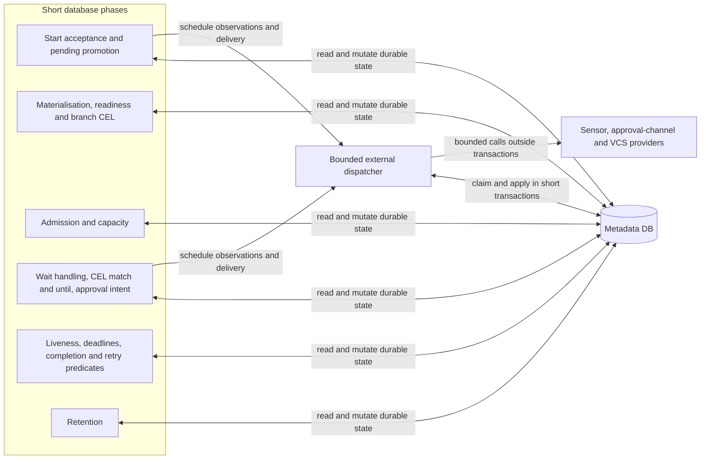
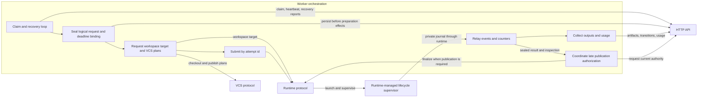
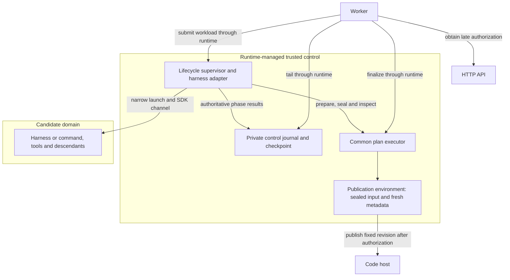
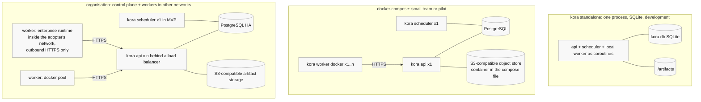

# kora architecture reference

Status: non-normative reference, consolidated against the specifications and ADRs through ADR-0022 on 2026-10-17. The editorial consolidation is pending owner review in [issue #76](https://github.com/realkarych/kora/issues/76). These are planned components; diagrams and named conformance gates are not implementation evidence.

CEL cost-regression amendment dated 2026-10-23: the project owner approved lightweight validation and a 100 ms target under [issue #167](https://github.com/realkarych/kora/issues/167#issuecomment-6351849696); the corresponding human-facing documentation wording was reviewed line by line and approved by the project owner on 2026-10-23.

Start with the [technical introduction](../../docs/technical-introduction.md). This reference keeps component and deployment views, the module/contract map, the stack inventory, canonical terms and unresolved implementation mechanics. For a change, use the [specification task index](../README.md#which-file-to-load-for-which-task), then the ADRs it cites. ADRs take precedence over specifications; neither is superseded by this reference.

## Components inside the scheduler

The diagram identifies responsibilities, not a prescribed pass schedule or lock implementation. [Durable discovery](../specs/scheduler.md#8-restart-and-multi-scheduler-safety) uses `needs_scheduling`; independent due-work scans remain active. [Branch selection](../specs/ir.md#45-branch-ownership-and-selection) gates direct targets, and [retry invalidation](../specs/data-model.md#6-clear-downstream-fr-68a) follows declared dependencies and composition ownership. The [loop](../specs/scheduler.md#2-the-scheduling-loop), [admission](../specs/scheduler.md#6-concurrency-limits-fr-610), [external dispatcher](../specs/scheduler.md#16-external-observation-dispatch-adr-0021) and [deadline guards](../specs/scheduler.md#17-inherited-deadline-enforcement-adr-0022) own the rules.

## Components inside a worker

The worker reports through the API; runtime-managed supervision enforces session limits. The API imports trusted immutable price revisions through engine functions; the engine pins a revision at attempt creation, the worker relays it in the saved request, and the runner uses it for live observations. The API/engine derives persisted USD; [data-model section 7](../specs/data-model.md#7-usage-records-and-completeness-fr-91) defines the ownership and honest missing-data semantics. [#213](https://github.com/realkarych/kora/issues/213) implements the shared immutable price, usage, coverage and approval values, exact arithmetic, forward metadata migration and scoped typed reads. Engine, API, worker, runner and adapter adoption remain pending with their named implementing work items. [Runtime lifecycle](../specs/protocols.md#2-runtime-fr-81), [VCS plans](../specs/protocols.md#4-vcs-fr-52) and [immutable records](../specs/data-model.md#11-immutable-contracts-and-execution-records-adr-0018) define the handoffs. For interruptions, use [original-domain recovery](../specs/scheduler.md#3-submission-execution-uncertainty-and-recovery): lease expiry, cancellation and deadline expiry do not themselves prove closure or release reservations.

## Protected execution boundary

This is an authority view, not a fixed process layout. Protected runtimes keep control journals and publication credentials outside candidate authority; negotiated worker-host placement must preserve that boundary. The supervisor has no control-plane API credential. Local follows the lifecycle for trusted development without hostile-code isolation. The saved inherited deadline reaches every managed preparation/execution/publication placement. [ADR-0016](../../docs/decisions/0016-trusted-execution-and-publication.md), [ADR-0022](../../docs/decisions/0022-inherited-execution-deadlines.md) and the [runtime conformance gates](../specs/protocols.md#13-conformance-suites-nfr-102) define and test the guarantees.

## Deployment shapes

These layouts use the same scheduling code and schema. [Standalone](../specs/scheduler.md#10-standalone-sqlite-versus-postgres) changes process layout, database driver and storage provider. The MVP uses one scheduler; [replication](../specs/scheduler.md#8-restart-and-multi-scheduler-safety) and aggregate external-call budgets require the stated future constraints.

## Module and contract map

Paths below are planned package locations from the stack decision and [ADR-0026](../../docs/decisions/0026-package-layers.md), not a claim that implementation exists. Which package may import which is fixed in [package layers](#package-layers).

| Planned area | Contract to read before changing it |
|---|---|
| `src/kora/ir`, `src/kora/dsl` | [IR and validation](../specs/ir.md), [author-side compilation](../specs/dsl.md); the compiled schema is the API/scheduler boundary. The first `ir` modules landed under [issue #201](https://github.com/realkarych/kora/issues/201): `kora.ir.node` holds `ErrorClass` and `ToolPolicy`, `kora.ir.json` the bounded JSON types moved from `kora.protocols`, and `kora.ir.errors` the safe validation-error converter; `kora.ir.globs` holds the path glob matcher, the wildcard core and the fuel counter shared by the `allow_deny` policy and the executor (issue #233). The common execution configuration models land under [issue #212](https://github.com/realkarych/kora/issues/212): `kora.ir.config` holds `NodeLimits`, `Workspace`, `NetworkPolicy`, `McpServer`, `CommandResource` and `CommandConfig`; `kora.ir.scalars` holds their duration, digest and environment-name patterns, and `kora.ir.record` shares flattened extension handling with `ToolPolicy`. The control configuration models land under [issue #225](https://github.com/realkarych/kora/issues/225): the same module holds `BranchCase`, `BranchConfig`, `FanOutConfig`, `SubgraphNodeConfig` and `Retry`; scalars add node IDs, branch targets and raw expression bounds, and shared records preserve declared wire aliases. The remaining configuration and canonical data/export foundation lands under #237; declaration, trigger, runtime and contract records under #238; and the eight envelopes, shared graph/subgraph registry, complete document and open provenance under #239. `kora.ir.schema` generates the committed schema directly from `GraphDocument` under [issue #218](https://github.com/realkarych/kora/issues/218), with deterministic bytes and a required drift test. Real model/type names own local references, and scalar constraints may be inlined. These records validate structure without resolving payload revisions or performing semantic, provider or execution admission. The [shared diagnostic contract](../specs/diagnostics.md) assigns `Diagnostic`, `SourceLocation`, `ConfigWarning` and `ContractViolation` to `kora.ir.diagnostics`, implemented under [issue #219](https://github.com/realkarych/kora/issues/219) as frozen values with an explicit CEL conversion boundary before validator and protocol consumers. The bounded collector and scoped graph-link pass land under #463; whole-IR admission and provider rebasing remain pending their implementing issues. The internal CEL diagnostic and safe-field intermediate remain distinct. |
| `src/kora/ir/agent_session.py`, `agent_session_validation.py` | [AgentSession revision 1](../specs/artifacts/AgentSession.md), implemented under [issue #453](https://github.com/realkarych/kora/issues/453): bounded strict raw/native logical admission, immutable complete identity, detached metadata-only summaries and supplied transcript byte integrity. Accepted-view construction, authoritative pricing, runtime/API/storage/retention/CEL and derived aggregates retain their named owners. No package-layer permission changes. |
| `src/kora/ir/command_result.py`, `command_result_validation.py` | [CommandResult revision 1](../specs/artifacts/CommandResult.md), implemented under [issue #451](https://github.com/realkarych/kora/issues/451): bounded strict raw/native admission, owned canonical bytes, complete identity, detached summaries and supplied-capture byte integrity. Runtime provenance, capture wire/owner binding, API/storage/retention/CEL and derived aggregates remain with their named implementing owners. No package-layer permission changes. |
| `src/kora/ir/structured_output.py`, `structured_json.py`, `structured_schema_input.py`, `structured_schema_work.py`, `structured_schema_locations.py`, `structured_schema_preparation.py` | [StructuredOutput revision 1](../specs/artifacts/StructuredOutput.md), implemented under [issue #446](https://github.com/realkarych/kora/issues/446): bounded exact raw/native admission, an owned immutable canonical snapshot, complete digest and fresh detached views, fixed safe violations and frozen descriptor compatibility. [#500](https://github.com/realkarych/kora/issues/500) supplies internal meter, native scalar, sorted-index and owned flat-arena primitives. [#501](https://github.com/realkarych/kora/issues/501) implements complete preparation under the accepted [#498](https://github.com/realkarych/kora/issues/498) contract: input/result/accounting values in `structured_schema_input`, original schema positions/strict reference decoding/closed targets and the potential-call DAG in `structured_schema_locations`, and exact DTO/normalization/ancestry/closure/constraint/checker roles plus `prepare_structured_schema_input` in `structured_schema_preparation`. `kora.ir` exports the operation and its DTO/prepared/refusal/accounting values. The only public prepared data is safe accounting; the caller-bound DEBUG completion event has fixed status flags and safe accounting slots, with zero placeholders on refusal. [Focused evidence and remaining independent/final-head checks](../research/structured-schema-preparation-2026-10-30.md#complete-operation-evidence-under-501) remain explicit. Preparation grants no payload-validity/extraction or evaluator authority. The complete evaluation resource/charging policy is approved under #515, while its reserved saved identity remains unavailable for effective execution until the complete implementation meets its activation gates; exact evaluation, common composition, CEL, producers, uploads/replay/retention and derived-list activation retain their named owners. The standalone exact built-in provider is implemented under #489. No package-layer permission changes. |
| `src/kora/ir/structured_schema_evaluation_policy.py`, `structured_schema_evaluation_work.py`, `structured_schema_numbers.py` | Internal numerical foundation under [#515](https://github.com/realkarych/kora/issues/515): exact immutable thirteen-parameter binding and checked unchanged ten-key preparation projection, shared monotone evaluation work/auxiliary meter, precharged intermediate arithmetic and exact canonical-decimal integer classification, numerical ordering/equality and positive-divisor divisibility. [StructuredOutput section 3.3](../specs/artifacts/StructuredOutput.md#33-exact-bounded-evaluation) owns the complete approved numerical/handler/adapter schedule, including mandatory shortcut charging. The helpers have no broad public IR export, schema evaluator, provider entry point, artifact-acceptance value, extraction or consumer activation. No per-number logging, new package, dependency or import permission. [Evidence status and limits](../research/structured-schema-numbers-2026-10-31.md). |
| Existing `src/kora/ir` modules; planned `src/kora/protocols/effective_artifact_type.py` | [ADR-0027](../../docs/decisions/0027-bounded-effective-schema-validation.md) and [StructuredOutput section 3](../specs/artifacts/StructuredOutput.md#3-saved-effective-schemas-and-cel-view): pure IR preparation and closed targets implemented through #500/#501; internal scalar arithmetic under #515 and planned bounded schema evaluation, plus shared pure protocols composition with trusted bound type behavior before effective extraction. The complete evaluation policy is owner-approved under #515. Its identity remains reserved/unavailable for effective execution until recursive equality, every supported bounded handler, safe pinned-engine adaptation, complete evaluation and common composition meet their named implementation and verification gates. Preparation implements neither evaluator nor consumer, preserves provider hooks/constructor ABI and requires no new package or allowed import. |
| `src/kora/ir/graph_links.py`, `link_cycles.py`, `diagnostic_collection.py` | Scoped typed graph-link validation and reusable bounded diagnostic collection under [issue #463](https://github.com/realkarych/kora/issues/463). Iterative per-scope and definition-cycle analysis visits stored bodies once; source-safe findings preserve deterministic count/byte prefixes. No raw admission, type/CEL/provider validation or public-surface operation. The [evidence record](../research/graph-link-validation-evidence-2026-10-30.md) separates blocking structural/retention checks from time/heap/RSS diagnostics. |
| `src/kora/ir/type_schemas.py`, `inline_schemas.py`, `schema_validation.py`, `schema_keywords.py`, `schema_locations.py`, `schema_catalogue.py`, `artifact_schemas/` | Saved-type metaschema validation and offline pointer closure under [issue #473](https://github.com/realkarych/kora/issues/473). Iterative schema-position traversal, safe native keyword views and per-call reference lookup reuse IR diagnostics; immutable published built-ins ship in the wheel. Inline authored fields reuse the shared checker under [issue #476](https://github.com/realkarych/kora/issues/476), with isolated local roots and saved-only URNs. No public admission or execution authority. [Saved-schema evidence](../research/type-schema-validation-evidence-2026-10-30.md), [inline evidence](../research/inline-schema-validation-evidence-2026-10-30.md). |
| `src/kora/ir/output_schemas.py`, `schema_equality.py`, `approval_form.py` | Output-role cardinality and authored agent/response-schema consistency under [issue #479](https://github.com/realkarych/kora/issues/479). Iterative structural JSON equality, memoized saved ancestry and a fresh published approval-form value preserve omission, safe diagnostics and per-call ownership. No schema resolution, execution admission or new package dependency. [Evidence](../research/output-schema-consistency-evidence-2026-10-30.md). |
| `src/kora/ir/edge_types.py`, `type_ancestry.py` | Nominal compatibility of direct whole-artifact edges under [issue #482](https://github.com/realkarych/kora/issues/482), extended to equal-depth covariant lists under [issue #495](https://github.com/realkarych/kora/issues/495). A per-call reverse forest and global preorder intervals classify saved ancestry without per-edge parent walks. Scoped input accounting, safe IR003 diagnostics and count-only completion preserve prerequisite ownership; iterative endpoint parsing shares declaration spelling rules without changing output roles. Paths, list materialization, inherited schema compatibility and public admission remain separate. [Scalar evidence](../research/direct-edge-type-validation-evidence-2026-10-30.md) and [list evidence](../research/list-edge-type-validation-evidence-2026-10-30.md). |
| `src/kora/ir/export_types.py` | Declared same-body producer-to-export compatibility under [issue #497](https://github.com/realkarych/kora/issues/497). Each stored definition is visited once without expanding calls; keyed node/output lookup and the shared `TypeAncestry.accepts_type` relation reuse saved ancestry and iterative endpoint parsing. Scoped counters and bounded body-owned IR003 diagnostics preserve missing-prerequisite ownership. Wrapper mappings, fan-out collect, payload admission and execution remain separate. [Evidence and limits](../research/subgraph-export-type-validation-evidence-2026-10-30.md). |
| `src/kora/ir/subgraph_interfaces.py` | Ordinary wrapper input/output interface checks under [issue #505](https://github.com/realkarych/kora/issues/505): complete names, input assignability and exact declared export-type preservation. Root and stored bodies are scanned once without call expansion; saved ancestry, keyed lookups and bounded node-owned diagnostics preserve prerequisite ownership. [Evidence and limits](../research/subgraph-interface-validation-evidence-2026-10-30.md). |
| `src/kora/ir/tool_patterns.py`, `src/kora/ir/tool_policies.py` | Shared pure tool-pattern compiler and kora-owned layer checker, plus authored-agent static IR013 validation under [issue #518](https://github.com/realkarych/kora/issues/518). Root and stored bodies are scanned once; exact reserved-name checks add no runtime/namespace admission. The existing allow_deny provider imports the shared grammar while retaining runtime matching, envelopes, table, fuel and cache. [Evidence and limits](../research/tool-policy-validation-evidence-2026-10-31.md). |
| `src/kora/ir/expression_fields.py`, `expression_syntax.py` | Scoped operational CEL/path syntax under [issue #487](https://github.com/realkarych/kora/issues/487). Lazy typed-field enumeration uses the existing pure parsers, exact field/offset diagnostics and per-call ownership, including dormant retries. No rendering, typing, resolution, evaluation or public admission. [Evidence](../research/expression-syntax-validation-evidence-2026-10-30.md). |
| `src/kora/ir/input_paths.py` | Node-local binding for workspace and approval input paths under [issue #491](https://github.com/realkarych/kora/issues/491). Shares lazy field enumeration with syntax validation; existing parser and direct input-map membership produce bounded fixed diagnostics, counters and no retained graph/path state. Nested resolution and execution authority remain separate. [Evidence](../research/input-path-validation-evidence-2026-10-30.md). |
| `src/kora/ir/type_declarations.py` | Scoped typed declaration and saved-parent validation under [issue #468](https://github.com/realkarych/kora/issues/468), reusing the existing collector, safe-source conversion and iterative cycle analysis. Checks balanced list spelling, declared base/parent names, namespace-qualified custom entries and published built-in revisions. No schema closure, behavior binding, edge assignability or public admission. The [evidence record](../research/type-declaration-validation-evidence-2026-10-30.md) records deterministic ownership checks and diagnostic observations. |
| `src/kora/ir/vcs_ref.py`, `vcs_ref_json.py`, `vcs_ref_url.py` | [VcsRef revision 1](../specs/artifacts/README.md), implemented under [issue #209](https://github.com/realkarych/kora/issues/209): frozen `VcsRef`/`PrincipalRef`, strict ordered object/raw boundaries, safe single violations, deterministic URL grammar, fixed manifest compatibility, canonical bytes, complete digest and fresh identity summary. Both values are exported from `kora.ir`; no import-layer permission changes. Publication, upload, storage, approval and rendering consumers retain their named implementation owners. |
| `src/kora/protocols/artifact_type.py`, `src/kora/plugins/artifact_type/binding.py`, `src/kora/plugins/artifact_type/vcs_ref.py`, `src/kora/plugins/artifact_type/command_result.py`, `src/kora/plugins/artifact_type/agent_session.py`, `src/kora/plugins/artifact_type/structured_output.py`, `src/kora/conformance/artifact_type.py` | [ArtifactType](../specs/protocols.md#8-artifact-type-fr-4143), coordinated by [#138](https://github.com/realkarych/kora/issues/138): operation-local expanded builtin binding, typed synchronous hooks, exact VcsRef, CommandResult and AgentSession revision-1 providers, the standalone exact built-in StructuredOutput provider and shared injected/installed conformance. StructuredOutput retains all JSON roots under its model domain; this fixed binding does not carry or evaluate inline/custom effective schemas. AgentSession selects the complete logical value and returns only its fixed safe metadata summary, preserving the separate physical transcript-byte identity. A pure fixed-structure comparator is shared; concrete model/error boundaries stay typed separately. Providers consume the existing packaged immutable schemas and models. No registry, deployment resolver, persisted execution-contract format or production artifact/capture owner is created. |
| `src/kora/api` | [HTTP resources and errors](../specs/api-and-agent-surface.md#2-resources-and-operations); [scheduler entry points](../specs/scheduler.md#12-execution-backend-boundary-nfr-55); [persistence and state machines](../specs/data-model.md). |
| `src/kora/scheduler` | [Passes](../specs/scheduler.md), [capacity and locks](../specs/data-model.md#13-run-acceptance-and-execution-capacity-adr-0020), [waits and approvals](../specs/scheduler.md#5-waits-hold-no-worker-nfr-13). |
| `src/kora/worker` | [API-mediated claims/recovery](../specs/scheduler.md#3-submission-execution-uncertainty-and-recovery), [runtime workload](../specs/protocols.md#2-runtime-fr-81), [VCS plans](../specs/protocols.md#4-vcs-fr-52). |
| `src/kora/observability` | [Logging contract](../specs/observability.md); every package may import it. Implemented under [issue #147](https://github.com/realkarych/kora/issues/147): `settings` (environment variables and ranges), `catalog` (event specifications per component), `context` (bound scope over context variables), `policy` (content policy and budget), `redaction` (bounded registry of literal values, matched with `str.find` over a snapshot, and `StreamMasker` for captured byte streams, issue #192), `sink` (bounded queue, single writer thread, loss counters), `render` (JSON and text) and `bootstrap` (`configure_process`, component loggers, the standard-library bridge). |
| `src/kora/cel`, `src/kora/cel_eval` | [CEL parsing, checking and evaluation](../specs/ir.md#7-expressions-and-templates); only `cel_eval` imports the binding. `kora.cel` holds the lexer, parser, limits, canonical rendering, paths, pattern subset, function table, type model and cost estimate ([issue #161](https://github.com/realkarych/kora/issues/161)); `kora.cel_eval.binding`, the only module that imports the binding, loads it after checking its distribution and files ([issue #165](https://github.com/realkarych/kora/issues/165)); the strict converter, process-owned evaluation thread, bounded program cache and safe error records are implemented under [issue #166](https://github.com/realkarych/kora/issues/166). The initial shared binding limits are 4,096 canonical JSON bytes and 256 values, selected by the [registered conversion measurements](../research/cel-cost-calibration-2026-10-22.md#qualified-smaller-bound-result) under [issue #167](https://github.com/realkarych/kora/issues/167). The provisional steps budget is 100,000,000,000,000 logical units, with a compact 100 ms regression gate and a golden estimate corpus; the 16 MiB logical estimate is not an RSS envelope. Product consumers still require schema/projection integration and their real integration evidence; typed checks correct native minimum-int negation since [#372](https://github.com/realkarych/kora/issues/372). |
| `src/kora/models`, `src/kora/client` | [HTTP resources and errors](../specs/api-and-agent-surface.md#2-resources-and-operations); the [shared API client](#stack-per-component). |
| `src/kora/db` | [Persistence and state machines](../specs/data-model.md), [migrations](../specs/scheduler.md#14-migrations-nfr-72). Implemented under [issue #153](https://github.com/realkarych/kora/issues/153): `tables` (the Core table objects of data-model.md section 2, no ORM mapping), `types` (byte-ordered text, UTC timestamps, JSON documents and decimal amounts that behave the same on both databases), `identifiers` (ULIDs from injected time and randomness, monotonic within a millisecond), `migrations` (the Alembic environment configured in code and migration 0001), `connection` (`KORA_DATABASE_URL` parsing, the SQLite writer lock and reader connections, the PostgreSQL pool, the shielded transaction unit) and `reads` (registry, discovery, finish-check and occupancy reads returning frozen rows); the package's own `db` component records migrations, rolled-back transactions and a close that outlived its deadline, whose units still in flight then fail with `DatabaseClosedError` instead of committing ([issue #158](https://github.com/realkarych/kora/issues/158)). `kora db upgrade` is wired by the composition root `kora.__main__`. |
| `src/kora/engine` | [Scheduler entry points](../specs/scheduler.md#12-execution-backend-boundary-nfr-55), [state machines](../specs/data-model.md#4-state-machines). The internal pure completion foundation under [issue #544](https://github.com/realkarych/kora/issues/544) holds frozen checked facts/results in `completion_models` and separate physical-attempt and top-level-run decisions in `completion`. It performs no query, transition, expiry write, event, artifact promotion, retry or resource release. Checked-fact production, persistence mapping and transactional/runtime activation retain their implementing owners; [evidence and limits](../research/completion-decision-foundation-2026-10-31.md). The private [#559 retry eligibility foundation](../research/node-retry-eligibility-foundation-2026-10-31.md) adds `retry_models` and `retry` for class/list/count/predicate policy recommendations, with no retry activation or authority grant. |
| `src/kora/plugins/runtime/local`, the `kora-runner` and `kora-runner launch` entry points | [Local runtime](../specs/protocols.md#local-runtime-issue-123), [harness launcher](../specs/protocols.md#harness-launcher-issue-123), [local runtime contracts](../specs/protocols.md#local-runtime-contracts-issue-123). `channel` holds the sectioned-message codec, the section and operation caps and the response envelope's error branch under [issue #314](https://github.com/realkarych/kora/issues/314), over the typed frames that `kora.runner.channels` reads through its reservations; under [issue #315](https://github.com/realkarych/kora/issues/315) it adds the `status` request and its response form. `serving` holds the runner's control server under #315: the accept loop with its bound of 8 unattached connections, the 5 s first-frame deadline, kernel attestation on a bounded executor, the pre-attach `status` answer, the 60 s socket recheck and rebind, and the coalesced refusal counts; `control` holds the worker's side, which connects, checks the listener against the registry's runner identity and asks `status`. `runtime` holds `LocalRuntime` under [issue #323](https://github.com/realkarych/kora/issues/323): the async factory that opens the state root and its lineage, and the operations before a runner, over `kora.runner.registry`'s cells and bounded executor; under [issue #313](https://github.com/realkarych/kora/issues/313) it adds `submit` up to readiness. `spawn` holds the socket-directory choice, the launcher, its `ExitWatch` collection and the readiness wait; `supervisor` is the runner entry that `kora-runner` maps to. Under [issue #430](https://github.com/realkarych/kora/issues/430) `retire` on a `starting` entry sweeps for the recorded runner vector through a second one-worker executor and tombstones `no_runner_started` only after each match is confirmed gone. |
| `src/kora/plugins/<family>/fake`, `src/kora/testing` (the scenario engine, `kora.testing.runner`, `VirtualClock`, `QuiescenceMonitor`) | [Fakes and the testing composition](../specs/fakes.md), [scenarios](../specs/dsl.md#4-testing-graphs-without-model-calls-nfr-101). `kora.plugins.harness.fake` (`script`, `adapter`) is implemented under [issue #267](https://github.com/realkarych/kora/issues/267); `kora.conformance.harness` holds the harness conformance cases and their host. |
| `src/kora/runner`, `src/kora/executor` | [Runtime lifecycle](../specs/protocols.md#2-runtime-fr-81), [VCS plans](../specs/protocols.md#4-vcs-fr-52), [protected execution boundary](#protected-execution-boundary). `kora.executor` is implemented under [issue #159](https://github.com/realkarych/kora/issues/159) ([executor and git provider](../specs/protocols.md#executor-and-slice-1-git-provider-issue-159)): `entry` (the phase entry points and their result models), `launcher` (step processes, pipes and termination), `guard` (deadline clipping), `steps` (placeholders, areas, tool resolution), `files` (descriptor-relative plan files and private directories), `captures`, `seal` (the `kora.git.v1` sealed input), `scan` (the inspection source protocol and the scanner), `protected` (the fuel-bounded protected-path check), `authorization` (the binding pin, credential tuple match and authorization match), `digests` and `failures`. `kora.runner.outcome`, `calls` and `usage` hold the harness-neutral session rules shared by every adapter, implemented under [issue #267](https://github.com/realkarych/kora/issues/267). Generic local identity, unreaped exit/group anchors, bounded channels/capture, gated processes and descriptor-anchored filesystem primitives are implemented in `runner` under [issue #247](https://github.com/realkarych/kora/issues/247). Under [issue #312](https://github.com/realkarych/kora/issues/312) `identity` reads the observer's pid namespace, `filesystem` gains the filesystem-type refusal table, the no-replace rename and bounded private-file reads, and `registry` holds the registry head model, the hashed per-attempt names, the pure transition function for the pre-runner operations, the per-attempt lock and atomic replacement, the bounded transition executor with its 2 s lock deadline, and `domain.json` with its boot log; the runtime class that uses them is [issue #323](https://github.com/realkarych/kora/issues/323). The runner entry points and the runtime-specific controller remain with work item 14. Under [issue #430](https://github.com/realkarych/kora/issues/430) `kora.runner.identity`'s native reader lists the processes of the caller's three uids that carry an exact argv, `kora.runner.processes.ExitAnchor` signals the process it pins, and `kora.runner.registry` holds the runner prefix, the fence and the tombstone cells of a `starting` entry. Under [issue #315](https://github.com/realkarych/kora/issues/315) `kora.runner.peers` holds the kernel peer attestation: `SO_PEERPIDFD`, `SO_PEERCRED` or `LOCAL_PEERPID` with `LOCAL_PEERCRED`, chosen once per process, with the accept-time window and every identity read through the identity reader. |
| `src/kora/plugins/vcs/local` | The provider-neutral half of the local VCS providers, moved out of the git provider under [issue #296](https://github.com/realkarych/kora/issues/296) for the directory-backed fake VCS of [issue #266](https://github.com/realkarych/kora/issues/266): the configuration and principal models, remote path forms and the identity pin, the refusal table, the credential and destination checks, the per-provider logging events and the Linux `prlimit` wrapper. |
| `src/kora/plugins/vcs/git` | Implemented under [issue #159](https://github.com/realkarych/kora/issues/159): `provider` (configuration, `acquire_credential`, plans, `head_sha`), `plans`, `environment`, `tools`, `remotes` (the bare-repository check), `source` (the in-process inspection source over `git cat-file --batch`) and the standard-library helpers `export`, `tree_build` and `decoder` that run as plan steps. |
| `src/kora/protocols`, `src/kora/plugins/<protocol>/` | [Provider metadata and loading](../specs/protocols.md#1-common-rules); core depends on protocols, implementations register through `kora.provider`. Since [issue #236](https://github.com/realkarych/kora/issues/236) `kora.protocols.policy` holds the policy types and protocol, `kora.protocols.harness` the harness adapter protocol and its session, event and result types, and `kora.protocols.vcs` only `WorkspaceRef` and `WorkspaceTarget`. Since [issue #262](https://github.com/realkarych/kora/issues/262) the modules import in the order `deadlines` (`ExecutionDeadline` and the local thresholds), `common`, `identity` (`ProcessIdentity`, `GrantBinding`, `Handle`, the digest and timestamp scalars and the canonical-size counters), `evidence` (the runtime and dispatcher records, `PublicationOutcome` and `ClosureEvidence`), `report` (`AttemptError`, `TerminalReport`), `history` (the resumable-history models of issue #226, `RecoveryEvidence`, the hash chains and the page readers), `vcs` (the plans, inspection and publication models, the credential models and the slice-1 `Vcs` protocol, with the plan-executor names), and `runtime` (the workload, observation and authorization models and the `Runtime` protocol), each importing only modules before it; `harness`, `policy` and `vcs` never import `runtime`. `kora.conformance.runtime` and `kora.conformance.vcs` hold their protocols' common cases. |
| `src/kora/cli`, `src/kora/mcp`, `web/` | [Shared API surface and parity](../specs/api-and-agent-surface.md); [console design](../../docs/console.md). `src/kora/cli` holds the Typer root with `kora --version`, the thin `kora plugins list` views and installed discovery child under #248 the pure configured-conformance result/event view under #215, and the `cli` component's lifecycle events, and `src/kora/__main__.py` is the composition root that reads the logging configuration, configures diagnostics, installs the failure hooks and maps the exit codes ([issue #147](https://github.com/realkarych/kora/issues/147)). For listing, that root owns the generic runner process/group and private channels; CLI modules import neither runner nor conformance. |
| `conformance/`, `tests/` | [Provider conformance](../specs/protocols.md#13-conformance-suites-nfr-102), [testing rules](../../AGENTS.md#testing); [standalone parity](../specs/scheduler.md#10-standalone-sqlite-versus-postgres). `kora.conformance` holds the opt-in pytest plugin (`plugin`), the diagnostics capture shared with kora's own tests (`capture`), the common cases (`common`) and the secrets cases (`secrets`), since issue #204, the policy cases (`policy`), since issue #236, and the runtime and VCS cases (`runtime`, `vcs`), since issue #262. The generic parent lifetime under [issue #247](https://github.com/realkarych/kora/issues/247) uses `kora.protocols.lifetime` for closed transport values and `kora.conformance.lifetime`, `transport`, `controllers`, `io_helper`, `journal` and `diagnostics` for admission, replay, scoped cleanup, private IPC, fixed durable mutations and recovery. The [lifetime ABI](../specs/conformance-lifetime.md), [ownership evidence](../research/local-lifetime-recovery-observations-2026-10-23.md) and [measurement record](../research/conformance-lifetime-measurement-2026-10-23.md) distinguish resource settlement from UNKNOWN and logical accounting. Installed listing is implemented under #248. The exact-provider bridge under #303 owns prepared receivers; `kora.conformance.storage_cases` under #305 owns per-case cwd and explicit default-pool settlement on the caller loop. Under #307, `executor` owns complete selected-suite accounting, `session`/`command_case`/`command_plugin` compose the ordinary pytest wrapper, and `child`/`result` own installed bootstrap and bounded private completion. Under #215, `kora.conformance.command` composes that child with the lifetime owner and fixed cleanup recovery; the composition root lazily imports it so other commands do not require the conformance extra. |

Cross-component changes also consult the owners of [content-bound approvals](../../docs/decisions/0008-content-bound-approvals.md), [cost accounting](../../docs/decisions/0010-cost-accounting-and-limits.md), [redaction and secrets](../specs/protocols.md#6-secrets-fr-101), [metrics](../specs/scheduler.md#11-metrics-and-health-nfr-73) and [inherited deadlines](../../docs/decisions/0022-inherited-execution-deadlines.md). These links replace a second catalog of rules and future test names.

The immutable model base is defined once in `kora.protocols.boundary` and re-exported by `kora.protocols.common`. Fixed filesystem helpers and their identity, lifetime and filesystem records import this data-only base directly. Deadline identifiers use the same bounded visible-ASCII language locally, so importing clock and filesystem records does not initialize provider context or structured logging.

IR diagnostic models retain eager Pydantic initialization; their CEL conversion parameter imports its exact diagnostic type only for static checking. A fixed filesystem helper therefore does not activate the CEL checker through that annotation. Generic channels own idle readability separately from bounded frame transfer. Conformance recovery alone reconciles the fixed unpublished `next` file after verified exclusive ownership and earlier-effect settlement; its contents never replace the authoritative journal.

## Package layers

Reference table for [ADR-0026](../../docs/decisions/0026-package-layers.md), which states the invariant and the rules; `tests/architecture/test_import_layers.py` mirrors this table and checks both. A module of package `kora.<y>` may import `kora.<x>` only when `x` is `y` or is listed in `y`'s row; a module under `plugins` belongs to its longest listed family prefix, and `mcp.stdio` is matched before `mcp`. The composition roots `kora.__main__`, `kora.standalone`, `kora.testing` and `kora.conformance` may import anything, and no package imports a root. A new package enters the table in the change that creates it; widening a row is approved in that change's issue plan.

| package | holds | may import |
|---|---|---|
| `kora` | the package root, which imports no kora package at module level; `kora.plugins` is a namespace package that imports nothing | — |
| `observability` | the logging bootstrap and bound loggers ([observability](../specs/observability.md)) | — |
| `cel` | CEL parser, schema-driven checker and canonical rendering, without the binding | `observability` |
| `ir` | IR models, validator, engine-neutral StructuredOutput schema preparation and internal exact numerical primitives; planned complete schema evaluation (ADR-0027) | `cel`, `observability` |
| `protocols` | provider protocols, their data types and provider loading, including the recovery, dispatcher, publication and credential types, the workload descriptors that worker routes carry, the local deadline thresholds, `Clock` and `ActivityReporter`, `SecretValue` with its scope and transfer field, `ProtocolContext`, the authentication-only `AuthenticationContext` with logger and clock (#534), process identity and the boundary-model base (issue #204); planned pure effective-artifact composition over bound behavior and the IR evaluator (ADR-0027) | `ir`, `observability` |
| `models` | API request and response models, including worker-route bodies | `ir`, `protocols`, `observability` |
| `client` | the shared `httpx` API client | `models`, `protocols`, `ir`, `observability` |
| `executor` | VCS plan executor | `protocols`, `ir`, `observability` |
| `runner` | `kora-runner` supervisor, including its registry, control channel and journal | `executor`, `protocols`, `ir`, `observability` |
| `db` | SQLAlchemy tables, read functions, token-row revocation primitives and migrations; writes of the execution tables, `approval_request` and `artifact_version` are `engine` functions | `ir`, `observability` |
| `cel_eval` | evaluation of checked expressions through the binding | `cel`, `ir`, `observability` |
| `engine` | shared transition functions | `db`, `cel_eval`, `protocols`, `ir`, `observability` |
| `api` | FastAPI application | `engine`, `db`, `models`, `cel_eval`, `cel`, `protocols`, `ir`, `observability` |
| `scheduler` | scheduling passes and tick | `engine`, `db`, `cel_eval`, `protocols`, `ir`, `observability` |
| `worker` | claims, preparation and upload | `client`, `executor`, `models`, `protocols`, `ir`, `observability` |
| `dsl` | Python DSL and author-side compiler; compile asks the harness adapter's `check_config` through the provider registry | `cel`, `protocols`, `ir`, `observability` |
| `cli` | CLI over the shared client; `kora compile` runs the DSL in-process | `client`, `models`, `dsl`, `cel`, `protocols`, `ir`, `observability` |
| `mcp` | MCP tool definitions shared by the stdio and HTTP-mounted servers | `client`, `models`, `protocols`, `ir`, `observability` |
| `mcp.stdio` | the stdio-only authoring tools `kora_compile` and `kora_test`, which the HTTP-mounted server omits | `mcp`, `client`, `models`, `dsl`, `cel`, `protocols`, `ir`, `observability` |
| `plugins.runtime`, `plugins.harness` | execution-side providers that share supervisor code with `runner` | `runner`, `executor`, `protocols`, `ir`, `observability` |
| `plugins.vcs` | VCS providers | `executor`, `protocols`, `ir`, `observability` |
| `plugins.policy`, `plugins.secrets` | policy and secrets providers; `plugins.policy.allow_deny` is the `allow_deny` policy (issue #233), and `plugins.secrets.env` is the `env` provider (issue #192) | `protocols`, `ir`, `observability` |
| `plugins.authentication`, `plugins.approval` | providers that read their own rows: `static_token` reads `api_token`, the `cli` channel polls its request row | `db`, `protocols`, `ir`, `observability` |
| `plugins.sensor`, `plugins.storage`, `plugins.artifact_type`, `plugins.exporter` | control-plane providers without metadata database access; storage may keep provider-private bookkeeping, with no metadata authority or `kora.db` import | `protocols`, `ir`, `observability` |

**Fake modules** ([fakes.md section 2](../specs/fakes.md#2-fakes-never-reach-a-serving-process), issue #136). A module within `kora.plugins.<family>.fake` is imported only by `kora.testing`, `kora.conformance`, its own fake module and `tests/`, and no fake module imports a fake module of another family. `kora.standalone` imports neither testing root, and `kora.__main__` imports them only inside its top-level `test`, `conformance` and `mcp` command functions; dry-run is deferred by [the first-slice contract](../specs/first-slice.md), and any future import exception requires its own owner-approved author-side testing implementation. Composition roots make no dynamic-import call (`importlib.import_module`, `importlib.util.spec_from_file_location`, `importlib.util.module_from_spec`, `__import__`, `pkgutil.resolve_name`, `runpy.run_module`, `runpy.run_path`), whatever its argument. Elsewhere the rule sees static imports and literal dynamic imports only, and no checked form covers an entry point's `load()` outside provider loading, as ADR-0026 states. `tests/architecture/test_import_layers.py` checks the rule with its seeded self-test.

## Stack per component

The inventory is maintained under [AGENTS.md](../../AGENTS.md#code). *Decided* entries follow [ADR-0013](../../docs/decisions/0013-implementation-stack.md) and the cited decisions; *proposed* entries remain implementation candidates.

| component | stack | status | alternatives considered |
|---|---|---|---|
| Language and runtime | Python 3.11+ (NFR-11.1), `asyncio` throughout | decided | — |
| Local conformance lifetime | Existing Pydantic and standard-library POSIX process identity, descriptor-relative filesystem operations, locks and private Unix sockets; fixed helpers perform bounded durable mutations under exact parent ownership. No new dependency. The [lifetime ABI](../specs/conformance-lifetime.md), [ownership record](../research/local-lifetime-recovery-observations-2026-10-23.md) and [measurement record](../research/conformance-lifetime-measurement-2026-10-23.md) define the boundary and evidence | generic library implemented under #247; installed commands and runtime activation remain separate | executor threads for durable mutations; closure inferred from PID alone |
| Packaging | monorepo: one distribution `kora` with extras (`kora[postgres]`, `kora[docker]`, `kora[otel]`, `kora[cel]`; the API, scheduler, `kora standalone` and the scenario tests (`kora test`, `kora_test`, `run_scenario`) require `kora[cel]`, and a plain install suffices for `kora compile`); `uv` for dependency management and `hatchling` as build backend (kept over `uv_build` because the embedded web build needs a custom build hook); `src/` layout; the frontend lives in `web/` (pnpm) and its production build is embedded into the Python package at build time, so one install and one image carry everything; images include `kora[cel]` on a glibc base with a Python and architecture pair that has a binding wheel | decided | Poetry; `uv_build`; multi-package workspace; separate frontend repository |
| Python build toolchain | uv-managed development and build groups; the Hatchling requirement is identical in the build-system and build group; the build group also locks its editable-build helper, and explicit editable installations require hashes for every isolated build dependency ([editable build evidence](../research/editable-build-dependency-lock-2026-10-23.md)); runtime dependencies and optional extras enter with their first consumer (the first extra, `postgres`, entered under [issue #153](https://github.com/realkarych/kora/issues/153), and the second, `cel`, under [issue #165](https://github.com/realkarych/kora/issues/165), with `constraint-dependencies` holding `wcwidth` at its last pure-Python release for the binding's import chain); native runtime and test-support packages are listed in `no-build-package` and CI installs with `uv sync --no-build`, so a missing wheel fails instead of compiling on the runner; exact pins and reasons in the [scaffold research](../research/repository-scaffold-and-ci-2026-10-18.md#python-implementation-record) and the [metadata database research](../research/metadata-database-stack-2026-10-20.md) | implemented scaffold under ADR-0013 | unpinned isolated backend resolution; unused runtime dependencies; source builds of native dependencies on runners |
| Local-runtime host fixtures | Linux uses the system `sleep`; macOS requires the system C toolchain at `/usr/bin/cc` to build the bounded `scripts/ci/setuid-sleep.c` helper, installed as `nobody` with mode `4755`. Only privileged test preparation needs this toolchain; the runtime gains no dependency. The [attestation and fixture evidence](../research/local-runtime-attestation-probe-2026-10-30.md) records the reason and limits | implemented under #315; fixture/toolchain addition approved by the owner on 2026-10-31 | relocating an OS-signed executable; replacing the real cross-UID process with a test double |
| Python source checks | Ruff formatting and linting with `--ignore-noqa`, the families `E`, `F`, `I`, `UP`, `B`, `ANN`, `S`, `BLE`, `PT`, `PGH`, `ERA`, `T20`, `TID` and `RUF100`, a banned-API table for skip, xfail, exit, mock, blind-suppression and warning-filter names, and the allowances `S101` and `S603` under `tests/`, `S603` in the build hook, `BLE001` in `kora.__main__`, `kora.observability.bootstrap` and `kora.observability.sink` (pinned to one, two and one handler) and `TID251` in `tests/support/warning_filters.py`; strict Pyright with `enableTypeIgnoreComments = false`; pytest with strict configuration/markers and warnings as errors, `pytest-asyncio` in strict mode; `tests/architecture/test_no_suppression.py` for comments, docstrings, directives, hooks, string markers, mock fixtures, dynamic imports, blind handlers, shadowing configuration files and the pinned configuration; exact pins in the [scaffold research](../research/repository-scaffold-and-ci-2026-10-18.md#python-implementation-record), the [logging and scanner research](../research/logging-stack-and-ci-scanners-2026-10-20.md) and the [no-suppression research](../research/no-suppression-checks-2026-10-20.md) | implemented scaffold under AGENTS.md; pytest follows ADR-0013; `S` family and `pytest-asyncio` under [issue #147](https://github.com/realkarych/kora/issues/147); the no-suppression families, allowances and test under [issue #155](https://github.com/realkarych/kora/issues/155) | separate formatter and import sorter; unchecked build sources; Semgrep Community Edition (rules fetched at run time, not pinned) |
| Security scanners in CI | CodeQL (`python`, `javascript-typescript`, `actions`, default suite, `build-mode: none`, generated and vendored paths excluded by `.github/codeql/config.yml`), OSV-Scanner reusable workflows over `uv.lock` and `web/pnpm-lock.yaml` (newly introduced vulnerabilities on pull requests, full scan on `master` and weekly), Gitleaks (pull-request commits, pushed ranges, full history weekly and on dispatch); all pinned by commit; versions and coverage per trigger in the [logging and scanner research](../research/logging-stack-and-ci-scanners-2026-10-20.md) | implemented under [issue #147](https://github.com/realkarych/kora/issues/147); required-status activation is an owner action recorded in the pull request | Semgrep Community Edition; `pip-audit` (Python only); GitHub secret scanning alone (provider patterns only) |
| Scaffold build verification | Isolated, hash-constrained default sdist-to-wheel build; frozen offline frontend installation in the wheel hook, which fails the build when `index.html` references a missing asset; editable setup skips frontend tools | implemented scaffold under ADR-0013 and AGENTS.md; [development commands](../../docs/development.md) and [dated evidence](../research/repository-scaffold-and-ci-2026-10-18.md) | wheel-only builds that miss sdist omissions; installed-wheel and archive-content tests, removed under [issue #112](https://github.com/realkarych/kora/issues/112) |
| Continuous integration | Required three-lane Linux/macOS source/build matrix with pinned Python, Node, uv and pnpm; lockfile-keyed dependency-store caches; existing Markdown/link/Mermaid/schema/template jobs preserved; a serial logging-overhead measurement step with an uploaded artifact in the Linux 3.11 lane and three scanner workflows ([issue #147](https://github.com/realkarych/kora/issues/147)); a PostgreSQL container pinned by digest on the Linux lanes, selected through `KORA_TEST_DATABASES`, and a serial metadata database lifetime measurement with its own artifact in the Linux 3.11 lane ([issue #153](https://github.com/realkarych/kora/issues/153)); [workflow](../../.github/workflows/ci.yml) and [dated action/tool evidence](../research/repository-scaffold-and-ci-2026-10-18.md#ci-and-documentation-check-record) | implemented scaffold under AGENTS.md; complete-workflow budget requires measured run evidence | cached virtual environments; duplicate pnpm store caches; skipped build checks; per-job timeout as timing evidence |
| IR models and JSON Schema | Pydantic v2 models as the single definition; `model_json_schema()` publishes `ir.schema.json`; YAML read/write with `ruamel.yaml` (keeps comments for lock-file style output). The protocol boundary models of `kora.protocols` use the same Pydantic, added under [issue #204](https://github.com/realkarych/kora/issues/204) as `pydantic==2.14.1` with its transitive set `pydantic-core` 2.50.1 (native, listed in `no-build-package`), `annotated-types` 0.8.0 and `typing-inspection` 0.4.4. `ruamel.yaml` is pinned as `ruamel-yaml==0.19.1` in the development group under [issue #201](https://github.com/realkarych/kora/issues/201), with no transitive dependency, because only the IR model tests read the YAML examples so far; it moves to the runtime dependencies with its first production consumer | decided (ADR-0013) | PyYAML (no round-trip) |
| Expression language | CEL (DD-3) through the Rust-backed `common-expression-language` Python binding in the `kora[cel]` extra, pinned exactly: kora-controlled installs (the hash-locked `uv.lock` with the binding in `pyproject.toml`'s `no-build-package` setting, and CI and images with binary-only flags) take it only from binary wheels and never build it from source, and elsewhere a platform without a wheel is unsupported, which supersedes the source-build condition in the probe record. The first change that adds the dependency updates `pyproject.toml`, the CI sync flags and `docs/development.md` together. kora's own parser, schema-driven checker, canonical rendering and cost estimate, with no further direct dependency ([ir.md section 7](../specs/ir.md#7-expressions-and-templates)); the binding requires typer, rich, prompt-toolkit and pygments unconditionally, accepted because Typer and rich are already the CLI stack; prompt-toolkit and its dependency wcwidth (PyPI metadata, checked 2026-10-19) are new. Evaluation in-process in the API and scheduler under static limits, data bounds, a cost estimate and a per-transaction allowance. The CEL conformance suite runs in CI through a hand-written textproto reader and through the binding; the binding's deviations from cel-spec are listed per case in twelve categories ([ir.md section 7.8](../specs/ir.md#78-conformance)), and iterating over a map visits its keys in a changing order. Evidence: [CEL binding probe](../research/cel-binding-probe-2026-10-19.md) and the [CEL stack record](../research/cel-stack-2026-10-21.md), which holds the pin baseline of [issue #165](https://github.com/realkarych/kora/issues/165). The lock constrains `wcwidth` to 0.8.5, its last pure-Python release, because `import cel` loads it through prompt-toolkit; the constraint binds only installs from kora's lock. Re-check when the binding moves to the `cel` crate 0.15 (quadratic macros, [its issue 57](https://github.com/hardbyte/python-common-expression-language/issues/57)), ships cp315 wheels beyond Linux x86_64 and i686 (0.10.0 has only those), abi3 or musllinux wheels ([46](https://github.com/hardbyte/python-common-expression-language/issues/46), [47](https://github.com/hardbyte/python-common-expression-language/issues/47)), counts string `size()` in code points, releases the GIL ([45](https://github.com/hardbyte/python-common-expression-language/issues/45)), moves its CLI dependencies into an extra, changes publisher or attestation, gets an advisory against it or its bundled crates, or yanks the pinned release; when CI's upper Python lane has no wheel; when the pinned cel-spec revision changes; and when `cel-expr-python` matures. Every pin change repeats functional conformance, golden estimates, the compact cost regression and evaluator lifetime checks against `kora.execution.v1` (ir.md section 7), and re-verifies the exception mapping, the regular-expression engine (linear time, no backreferences, a compiled-size limit), the transitive set, the wheel matrix and the publisher and attestations against a baseline recorded in dated research when the pin is set. A scheduled CI job scans the binding's bundled crates, which lockfile scanning cannot see, against advisories between pin changes. The binding's `Cargo.lock` is committed as `.github/osv/common-expression-language/Cargo.lock`, with a scoped override for its source-less root crate, whose name and version collide with an unrelated advisory ([crate lock record](../research/cel-crate-lock-copy-2026-10-21.md), [issue #168](https://github.com/realkarych/kora/issues/168)); both OSV jobs scan it since [issue #165](https://github.com/realkarych/kora/issues/165), which also activated the pin, crate-coverage and loader checks; the compact regression and golden checks activate under [issue #167](https://github.com/realkarych/kora/issues/167), replacing exhaustive numerical fitting and crash-threshold searches. The provisional logical budget and observed 100 ms target establish no universal time, RSS or crash-margin guarantee. A newly exposed workload gap needs an explicitly approved measurement method; real consumer fairness, transaction and large-scale checks remain required | decided (ADR-0006 and ADR-0013 as amended 2026-10-19); wording pending owner review | `cel-python` (no static checking, deviates from current CEL semantics); as parser sources: `lark` with the cel-python grammar (a new dependency, kora would still write the checker), cel-python's own parser (pulls `google-re2`, which has no cp315 wheels), `cel-expr-python` (field-level typing needs protobuf message types; version 0.1.x) |
| Prompt templates | Jinja2 `SandboxedEnvironment` (DD-11) | decided | — |
| Artifact schema conformance tests | `jsonschema==4.26.0` independently validates the frozen draft-2020-12 schema with a local-only reference registry; the standard library and structural Pydantic admission do not supply that validator. The library is also a core runtime dependency since #473. `types-jsonschema==4.26.0.20261006` supplies published typing stubs for strict Pyright. Locked transitive packages and wheel evidence are recorded in [the dated dependency record](../research/vcs-ref-models-2026-10-23.md). The artifact tests use neither package through production model code; optional configured conformance has its own row below | conformance tests implemented under #209; runtime dependency promoted under #473 | a handwritten partial schema validator, rejected |
| Saved type-schema validation | Core dependencies `jsonschema==4.26.0` and `referencing==0.37.0`, promoted from the existing optional conformance set under #473 without version changes, validate authored schemas against the real draft-2020-12 metaschema. The existing locked transitive set and development stubs are reused. Standard-library parsing and Pydantic structural admission cannot perform this check. Only packaged metaschemas and fixed built-in resources are used; author references use a separate saved-map resolver. [Boundary and dependency evidence](../research/type-schema-validation-evidence-2026-10-30.md) | implemented for saved type contracts | handwritten metaschema replacement or remote retrieval, rejected |
| Provider configuration validation | `jsonschema==4.26.0` and `referencing==0.37.0`, originally optional `kora[conformance]` dependencies and promoted to core under #473, validate configured provider input through an explicit offline registry; standard-library JSON parsing and Pydantic model generation do not validate arbitrary advertised JSON Schemas. Existing development stubs supply strict typing. [Dependency, platform and limitation evidence](../research/conformance-inputs-2026-10-26.md) records the reused locked set. Ordinary listing does not import this module | input library implemented under #280; owned command integration remains #215 | a handwritten partial validator or remote retrieval, rejected |
| HTTP API | FastAPI + Pydantic v2; OpenAPI published for the web client generator and the parity coverage test; NDJSON streaming for logs and events; segment and transcript uploads exempt from the 4 MB body limit; `uvicorn` | decided | Litestar; Django REST |
| Metadata DB access | SQLAlchemy 2.x Core with `asyncpg` for PostgreSQL (the `kora[postgres]` extra) and `aiosqlite` for SQLite; no ORM class is mapped to any table, because [scheduler.md section 12](../specs/scheduler.md#12-execution-backend-boundary-nfr-55) confines writes of the execution tables to `kora.engine` functions on Core statements; Alembic migrations through `kora db upgrade` with the environment configured in code and a comment-free script template; identifiers are 26-character ULIDs in `COLLATE "C"` text columns, timestamps are `timestamptz` and fixed-width UTC text on SQLite, JSON is `jsonb` and text on SQLite, digests are computed over canonical JSON before storage; `usage_record.usd_estimate` is a decimal that SQLite stores as text, so sums over it are computed in Python from `Decimal` rows, never in SQL; exact pins and the SQLAlchemy 2.1 choice in the [metadata database research](../research/metadata-database-stack-2026-10-20.md) | implemented under [issue #153](https://github.com/realkarych/kora/issues/153) (ADR-0013) | raw SQL with `psycopg` 3; SQLModel; a typed ORM layer |
| External observations | Existing scheduler async dispatcher; durable owner tokens and approval delivery metadata; unlocked calls with finite installation/resource/namespace budgets and current-owner apply | decided direction (ADR-0021); wording pending owner review | cooperative installed providers; process isolation deferred, no broker or worker-token expansion |
| Row claims and scheduler loop | PostgreSQL: run lock first (`pg_try_advisory_xact_lock`), then `SELECT … FOR UPDATE SKIP LOCKED` on that run inside short transactions; SQLite: single-writer process; the dialect table of scheduler.md §10 lists every statement that differs | decided (scheduler.md §3, §10) | external queue (Redis) rejected: run state must live only in the DB (NFR-1.2); row claims without a run lock rejected for the lock order of scheduler.md §12 |
| Worker ↔ control plane | workers call the HTTP API only (register, claim, heartbeat with lease epoch, segment and artifact upload, state transitions) over outbound HTTPS with a service token; standalone uses the same client over an in-process ASGI transport | decided (current contract [ADR-0003](../../docs/decisions/0003-scheduler-and-workers-over-http.md)) | workers write SQL directly |
| API client | one hand-written `httpx` client that shares the Pydantic request and response models with FastAPI; used by the Typer CLI, the MCP tools and the worker; a contract test checks it against the OpenAPI document | decided (current contract [ADR-0002](../../docs/decisions/0002-ai-first-api-and-thin-clients.md)) | generated `openapi-python-client` |
| CLI | Typer (Click-based) over the shared client; `rich` for tables | decided | Click directly; argparse |
| MCP server | official `mcp` Python SDK 2.x, server class `MCPServer` (named `FastMCP` in 1.x), two curated servers (`kora-authoring`, `kora-operating`, sixteen task-shaped tools in the full inventory, ten in the first slice, incl. `kora_admin` for `platform`-flag operations) over the shared client; tools that start work return at once and waiting is the bounded `wait` option of `kora_runs` over the run read ([API section 2](../specs/api-and-agent-surface.md#bounded-run-read-wait-adr-0002)); skills stay files in the harness's own format; stdio process `kora mcp` and the same servers mounted on the API under `/mcp`, reaching it through the in-process ASGI transport (DD-18, DD-28; SDK and client facts in the [MCP Tasks probe record](../research/mcp-tasks-probe-2026-10-19.md), checked 2026-10-19) | decided (SDK: ADR-0013; surface: ADR-0002, amended 2026-10-23) | one generated tool per API operation; MCP Tasks (`io.modelcontextprotocol/tasks` extension), deferred and revisited when the official Python SDK implements it and Claude Code or Codex declares it |
| Policy | `allow_deny` reference implementation of the policy protocol, invoked by the session runner from harness pre-tool-call hooks (DD-29); Cedar (`cedar-python`) and OPA as plugins later | decided | harness-native allowlists only |
| Harness adapters | programmatic interfaces instead of CLI output (DD-27): Claude Agent SDK for Python (`claude-agent-sdk`) and a small kora client speaking the `codex app-server` JSON-RPC protocol directly over stdio (the Codex SDK exists only for TypeScript) in MVP; after MVP an ACP adapter (`agent-client-protocol` JSON-RPC over stdio) for OpenCode, Pi, Gemini and others, through the same protocol and conformance suite (ADR-0004); hosted entirely by the session runner inside the runtime, which is the sole enforcer of `max_events`, soft budget and `stall_after` from the SDK event stream; harness binaries fixed per installation image with the auto-updater off and a tested version range checked at worker start (DD-14); the `claude` adapter runs the CLI bundled in the pinned `claude-agent-sdk` wheel, started through the runtime launcher passed as `cli_path`, so the SDK version pins the harness version and its digest is recorded per attempt ([protocols.md section 3](../specs/protocols.md#3-harness-adapter-fr-21-fr-33-fr-66-fr-91-dd-27), issue #125) | decided | CLI JSONL parsing (`claude -p --output-format stream-json`, `codex exec --json`) |
| Local runtime | subprocess on the worker host with a per-attempt temp workspace; one detached `kora-runner` per attempt, found through a file registry per execution domain under `state_root`, controlled over a Unix socket authenticated by kernel peer attestation, journalling to an append-only JSON-lines file, each a plain detached session and, on Linux, the subreaper of its candidates; standard library and `ctypes` only (`os`, `fcntl`, `socket`, `select`, `asyncio`), no new dependency ([protocols.md section 2](../specs/protocols.md#local-runtime-issue-123), issues #123 and #194) | decided (subprocess); proposed (the runner design of issue #123) | — |
| Docker runtime | Docker Engine API through `aiodocker` (async); one logical attempt handle, candidate container and separate publisher container, host-side supervisor/control state, private sealed workspace transfer, egress through a candidate network without a direct route out and a small kora-owned forward proxy on `asyncio` streams that allows only the resolved domains (CONNECT and absolute-form HTTP), no new dependency; MCP servers holding secrets in sidecar containers of the attempt, reached over MCP's HTTP transport (ADR-0009, amended 2026-10-18); credential proxy as a sidecar after MVP (ADR-0004) | decided (ADR-0013, ADR-0016); proxy deferred | shelling out to the `docker` CLI (simpler, harder to test) |
| VCS (git) | `git` CLI via subprocess for trusted checkout, sealed object import/raw-tree preparation and fixed-revision push; code-host APIs via `httpx` (GitHub, GitLab) for change requests and status; GitHub App installation tokens issued in the control plane from a JWT signed with the App key (PyJWT with its `cryptography` backend, because `httpx` does not sign JWTs; ADR-0023) | proposed | dulwich/pygit2 (no benefit over the CLI for MVP) |
| Artifact storage | two implementations in MVP (FR-4.4, ADR-0005): `local`, a filesystem tree by digest, for standalone and development, and `s3` for any S3-compatible service through `obstore` (Rust-backed, async; GCS and Azure reachable through the same library), for organisation-scale storage operations; capacity is to be measured against the [load assumptions](../analysis/control-plane-load-estimate.md); docker-compose ships an S3-compatible object store | decided (2026-10-16) | `aiobotocore` (heavier, pins `botocore` versions); MinIO-only client |
| Secrets | env and file providers in MVP; Vault via `hvac` post-MVP | decided | — |
| Frontend (`kora web`) | React + TypeScript + Vite, built from a locked pnpm lockfile; TanStack Query for data; shadcn/ui (Tailwind) components; React Flow for the live graph view, laid out left to right by the ELK layered algorithm through its JavaScript build (`elkjs`), chosen because it lays out the fan-out and sub-graph frames as compound nodes (ADR-0015); TypeScript API client generated with `@hey-api/openapi-ts`; static SPA served by `kora api`; login exchanges the API token for an opaque server-side session cookie (`SameSite=Strict`, `Secure`), CSRF protection on cookie-authenticated mutations, CSP, and cookies never accepted on Bearer-only API paths (DD-19, current contract [ADR-0011](../../docs/decisions/0011-namespaces-and-personal-tokens.md)). MVP ships the full console of FR-7.3 (approvals, runs, live graph, attempts and their diff, live logs, cost, graphs and versions; [api-and-agent-surface.md](../specs/api-and-agent-surface.md) section 6), held to the user-experience bar of NFR-13.1; live views read the NDJSON `?follow=true` streams; graph editing is post-MVP; the console's design, its four actions and the data the API exposes for it are [docs/console.md](../../docs/console.md) and [ADR-0015](../../docs/decisions/0015-web-console-design.md) | decided | server-rendered Jinja2 + HTMX; Next.js; SvelteKit |
| Browser verification | Playwright drives pinned Chromium through real local production/development servers, a bounded exact-origin proxy, responsive smoke, failure/cancellation and exact owned-resource release checks; Node supplies process, filesystem and HTTP ownership. The exact development-only dependency and retained artifact limits are in the [browser-check record](../research/console-browser-checks-2026-10-21.md). | implementing under [issue #179](https://github.com/realkarych/kora/issues/179); functional protocol and final CI evidence recorded separately; numerical benchmark removed by owner approval | mocked transports; unregistered manual browser results; historical numerical evidence presented as current verification |
| Frontend scaffold dependencies | `react` and `react-dom` render the static shell; Vite and `@vitejs/plugin-react` provide development serving and production bundling into `src/kora/api/static`; TypeScript checks browser and build code with `@types/react`, `@types/react-dom` and `@types/node`; ESLint, `@eslint/js`, `typescript-eslint`, `globals`, `eslint-plugin-react-hooks` and `eslint-plugin-react-refresh` enforce JavaScript, typed TypeScript, browser/Node globals, hooks and refresh rules. Node and pnpm are pinned; the frozen pnpm lockfile and strict dependency build policy control installation. Exact versions and dependency-script evidence are in the [scaffold research](../research/repository-scaffold-and-ci-2026-10-18.md#frontend-implementation-record). Additional console libraries enter with their first consumers. | implemented scaffold under ADR-0013 and AGENTS.md | unused console dependencies; build-time TypeScript transpilation without separate checks; blanket dependency-script approval |
| Observability | OpenTelemetry Python SDK with OTLP exporter as the reference exporter, loaded in the control plane only and replaying the append-only event table (`invoke_workflow` per run, `invoke_agent` per attempt built from the session segments at finish, `gen_ai.conversation.id` = harness session id); `prometheus-client` for scheduler and worker metrics; `structlog` JSON logs | decided (ADR-0013) | vendor SDKs only (Langfuse, Datadog) without OTel |
| Git and util-linux `prlimit` | External tools of the git provider, resolved at start-up from its configured tool path and checked there: Git 2.43.0 or newer, the first release with `attr.tree` ([research](../research/git-version-2026-10-25.md)); `prlimit` from util-linux on Linux only, which bounds the address space and file size of publisher Git children. No Python dependency is added | implemented under [issue #159](https://github.com/realkarych/kora/issues/159) | a Python Git library (adds a dependency and its own object parser); `preexec_fn` resource limits (unsafe with threads) |
| Logging runtime | `structlog` 26.1.0, the first runtime dependency: context variables, the filtering bound logger and the processor chain of the [bootstrap](../specs/observability.md); no runtime dependency of its own on Python 3.11+; rendering through the standard library `json` module and one daemon writer thread per process | implemented under [issue #147](https://github.com/realkarych/kora/issues/147) | standard-library `logging` alone (no typed processor chain); `loguru` (not in ADR-0013) |
| CLI framework | `typer` 0.27.3 (ADR-0013), which vendors its Click fork and brings `rich`, `shellingham` and `annotated-doc`; the composition root runs the command through `make_context` and `invoke` so that interrupts, usage errors and unhandled errors map to exit codes 130, 2 and 70 without Typer's own exception hook or pretty tracebacks | implemented under [issue #147](https://github.com/realkarych/kora/issues/147) | Click, argparse (ADR-0013) |
| Plugins | one `kora.provider` entry-point group whose entry points are named `<protocol>.<name>` and return validated provider metadata with a `config_schema` per protocol; processes load only their configured providers ([provider loading](../specs/protocols.md#provider-loading-issue-150), [issue #150](https://github.com/realkarych/kora/issues/150)); `kora plugins list`; no pluggy hook wrappers in MVP | decided (current contract [ADR-0005](../../docs/decisions/0005-eleven-protocols-with-conformance-suites.md)) | one entry-point group per protocol; pluggy |
| Authentication | `static_token` authenticator in MVP issuing personal bearer tokens: a user principal is bound to a person and a namespace list with the two flags `approve` and `platform` and a per-namespace `transcripts` capability; a service principal per worker is bound to a runtime and a namespace list; no roles or groups (DD-32, [protocols.md](../specs/protocols.md) §10); OIDC via `authlib` post-MVP behind the same `Principal` | decided | single shared API token; RBAC in MVP |
| Testing | `pytest` + `pytest-asyncio`; `hypothesis` for IR and compiler properties; `testcontainers` for PostgreSQL and an S3-compatible server on the Linux CI job, which has Docker (macOS CI runs the artifact storage suite on `local`); the fakes ship in the distribution as `kora.plugins.<family>.fake` modules, constructed by injection and never discovered, with the scenario engine and the testing runner in `kora.testing` (NFR-10.1, [fakes.md](../specs/fakes.md)); conformance suites as pytest plugins adopters run against their implementations; since [issue #204](https://github.com/realkarych/kora/issues/204) the opt-in plugin `kora.conformance.plugin` needs the `kora[conformance]` extra, `pytest==9.1.1`, and kora's own suite loads it through `addopts`. The PostgreSQL part is implemented under [issue #153](https://github.com/realkarych/kora/issues/153): one parametrised `database` fixture in `tests/conftest.py` runs every database test on SQLite and PostgreSQL, the container image is pinned by digest, the reaper container is disabled and the session fixture removes the container, each test gets a database cloned from a migrated template, and `KORA_TEST_DATABASES` selects the parameters without silent skips | decided (ADR-0013); PostgreSQL fixture implemented under [issue #153](https://github.com/realkarych/kora/issues/153) | a GitHub Actions service container (would change a decided ADR-0013 row) |
| Repo layout | `src/kora/{observability,cel,ir,protocols,models,client,executor,runner,db,cel_eval,engine,api,scheduler,worker,dsl,cli,mcp,mcp/stdio,plugins/{runtime,harness,vcs,…}}` plus the composition roots `__main__`, `standalone`, `testing` and `conformance` under the [package layers](#package-layers) of ADR-0026; `web/` (Vite project, build output embedded into `src/kora/api/static` at package build); `docs/`; `examples/`; `tests/`; `conformance/` | decided | multi-package monorepo |
| Mutation audit tooling | Optional uv group `mutation`, Cosmic Ray 8.7.0 for native enumeration/apply, existing pytest and bounded JUnit parsing for behavioral outcomes. Exact dependency/build details and evidence are in the [dated record](../research/mutation-testing-2026-10-30.md). No runtime dependency is added. | Local foundation under [#456](https://github.com/realkarych/kora/issues/456); daily master activation under [#455](https://github.com/realkarych/kora/issues/455) | Per-PR product mutation campaigns; unclassified native kill totals; a new public product surface |

## Glossary

| term | meaning | not to be confused with |
|---|---|---|
| **run** | one instance of a graph version being carried out, from trigger to a terminal state; the API resource `run_…` | "execution" (not used) |
| **target** | the business object a run works on (a query, a dependency, a flaky test), named by the optional run-lifetime immutable `run.target_key` with namespace scope (ADR-0014/ADR-0019); several runs work on one target over time, and under `defer` one holds it at a time | the delivery key (`run.idempotency_key`), the attempt, a fan-out element |
| **attempt** | one runtime submission of a node instance; the unit of cost and of the `attempt` table | a sub-graph attempt |
| **execution domain** | non-reused identity of the runtime control-registry lineage; persisted before dispatch authority, retained through recovery and never reused by a replacement host/registry (ADR-0017) | a stable worker host name or process incarnation |
| **execution uncertainty** | old execution, dispatcher or publication may still act; original reservations/hold remain, last observation and evidence provenance are exposed | terminal `lost` or permission to retry |
| **dispatcher** | durable grant for one worker incarnation and attempt lease generation; closure atomically gates new dispatch and settles/fences in-flight operations | an API epoch alone or runtime termination receipt |
| **sub-graph attempt** | one pass over a sub-graph body under FR-2.7a; the `subgraph_attempt` integer on node instances; `max_attempts` on a subgraph counts these; `previous_attempt` is the input the next one receives | a runtime attempt |
| **node kinds** | `agent`, `command`, `human_input`, `wait_event`, `timer`, `branch`, `fan_out`, `subgraph`; always spelled this way | "fan-in", "approval node", "sensor node" |
| **SDK event stream** | the raw messages the harness emits inside the runtime: Claude Agent SDK messages, Codex app-server notifications or, after MVP, ACP agent updates | the normalised event stream |
| **normalised event stream** | kora's `{i, at, kind, data}` events written by the session runner to `private control journal`, uploaded as session segments | the opaque transcript |
| **tool_policy** | the single tool-call policy of a node (allow and deny patterns), evaluated by the policy protocol per layer together with the namespace policy | harness permission modes, `allowed_tools` (DSL sugar only) |
| **change request** | the code host's review object (GitHub pull request, GitLab merge request, the review object of an in-house code host); protocol-level text uses this term only | "PR" |
| **kora web** | the React web console served by `kora api`; "web console" in requirements | "approvals page", "UI", "dashboard" |
| **ir_version** | the IR format version (`1.0`), semver | `graph.version`, the author's own informational version string of a graph; `graph_version.number`, the control plane's sequence number assigned at deploy |
| **session runner** | kora's lifecycle supervisor: protected journal and phase checkpoint, harness adapter and candidate launcher, session limits, sealing/inspection and late authorized publication (ADR-0016); local follows the lifecycle in a trusted environment | the worker, which claims, requests plans, submits, relays and uploads |
| **plan executor** | kora's code that executes a `CheckoutPlan` or a `PublishPlan`: in a trusted runtime or private worker-host publication environment, as negotiated; never credentialed in candidate metadata | the VCS, which only returns plans |
| **graph version** | immutable deployed IR plus its resolved contract, identified as a version of a graph ([records](../specs/data-model.md#11-immutable-contracts-and-execution-records-adr-0018)) | the author's informational version string |
| **node instance** | one node occurrence in one run, including its fan-out/subgraph context ([identifiers](../specs/data-model.md#3-identifiers-and-keys)) | the reusable node definition |
| **artifact version** | one stored output version with availability and lineage ([entities](../specs/data-model.md#2-entities)) | a payload blob, which may be shared by digest |
| **wait** | durable waiting state for a timer, approval, event, poll, retry or admission ([waits](../specs/scheduler.md#5-waits-hold-no-worker-nfr-13)); distinct from the run read's bounded `wait` option and its `wait` result object ([run-read wait](../specs/api-and-agent-surface.md#bounded-run-read-wait-adr-0002)) | a worker occupied while waiting |
| **lease epoch** | monotonically advancing ownership generation fencing earlier worker reports ([recovery](../specs/scheduler.md#3-submission-execution-uncertainty-and-recovery)) | proof that old physical execution has stopped |
| **result authority** | permission to accept a current result, including current-attempt, desired-state and deadline guards ([authority](../specs/data-model.md#152-sticky-expiry-and-current-result-authority)) | permission to append bounded historical diagnostics |
| **inherited deadline** | saved minimum cutoff of the applicable node, subgraph and run clocks ([deadlines](../specs/scheduler.md#17-inherited-deadline-enforcement-adr-0022)) | evidence of termination at the nominal cutoff |
| **target hold** | independently acquired exclusion for a bound target, released only under its settlement rules ([capacity](../specs/data-model.md#13-run-acceptance-and-execution-capacity-adr-0020)) | immutable target identity |
| **provider** | an installed implementation of a kora protocol, discovered by entry point ([loading](../specs/protocols.md#1-common-rules)) | a graph node or scheduling policy |
| **workload** | the runtime submission containing plans, agent/command configuration, limits and inputs ([runtime](../specs/protocols.md#2-runtime-fr-81)) | the mutable candidate workspace |
| **WorkspaceRef** | the prepared workspace reference used by trusted executors ([VCS](../specs/protocols.md#4-vcs-fr-52)) | a published result |
| **VcsRef** | the typed published revision/change-request output ([VCS](../specs/protocols.md#4-vcs-fr-52)) | an unverified candidate branch |
| **ReviewBundle** | review facts and narrative whose bound digests identify approval evidence ([approval](../../docs/decisions/0008-content-bound-approvals.md)) | an approval automatically valid for later commits |
| **clear downstream** | transactional invalidation of declared data/control and composition dependencies; full clears become `pending`, child-only wrapper recollection becomes `running` ([lineage](../specs/data-model.md#6-clear-downstream-fr-68a)) | deletion of historical attempts and artifacts |
| **fake** | a real protocol implementation constructed by injection, never discovered, and checked by conformance ([testing](../../AGENTS.md#testing), [fakes.md](../specs/fakes.md)) | a mock or runtime patch |

## Open implementation questions

These are unresolved aspects of the repository design at the consolidation baseline, inherited from [issue #48](https://github.com/realkarych/kora/issues/48); they do not assert that the issue itself is open. The rows raised under issue #124 name it. The [dated audit](../research/architecture-documentation-consolidation-2026-10-17.md) preserves their original sources. Established constraints below remain binding while these mechanics are specified.

| Topic | Remaining question and established constraint |
|---|---|
| Installed conformance lifetime activation | The [lifetime ABI](../specs/conformance-lifetime.md) was accepted under [#231](https://github.com/realkarych/kora/issues/231); [#247](https://github.com/realkarych/kora/issues/247) supplies its generic local library. Installed listing is implemented under [#248](https://github.com/realkarych/kora/issues/248); offline input snapshots under [#280](https://github.com/realkarych/kora/issues/280) are a library prerequisite for configured conformance implemented under [#215](https://github.com/realkarych/kora/issues/215). [#282](https://github.com/realkarych/kora/issues/282) supplies common/secrets checks on caller loops and typed secrets inputs, preserving the direct pytest interface. [#286](https://github.com/realkarych/kora/issues/286) adds shared policy/harness checks and typed inputs, with exact-provider harness execution and independent preparation configuration. [#288](https://github.com/realkarych/kora/issues/288) adds shared native VCS checks and explicit fixture inputs while retaining caller ownership of loop/thread shutdown and temporary roots. Runtime/testing-runner pre-live handoff and managed-domain controllers still activate in work items 7/14. A cleanup callback inside pytest cannot replace parent authority, and every required first-slice lifecycle gate remains binding. Storage reader/lifetime/inventory checks share the caller loop under #290, create-only publication under #292, and the remaining reconstruction checks plus typed inputs under #295. All nine named library checks and existing size variants retain fresh state per case and caller-owned actual receiver closure. The accepted installed per-case domains and core-owned auxiliary receivers are specified under #295. The #303 bridge supplies retained construction/schema authority, exact primary cleanup and distinct auxiliary closure on the caller loop, including cancellation. The #305 case runner supplies anchored case cwd/domain sequencing and actual explicit default-pool settlement. The #307 installed wrapper retains storage failures before pytest regains control and supplies complete-check accounting plus bounded private pytest-report validation. Public command enforcement and the additional qualification workload are implemented under #215. The [evidence record](../research/configured-command-2026-10-27.md) identifies current ordinary checks and unavailable exact-revision release qualification. |
| Staged artifact storage and promotion | [#229](https://github.com/realkarych/kora/issues/229) blocks work items 8/12 and #216: the existing API upload contract needs typed staging/reread/create-only promotion/cleanup operations absent from the four-method ArtifactStorage interface. Resolve physical identity, immutable parts, response-loss attribution and late-mutation/cleanup settlement, updating ADR-0005 and provider conformance before implementation/readiness. Required first-slice gates and conservative owner/deletion fencing remain binding. |
| Run outcome for containers and node cancellation | The top-level run finish and outcome are specified ([data-model section 4](../specs/data-model.md#4-state-machines), [scheduler section 2](../specs/scheduler.md#2-the-scheduling-loop)). Open: how a `fan_out` or sub-graph whose current body still has live work becomes finished for the run; how a container's outcome derives from its body; what follows a cancelled node for readiness; `upstream_failed` from an unresolved required input; and graph triggers after a run re-enters `running`. Revisit when the first slice that implements `fan_out`, sub-graphs, branches or node cancellation is planned. |
| Harness binary in images | How does a Docker candidate image obtain the CLI that the pinned `claude-agent-sdk` wheel bundles for the candidate's platform, which can differ from the supervisor's, and mount it read-only outside the candidate root, and where does the supervisor read that wheel's `RECORD`, verified against its `uv.lock` hash, for the digest check? [Section 3](../specs/protocols.md#3-harness-adapter-fr-21-fr-33-fr-66-fr-91-dd-27) fixes the version, the check and the launcher; the image build is unspecified. |
| Harness launcher and directories on Docker | Resolved for `local` in [protocols.md section 3](../specs/protocols.md#harness-launcher-issue-123) (issue #123). For the Docker runtime: where the launcher runs, how it drops to the candidate principal before `exec`, and how the read-only `harness_input` placement is mounted into the candidate container. |
| Node hooks on `claude` | How do a node's `hooks` reach the Claude harness? Supervisor-side SDK callbacks would run author code with supervisor authority, and command hooks in the candidate domain could return `updatedInput` or a permission decision outside the namespace policy. The full-feature adapter mapping warns `IR008` and does not pass unresolved hooks; the [first-slice installation contract](../specs/first-slice.md) refuses nonempty hooks with `IR028` in shared validation before `check_config` ([section 3](../specs/protocols.md#3-harness-adapter-fr-21-fr-33-fr-66-fr-91-dd-27)). |
| Budget ordering | Where do daily/run/subgraph budget checks sit relative to admission checks? [Scope lock order](../specs/scheduler.md#6-concurrency-limits-fr-610) and no reservation before all checks pass are fixed. |
| Dry-run placement | Which work item activates `trigger --dry-run`, and how is it requested? It is not an API operation and runs author-side through `kora.testing` under the composition rules of [fakes.md section 2](../specs/fakes.md#2-fakes-never-reach-a-serving-process); [first-slice.md](../specs/first-slice.md) defers it until author-side testing implementation, with no import exception added now. Run in the author's process, it evaluates CEL and needs `kora[cel]`. |
| Health serving | How do scheduler and worker serve health/readiness/metrics? [NFR-7.3](../../docs/requirements/non-functional.md) requires them and [scheduler health](../specs/scheduler.md#11-metrics-and-health-nfr-73) specifies content, not serving placement. |
| Command inputs | Who materializes `.kora/inputs/*.json` for a runner executor? [IR command inputs](../specs/ir.md#4-node-kinds-and-their-config) name the worker; [executor placement](../specs/protocols.md#4-vcs-fr-52) must still respect workspace authority. |
| Run-lock contention | On PostgreSQL a claim uses `pg_try_advisory_xact_lock`, so ready attempts of a run whose lock is continuously contended by heartbeats, uploads and scheduler rounds may not be claimed for a long time; scheduler rounds use the blocking lock, so one contended run can delay the other runs of a discovery batch ([scheduler section 12](../specs/scheduler.md#12-execution-backend-boundary-nfr-55)). A fairness rule for claims and a lock mode or per-run budget for rounds are open; the hot-run measurements of section 12 decide them. |
| Inbound event discovery | How does a newly persisted inbound event make the runs with matching open waits discoverable? [ir.md section 7.7](../specs/ir.md#7-expressions-and-templates) requires their marker to stay set, but nothing sets it on arrival. Candidates are bounded per-run marking transactions, or an indexed "open wait with an unevaluated eligible event" predicate among the independent progress sources of [scheduler section 8](../specs/scheduler.md#8-restart-and-multi-scheduler-safety). Outside the first slice. |
| Package root exports | [dsl.md section 1](../specs/dsl.md#1-surface) imports the DSL as `from kora import graph, subgraph, node, …`, while the [package layers](#package-layers) give the root no kora import. The DSL work item decides how these names are exposed without loading the compiler into the API, scheduler, worker or runner, consistent with `test_control_plane_never_imports_compiler`, and changes the root row in that change. `kora.artifacts` (dsl.md section 1) enters the table with the built-in artifact types work item. |
| Digest mismatch errors | Which [error class](../specs/ir.md#6-retry-policy-and-strategy-fr-63-fr-64) represents a skill/MCP digest mismatch? Pinning and verification are required; this mapping is unspecified and activates with skill/MCP resource delivery, which the first slice refuses. |
| Skill delivery | Where is skill content read at deploy time and obtained at execution time? [ADR-0018](../../docs/decisions/0018-immutable-attempt-history.md) preserves identity/availability while deferring resource/skill transport. First-slice installations refuse nonempty skill/MCP configuration until that implementation. |
| First-slice policy and retention | Supported namespace policy is provisioned through trusted startup configuration with the normal monotonic policy revision/lock and frozen-attempt rules; public policy CRUD waits for namespace management. Finite retention and abandoned-upload cleanup are required under #216. [First-slice.md](../specs/first-slice.md) defines exact activation. |
| Secret prefix ownership | Are allowed prefixes owned by [namespace policy](../specs/data-model.md#2-entities) or [provider configuration](../specs/protocols.md#6-secrets-fr-101)? Validation-time and resolution-time enforcement remain required. Until ownership is settled, provider configuration is the single authoritative source for both IR007 and resolution; namespace provisioning cannot widen it. |
| Browser API bridge | How does the [cookie-authenticated console](../specs/api-and-agent-surface.md#6-web-console-fr-73-fr-115-nfr-131) invoke Bearer-only public operations through the generated client? Preserve server-side sessions, CSRF protection and the Bearer-only boundary; no route or token-exposure design is implied. |
| MCP SDK HTTP stack | Does the official `mcp` 2.x package bring an HTTP client stack of its own beside the shared client's `httpx`? Check and record its dependencies with their date in `knowledge/research/` when the first MCP server lands; a second stack in one process needs a stack decision. Raised under [issue #124](https://github.com/realkarych/kora/issues/124). |
| Scenario cancellation | When `kora_test` or `kora test` is cancelled or its process is stopped, how does the [scenario runner](../specs/dsl.md#4-testing-graphs-without-model-calls-nfr-101) stop further claims and launches before signalling, which runtime resources it releases (local process groups and runners; containers, sidecars and networks on the docker runtime) besides the temporary standalone's own resources, what termination grace applies, whether release finishes before the server answers its next request after `notifications/cancelled`, and which budget, started at the first shutdown event and unchanged by later signals, keeps the release inside the supported MCP clients' shutdown escalation, which differs between clients and is to be recorded with its check date in `knowledge/research/`? Also open: whether orphans left by a SIGKILL of the server are reaped at the next start or bounded outside the server, whether the supported clients send `notifications/cancelled` when their tool-call timeout fires, and how scenario processes are kept from inheriting the server's protocol descriptors. Established constraints ([API section 4](../specs/api-and-agent-surface.md#4-mcp-servers-fr-01-dd-28)): release as the command watchdog does, no result after cancellation, and SIGKILL of the server and descendants that leave their process group as remaining limits. Raised under [issue #124](https://github.com/realkarych/kora/issues/124). |
| Operating-skill waiting budget | Without a budget from the user, the [operating loop](../specs/api-and-agent-surface.md#5-harness-skills-fr-02) keeps following a run that still progresses on its own; should the skill state a default budget after which it reports and stops? Raised under [issue #124](https://github.com/realkarych/kora/issues/124). |
| Mutation recovery in the browser | How does an unresolved logical action survive reload/login? [API idempotency](../specs/api-and-agent-surface.md#1-conventions) already requires the same key/body for retransmission and a fresh key for a new action; persistence and reconciliation are unspecified. |
| Selected-candidate evidence | How does the [canonical graph](../specs/examples/sql-optimization.ir.yaml) carry the selected candidate's exact equivalence/gate result versions into `ReviewBundle.facts`? ADR-0008 requires bound gate evidence; the current candidate/bundle inputs do not specify that assembly completely. Do not replace it with agent narrative or infer a passing gate from lineage alone. |
| Scheduling metric attribution | How are pre-submit preparation and dependencies-satisfied-to-ready time attributed? [NFR-3.1](../../docs/requirements/non-functional.md) and [scheduler section 9](../specs/scheduler.md#9-scheduling-latency-nfr-31) must retain the SLO, its exclusions and notification-disabled measurement requirement; the two existing metric intervals do not prove it. |
| Selection and focus | Which selection treatment remains distinct from the [keyboard focus ring](../design/console/tokens.md#node-geometry-and-zoom), including when both apply? The earlier identical outlines conflict with the distinct-state requirement; focus colour comes from the tokens, not a separate page-level accent rule. |
