# kora internals: an introduction for contributors

Status: orientation for contributors, written from the specifications and decision records on 2026-10-16 and not reviewed line by line by the project owner. It is not normative. The specifications in `knowledge/specs/`, listed in [knowledge/README.md](../README.md), and the decision records in [docs/decisions/](../../docs/decisions/README.md) are; where this book and they disagree, they are right and the book is fixed.

## About this book

This book is for engineers who will change kora's code, not for people who use kora. It describes the design of the MVP as the specifications state it: the domain kora models, the processes it runs, how one run moves through them, and which component owns which decision. After reading it you can place a task on the map, name the process, component and specification it touches, say which invariants your change must not break, and find the tests that prove the behaviour.

| reading path | chapters | time |
|---|---|---|
| Day one, everyone | this page, Part I (chapters 1 to 6) and chapter 7 | about an hour |
| Before a first change to the scheduler, the API, the worker or the data model | Part II (chapters 8 to 10), then the chapter of your component in Part III | about 40 minutes, plus 10 per component |
| On demand | the rest of Part III, Part IV and the appendices | when a task needs it |

**Identifiers.** `FR-n.m` and `NFR-n.m` are requirements in [docs/requirements/](../../docs/requirements/functional.md); `ADR-nnnn` are decision records; `DD-n` are entries of the design-decision register in [knowledge/reviews/design-decisions-2026-10-15.md](../reviews/design-decisions-2026-10-15.md); `DSLnnn`, `IRnnn` and `APInnn` are error codes of the compiler, the validator and the API.

**Notation.** Structure diagrams follow the [C4 model](https://c4model.com): system context, containers, components inside one container, and deployment. Behaviour uses UML sequence and state notation, and an activity flow for admission. The data model uses crow's-foot entity-relationship notation. Graph diagrams draw the nodes of one graph. Every element names its type in brackets; [appendix A](#a-diagram-key) is the key.

**Open questions.** Where the specifications are silent or disagree, the book says so in place with an **Open** note. Each note links [#48](https://github.com/realkarych/kora/issues/48), which lists the question under the same title, and the note goes when its question is decided.

**Abbreviations.** IR, the intermediate representation, the compiled graph document; DSL, the Python domain-specific language for graphs; CEL, Common Expression Language; MCP, Model Context Protocol; ACP, Agent Client Protocol; VCS, version control system; OTel and OTLP, OpenTelemetry and its wire protocol; HMAC, keyed-hash message authentication code; NDJSON, newline-delimited JSON; ASGI, the Python asynchronous server gateway interface.

## Part I. The system

### 1. What kora is

kora is a control plane that runs graphs whose nodes are full coding-agent sessions: Claude Code and Codex in the MVP. A graph is written in Python, compiled on the author's machine into a versioned YAML document, deployed, and triggered by hand, on a schedule, by a webhook or by a sensor. Each agent node runs as one session on an isolated checkout inside a runtime: a local process, a Docker container or an adopter's own infrastructure. The graph adds the deterministic loop around the sessions: trigger rules, retries of nodes and of whole sub-graphs, typed artifacts, approvals bound to the exact content under review, cost accounting and limits.

The rest of the book uses one small graph as its running example, a weekly dependency upgrade.

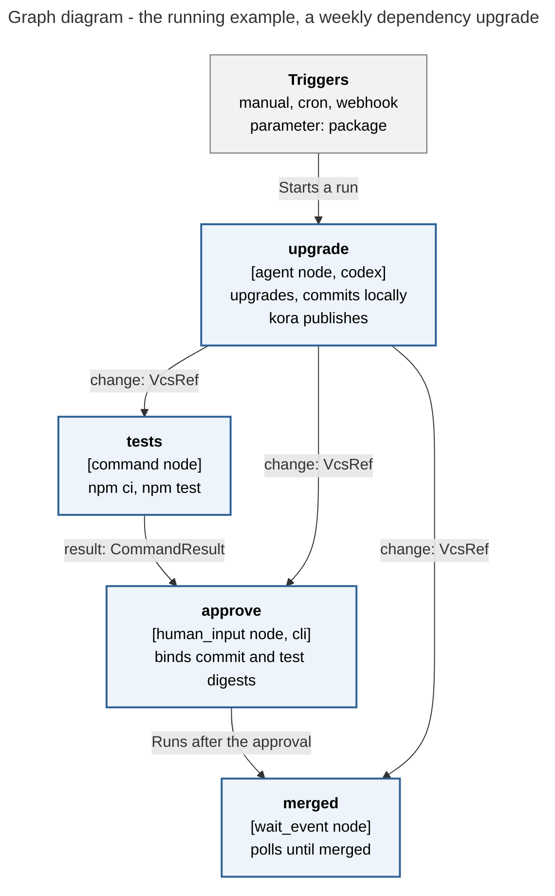

Boxes are nodes with their kind; arrows are edges, labelled with the artifact that flows along them, or with "runs after" for an ordering edge that carries none. The triggers are manual, a cron at 09:00 UTC every Tuesday and a webhook named `upgrade_requested`. `tests` reads the `VcsRef` that `upgrade` produced, so it checks out exactly the commit the agent pushed. `approve` binds that commit and the digest of the test result, so an approval can never cover a later push. The graph declares the `package` parameter as its target key with the policy `defer`, and `overlap: allow`: two runs of the graph may exist at once, but two runs for the same package never work at the same time, because the second waits at admission until the first leaves `running` and its execution/publication recovery is settled ([ADR-0014](../../docs/decisions/0014-target-identity.md); [chapter 2](#2-the-domain-model)). The full document is [examples/dependency-upgrade.ir.yaml](../specs/examples/dependency-upgrade.ir.yaml).

Three kinds of process do the work, and [chapter 3](#3-processes-and-where-they-run) draws them. The control plane, `kora api` and `kora scheduler`, shares one Metadata DB and decides what runs next. Workers run next to the execution infrastructure, claim work through the API and submit it. The lifecycle supervisor launches a candidate session or command through the runtime, enforces its limits and owns private control state. Protected publication uses a separate authority; local is a trusted development/test environment (ADR-0016).

The kind of a node decides who executes it.

| kind | what it does | executed by |
|---|---|---|
| `agent` | one coding-agent session | a worker and the session runner, as an attempt |
| `command` | a deterministic gate: an argv list, never a shell string assembled by kora; a graph may still call `sh -c` explicitly | a worker and the session runner, as an attempt |
| `human_input` | an approval with a form | the scheduler, as a wait and an approval request |
| `wait_event` | waits for a webhook or polls a sensor | the scheduler, as a wait |
| `timer` | a durable delay | the scheduler, as a wait |
| `branch` | routes by a CEL expression | the scheduler |
| `fan_out` | maps a list over a sub-graph body | the scheduler |
| `subgraph` | a body used as one node, retried as a unit | the scheduler |

### 2. The domain model

A graph is a definition; a run is its execution. The definition side is immutable once deployed. The execution side is rows that change state in short transactions; [chapter 14](#14-data-model-and-persistence) lists who writes each table. The diagram shows the entities a contributor meets first; the full model is [data-model.md](../specs/data-model.md) section 2.

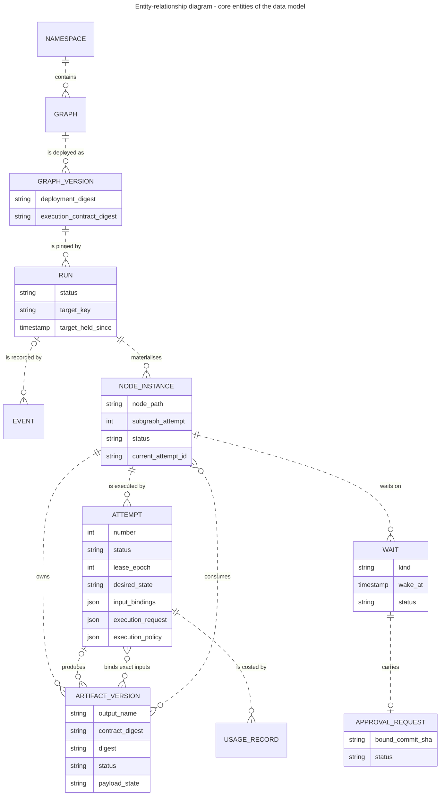

Lines are dashed because every entity drawn has its own ULID key, so no relationship is identifying. An event may belong to no run: the event kinds include `worker.registered`. Most artifact versions come from an attempt; the scheduler writes some itself, among them the collected list of a fan-out and the `PreviousAttempt` of a sub-graph.

The words below are used everywhere else; [appendix B](#b-glossary) has the full glossary.

- **Graph, graph version, IR.** A graph is a directed acyclic graph of typed nodes with a stable identity. Deployment saves an immutable compiled document plus its resolved execution/type contract; an identical complete deployment returns the same graph version (ADR-0018). The document is the IR; the control plane never sees Python.
- **Run.** One execution of a graph version with its parameters. A run pins its execution version for its whole life; live graph concurrency caps are operational policy from the newest active version, or newest deployed when none is active (ADR-0020). Lifecycle status, outstanding acceptance, physical execution occupancy and target ownership are separate.
- **Node instance and node path.** One node inside one run, one per fan-out element and per sub-graph attempt, addressed by a node path such as `candidates[2]@3.review`.
- **Attempt and handle.** An attempt is exactly one runtime submission of an `agent` or `command` node instance, and the unit of cost. The handle is the runtime's own identifier of that submission, stored on the attempt once the runtime returns it. Each attempt owns immutable exact input bindings and a saved nonsecret request sealed before preparation effects; later node clearing cannot erase them (ADR-0018).
- **Artifact and artifact version.** An artifact is a node path and an output name. Each new output is a version: `current`, `superseded` by a newer one, or `invalid`; all outputs of a declared target source start `staged` until its complete result is atomically accepted (ADR-0019).
- **Wait.** The row that a waiting node is: a timer, an approval, an event, a poll, a retry back-off or admission back-pressure. No process or worker is held while a node waits. A run reserves one execution-run slot only while any physical attempt remains non-terminal; outstanding acceptance and acquired target holds can persist without it (ADR-0020).
- **Approval request.** What a `human_input` node asks, bound to one commit SHA and a set of digests, so a response can approve only that content.
- **Target key, `overlap` and `on_active`.** A target key is the optional business identity of a run, such as a package name, scoped to the namespace. It binds once at parameter creation or successful acceptance of the complete declared source result and never changes or clears; releasing the hold does not unfreeze identity (ADR-0019). A run holds its target from the first attempt admitted under its key until it leaves `running` and blocking execution/publication recovery is settled (ADR-0017). `graph.overlap` decides first, at canonical start acceptance/promotion and per graph, using accepted pending/running lifecycle runs: `allow`, `skip` or `queue`. `graph.target.on_active` decides second, at admission and per key: `allow` proceeds, `defer` waits while another run holds the key. A graph that declares `defer` therefore sets `overlap: allow`, or `skip` and `queue` act first.

The canonical graph of the specifications shows the structural kinds at work. A fan-out runs one body instance per list element; the body is a sub-graph retried as a unit, and a `branch` inside it can end the current sub-graph attempt with `$fail_attempt`.

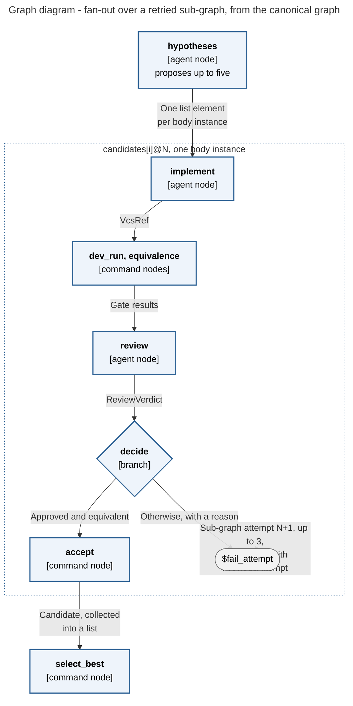

- **The dotted box** is one body instance, `candidates[i]@N`: element `i` of the list in sub-graph attempt `N`. The fan-out runs at most three body instances at a time (`max_parallel`), and with `skip_failures` it collects the instances that succeeded.
- **The node path** `candidates[2]@3.review` names the `review` node in the body instance for list element 2, during sub-graph attempt 3. It is the join key of logs, events and the console.
- **"Attempt" alone always means a runtime submission.** A sub-graph attempt is only the integer after `@`, never an attempt row.
- **Sub-graph attempt N+1** materialises a fresh body, reuses the nodes marked `attempt_invariant`, and marks the previous body's artifact versions `superseded` ([ir.md](../specs/ir.md) sections 4.4 and 5).

### 3. Processes and where they run

Two things are easy to confuse. The engineer's own coding agent, Claude Code or Codex with kora's skills, is a user of kora: it calls kora's MCP tools like a person calls the CLI. The agent sessions inside a graph are work that kora runs: they never call kora, receive typed inputs through the workspace and the prompt, and leave typed outputs that kora collects after the session ends.

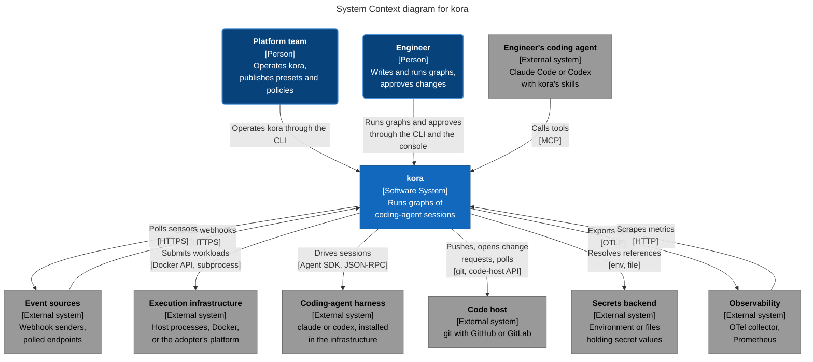

Inside kora are nine containers: seven programs and two data stores. The container diagram shows how they connect. The platform team is left out because it uses the same CLI as the engineer, and the execution infrastructure is left out because the worker reaches the session runner through it; the deployment diagrams below show where the runner runs.

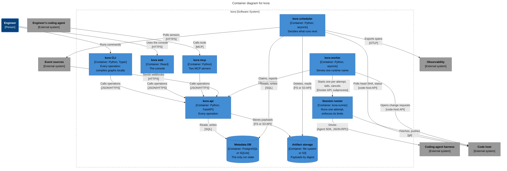

| container | owns | never does |
|---|---|---|
| `kora api` | every operation; authentication; webhook ingestion; the worker endpoints fenced by the lease epoch; OpenAPI; serves `kora web` and the MCP servers over HTTP | running the scheduling loop; running sessions |
| `kora scheduler` | the scheduling passes and the entry points through which the API reaches them; the retention task; the exporter feed | calling runtimes, harnesses or workers |
| `kora worker` | claiming attempts of its runtime, one per poll; requesting plans; submitting; relaying events; opening the change request; uploading results | deciding what runs; enforcing limits; touching the database |
| session runner | inside the runtime: the plans, the session or command, the attempt's limits and deadline, the tool-policy decisions | talking to the API or the database |
| `kora CLI` | every operation as a command; compiling graph sources locally; local commands such as `standalone` and `db upgrade` | operation logic of its own |
| `kora mcp` | two MCP servers that act with the user's token; a stdio process locally, mounted on `kora api` over HTTP | logic or permissions of its own |
| `kora web` | the console over the public API; its mutations in the MVP are the approval response, triggering a run, retrying a node and cancelling a run or node ([docs/console.md](../../docs/console.md)) | logic or database access of its own |
| Metadata DB | every entity; the only run state; payloads up to 64 KiB inline | larger payload bytes |
| Artifact storage | payload bytes by digest: artifacts, transcripts, session segments | metadata |

Only `kora api`, `kora scheduler` and the local `kora db` commands touch the Metadata DB. Not drawn: `kora api` and `kora scheduler` resolve secrets too, for webhook signatures and sensor headers, and the worker resolves them when it builds a submission; `kora api` exposes `/metrics`; the skills installed in the engineer's agent are files, not a process. Where each container's code lives is [chapter 5](#5-code-map).

Each process holds only the credentials its work needs.

| who | holds | can reach | never |
|---|---|---|---|
| `kora api` | database credentials; webhook secrets resolved through the secrets provider | the Metadata DB, artifact storage, approval channels | runs sessions |
| `kora scheduler` | database credentials; secrets for sensor headers | the Metadata DB, artifact storage, the code host for `head_sha` and status, sensors, approval channels, the OTel collector | reaches a worker or a runtime |
| `kora worker` | a service token bound to a runtime and a namespace list; secret values only while it builds a submission, or while it runs the plans itself under `worker_host` | the API over outbound HTTPS, its runtime, the code host for change requests | holds database credentials |
| session runner and harness | a constructed minimal environment with the resolved secrets and harness credentials of one attempt | the workspace, the code host over git, the network egress the runtime allows | reaches the API, the database or kora's MCP servers; loads the repository's own harness configuration unless `trust_repo_config` allows it |
| a person or their agent | a personal token with a namespace list and the `approve` and `platform` flags | the API, through the CLI, MCP or the console | approves without `approve`; publishes presets or policies without `platform` |

Every captured stream, error detail and VCS result passes the redaction filter that each resolved secret registers with ([ADR-0009](../../docs/decisions/0009-target-repository-trust-boundary.md), [ADR-0011](../../docs/decisions/0011-namespaces-and-personal-tokens.md), [protocols.md](../specs/protocols.md) sections 2 and 6).

The same code runs in every deployment shape; only the process layout, the database driver and the artifact storage implementation change. The organisation shape drives most design decisions: workers inside an adopter's closed network.

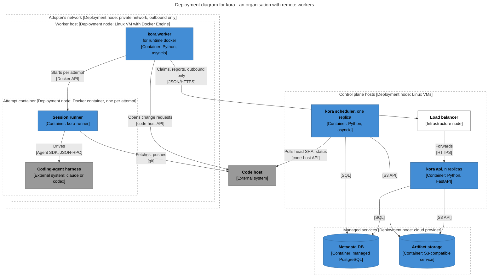

`kora standalone` is the development shape: the same containers wired into one process on SQLite.

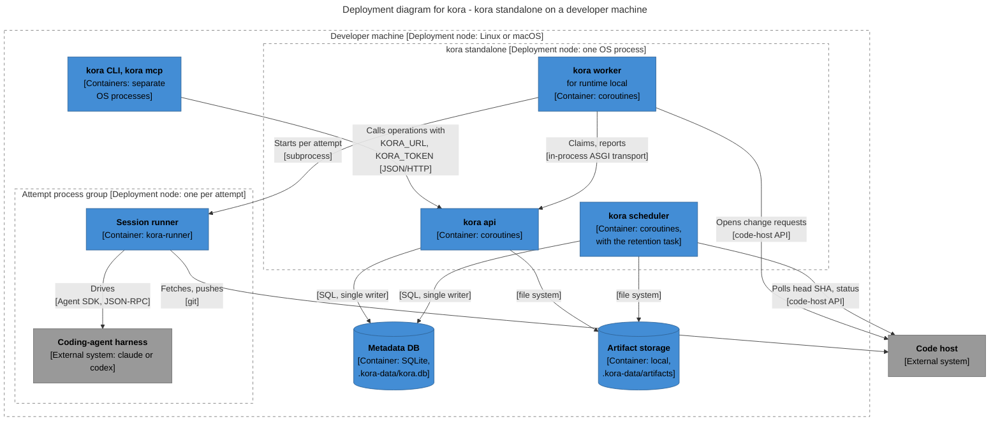

| shape | processes | database and storage | runtime |
|---|---|---|---|
| `kora standalone` | api, scheduler and a local worker as coroutines in one process | SQLite and `./.kora-data`, which also holds the workspaces | `local` by default |
| docker-compose | one api, one scheduler, one or more workers | PostgreSQL and an S3-compatible container | `docker` |
| organisation | as drawn; one scheduler in the MVP, designed for more replicas, which serialise per run and on the shared admission scopes | PostgreSQL and the organisation's object store | `docker` or the adopter's own runtime |

`kora standalone` also bootstraps the data directory, the `default` namespace, a personal token printed once and an internal service token for its worker ([scheduler.md](../specs/scheduler.md) sections 1 and 10). What differs between SQLite and PostgreSQL is in [chapter 14](#14-data-model-and-persistence); the upgrade order is in scheduler.md section 14.

### 4. The plug-in seam

Everything an adopter's infrastructure plugs into is one of eleven protocols: where sessions run, which harness drives them, which VCS and code host hold the code, and how approvals, secrets, storage, telemetry, authentication, sensors and tool policy work. Core code calls the interface and never names an implementation ([invariant 11](#6-invariants)).

- **Discovery.** Implementations are found through one entry-point group, `kora.provider`. Each entry point returns `ProviderMetadata` with the protocol, the name, the implementation, a `config_schema` validated at start-up and a version; `kora plugins list` prints what is installed ([protocols.md](../specs/protocols.md) section 1, [ADR-0005](../../docs/decisions/0005-eleven-protocols-with-conformance-suites.md)).
- **Shape.** Every protocol has a `name`, a `capabilities()` method returning frozen flags and a `config_schema`. All methods are `async` and cancellable. Implementations receive a `ProtocolContext` with the namespace, run, attempt, a logger and a secrets resolver, and never import the scheduler.
- **Errors.** Every failure is a `KoraProtocolError(code, message, retryable, details)`. `retryable=True` maps to the error class `infrastructure`, and an implementation that cannot answer raises it rather than guessing.
- **Proof.** Each protocol has a conformance suite, `kora.conformance.<protocol>`, that production implementations and kora's fakes both pass; an adopter runs it as `kora conformance <protocol> <name>` (protocols.md section 13).
- **Fakes.** The fake harness and the fake runtime ship as test fixtures (NFR-10.1). The fake VCS is a directory-backed implementation validated by the VCS suite, and tests also use a fake approval channel. The testing rules forbid mocks, so almost every integration test runs on fakes.

| protocol | MVP implementations | called from | protocols.md section |
|---|---|---|---|
| runtime | `local`, `docker` | worker | 2 |
| harness adapter | `claude`, `codex`; `acp` after the MVP | runner (`run`); worker (`build_session_spec`); the graph-definition library in the CLI and the API (`check_config`, `policy_coverage`) | 3, 14 |
| vcs | `git` with GitHub and GitLab | worker (plans, `open_change_request`); scheduler (`head_sha`, sensors) | 4 |
| approval channel | `cli`, `vcs` | scheduler (`request`, `poll`, `notify`); API (`notify` when a manual retry invalidates a request) | 5 |
| secrets | `env`, `file` | worker at submit; API for webhook secrets; scheduler for sensor headers | 6 |
| artifact storage | `local`, `s3` | API (put, get); scheduler (retention delete, exporter reads) | 7 |
| artifact type | built-in types and the registry | API (validate on upload); scheduler (summaries for CEL); the graph-definition library | 8 |
| observability exporter | `otel` | scheduler, from the event table | 9 |
| authentication | `static_token` | API | 10 |
| sensor | `change_request_status`, `ci_status`, `http` | scheduler; the graph-definition library (`config_schema`) | 11 |
| policy | `allow_deny` | runner (decide); the graph-definition library (`validate`) | 12 |

The runtime protocol is the one most of Part II depends on. A worker calls it through its runtime implementation:

- `workspace_target(attempt_id)` names the workspace root before submission;
- `submit(workload)` is idempotent on the attempt id and returns the handle;
- `lookup(attempt_id)` recovers a handle after a crash; `None` is handle absence in the original registry, not proof that a paused dispatcher cannot submit; unknown registry/reachability is a retryable error;
- `adopt(handle)` re-attaches to a running session and its event file after a worker restart;
- `status`, `events(handle, from_offset)` and `heartbeat` observe the logical lifecycle: `events` tails the supervisor-owned private control journal from a stored offset;
- `finalize(handle, authorization)` publishes only the stored inspected revision after late authorization;
- `cancel(handle, grace)` requests a stop; `retire(attempt_id, grace)` durably fences delayed submit/finalize and returns affirmative runtime termination evidence; `recovery` and `record_dispatcher_quiescence` retain domain-bound evidence for all grants; `release(handle)` frees bulky storage after recovery is settled but keeps fences/receipts (ADR-0017).

Its capabilities say what a runtime can promise: `portable_handles` when any worker of the runtime can find and adopt a submission, `plan_executors` for where VCS plans may run, `supports_resume`, `enforces_network_policy`, `credential_proxy`, `protected_execution`, `max_concurrent` and `default_stall_after`. `local` and `docker` declare `portable_handles = False` and `supports_resume = False` in the MVP. Local declares `protected_execution = False`; deployments requiring it reject local without adding an extra local opt-in.

### 5. Code map

The repository layout is a decided row of the stack table in [detailed.md](detailed.md) section 7: `src/kora/` with one package per part, plus `web/`, `tests/`, `conformance/` and `examples/`.

| path | holds | specified in |
|---|---|---|
| `src/kora/ir` | the IR as Pydantic models, which generate `ir.schema.json` | [ir.md](../specs/ir.md) |
| `src/kora/dsl` | the DSL builder and the compile step | [dsl.md](../specs/dsl.md) |
| `src/kora/cli` | the Typer commands | [api-and-agent-surface.md](../specs/api-and-agent-surface.md) section 3 |
| `src/kora/mcp` | the two MCP servers | api-and-agent-surface.md section 4 |
| `src/kora/api` | the FastAPI application and its routers; `static/` receives the console build | api-and-agent-surface.md sections 1 and 2 |
| `src/kora/scheduler` | the passes, the entry points, the retention task, the exporter feed | [scheduler.md](../specs/scheduler.md) |
| `src/kora/worker` | the claim loop and the attempt pipeline | scheduler.md section 3, protocols.md section 4 |
| `src/kora/protocols` | the eleven protocol interfaces and their data types | [protocols.md](../specs/protocols.md) |
| `src/kora/plugins/<protocol>/` | kora's own implementations, such as `plugins/runtime/docker`, registered under `kora.provider` | protocols.md |
| `conformance/` | the conformance suites, which protocols.md names `kora.conformance.<protocol>` | protocols.md section 13 |
| `web/` | the console, a Vite project built with pnpm | api-and-agent-surface.md section 6 |

**Open:** [#48](https://github.com/realkarych/kora/issues/48), where the session runner, the plan executor, the shared API client, the persistence layer and the validator that the compiler and the API share live in the repository.

The specifications fix which part may depend on which, and two tests hold the hardest rules.

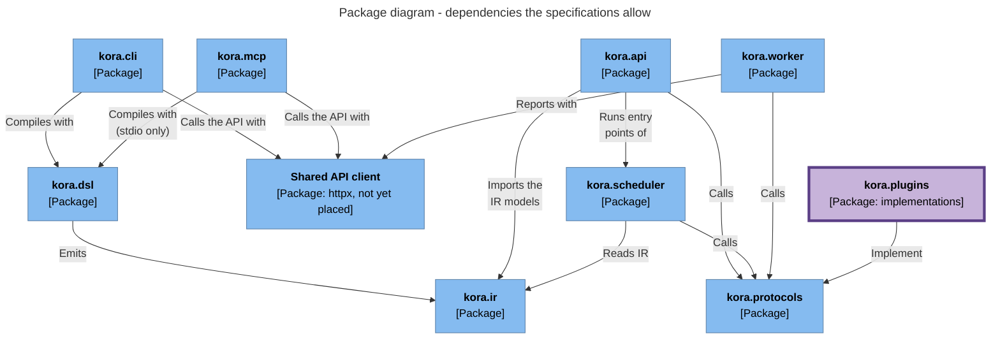

- **The control plane never imports the compiler's import step.** `test_control_plane_never_imports_compiler` checks over the module graph that the API, scheduler, worker and runner packages do not import the compiler's import step ([dsl.md](../specs/dsl.md) section 2).
- **No operation compiles sources.** `test_parity_client_side_operations` checks that the OpenAPI document has no operation that compiles while `kora compile` and `kora_compile` exist.
- **Core code never names an implementation.** Implementations are loaded through `kora.provider` (NFR-5.2), and an implementation never imports the scheduler (protocols.md section 1).
- **A worker never touches the database.** It has the shared client and nothing else towards the control plane ([ADR-0003](../../docs/decisions/0003-scheduler-and-workers-over-http.md)).
- **The console is not a Python package.** `kora web` reaches the API only through the TypeScript client generated from OpenAPI.

### 6. Invariants

These rules hold the construction together. Each is stated as something that never happens, with the decision or specification behind it, the chapter that shows it and, where the specifications name one, the test that proves it. A change that would break one changes a decision: it is discussed in an issue first and lands as an amended decision record or, when it is large or uncertain, as a proposal ([AGENTS.md](../../AGENTS.md)).

1. **No client contains logic.** The HTTP API is the only implementation of every operation, and every operation is reachable from the CLI and from an MCP tool ([ADR-0002](../../docs/decisions/0002-ai-first-api-and-thin-clients.md); [chapter 17](#17-thin-clients-and-the-console); the parity coverage test).
2. **No control-plane process imports an author's Python.** Graphs compile in the author's process, and the control plane accepts only compiled documents (ADR-0002, ADR-0006; [chapter 11](#11-graph-definition); `test_control_plane_never_imports_compiler`).
3. **The API never schedules by its own code.** It reaches the scheduler's transition code through three entry points: start a run, deliver a signal and tick (scheduler.md section 12; [chapter 13](#13-api)).
4. **A worker never decides and never touches the database.** It has one outbound HTTPS path to the API, and every report carries the lease epoch, so a worker that lost its lease cannot write (ADR-0003; [chapter 8](#8-one-attempt-and-when-a-process-dies)).
5. **No side effect happens before its row is durable.** The attempt row precedes `runtime.submit`, which is keyed by the attempt id; the approval request row precedes `channel.request` (data-model.md section 1; chapter 8; `test_submit_crash_recovers_in_original_execution_domain`).
6. **No pass keeps state between ticks.** Readiness is a query over rows, so a restarted scheduler only runs a recovery pass first (NFR-1.2; [chapter 12](#12-scheduler)).
7. **A waiting node never holds a worker.** It is a `wait` row and, for approvals, an `approval_request` row (NFR-1.3; [chapter 9](#9-waits-approvals-and-retries)).
8. **Nothing but the session runner enforces `max_events`, the attempt's `budget_usd` and `stall_after`.** The node deadline is enforced twice: by the runner, also during a partition, and by the scheduler's timeout pass, which decides the attempt's state. Run and sub-graph budgets belong to the scheduler ([ADR-0010](../../docs/decisions/0010-cost-accounting-and-limits.md); [chapter 10](#10-limits-cost-and-safe-retries); `test_runtime_enforces_deadline_during_control_plane_partition`, `test_parallel_attempts_share_run_budget`).
9. **An agent session never reaches kora.** The tool-policy decision point runs inside the session runner, and an agent node never gets kora's own MCP server (ADR-0009, DD-5; [chapter 16](#16-session-runner)).
10. **No approval covers a later commit.** A request binds one commit SHA and its digests; a push invalidates it, and the head is checked again before downstream starts ([ADR-0008](../../docs/decisions/0008-content-bound-approvals.md); chapter 9; `test_push_cannot_rebind_old_evidence`).
11. **Core code never imports a protocol implementation by name.** Implementations are found through the `kora.provider` entry point and pass one conformance suite per protocol (ADR-0005; [chapter 4](#4-the-plug-in-seam)).
12. **Nothing exists only in standalone mode.** Standalone is the same code wired into one process, and every database test runs on PostgreSQL and SQLite (NFR-0.1; [chapter 3](#3-processes-and-where-they-run), chapter 14).

## Part II. Behaviour

### 7. One run, end to end

The sequence follows the running example from deployment to a merged change. Each step names the process that performs it; the table after the diagram names the component, described in Part III.

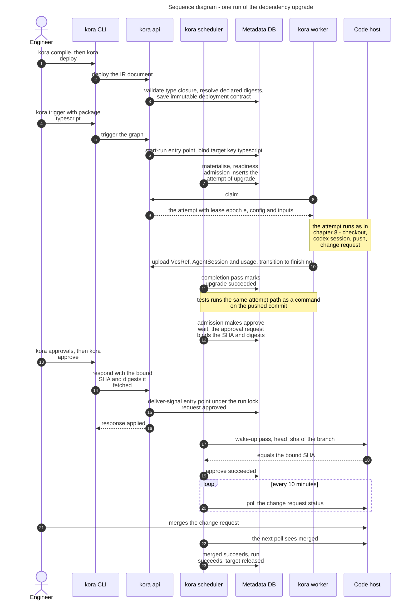

| steps | component | chapter |
|---|---|---|
| 1, 2 | CLI commands and the shared API client | [11](#11-graph-definition) |
| 3 | the registry router, the IR validator and persistence in `kora api` | [13](#13-api) |
| 4 to 6 | the run operations router and the start-run entry point | 13, [12](#12-scheduler) |
| 7 | passes 2, 3 and 5 | 12 |
| 8, 9 | the worker's claim loop and the API's worker endpoints | [15](#15-worker), 13 |
| 10 | the worker's uploader and the API's upload processing | 15, 13 |
| 11 | pass 8, completion | 12 |
| 12 | pass 5, admission, and the approval channel | 12, [9](#9-waits-approvals-and-retries) |
| 13 to 16 | the CLI, the run operations router, the deliver-signal entry point | 13 |
| 17 to 19 | pass 6, the wake-up pass, with the re-check before downstream | 12, 9 |
| 20, 22 | pass 6 polling the `change_request_status` sensor | 12 |
| 23 | pass 6 completing `merged`, then pass 8 completing the run; leaving `running` releases the target only after execution/publication recovery is settled | 12, 9 |

Three things in this sequence are easy to miss.

- **The scheduler never talks to the worker.** It writes an attempt row, and the worker finds it by polling the API.
- **The approval response does not schedule anything in the API's own code.** It enters the scheduler's deliver-signal entry point, so the response is checked and the request changes state under the run lock. The node itself succeeds later, in the wake-up pass, after the head is checked again.
- **A person merges the change request on the code host.** The graph only waits for it, with a sensor that polls every 10 minutes.

### 8. One attempt, and when a process dies

An attempt is where kora meets the outside world, and most of its rules exist for the moment a process dies. Its states come first, because the sequences below use them.

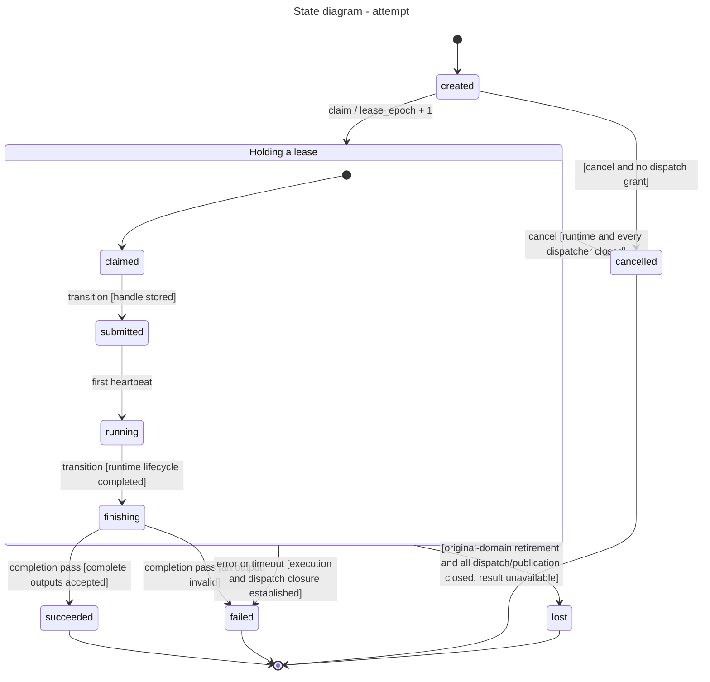

- **An expired lease is recovered in place.** Record `execution_state=unknown` with last observation, retain all reservations and acquired target holds, and grant recovery in the original domain with a fresh epoch/incarnation. All earlier grants remain recorded. Observation/adoption cannot restore platform writes while any earlier dispatcher remains unresolved (ADR-0017).
- **`lost` is classified `infrastructure`** and spends none of the node's agent attempts. An unreachable runtime never yields `lost`.
- **The error classes** a failed attempt can carry, and what decides after each, are in [chapter 9](#9-waits-approvals-and-retries).

**Resolved recovery constraint (ADR-0017):** cancelled/superseded attempts remain claimable for recovery-only observation, retirement and historical reporting even after terminal run status; no new submission/publication is allowed. A never-dispatched created attempt may cancel from durable metadata alone. Other transition-ownership questions remain in [#48](https://github.com/realkarych/kora/issues/48).

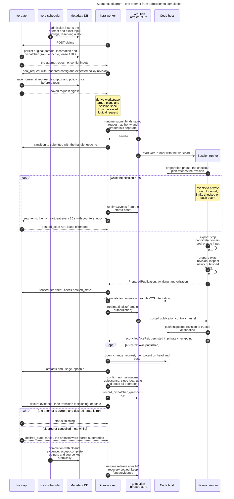

Calls written `runtime.x` go through the worker's runtime implementation to the execution infrastructure. On `local` and `docker` the session runner executes both plans, because the runtime and the git VCS both declare the `runner` executor; the worker learns the resulting `WorkspaceRef` and `VcsRef` from `phase` events in the event file.

The lease epoch fences API writes, while the original domain, retirement fence and every dispatcher's closed gate govern recovery of physical execution and platform effects (ADR-0017). A worker's stable host name is a routing hint; each process has a fresh incarnation, and a replaced/lost runtime registry has a different domain. Non-portable handles require access to the original host/domain. Portable runtimes allow another worker to observe the same service/domain and its recovery state; neither case authorizes replacement from an empty lookup.

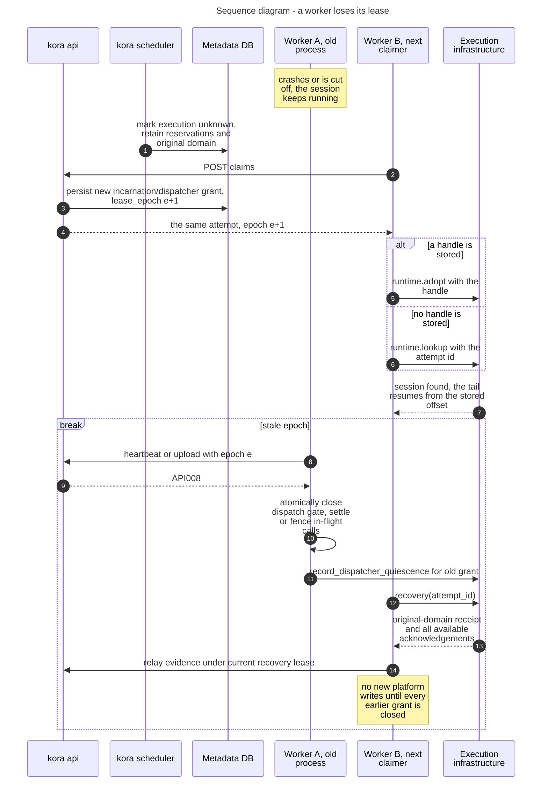

| what fails | what happens next | specified in |
|---|---|---|
| a worker after the claim, before the handle is stored | recover the same original domain; a found handle is adopted; `None`, unreachable or a replacement registry cannot permit new submission. Retirement and all dispatcher closure are required before confirmed loss/replacement | scheduler.md section 3 |
| a worker after `submitted` | the next claimer adopts the handle and tails from `counters.stream_offset` | scheduler.md section 3 |
| a worker after the push, before the `VcsRef` upload | the next claimer adopts the private prepared-result checkpoint and closes every earlier dispatcher and pending operation before new effects, then reconciles the exact revision/destination through late `finalize`; unexpected remote content conflicts; `open_change_request` searches head/base before create; no mutable-workspace recollection | scheduler.md section 3, protocols.md section 4 |
| required sealed input or prepared publication checkpoint is missing/corrupt | record infrastructure error, but retain the unresolved attempt/reservations until runtime termination and every dispatcher/publication closure are established; any existing branch remains discoverable | scheduler.md section 3 |
| a host that never returns, non-portable handles | unknown execution holds capacity and acquired target indefinitely until an operator establishes and attests actual termination/decommissioning and closure of every old dispatcher/publication operation; no second lease-period loss or force retry | ADR-0017, scheduler.md section 3 |
| the runtime cannot answer | unknown execution stays non-terminal with its reservations; observe/retire again in the original domain | scheduler.md section 3 |
| the control plane is unreachable | the runner still stops the session at its limits and its deadline; the timeout pass records intent; terminal status and release wait for affirmative closure evidence | scheduler.md section 4 |
| a cancel or a clear downstream while the attempt runs | `desired_state = cancel` reaches the worker that holds the lease in the next heartbeat response, and recovery-only claims remain available after terminal run status; `retire` and dispatcher evidence establish closure before release; later uploads are stored `superseded`; usage is kept | data-model.md sections 3 and 6 |

Two fences keep late writes out of current state. The lease epoch fences a previous lease holder. **Result authority** fences the attempt's own late writes: an attempt may create current artifact versions or move to `finishing` only while its `desired_state` is `run` and it is its instance's `current_attempt_id`. A cancel or a clear downstream revokes both in the transaction that orders it, and usage, segments and events are still accepted under a valid epoch, so the cost of a cancelled attempt is never lost ([data-model.md](../specs/data-model.md) section 3). `test_cleared_attempt_cannot_publish_current` holds the second fence; execution-recovery conformance cases in protocols.md section 13 also cover stale epochs, old dispatcher closure and retained reservations. API/result fences do not stop an external effect already dispatched.

### 9. Waits, approvals and retries

Every transition below writes an event row in the same transaction. Labels read `event [guard] / action`; the node instance diagram has so many transitions that its conditions are in a table instead.

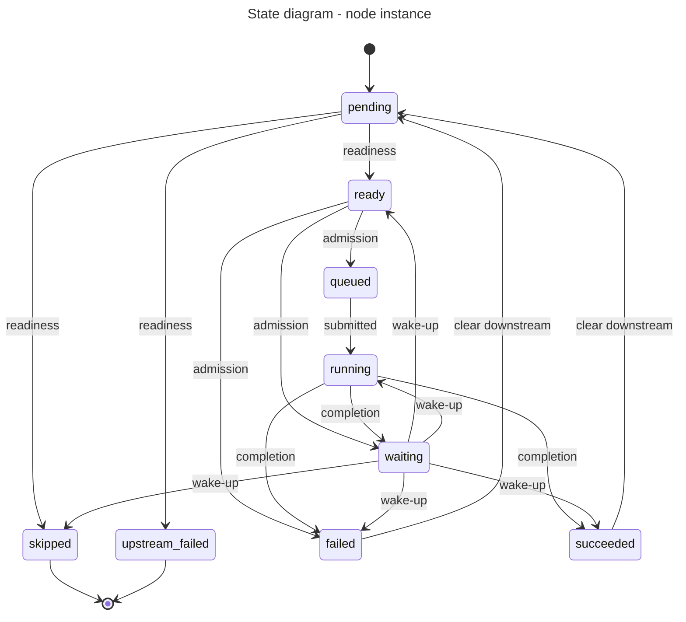

| transition | event | condition |
|---|---|---|
| `pending` to `ready` | readiness | every upstream instance is terminal under the trigger rule; the inputs are resolved to current versions |
| `pending` to `skipped` | readiness | the trigger rule is not met, or a branch did not choose the node |
| `pending` to `upstream_failed` | readiness | an upstream instance failed |
| `ready` to `queued` | admission | an agent or command node with room in every scope; the attempt is inserted |
| `ready` to `waiting` | admission | a waiting kind gets its wait row, or a full scope gives an admission wait |
| `ready` to `failed` | admission | the run or sub-graph budget is exhausted; class `budget_exhausted` |
| `queued` to `running` | the attempt's `submitted` transition | |
| `running` to `succeeded` | completion | complete outputs accepted; a declared target source promotes its whole staged result and checks/binds its key atomically |
| `running` to `waiting` | completion | the attempt failed and the retry policy allows another: a retry back-off wait |
| `running` to `failed` | completion | no retry is left |
| `waiting` to `ready` | wake-up | a retry back-off or an admission wait is over |
| `waiting` to `running` | wake-up | a sensor poll is due |
| `waiting` to `succeeded` | wake-up | a timer is due, an event matched, an approved request passed the re-check, or a wait expired with `on_expiry: default_value` |
| `waiting` to `failed` | wake-up | rejected, expired with `on_expiry: fail`, or the head moved |
| `waiting` to `skipped` | wake-up | expired with `on_expiry: skip` |
| `succeeded` or `failed` to `pending` | clear downstream | the instance is in the closure of a manual retry or of a new sub-graph attempt |
| any state that is not settled to `cancelled` | cancel | not drawn |

- **Clear downstream** resets every instance in its closure to `pending`, not only the succeeded and failed ones drawn here ([data-model.md](../specs/data-model.md) section 6).
- **The structural kinds are not drawn.** A `branch` evaluates in pass 4 and marks its non-chosen targets `skipped`; a `fan_out` completes in pass 4 when all its body instances are terminal; a `subgraph` instance is `running` while its body runs and fails with class `attempt_failed` when the body routes to `$fail_attempt`.
- **A wait** is `open` until it is `satisfied`, `expired` or `cancelled`. Every timed expiry in the system, approvals and sensors included, is the `wake_at` of a wait row, and expiry applies the node's `on_expiry`.

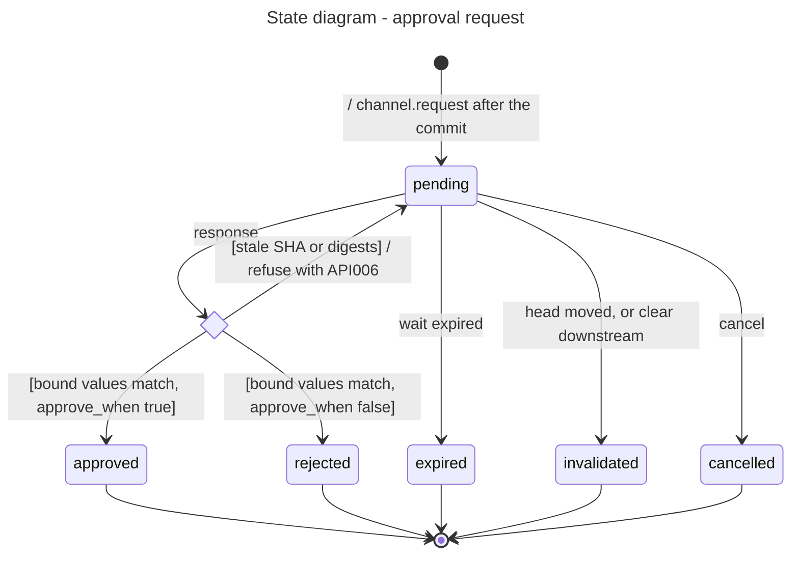

An approved request does not complete its node by itself: the wake-up pass checks the head once more before downstream starts, and a moved head fails the node with `candidate_moved` while the request stays `approved` as the audit record. An approval response from any channel is applied through one function under the run lock: load the request, check that it is still `pending`, compare the commit SHA and digests with the bound values, then transition. The channel is only a transport. A token without the `approve` flag gets `API005`, and a VCS response from the change request's author, from kora's own bot identity or from a login outside the namespace's `approver_allowlist` is refused and logged. `rejected` fails the node with class `approval_rejected`.

A push during review is applied through a second function next to the response one, also under the run lock, so a push and a response that race are serialised and the one applied second finds the request no longer `pending` ([scheduler.md](../specs/scheduler.md) section 5).

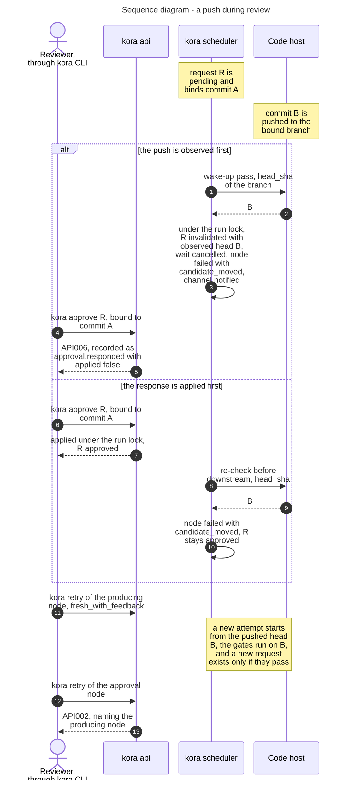

A request covers one immutable revision, so nothing ever asks again on the same bundle. The head is observed through the VCS protocol's `head_sha` at the VCS polling interval; a VCS that declares `head_sha_watch` delivers the same observation earlier as an inbound event, and a replayed push webhook is deduplicated by its delivery key. `test_push_cannot_rebind_old_evidence` fixes this lifecycle on the fake VCS and the fake approval channel, in both orders of the race.

**Error classes.** Every failed attempt or node carries one class from a closed list ([ir.md](../specs/ir.md) section 6). The class decides which policy acts.

| class | set when | decided by |
|---|---|---|
| `harness_error` | the harness session ends in an error | the node's retry policy |
| `command_failed` | a command exits with a code outside `success_exit_codes` | the node's retry policy |
| `timeout` | the timeout pass finds the deadline passed | the node's retry policy |
| `events_exhausted`, `stalled` | the session runner stops the session at `max_events` or after `stall_after` of silence | the node's retry policy |
| `budget_exhausted` | the session runner stops the session at the attempt budget, or admission finds the run or sub-graph budget exhausted | the node's retry policy |
| `artifact_invalid` | an output fails its schema, or the collection phase finds no changed paths or fails to publish | the node's retry policy |
| `protected_path_modified`, `secret_leak` | the plan executor finds a changed protected path or a secret in the diff | the node's retry policy |
| `config_error` | a tool the plan requires is missing | never retried |
| `infrastructure` | a checkout step fails, a protocol error is retryable, or the attempt is `lost` | the `infrastructure_retry` policy, spending no agent attempts |
| `attempt_failed` | a sub-graph body routes to `$fail_attempt` | the sub-graph's retry policy |
| `approval_rejected`, `approval_expired`, `wait_expired` | an approval is rejected, or a wait expires | the node's retry policy |
| `candidate_moved` | the head of a bound branch moved | never retried: the author retries the producing node |
| `cancelled` | a cancel | never retried |

**Four mechanisms run graph work again**, and they differ in what they clear.

| | node retry | manual retry | sub-graph attempt N+1 | rerun |
|---|---|---|---|---|
| started by | the completion pass, from the node's retry policy | `kora retry`, through the API | the completion pass, from the sub-graph's retry policy | `kora rerun`, through the API |
| what it creates | a back-off wait, then a new attempt of the same instance | a clear-downstream transaction, then ordinary passes | a clear downstream of the body, then a fresh body | a new run linked by `rerun_of` |
| what it clears | nothing | the node and its downstream closure; their pending approvals are invalidated | the previous body; `attempt_invariant` nodes are reused | nothing; the original run is untouched |
| graph version | pinned | pinned | pinned | pinned, latest or named |
| strategy | from the node's policy | an optional override | none: the fresh body sees the previous result only through `$previous_attempt` | not applicable |

A retry strategy says where the next attempt of an agent node starts.

- **`fresh`**: a new workspace from the declared revision.
- **`fresh_with_feedback`**: a new workspace checked out from the branch of the previous attempt's `VcsRef`, at that branch's current head, with a `Feedback` carrying the review comments. It works on every runtime and is the documented default where the next attempt needs the previous attempt's work.
- **`resume`**: continue the previous harness session from its stored handle. On the MVP runtimes it always falls back to `fresh_with_feedback` and records `strategy_fallback`, because `release` frees the workspace that holds the harness checkpoint ([scheduler.md](../specs/scheduler.md) section 7).

Below the four sits the `infrastructure_retry` policy of the graph's `runtime` section: an attempt that failed with class `infrastructure`, such as a `lost` one, is resubmitted under it only after runtime termination and all dispatcher/publication closure are proven, without spending the node's attempts. Lease expiry is unknown execution and consumes no retry count. Manual retry records intent while the whole run waits for recovery; linked rerun is refused for any replacement-blocking condition (ADR-0017).

A manual retry is the transaction that changes most at once. It runs through the deliver-signal entry point, under the run lock ([data-model.md](../specs/data-model.md) section 6).

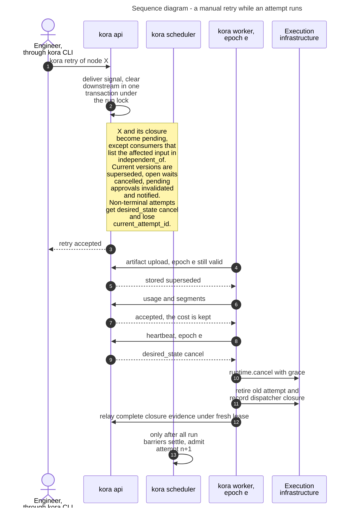

Retry never rebinds a target: the complete source result must return the original key, otherwise it fails with non-retryable `config_error` / `target_identity_conflict` and none of its staged outputs becomes current (ADR-0019). Same-key results may refresh normally; a different target requires a separate run. A run moves through its own states around all of this.

```mermaid
---
title: State diagram - run, with its target hold
---
stateDiagram-v2
  accTitle: Run states with the target hold
  accDescr: A run is created pending when a trigger is accepted, with its target key bound if it comes from a parameter. Graph-serialized promotion makes it running; queue waits for no running graph run and chooses the oldest pending run. Pending and running contribute to outstanding acceptance but only non-terminal physical attempts reserve execution capacity. While running it does not hold its target until admission admits an attempt under a bound key, which sets target_held_since, under defer, while another run holds the key, it waits at admission first. When nothing is left that is not terminal the completion pass ends the run as succeeded or failed, a cancel cancels it. Leaving running releases the hold only after execution and publication recovery is settled. A cancelled run may retain an acquired hold. Manual retry retains an unresolved hold; after settled release it first reacquires outstanding acceptance before clear effects and takes the hold at next physical admission. A failed run can also be cancelled.
  [*] --> pending: trigger accepted / bind the key from a parameter
  pending --> running: graph-locked promotion [saved overlap permits]
  state running {
    state "not holding" as unheld
    state "deferred" as deferred
    state "holding" as holding
    [*] --> unheld
    unheld --> holding: admission [key bound] / set target_held_since
    unheld --> deferred: admission [on_active defer and another run holds the key] / admission wait
    deferred --> holding: admission [holder released after recovery settled]
  }
  running --> succeeded: completion [nothing left that is not terminal]
  running --> failed: completion [nothing left that is not terminal]
  running --> cancelled: cancel
  failed --> running: manual retry [outstanding quota permits] / clear, retain or reacquire hold
  failed --> cancelled: cancel
  succeeded --> [*]
  cancelled --> [*]
```

- **Leaving `running`** clears `target_held_since` only after every blocking execution/publication recovery is settled. Until then a terminal run keeps the hold. A retried run retains an unresolved hold; after settled release it takes the hold again at its next admission behind any new holder (ADR-0017). No key/hold is invented for an unbound run. The first key and its durable origin survive clear/retry/release/expiry; binding itself acquires no hold (ADR-0019).
- **The hold is set whatever the policy.** A run of an `allow` graph never waits, but it holds its target for the benefit of another graph's `defer` on the same namespace key.
- **`run.target_deferred`** is written once per run and holder, for the first admission wait behind that holder. A key bound from an output is bound by the completion pass, with a `run.target_bound` event, and a run never loses its key.
- **A run without a key** never holds a target and never waits on this scope ([ADR-0014](../../docs/decisions/0014-target-identity.md), scheduler.md section 6).

**Open:** [#48](https://github.com/realkarych/kora/issues/48), what decides whether a run with nothing left that is not terminal ends `succeeded` or `failed`. data-model.md section 4 lists both outcomes, and a node's `failed` is not terminal.

### 10. Limits, cost and safe retries

Limits live at four levels: node, sub-graph, run and namespace. A hard limit stops the session at the limit; a soft limit tolerates an overshoot of `budget_headroom_pct` and of what is already running, and the namespace's daily budget only the latter.

| limit | level | kind | enforced by | at the limit |
|---|---|---|---|---|
| `timeout` | node, sub-graph, run | hard | the scheduler's timeout pass decides the state; the runner also stops the session at the node deadline | cancel with grace; class `timeout` |
| `max_events` | agent node | hard | the session runner | interrupt, 30 s grace, kill; class `events_exhausted` |
| `stall_after` | agent node, runtime default 15 min | hard | the session runner, with the window extended during an unanswered tool call | the same termination; class `stalled` |
| `budget_usd` | agent node | soft | the session runner, from streamed usage | past the budget plus headroom, the same termination; class `budget_exhausted` |
| `budget_usd` | sub-graph, run | soft | the scheduler: usage records plus live counters | no further admission in the scope; ready instances fail with `budget_exhausted`; running attempts finish |
| `daily_budget_usd` | namespace | soft | the admission pass | no new attempts admitted; running ones finish |

Usage, counters and events travel two ways: the session's own event stream, and the rows the control plane reads.

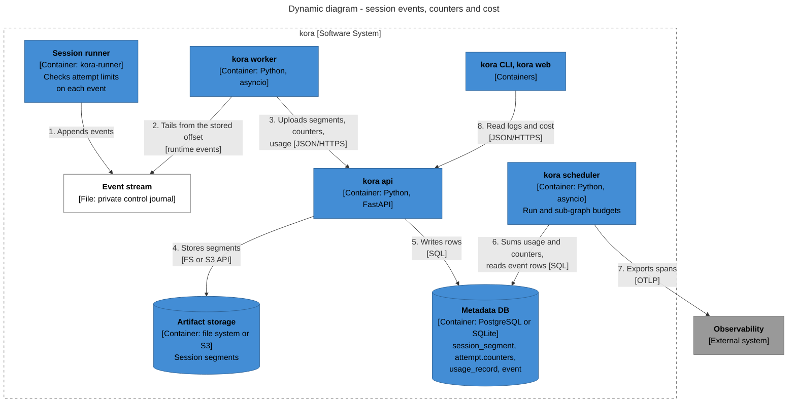

The exporter feed also reads an attempt's session segments from artifact storage when the attempt reaches `finishing`. `usd_estimate` is derived when a usage record is written, from the harness figures or from the active price table; totals are always sums, never stored, and every total carries the weakest completeness of its parts: `complete`, `partial` or `unavailable` (data-model.md section 7, ADR-0010).

**Open:** [#48](https://github.com/realkarych/kora/issues/48), which process writes `attempt.price_table_id` and derives `usd_estimate`. detailed.md section 4 gives a price-table snapshot to the worker's usage recorder, while data-model.md names no writer and protocols.md section 14 has the runner apply a price table that the workload does not carry.

**Keys that make retries safe.** Every side effect has a natural key, so repeating it after a crash does nothing new.

| key | what a duplicate of it cannot do | specified in |
|---|---|---|
| `run.idempotency_key` | start a second run for one delivery: the caller's key, `cron:<graph version>:<fire time>`, the webhook delivery id, `<parent run>:<event>` for a graph trigger | data-model.md section 3 |
| `Idempotency-Key` header | apply a mutating request twice; the answer is replayed from `idempotency_record` | data-model.md section 3 |
| `inbound_event` key | match a replayed webhook twice | data-model.md section 2 |
| attempt id | start a second runtime submission; `lookup` recovers the handle | scheduler.md section 3 |
| `approval_request.id` | post a second request on the channel after a crash | data-model.md section 3 |
| repository and branch; head and base | create a second commit or push; open a second change request | protocols.md section 4 |
| deployment digest | create a second version from the same canonical IR and resolved execution contract | api-and-agent-surface.md section 2 |

The target key is not one of them and deduplicates nothing. Under `defer` it orders the runs of one target; under `allow` it still takes the hold, which a `defer` graph of the same namespace waits on (scheduler.md section 6).

## Part III. Components

Each chapter names its zone from [chapter 20](#20-zones-and-contracts) and its code location from [chapter 5](#5-code-map), says why the component is built the way it is, draws its components, and lists the decisions, tests and open questions that touch it.

### 11. Graph definition

Zone: Graph definition. Code: `src/kora/dsl`, `src/kora/ir`, `src/kora/cli`.

Graphs are Python, but the control plane never runs authors' Python: compilation happens in the author's own process, the `kora compile` CLI or the stdio authoring MCP server, and only the compiled document crosses the network. `kora api` imports the IR models and the shared validator, never the compiler's import step, so compile errors and server-side validation errors are one vocabulary with stable codes and YAML paths. Compilation is offline: registry presets and the namespace policy are pulled beforehand with `kora presets pull`.

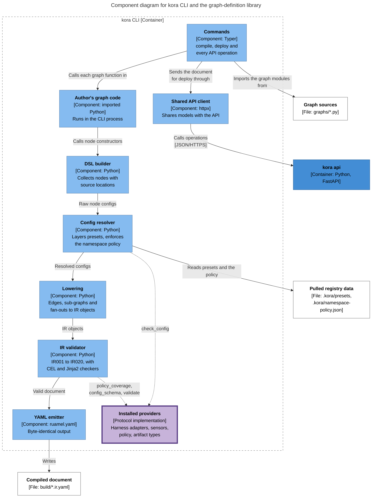

| component | responsibility | specified in |
|---|---|---|
| Commands | `compile`, `validate`, `plan`, `deploy` and one command per API operation; `--json` prints the API response verbatim | api-and-agent-surface.md section 3 |
| DSL builder | graph functions, node constructors, the `>>` operator; detects duplicates and cycles | dsl.md section 1 |
| Config resolver | layers global, graph, preset and node configuration; asks each harness adapter's `check_config`; refuses a preset that raises trust above the namespace policy (`DSL013`) | dsl.md sections 2 and 3 |
| Lowering | turns expressions, edges, sub-graphs and fan-outs into IR; records `source_digest` and the preset snapshot | dsl.md section 2 |
| IR models | one Pydantic definition of the document, imported by the API; it generates `ir.schema.json` | detailed.md section 7, ADR-0013 |
| IR validator | the rules `IR001` to `IR020`; the same code answers `POST /validate`; its checkers type-check CEL against the declared artifact schemas and parse Jinja2 templates in the sandbox | ir.md sections 7 and 10 |
| YAML emitter | deterministic output for identical source/SDK/cache inputs; deployed identity also binds the resolved execution contract | dsl.md section 2 |
| Shared API client | hand-written `httpx`, sharing the Pydantic models with the API; used by the CLI, the MCP servers and the worker | api-and-agent-surface.md section 3 |

Decisions: ADR-0002, ADR-0006, ADR-0012. Tests: `test_control_plane_never_imports_compiler`, `test_parity_client_side_operations`, `test_required_policy_is_enforced_or_rejected`. Unsettled before code: the CEL binding has not been prototyped (the roadmap item "The CEL binding").

### 12. Scheduler

Zone: Scheduler. Code: `src/kora/scheduler`.

The scheduler decides and persists; it never calls a runtime, a harness or a worker. Every pass is a short transaction from rows to rows and keeps nothing in memory, so a restarted scheduler runs one recovery pass and continues. The trigger pass claims rows one by one with `SKIP LOCKED` on PostgreSQL. Passes 2 to 8 work per run under the run lock, an advisory lock on `run.id` on PostgreSQL and the single writer on SQLite, so two replicas never evaluate one run at once. The tick driver runs the passes every second and right after a transition, woken by `LISTEN/NOTIFY` on PostgreSQL; every tick also queries oldest-pending promotion candidates independently of touched-run filtering, so blocked queues are revisited after predecessor completion/restart; for touched runs it repeats passes 2 to 8 until no row changes, at most ten rounds.

**Open:** [#48](https://github.com/realkarych/kora/issues/48), whether the timeout pass takes the run lock. scheduler.md section 2 counts pass 7 among the per-run passes and also calls timeouts per row.

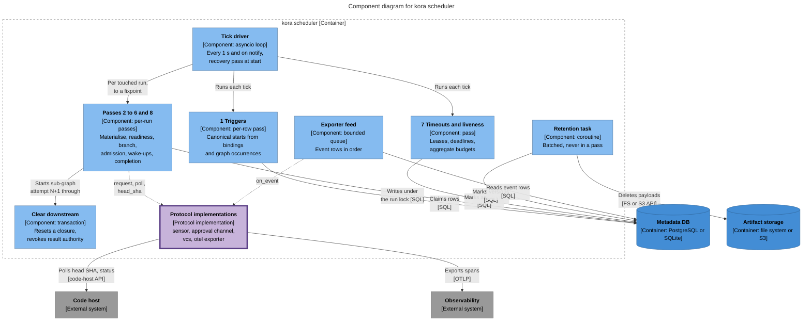

| component | responsibility | specified in |
|---|---|---|
| 1 Triggers | due cron/start-sensor/graph occurrences use shared canonical start: bounded pending run or durable skip, explicit saturation rejection and cursor advance; webhook acceptance already committed its outcome and is never converted again | scheduler.md section 2, ir.md section 8 |
| 2 Materialise | every-tick pending candidates independent of touched-run filtering; graph-locked promotion, with oldest pending queue run only when no graph run is running; creates pinned-IR instances; body materialisation stays lazy | scheduler.md section 2 |
| 3 Readiness | a query over pending instances; resolves inputs to current versions and records `consumed_versions` | scheduler.md section 2 |
| 4 Branch and collection | uses the saved graph contract/results for branch CEL and fan-out collection, without adding physical attempts | scheduler.md section 2 |
| 5 Admission | six limit scopes in a fixed lock order, drawn below; creates attempt rows with immutable exact input bindings, or wait and approval request rows with `run_cost` | scheduler.md section 6 |
| 6 Wake-ups | timers, inbound events matched against wait subscriptions, sensor and approval polls; head observation, invalidation and the re-check before downstream | scheduler.md section 5 |
| 7 Timeouts and liveness | marks expired leases reclaimable; fails wall-clock timeouts; sums run and sub-graph budgets | scheduler.md section 4 |
| 8 Completion and retry | marks instances done; applies retry policies; starts sub-graph attempt N+1; completes the run; accepts a target source's whole staged result and immutable key atomically | scheduler.md sections 2 and 7 |
| Clear downstream | one transaction for a manual retry or sub-graph attempt N+1 | data-model.md section 6 |
| Retention task | expires blobs and inline content only after all unexpired artifact/segment/request/derived owners and required active/recovery holds permit deletion; marks explicit availability | scheduler.md section 13 |
| Exporter feed | a bounded queue over event rows in order; reads an attempt's session segments from artifact storage when the attempt reaches `finishing`; drops are counted; replay from any row | protocols.md section 9 |
| Metrics | queue depth, latencies, stalled/confirmed-lost counts, unknown execution count/age, retained scopes/target holds, pending dispatcher/publication recovery, last-known partial spend; `/readyz` fails until the recovery pass completes | scheduler.md section 11 |

**From a start to a run or skip.** Every source uses shared canonical acceptance (ADR-0020, data-model section 13): authenticate/envelope, accepted receipt/digest replay, new-version validation, overlap, outstanding quota, then one commit of the pinned pending run and receipt or a durable no-run skip. API webhook acceptance calls that entry before acknowledgement; a receipt is not an unconverted work queue or a signal subscription. Matching accepted replay precedes current schema and quotas. A full quota refuses client starts without consuming the key; internal occurrences record rejection and advance their cursor without catch-up. A settled-failed retry reacquires outstanding capacity before clearing; existing recovery/rerun barriers remain. The immutable target binds at valid parameter creation or complete output-source acceptance.

Wait-directed events remain the wake-up pass's input; canonical start receipts are excluded from signal matching (ADR-0020).

**Admission.** Pass 5 decides whether a ready instance gets an attempt now. The order of the six scope locks is fixed, so two scheduler replicas holding different run locks serialise on a shared scope and never admit over a limit.

```mermaid
---
title: Activity diagram - admission of one ready instance
---
flowchart TB
  accTitle: Admission of one ready instance
  accDescr: Admission takes a ready instance under the run lock. A waiting kind gets a wait row, a human_input node also gets an approval request with the run's cost, and its channel is asked after the commit. An agent or command instance waits with execution_recovery while any old attempt in the run has unresolved execution/publication. Otherwise it fails with budget_exhausted when its run or sub-graph budget is exhausted and gets an admission wait while its namespace is over its daily budget. Otherwise six scopes are locked and counted in a fixed order: global, namespace, graph, runtime, fan-out instance and target. Target/recovery blockers take priority over generic concurrency reasons. A blocked candidate gets an admission wait and the scan continues to later eligible instances in stable node ID order; the first wait behind a target holder writes run.target_deferred. When every scope has room, the attempt is inserted created, which reserves attempt capacity and one distinct-run slot if it is the first physical attempt, the target hold is set when the key is bound, and the instance becomes queued. The commit releases the scope locks.
  classDef step fill:#EEF4FB,stroke:#2E6295,color:#000000
  classDef stop fill:#F2F2F2,stroke:#6B6B6B,color:#000000

  start(["Ready instance,<br/>under the run lock"]):::stop
  kind{"Node kind?"}:::step
  waitrow["Insert a wait row; for human_input<br/>also an approval request with run_cost;<br/>the instance is waiting"]:::step
  ask(["After the commit:<br/>channel.request"]):::stop
  budgets{"Budget checks: run or sub-graph<br/>budget exhausted? namespace over<br/>its daily budget?"}:::step
  fail(["Instance failed,<br/>class budget_exhausted"]):::stop
  scopes["Acquire scopes, then read counts:<br/>global, namespace, graph, runtime,<br/>fan-out instance, bound target"]:::step
  admwait(["Admission wait row,<br/>wake_at = now + admission_interval,<br/>continue scanning other eligible nodes"]):::stop
  insert["Insert the attempt, created,<br/>which reserves the slot; set<br/>target_held_since if the key is bound<br/>and the field is null; instance queued"]:::step
  commit(["Commit releases<br/>the scope locks"]):::stop

  start --> kind
  kind -->|"human_input, wait_event, timer"| waitrow
  waitrow -->|"human_input only"| ask
  recovery{"Any execution or publication<br/>recovery barrier in this run?"}:::step
  recoverywait(["Admission wait:<br/>execution_recovery with blocking attempt ids"]):::stop
  kind -->|"agent, command"| recovery
  recovery -->|"yes"| recoverywait
  recovery -->|"no"| budgets
  budgets -->|"run or sub-graph budget"| fail
  budgets -->|"daily budget"| admwait
  budgets -->|"neither"| scopes
  scopes -->|"target blocked or capacity full"| admwait
  scopes -->|"all checks pass"| insert
  insert --> commit
```

- **Physical reservations start at `created`.** Every non-terminal attempt, including history after clear/cancel, retains its applicable attempt scopes until closure. Fan-out max_parallel retains its separate unfinished-body unit through no-attempt waits; parallel nodes in one body add no second body unit. Graph execution-run usage counts distinct run IDs: first attempt acquires one, another parallel attempt adds none, last terminalization releases once. Waits without physical attempts reserve no execution-run slot; acquired target holds and outstanding acceptance remain. Namespace `max_pending_runs` bounds the separate outstanding predicate (default 1000), not pending status.
- **The target scope** counts every run that holds a key, whatever its graph's policy, but makes only runs of `on_active: defer` graphs wait. The first admission wait a run receives behind a given holder writes `run.target_deferred` once.
- **On SQLite** the single writer replaces every scope lock.
- **Limits are live policy.** Graph counts span versions; newest active (or newest deployed when none is active) supplies the cap. Deploy/retire/policy changes serialize with admission, effective reads name the source, and lowering a cap preserves existing occupancy. Run execution semantics stay pinned. The full state table and future race/parity tests are data-model section 13.

**Open:** [#48](https://github.com/realkarych/kora/issues/48), where the run, sub-graph and daily budget checks sit relative to the six scopes. scheduler.md section 6 lists only the six scopes in order; section 2 gives an instance held back by the daily budget an admission wait, and section 4 fails an instance whose run or sub-graph budget is exhausted.

The API reaches the passes through three entry points: start a run, deliver a signal (an approval response, an inbound event, a cancel or a manual retry) and tick (scheduler.md section 12). Chapter 13 draws them inside `kora api`, as scheduler code that the API runs.

**Open:** [#48](https://github.com/realkarych/kora/issues/48), how the API process reaches the scheduler's entry points, and when it calls tick.

Decisions: ADR-0001, ADR-0003, ADR-0007, ADR-0010, ADR-0014. Tests: `test_last_slot_reserved_once`, `test_created_attempt_reserves_capacity`, `test_capacity_released_once`, `test_target_hold_taken_once`, `test_same_target_triggers_follow_declared_policy`, `test_target_bound_from_artifact_version`, `test_failed_run_releases_target`, `test_push_cannot_rebind_old_evidence`, `test_parallel_attempts_share_run_budget`, `test_subgraph_budget_includes_previous_iterations`, `test_latest_graph_creates_explicit_new_execution`, `test_resume_after_original_environment_removal`.

### 13. API

Zone: API. Code: `src/kora/api`.

The API is the only door into kora: for people, for agents through MCP, for webhooks and for workers, which never hold database credentials. Operations that change run state do not schedule anything themselves: the routers call the scheduler's entry points, so a signal and the transition it causes commit in one transaction under the run lock. Every mutation writes an event row with the actor taken from the token, and every error is the one structured error envelope with a stable code.

```mermaid
---
title: Component diagram for kora api
---
flowchart TB
  accTitle: Component diagram for kora api
  accDescr: Clients call operations, the worker claims and reports, and event sources send webhooks; request handling authenticates every request and dispatches it to the operation routers, the webhooks router or the worker endpoints. The operation routers validate documents with the IR validator and send run signals to the scheduling entry points; the webhooks router invokes canonical start acceptance for run-directed deliveries or delivers wait signals. Accepted start receipts cannot be converted into a second run. The worker endpoints hand uploads to upload processing, which validates artifacts against their types and stores payloads in artifact storage. Every writer goes through persistence to the Metadata DB.
  classDef component fill:#85BBF0,stroke:#5D82A8,color:#000000
  classDef plugin fill:#C7B3DA,stroke:#5B3F86,stroke-width:4px,color:#000000
  classDef container fill:#438DD5,stroke:#2E6295,color:#000000
  classDef ext fill:#999999,stroke:#6B6B6B,color:#000000

  clients["<b>kora CLI, kora mcp, kora web</b><br/>[Containers]"]:::container
  worker["<b>kora worker</b><br/>[Container: Python, asyncio]"]:::container
  sources["<b>Event sources</b><br/>[External system]"]:::ext

  subgraph a ["kora api [Container]"]
    reqh["<b>Request handling</b><br/>[Component: middleware]<br/>Authentication, errors,<br/>idempotency, streams"]:::component
    ops["<b>Operation routers</b><br/>[Component: FastAPI routers]<br/>Registry, run operations,<br/>inspection, targets"]:::component
    hooks["<b>Webhooks router</b><br/>[Component: FastAPI router]<br/>Checks signatures,<br/>records inbound events"]:::component
    wk["<b>Worker endpoints</b><br/>[Component: FastAPI router]<br/>Claims and attempt reports"]:::component
    irval["<b>IR validator</b><br/>[Component: Python]<br/>The graph-definition<br/>library's rules"]:::component
    entry["<b>Scheduling entry points</b><br/>[Component: scheduler code]<br/>Start a run, deliver<br/>a signal, tick"]:::component
    uploads["<b>Upload processing</b><br/>[Component: Python]<br/>Validates artifacts,<br/>stores payloads"]:::component
    persistence["<b>Persistence</b><br/>[Component: SQLAlchemy 2.0]<br/>Models, transitions,<br/>event rows"]:::component
    prov["<b>Protocol implementations</b><br/>[Protocol implementation]<br/>authentication, secrets,<br/>approval channel, artifact type"]:::plugin
  end
  db[("<b>Metadata DB</b><br/>[Container: PostgreSQL or SQLite]")]:::container
  blobs[("<b>Artifact storage</b><br/>[Container: file system or S3]")]:::container

  clients -->|"Calls operations<br/>[JSON/HTTPS]"| reqh
  worker -->|"Claims and reports<br/>[JSON/HTTPS]"| reqh
  sources -->|"Sends webhooks<br/>[HTTPS]"| reqh
  reqh -->|"Dispatches operations to"| ops
  reqh -->|"Dispatches deliveries to"| hooks
  reqh -->|"Dispatches worker calls to"| wk
  reqh -.->|"authenticate"| prov
  ops -->|"Validates<br/>documents with"| irval
  ops -->|"Sends run signals to"| entry
  hooks -->|"Delivers inbound<br/>events to"| entry
  wk -->|"Hands uploads to"| uploads
  ops -->|"Reads, writes<br/>registry rows"| persistence
  entry -->|"Applies<br/>transitions"| persistence
  wk -->|"Records claims,<br/>reports"| persistence
  uploads -->|"Records versions,<br/>usage"| persistence
  uploads -.->|"validate"| prov
  entry -.->|"notify"| prov
  persistence -->|"Reads, writes<br/>[SQL]"| db
  uploads -->|"Stores payloads<br/>[FS or S3 API]"| blobs

  style a fill:none,stroke:#767676,stroke-dasharray:5 5
```

| component | responsibility | specified in |
|---|---|---|
| Request handling | tokens bound to a person or a worker and a namespace list, with the `approve` and `platform` flags; the error envelope; `Idempotency-Key` replay; body limits; NDJSON streams | api-and-agent-surface.md section 1 |
| Operation routers: registry | validate, plan, deploy; graphs and versions; presets, artifact types, namespaces; deploy resolves skill and MCP server digests | api-and-agent-surface.md section 2 |
| Operation routers: run operations | trigger, rerun, retry, cancel, approvals and respond; respond checks the bound SHA and digests (`API006`) | api-and-agent-surface.md section 2 |
| Operation routers: inspection | runs, timeline, nodes, attempts and their diff, logs, artifacts and lineage, cost; the target projection, computed from runs and approval requests and writing nothing; `?follow=true` streams | api-and-agent-surface.md section 2 |
| Webhooks router | HMAC/bearer authentication and replay window; canonical bounded start/skip commit before acknowledgement, or ordinary wait signal delivery; accepted replay before current version/quotas | api-and-agent-surface.md section 2 |
| Worker endpoints | register and claim; heartbeat, segments, artifacts, usage and transitions, each carrying the lease epoch; artifact uploads and the transition to `finishing` also need result authority | api-and-agent-surface.md section 2, scheduler.md section 3 |
| IR validator and planner | the shared validator; `/plan` materialises a document on the fake runtime | api-and-agent-surface.md section 2 |
| Scheduling entry points | start a run; deliver a signal; tick | scheduler.md section 12 |
| Upload processing | validates artifacts against saved contracts, stores actual summary/digest-selection results and payloads by digest; stages every output of the declared target source with full-payload identity for read-only replay; promotes `vcs.*` and `permission_denied` facts to event rows | api-and-agent-surface.md section 2, data-model.md section 2 |
| Persistence | the SQLAlchemy models and transitions, an event row per mutation, two dialect-specific statements | scheduler.md section 10, data-model.md section 4 |

Not drawn: the frontend session routes behind `kora open` and the console's cookie, the static console build, the MCP servers mounted under `/mcp`, and `/healthz`, `/readyz` and `/metrics` (api-and-agent-surface.md sections 2 and 6). The validator's calls to installed harness adapters, sensors and policy are drawn in [chapter 11](#11-graph-definition).

Decisions: ADR-0002, ADR-0008, ADR-0011, ADR-0014. Tests: the parity coverage test, `test_cleared_attempt_cannot_publish_current`, `test_target_projection_names_accepted_change`.

**Open:** [#48](https://github.com/realkarych/kora/issues/48), which process runs `kora trigger --dry-run`.

**Open:** [#48](https://github.com/realkarych/kora/issues/48), how the scheduler and the worker serve the health, readiness and metrics endpoints that NFR-7.3 asks every component for; only `kora api` has routes for them.

### 14. Data model and persistence

Zone: Data model. Code: see the open question in [chapter 5](#5-code-map).

The Metadata DB is the only run state, and the scheduler is a function from rows to actions, so most rules about behaviour are rules about who writes which table. The entities are drawn in [chapter 2](#2-the-domain-model) and their state machines in chapters 8 and 9.

The table names the main writer of each table.

| table | written by |
|---|---|
| `namespace`, `preset`, `artifact_type` | the API's registry routes; namespace policy and preset writes need the `platform` flag |
| `graph`, `graph_version` | the API's deploy route; the same canonical IR plus resolved execution contract returns the same version |
| `worker` | the API at registration; `last_seen_at` on every claim and attempt heartbeat |
| `idempotency_record` | the API's request handling |
| `trigger_binding` | read and advanced by the trigger pass (`next_fire_at`, `last_fired_key`) |
| `inbound_event` | canonical start writes durable accepted/skip receipts from API or scheduler entry; wait-directed delivery writes ordinary signal rows |
| `run` | only canonical start creates a bounded pending run; graph-locked promotion and ordinary passes move it; status alone is not a capacity reservation |
| `node_instance` | the passes and clear downstream |
| `attempt` | admission inserts the row and immutable input bindings; API reporting seals the nonsecret request/policy once before effects (ADR-0018); transition ownership remains the open question below |
| `wait` | created by admission and by completion for a retry back-off; resolved by the wake-up pass; cancelled by clear downstream, a run cancel or a timeout |
| `approval_request` | created by admission with `run_cost`; a response applied through the deliver-signal entry point; a head observation applied by the wake-up pass; invalidated by clear downstream |
| `artifact_version` | upload processing for physical outputs; the scheduler for PreviousAttempt, collections and wrapper exports with their own logical rows; target-source staging/promotion by atomic acceptance; clear supersedes current/staged rows; retention changes payload availability |
| `usage_record`, `session_segment` | the API, when a worker uploads them |
| `event` | the API and the scheduler, insert only, in the transaction of the change it records |

**Open:** [#48](https://github.com/realkarych/kora/issues/48), who moves attempt rows after admission. scheduler.md section 12 says only the passes move `attempt` and `node_instance` rows, while section 3 has the API commit the worker's transition to `submitted`, which also makes the node instance `running`, and data-model.md section 4 has the worker move the attempt to `finishing`.

The persistence rules are few and strict.

- **One schema on both databases.** SQLAlchemy 2.0, Core and the typed ORM, with `asyncpg` for PostgreSQL and `aiosqlite` for SQLite (detailed.md section 7). scheduler.md section 10 counts exactly two dialect-specific statements in the repository layer, the claim and the notify; the advisory locks below are the PostgreSQL side of what the single writer does on SQLite.
- **Append, do not overwrite.** Superseded results stay as rows with a status, and every transition writes an `event` row in the same transaction (data-model.md sections 1 and 4).
- **Migrations are additive within a minor version.** Columns are added nullable or with defaults, nothing is dropped or renamed until the next minor, and every release runs against the previous schema; the upgrade order is database, scheduler, API, workers (scheduler.md section 14).
- **Payloads up to 64 KiB are stored inline**; larger ones go to artifact storage by digest (data-model.md section 3).
- **Retention never runs inside a pass.** It uses `expiring`/`expired` for blobs and inline content, checking all artifact, segment, request and derived-result owners plus required active/recovery holds. Possible future retry does not pin terminal-run payloads; missing required retry inputs produce an explicit conflict before effects (data-model.md sections 10 and 11, ADR-0018).

| concern | PostgreSQL | SQLite, in `kora standalone` |
|---|---|---|
| row claims | `SELECT … FOR UPDATE SKIP LOCKED` | the single writer with `BEGIN IMMEDIATE` |
| run lock | `pg_advisory_xact_lock` on the run id | implicit: one writer |
| admission scope locks | `pg_advisory_xact_lock` per scope, in the fixed order | implicit: one writer |
| connection | a pool | one connection, WAL mode, one `asyncio` lock per transaction |
| wake-up | `LISTEN/NOTIFY` plus a 1 s poll | an in-process event plus a 1 s poll |

Every integration test that touches the database runs on PostgreSQL and on SQLite through one parametrised fixture and must behave the same on both ([AGENTS.md](../../AGENTS.md)).

The historical execution contract is [data-model section 11](../specs/data-model.md#11-immutable-contracts-and-execution-records-adr-0018). A graph version pins schemas, parents/references and behavior for every consumer; each physical attempt owns exact bindings and a once-sealed nonsecret request/policy. Recovery uses saved values and original checkpoints, never current aliases, input pointers or branch heads. Actual checkout/image/harness/fallback observations arrive later through existing records/events. Content-bearing request and derived values expire under the run's retention; inspect/diff show explicit availability and enforce transcript access. Historical reads use saved summary/digest/validation results, with no replacement-plugin execution. A compatible upgrade preserves active semantics. These records do not authorize effects or clear ADR-0017 uncertainty.

Target-source acceptance is [data-model section 12](../specs/data-model.md#12-immutable-run-target-identity-adr-0019). Stage the declared source's entire output set, including session/result artifacts, until complete-result/key acceptance and success commit together. Wrappers own exported artifact rows without mutating child history. Conflicting proposals remain historical with a non-retryable structured error; all_done handlers may run without consuming them. Exact source-output replay is read-only, compares full payload identity rather than selected digest fields, and cannot resurrect expiry or repair a settled attempt. Pre-binding/body work and external effects are not retroactively gated; a rerun rediscovers independently rather than transferring a rejected target.

### 15. Worker

Zone: Execution. Code: `src/kora/worker`.

A worker carries out the scheduler's decisions for the attempts it claims, one claim per poll up to its capacity, and reports through the API only. It neither decides nor enforces: deciding belongs to the scheduler and enforcing to the session runner, while the worker relays counters between them. The VCS protocol returns plans and never touches the workspace, because the workspace may sit in a sandbox the worker cannot reach. The worker picks `runner` when both protocols declare it, otherwise `worker_host` if both support it; absence of a compatible executor is an error. Host preparation uses an exposed target; after sealing, host publication receives immutable bytes into private storage before prepare/inspect and consumes that prepared state at late finalize ([protocols.md](../specs/protocols.md) section 4). Every report carries the lease epoch, so a worker that lost its lease cannot write to the API. Every effect also passes its local dispatch gate; replacement requires original-domain runtime retirement plus closure of all grants/operations; same-attempt live adoption can restore permitted platform writes after earlier grants/operations are closed without retiring that live execution. Recovery-only claims remain available for cancelled/superseded attempts and terminal runs (ADR-0017).

```mermaid
---
title: Component diagram for kora worker
---
flowchart TB
  accTitle: Component diagram for kora worker
  accDescr: The claim loop claims an attempt through kora api. The plan requester gets the workspace target and the checkout and publish plans, the session spec builder gets the session spec from the harness adapter, and the submitter submits the workload through the runtime implementation, which resolves session/preparation secrets and starts the lifecycle supervisor and candidate domain in the execution infrastructure. After immutable inspection the worker obtains a publication grant and calls finalize through the trusted runtime channel. The event tailer reads events and passes cancels and the release through the runtime implementation, and hands the session result to the output collector, which opens the change request through the VCS implementation. The uploader reports segments, counters, artifacts and usage to kora api.
  classDef component fill:#85BBF0,stroke:#5D82A8,color:#000000
  classDef plugin fill:#C7B3DA,stroke:#5B3F86,stroke-width:4px,color:#000000
  classDef container fill:#438DD5,stroke:#2E6295,color:#000000
  classDef ext fill:#999999,stroke:#6B6B6B,color:#000000

  api["<b>kora api</b><br/>[Container: Python, FastAPI]"]:::container
  subgraph w ["kora worker [Container]"]
    claim["<b>Claim loop</b><br/>[Component: Python]<br/>Polls every 1 s,<br/>adopts after a restart"]:::component
    plans["<b>Plan requester</b><br/>[Component: Python]<br/>Picks runner or worker_host"]:::component
    spec["<b>Session spec builder</b><br/>[Component: Python]<br/>Resolved config<br/>to SDK options"]:::component
    submit["<b>Submitter</b><br/>[Component: Python]<br/>Keyed by the attempt id"]:::component
    tail["<b>Event tailer</b><br/>[Component: Python]<br/>Bounded queue,<br/>spills to disk"]:::component
    collect["<b>Output collector</b><br/>[Component: Python]<br/>Artifact versions,<br/>usage records"]:::component
    upload["<b>Uploader</b><br/>[Component: Python]<br/>Heartbeats every 15 s"]:::component
    ha["<b>Harness adapter</b><br/>[Protocol implementation]<br/>claude, codex"]:::plugin
    rt["<b>Runtime</b><br/>[Protocol implementation]<br/>local, docker"]:::plugin
    sec["<b>Secrets</b><br/>[Protocol implementation]<br/>env, file"]:::plugin
    vcs["<b>VCS</b><br/>[Protocol implementation]<br/>git"]:::plugin
  end
  infra["<b>Execution infrastructure</b><br/>[External system]<br/>Runs the session runner"]:::ext
  codehost["<b>Code host</b><br/>[External system]"]:::ext

  claim -->|"Claims<br/>[JSON/HTTPS]"| api
  claim -->|"Passes the claimed attempt to"| plans
  plans -.->|"workspace_target"| rt
  plans -.->|"checkout_plan,<br/>publish_plan"| vcs
  plans -->|"Passes the plans to"| spec
  spec -.->|"build_session_spec"| ha
  spec -->|"Passes the workload to"| submit
  submit -.->|"submit"| rt
  rt -.->|"resolve"| sec
  submit -->|"Passes the handle to"| tail
  tail -.->|"events, cancel,<br/>release"| rt
  rt -->|"Starts, tails, stops<br/>[Docker API, subprocess]"| infra
  tail -->|"Passes the session result to"| collect
  tail -->|"Passes segments, counters to"| upload
  collect -.->|"open_change_request"| vcs
  vcs -->|"Opens change requests<br/>[code-host API]"| codehost
  collect -->|"Passes versions, usage to"| upload
  upload -->|"Reports<br/>[JSON/HTTPS]"| api

  style w fill:none,stroke:#767676,stroke-dasharray:5 5
```

| component | responsibility | specified in |
|---|---|---|
| Claim loop | registers, and refuses to start when the installed harness is outside the adapter's tested versions; one self-contained claim per poll; adopts its own attempts after a restart | scheduler.md sections 3 and 15 |
| Plan requester | the workspace target from the runtime, the checkout and publish plans from the VCS; `runner` when both declare it, else `worker_host`, which selects a private host publisher fed by sealed input through `finalize` | protocols.md section 4 |
| Session spec builder | the resolved configuration to SDK options and files to materialise through `build_session_spec`, before the checkout plan runs | protocols.md section 3 |
| Submitter | `runtime.submit` keyed by the attempt id; the runtime adapter resolves secrets into the child environment | protocols.md section 2 |
| Event tailer | `events(handle, from_offset)`; relays the runner's counters; a `cancel` in the heartbeat response becomes `runtime.cancel` | scheduler.md sections 3 and 4 |
| Output collector | outputs to artifact versions; usage per model with completeness; `open_change_request`, idempotent on head and base | protocols.md section 4 |
| Uploader | segments, artifacts, usage and transitions with the lease epoch; heartbeats every 15 s | api-and-agent-surface.md section 2 |

Tests: `test_publish_and_open_change_request_are_idempotent`, `test_workspace_preparation_recovers_after_worker_crash`, `test_submit_crash_recovers_in_original_execution_domain`, `test_vcs_runtime_cross_product`.

### 16. Session runner

Zone: Execution. Code: see the open question in [chapter 5](#5-code-map).

The session runner, `kora-runner`, is the lifecycle supervisor shipped with the runtime installation. It hosts the harness adapter and policy client, launches candidate processes through a runtime-supplied launcher and enforces `max_events`, the attempt budget, stall and deadline. Its private control journal and phase checkpoint are outside the candidate workspace; the worker tails them through the runtime. Only the supervisor emits authoritative phase results. The candidate harness/tools/commands and descendants do not hold the supervisor or publisher authority on a protected runtime. The supervisor has no API credential; the worker obtains late VCS authorization and calls `Runtime.finalize` after sealing and immutable inspection. Local deliberately provides the same lifecycle for trusted development/tests without OS isolation, administrator permission or an extra trust switch. [ADR-0016](../../docs/decisions/0016-trusted-execution-and-publication.md) and protocols.md sections 2 and 4 define the authority, launcher, transfer, idempotency and placement contracts.

```mermaid
---
title: Component diagram for the session runner
---
flowchart TB
  accTitle: Component diagram for the session runner
  accDescr: The workload reaches the phase driver through the runtime. The phase driver runs trusted checkout before candidate execution, stops and seals the candidate, and prepares and inspects a fixed publication; late authorization permits its publisher to push that revision. It verifies skill and MCP server digests, and starts either the harness adapter or the command executor. The harness adapter drives the harness and asks the policy decision point before every tool call. Events go to the limit enforcer, which can stop the session or the command, and then to the event writer, which appends to the event file that the worker tails.
  classDef component fill:#85BBF0,stroke:#5D82A8,color:#000000
  classDef plugin fill:#C7B3DA,stroke:#5B3F86,stroke-width:4px,color:#000000
  classDef container fill:#438DD5,stroke:#2E6295,color:#000000
  classDef ext fill:#999999,stroke:#6B6B6B,color:#000000
  classDef file fill:#FFFFFF,stroke:#6B6B6B,color:#000000

  worker["<b>kora worker</b><br/>[Container: Python, asyncio]"]:::container
  subgraph r ["Session runner [Container]"]
    driver["<b>Phase driver</b><br/>[Component: Python]<br/>Preparation, session,<br/>collection; verifies digests"]:::component
    plan_exec["<b>Plan executor</b><br/>[Component: Python]<br/>Shared with the worker"]:::component
    adapter["<b>Harness adapter</b><br/>[Protocol implementation]<br/>claude, codex"]:::plugin
    cmd["<b>Command executor</b><br/>[Component: Python]<br/>An argv list, no shell string"]:::component
    policy["<b>Policy decision point</b><br/>[Protocol implementation]<br/>allow_deny"]:::plugin
    limits["<b>Limit enforcer</b><br/>[Component: Python]<br/>Events, budget,<br/>stall, deadline"]:::component
    writer["<b>Event writer</b><br/>[Component: Python]<br/>The normalised stream"]:::component
  end
  file["<b>Event stream</b><br/>[File: private control journal]"]:::file
  codehost["<b>Code host</b><br/>[External system]"]:::ext
  harness["<b>Coding-agent harness</b><br/>[External system]"]:::ext

  worker -->|"Hands over the workload<br/>[Docker API or subprocess]"| driver
  driver -->|"Prepares, seals, inspects;<br/>publishes after finalize"| plan_exec
  plan_exec -->|"Fetches, pushes<br/>[git]"| codehost
  driver -.->|"run, for an agent node"| adapter
  driver -->|"Runs a command node with"| cmd
  adapter -->|"Drives<br/>[Agent SDK, JSON-RPC]"| harness
  adapter -.->|"decide"| policy
  adapter -->|"Passes normalised events to"| limits
  cmd -->|"Passes output events to"| limits
  limits -.->|"Stops the session"| adapter
  limits -->|"Stops at the deadline"| cmd
  limits -->|"Passes events, counters to"| writer
  writer -->|"Appends to"| file
  worker -->|"Tails<br/>[Docker API or file read]"| file

  style r fill:none,stroke:#767676,stroke-dasharray:5 5
```

| component | responsibility | specified in |
|---|---|---|
| Phase driver | owns private journal/checkpoint; prepares, launches candidate, stops/seals, inspects and waits for late finalization; verifies installed skill/MCP digests; only this driver emits authoritative phase results | protocols.md sections 2 and 4 |
| Plan executor | preparation: empties the root, materialises files, checks the required tools, runs the checkout steps, rejects changed protected paths; after sealing: fresh metadata, inspect complete newly published content, late authorized publication of the stored revision | protocols.md section 4 |
| Harness adapter | `claude` over the Agent SDK, `codex` over app-server JSON-RPC; maps SDK messages to normalised events; routes the pre-tool-call hook | protocols.md section 3 |
| Command executor | runs a command workload's argv list; records the exit code in `CommandResult` | ir.md section 4, protocols.md section 2 |
| Policy decision point | the namespace `tool_policy` prepended to the node's; rejects shell chaining and indirection; denies edits of protected paths | protocols.md section 12 |
| Limit enforcer | `max_events`, `budget_usd`, `stall_after` extended during an unanswered tool call, and the deadline; interrupt, 30 s grace, kill | ir.md section 9 |
| Event writer | the `{i, at, kind, data}` stream, including the `phase` events | scheduler.md section 4 |

The specifications describe the runner's agent path in detail; that it also runs the command of a command workload follows from `Workload.kind` and from the preparation phase running for both kinds (protocols.md sections 2 and 4).

**Open:** [#48](https://github.com/realkarych/kora/issues/48), who writes `.kora/inputs/*.json` under the `runner` executor. ir.md section 4 and ADR-0012 say the worker, and under `runner` only the runner reaches the workspace.

Each phase ends a failed attempt with its own error class, and the class decides which policy acts ([chapter 9](#9-waits-approvals-and-retries)).

| phase | failure | class |
|---|---|---|
| preparation | a required tool is missing | `config_error`, never retried |
| preparation | a checkout step fails | `infrastructure`, under `infrastructure_retry` |
| preparation | a `VcsRef` checkout changed a protected path | `protected_path_modified` |
| session | `max_events`, the attempt budget, `stall_after` | `events_exhausted`, `budget_exhausted`, `stalled` |
| session | the node deadline | the runner stops the session; the timeout pass sets `timeout` |
| session | a command exits outside `success_exit_codes` | `command_failed` |
| inspection | a secret found anywhere in newly published content/history | `secret_leak` |
| inspection/publication | no changed paths, malformed/incomplete native content or an unexpected remote revision | `artifact_invalid` |
| sealing/recovery | required private input or checkpoint unavailable | `infrastructure`; no regenerated publication under the same identity |

**Open:** [#48](https://github.com/realkarych/kora/issues/48), which error class a skill or MCP server digest mismatch gets.

Decisions: ADR-0004, ADR-0009, ADR-0010, ADR-0016. Tests: `test_required_policy_is_enforced_or_rejected`, `test_runtime_enforces_deadline_during_control_plane_partition`. Unsettled before code: the Claude Agent SDK with `setting_sources=[]` and the Codex app-server hook are documented but untested (the roadmap item "Harness SDK behaviour").

### 17. Thin clients and the console

Zone: Thin clients and Console. Code: `src/kora/cli`, `src/kora/mcp`, `web/`.

| client | what it is |
|---|---|
| kora CLI | one command per operation over the shared client; besides them `compile`, `plugins list`, `doctor`, `conformance`, `standalone`, `db upgrade` and `db verify-storage` work locally, while `presets pull` and `open` call the API outside the one-per-operation mapping |
| kora mcp | `kora-authoring` with 4 tools and `kora-operating` with 10, 14 in total under a cap of 15; `kora_compile` only in the stdio server; long operations as MCP Tasks |
| harness skills | `skills/kora-author` and `skills/kora-operate` for Claude Code and Codex, generated from the reference corpus |
| kora web | React, TypeScript, Vite, TanStack Query, shadcn/ui, React Flow; a client generated from OpenAPI; its design is [docs/console.md](../../docs/console.md) with [ADR-0015](../../docs/decisions/0015-web-console-design.md) |
| reference material | one registry of `DSLnnn`, `IRnnn`, `APInnn` and runtime error codes with recovery hints, generating `kora_reference`, `/reference/*` and the skills |

"Skills" means two different things. The harness skills above are files installed in the engineer's own coding agent, so that it can author and operate kora graphs. The skills attached to an agent node are part of that node's configuration: deploy resolves their digests, and the session runner verifies them before the session starts.

**Open:** [#48](https://github.com/realkarych/kora/issues/48), where deploy reads skill content to compute digests, and where that content comes from when the worker builds the session spec.

All of them are specified in [api-and-agent-surface.md](../specs/api-and-agent-surface.md) sections 3 to 7.

## Part IV. Working on kora

### 18. How a change lands

[AGENTS.md](../../AGENTS.md) is normative for every contributor and every coding agent; this chapter only names the rules a first pull request runs into.

- **An issue and a plan come first.** Every change goes through an issue and one pull request that closes it. Anything beyond a trivial fix needs an implementation plan as an issue comment, approved by the project owner before code is written.
- **Documents and code change together.** A change to described behaviour updates its specification or decision record in the same pull request. `docs/` changes only in pull requests the owner reviews line by line; drafts and research go to `knowledge/`.
- **The code carries no comments.** No comments or docstrings in hand-written code and no tool directives such as `# type: ignore`; full type annotations; pyright strict and ruff for Python, strict TypeScript and ESLint for `web/`.
- **Errors fail fast.** No swallowed exceptions or silent fallbacks; every error that leaves the API is the structured error envelope.
- **Tests use fakes, never mocks.** Most tests are integration tests on the real API, database, scheduler and worker; every database test runs on PostgreSQL and SQLite; tests are deterministic, and CI stays under 10 minutes. Tests that need Docker run on the Linux job only.
- **Dependencies are deliberate.** Python dependencies only through `uv`, frontend dependencies only through `pnpm`, each recorded with its reason in the stack table of detailed.md section 7.
- **Only Linux and macOS are supported.**

### 19. Common changes

**Add a protocol implementation, for example a Kubernetes runtime.**

- **Scope first.** A runtime outside the MVP set is new scope: it starts as an issue, and as a proposal in `docs/proposals/` when it is large or uncertain.
- **Where it lives.** kora's own implementations live under `src/kora/plugins/runtime/`; an adopter's runtime ships as a distribution of its own. Either registers `ProviderMetadata` under the `kora.provider` entry point with a `config_schema` ([protocols.md](../specs/protocols.md) section 1). A new client library is a dependency and goes into the stack table with its reason.
- **The protocol** is listed in [chapter 4](#4-the-plug-in-seam). The error contract matters most: `lookup` returning `None` is original-domain handle absence, never proof against delayed submission; unreachable or missing registry state raises `KoraProtocolError(retryable=True)`. Domain-bound `retire` and all dispatcher/publication closure are required for confirmed loss (ADR-0017). `events` reads the supervisor-owned private control journal, outside candidate storage, resumably from an offset; `finalize` publishes only the immutable inspected result after late authorization.
- **The workload** binds the API-saved nonsecret request and digest; changing dispatcher/lease authority and credential values are outside semantic hashing (ADR-0018). It carries the resolved configuration, the workspace target, the checkout plan or the `WorkspaceRef`, the publish plan, a constructed minimal environment, session/preparation secret references resolved before execution (publication authorization arrives only after inspection), the harness credentials, the artifact inputs, the limits with the absolute deadline, and the session spec (protocols.md section 2).
- **Capabilities.** `portable_handles` is true when any worker can find a submission by its attempt id; `plan_executors` is usually `runner` when pods reach the code host; `enforces_network_policy` is what a namespace with `require_network_enforcement` needs for nodes that receive secrets (`IR015`); `supports_resume` only when the harness checkpoint outlives `release`; `credential_proxy`, `protected_execution`, `max_concurrent` and `default_stall_after` as the platform allows. `require_protected_execution` rejects an incapable runtime; local declares false and is intended for trusted development/tests.
- **The image** carries `kora-runner` and the harness binaries, with the harness auto-updater disabled; the image digest is recorded on every attempt.
- **Workers.** Run one or more workers for the runtime name, inside the cluster's network if needed.
- **Proof.** `kora conformance runtime <name>` checks one handle for two submits, `lookup` after a restart and while unreachable, adoption as `portable_handles` promises, the event file resumed without duplicate or lost lines, the deadline enforced with the control plane unreachable, `cancel` within grace, the constructed environment, the declared capabilities and a `release` that removes bulky workspace state while retaining retirement fences and dispatcher evidence. ADR-0017 adds the future delayed-submit/finalize, registry-loss, multi-incarnation, partition/cancel/hold, operator evidence and surface-parity cases in protocols.md section 13. `test_vcs_runtime_cross_product` then runs the VCS you pair it with on it (protocols.md section 13). How kora's own CI would run a cluster within its ten-minute budget is not decided.

**Add an API operation.**

- Ship the route, its CLI command and its MCP tool in one change. The MCP servers have 14 tools under a cap of 15, so a new operation joins an existing tool where it fits, as rerun did inside `kora_trigger`.
- An operation that changes run state enters the scheduler's start-run or deliver-signal entry point; it never writes a transition itself.
- Write an event row for every mutation; accept `Idempotency-Key` on mutating calls; never require interactive input.
- Register new error codes with recovery hints and add an example to the reference corpus.
- Regenerate OpenAPI and the TypeScript client; the parity coverage test must pass. The checklist is [api-and-agent-surface.md](../specs/api-and-agent-surface.md) section 7.

**Change the graph format.**

- Change the IR models; `ir.schema.json` is generated from them.
- Add a validation rule with the next `IRnnn` code and its YAML path; update the DSL when authors write the field, with a `DSLnnn` code for its compile-time form.
- Update ir.md, both example documents and the scheduler pass that reads the field.
- The format has not shipped, so a change lands in `ir_version` 1.0, as `graph.target` did; minor versions with a migrator (NFR-6.3) begin after the first release ([ADR-0014](../../docs/decisions/0014-target-identity.md)).

**Test any of these** with the fakes of chapter 4 and the conformance suites, never with mocks, and run every database test on PostgreSQL and SQLite through the shared fixture.

### 20. Zones and contracts

kora splits into units worth owning. Where two meet, their owners must agree on an artifact, and the specifications say where it is written and which test proves it.

| zone | what it contains | chapters | specifications |
|---|---|---|---|
| Graph definition | the DSL, the compiler, the IR models and schema, the validator, the CEL checker and evaluator | [11](#11-graph-definition) | dsl.md, ir.md |
| API | request handling, the routers, upload processing, OpenAPI | [13](#13-api) | api-and-agent-surface.md sections 1 and 2 |
| Data model | the SQLAlchemy models, Alembic migrations, the state machines, the cost and limit arithmetic | [2](#2-the-domain-model), [14](#14-data-model-and-persistence) | data-model.md |
| Scheduler | the passes, the entry points the API runs, the retention task, the exporter feed | [12](#12-scheduler) | scheduler.md |
| Execution | `kora worker` and the session runner, with the plan executor and the command executor | [8](#8-one-attempt-and-when-a-process-dies), [15](#15-worker), [16](#16-session-runner) | protocols.md sections 2 to 4 |
| Protocols | the eleven interfaces, the reference implementations including `otel`, the fakes, the conformance suites, the provider loader | [4](#4-the-plug-in-seam) | protocols.md |
| Thin clients | the shared client, the CLI, the MCP servers, the skills, the reference material and error-code registry | [17](#17-thin-clients-and-the-console) | api-and-agent-surface.md sections 3 to 5 and 7 |
| Console | `kora web`, designed in [docs/console.md](../../docs/console.md) | 17 | api-and-agent-surface.md section 6 |
| Cross-cutting | content-bound approvals end to end, the redaction filter, the metrics registry | [9](#9-waits-approvals-and-retries), [3](#3-processes-and-where-they-run) | ADR-0008, protocols.md section 6, scheduler.md section 11 |
| Standalone | in-process wiring, the SQLite path, bootstrap | 3, 14 | scheduler.md section 10 |
| Test infrastructure | the two-database fixture, testcontainers, recorded SDK streams, the canonical-graph fixture, the CI matrix of Linux with Docker and macOS without | [18](#18-how-a-change-lands) | AGENTS.md |
| Deployment | the runtime image for `docker`, docker-compose, the packaging extras, the web build hook | 3 | detailed.md sections 6 and 7 |

For each pair of zones that touch, the table names the artifact both owners must agree on. Other pairs meet only through Standalone's wiring, Deployment's images and Test infrastructure's fixtures. The worker and the scheduler meet only through attempt rows behind the API, and the thin clients and the console never see the scheduler.

| zones | contract | where it is written | test |
|---|---|---|---|
| Graph definition and API | the IR schema and the shared validator; the providers installed in the API process for validation | ir.md section 10, `ir.schema.json` | `test_control_plane_never_imports_compiler` |
| Graph definition and Scheduler | IR semantics: node kinds, triggers, retry policy, `graph.target`; the CEL evaluator as a library | ir.md sections 4 to 9 | none named |
| Graph definition and Execution | the resolved agent configuration the session spec builder consumes; Jinja2 rendering at attempt start; the harness mapping tables | ir.md sections 4.1 and 7, protocols.md section 14 | none named |
| Graph definition and Protocols | `check_config`, `policy_coverage`, sensor `config_schema` and `Policy.validate`, called by the validator | dsl.md section 2, protocols.md sections 3, 11 and 12 | `test_required_policy_is_enforced_or_rejected` |
| API and Thin clients, Console | OpenAPI resource and error shapes; the generated TypeScript client; the shared `httpx` client; error codes registered with hints | api-and-agent-surface.md sections 1, 2 and 7 | the parity coverage test, `test_parity_client_side_operations` |
| API and Data model, Scheduler | the database schema and the state machines; the scheduling entry points; the artifact versions the control plane writes; the target projection | data-model.md sections 2 to 5, scheduler.md section 12, api-and-agent-surface.md section 2 | `test_latest_graph_creates_explicit_new_execution`, `test_target_projection_names_accepted_change` |
| API and Execution | the worker endpoints, the lease epoch and result authority; the skill and MCP server digests the runner verifies | api-and-agent-surface.md section 2, scheduler.md section 3, data-model.md section 3 | `test_cleared_attempt_cannot_publish_current` |
| Inside Execution: worker and runner | the workload, the normalised event stream, the plan executor as shared code | protocols.md sections 2 to 4 | `test_workspace_preparation_recovers_after_worker_crash` |
| API, Scheduler and Execution with Protocols | the eleven interfaces, the conformance suites, the fakes | protocols.md sections 1 and 13 | `test_vcs_runtime_cross_product` |
| Data model and Scheduler | the six admission scopes and their lock order; the target hold columns | scheduler.md section 6, data-model.md section 3 | `test_last_slot_reserved_once`, `test_target_hold_taken_once` |
| Namespace policy: Graph definition, Scheduler, Execution, Protocols | each policy field and its enforcement point, [appendix C](#c-namespace-policy-enforcement) | data-model.md section 2, dsl.md section 2, scheduler.md section 6, protocols.md sections 6, 11 and 12 | none named |
| Cost: Data model with every zone that records usage | usage records, the price table, one arithmetic module; the attempt budget in the runner, run and sub-graph budgets in the scheduler | ADR-0010, scheduler.md section 4 | `test_parallel_attempts_share_run_budget` |
| Approvals: Cross-cutting with Scheduler, API, Protocols and Console | binding, invalidation on push, the re-check, the form and its rendering | ADR-0008, scheduler.md section 5 | `test_push_cannot_rebind_old_evidence` |
| Redaction: Cross-cutting with Execution and API | the filter every captured stream, error detail and VCS result passes through | protocols.md section 6 | none named |
| Metrics: Cross-cutting with every zone | metric names as one registry | scheduler.md section 11 | none named |

## Appendices

### A. Diagram key

| element | drawn as | stands for |
|---|---|---|
| person | dark blue rounded box with white text, `[Person]` | a human user |
| software system | blue box with white text, `[Software System]` | kora as a whole |
| container | mid-blue box, `[Container: technology]`; a cylinder for a data store | a program or data store of kora |
| component | light blue box, `[Component: technology]` | a unit inside one container |
| package | light blue box, `[Package]` | a Python package, in chapter 5 only |
| protocol implementation | purple box with a thick border, `[Protocol implementation]` | code loaded through `kora.provider`; the border keeps it distinct in grey-scale |
| external system | grey box, `[External system]` | something outside kora |
| file | white box with a grey border, `[File: path]` | a file on disk |
| infrastructure node | white box, `[Infrastructure node]` | a deployment helper such as a load balancer |
| boundary | dashed grey frame without fill, named with its type | kora as a system, the container of a component diagram, or a deployment node |
| graph node | pale blue box, `[<kind> node]` | a node of one graph, in chapters 1 and 2 |
| body instance | dotted blue frame | one fan-out body instance, in chapter 2 |
| trigger, sentinel | light grey box or stadium | a graph's triggers; the `$fail_attempt` target |
| activity step | pale blue box, a diamond for a decision, a grey stadium for a start or an end | the admission flow in chapter 12 |

- **A solid arrow** points one way and says what the source does, or names the data it passes. An arrow that leaves a process names the wire technology in brackets: `[JSON/HTTPS]`, `[SQL]`, `[git]`. Between components of one process it is an in-process call.
- **A dotted arrow** in a C4 diagram is a call into a protocol implementation, labelled with the method. In a graph diagram it starts the next sub-graph attempt.
- **A numbered arrow** belongs to a dynamic diagram and gives the order of the steps.
- **An arrow to artifact storage** goes through the artifact storage implementation, which is not drawn separately.
- **In a sequence diagram** a solid arrow with a filled head is a call, a dashed arrow a reply and an open head an asynchronous message; `alt`, `loop` and `break` frame alternatives, repetition and an early end.
- **In a state diagram** a label reads `event [guard] / action`, a frame groups states that share a transition, and a diamond is a choice.

### B. Glossary

| term | meaning | chapter |
|---|---|---|
| admission | pass 5: decides whether a ready instance gets an attempt now, waits or fails | [12](#12-scheduler) |
| `AgentSession` | the artifact of an agent attempt; its payload is the harness transcript | 7 |
| approval request | what a `human_input` node asks; bound to one commit SHA and a set of digests | [9](#9-waits-approvals-and-retries) |
| artifact, artifact version | an artifact is a node path and an output name; a version is `staged` for a tentative target-source result, or `current`, `superseded`, `invalid` | [2](#2-the-domain-model) |
| attempt | exactly one runtime submission of a node instance, and the unit of cost | [8](#8-one-attempt-and-when-a-process-dies) |
| change request | the code host's review object, such as a GitHub pull request or a GitLab merge request | 7 |
| clear downstream | the one transaction that resets a node and its downstream closure to `pending` on a manual retry or a new sub-graph attempt | 9 |
| `CommandResult` | the artifact of a command node: exit code, duration, output references | 1 |
| `desired_state` | `run` or `cancel` on an attempt; the worker reads it in every heartbeat response | 8 |
| entry points | start a run, deliver a signal and tick: the scheduler code through which the API reaches the passes | 12 |
| error class | the closed list of failure kinds that retry policies match on | 9 |
| event row | the append-only timeline in the Metadata DB; not the session's event stream | [14](#14-data-model-and-persistence) |
| fake | a real implementation of a protocol, used in tests and validated by the same conformance suite | [4](#4-the-plug-in-seam) |
| graph, graph version | stable graph identity; an immutable deployed IR and resolved contract; identical complete deployments return the same version | 2 |
| handle | the runtime's identifier of one submission, stored on the attempt | 2 |
| hard limit, soft limit | a hard limit stops the session at the limit; a soft limit may be overshot by a set headroom and by what is already running | [10](#10-limits-cost-and-safe-retries) |
| inbound event | a deduplicated signal or a compact durable accepted/skip start receipt; receipt rows are never matched to waits or queued for run conversion | 12 |
| IR | the YAML document the compiler emits and the control plane reads | [11](#11-graph-definition) |
| execution uncertainty | expired ownership or unavailable evidence while old execution/dispatch/publication may continue; retain reservations, original domain and every dispatcher grant until closure (ADR-0017) | 8 |
| lease, lease epoch | a worker's 120-second claim on an attempt; the epoch grows on every claim and fences earlier holders | 8 |
| node instance, node path | one node inside one run, addressed by a path such as `candidates[2]@3.review` | 2 |
| normalised event stream | the session runner's `{i, at, kind, data}` lines in `private control journal` | [16](#16-session-runner) |
| `on_active` | the graph's per-target policy at admission: `allow` or `defer` | 2 |
| `overlap` | graph lifecycle policy at canonical acceptance/promotion: allow, skip behind accepted pending/running work, or oldest-pending queue promotion when no run is running | 2 |
| pass | one step of the scheduler's loop, a short transaction from rows to rows: 1 triggers, 2 materialise, 3 readiness, 4 branch and collection, 5 admission, 6 wake-ups, 7 timeouts and liveness, 8 completion and retry | 12 |
| plan, plan executor | the VCS returns typed plans; a common executor prepares the workspace, then prepares/inspects/publishes sealed input using fresh trusted metadata and late authorization | [15](#15-worker) |
| preset | a versioned block of node configuration, from the registry or from graph code; a snapshot is copied into the IR at compile time | 11 |
| protocol, provider | one of eleven pluggable interfaces; an implementation is a provider found through the `kora.provider` entry point | 4 |
| result authority | an attempt may create current versions or move to `finishing` only while it is its instance's current attempt and its `desired_state` is `run` | 8 |
| `ReviewBundle` | the context of an approval, facts and narrative apart; its facts digests are bound to the request | 9 |
| run | one execution of a graph version with its parameters | 2 |
| run lock | the per-run lock the per-run passes and the entry points take | 12 |
| sensor | a protocol implementation the scheduler polls for a `wait_event` node or a sensor trigger; the node's `until` expression decides | 12 |
| session runner | `kora-runner`, kora's process inside the runtime that runs the plans and the session and enforces its limits | 16 |
| skills | two things: files installed in the engineer's own agent, and skills attached to an agent node, whose digests deploy pins | [17](#17-thin-clients-and-the-console) |
| strategy | where the next attempt of an agent node starts: `fresh`, `fresh_with_feedback` or `resume` | 9 |
| sub-graph attempt | one pass over a retried sub-graph body; an integer on node instances, never an attempt row | 2 |
| target key, target hold | the optional identity binds once for the run's lifetime, independent of its reacquirable hold (ADR-0019); a run holds it from the first attempt admitted under its key until it leaves `running` and all blocking execution/publication recovery is settled (ADR-0017) | 9 |
| `VcsRef` | the artifact of a published change: repository, branch, commit, base commit, diff summary and the change request's URL | 1 |
| wait | the row that is a waiting node: timer, approval, event, poll, retry back-off or admission back-pressure | 9 |
| worker id | a worker's configured name, stable per host across restarts | 8 |
| workload | what a worker submits to a runtime: the plans, the session spec or the command, the limits and the inputs | 4 |
| `WorkspaceRef` | the result of the preparation phase: the root, the repository, the commit, the base commit and the branch | 16 |

The canonical spelling of terms follows [detailed.md](detailed.md) section 9.

### C. Namespace policy enforcement

A namespace's policy is set by the platform team and enforced at the points below.

| field | enforced by |
|---|---|
| concurrency limits | physical admission counts attempts and distinct executing runs; canonical start/settled-failed retry check outstanding `max_pending_runs`; target holds are independent |
| `daily_budget_usd` | the admission pass |
| `tool_policy` | the session runner at every tool call, prepended to the node's; `IR019` at validation |
| allowed secret prefixes | `IR007` at validation; the secrets provider at resolution |
| `approver_allowlist` | the function that applies an approval response from the `vcs` channel |
| `require_network_enforcement` | `IR015` at validation |
| `allow_trust_repo_config` | `IR017` at validation; `DSL013` at compile time |
| `http_allowlist` | the `http` sensor |
| default retention | copied onto each run; applied by the retention task |

**Open:** [#48](https://github.com/realkarych/kora/issues/48), where allowed secret prefixes are defined. data-model.md section 2 puts them in the namespace policy, and protocols.md section 6 in the secrets provider's configuration.

## Where to go next

[knowledge/README.md](../README.md) says which specification to load for which task, and the decision records in [docs/decisions/](../../docs/decisions/README.md) say why each choice was made. For work in one zone, start with the specifications its row in [chapter 20](#20-zones-and-contracts) names, then the decision records they cite.
